# Pairing, bonding, and security prerequisites

Scope: every camera family Furble implements at this tree. The families are
Fujifilm Basic, Fujifilm Secure v4.0, Fujifilm Secure v4.1, Ricoh GR III and
GR IIIx, Ricoh GR IV and GR IV HDF, Canon EOS Smart, Canon EOS Remote, Nikon
Remote (ML-L7 style), Nikon Smart (SnapBridge LSS style), Sony, Panasonic
LUMIX, and DJI Osmo Action 4 and Action 5 Pro.

This is a prerequisites reference, not a certification. A code path in Furble
is not proof that a camera accepts it. A UUID or handler in a vendor image is
not proof that a camera advertises it, reaches it, or enforces the same
security level at runtime. The evidence label on every row says which kind of
claim it is. The source corpus is the sibling private checkout
`../../rea-camera-firmware`, referred to below as the RE corpus. Vendor images
are not redistributed.

Related documents, which this file does not replace:

- `docs/camera-research/fuji-canon-nikon.md`
- `docs/camera-research/fujifilm-secure-gatt.md`
- `docs/camera-research/ricoh.md`
- `docs/camera-research/sony-lumix-dji.md`
- `docs/supported-hardware.md`
- `lib/furble/CLAUDE.md`
- `docs/diagrams/state-machines.md`

## 0. How to read this file

### 0.1 Evidence labels

| Label | Meaning |
| :--- | :--- |
| `firmware-static` | Read from a decoded vendor image in the RE corpus. An address, byte range, UUID table entry, or symbol exists. It does not prove runtime reachability or acceptance. |
| `app-static` | Read from official Android app code. It proves the app contains a path, not that a camera honours it. |
| `hardware-capture` | Reported on a real camera link by a cited party. It is not reproduced for this document unless stated. |
| `public-source` | A vendor manual, vendor firmware page, Bluetooth SIG assignment, public implementation, or the audited Furble source itself. The citation distinguishes the kind. |
| `inference` | A reasoned conclusion from the cited evidence, not a direct observation. |
| `unknown` | Explicitly unresolved. It must be captured before a compatibility claim is complete. |

Two rules apply to every family.

1. Static presence is not reachability. `firmware-static` means the table entry
   or handler exists in the image. It does not mean the camera emits that
   advertisement in a given menu state, or accepts that write.
2. A successful ATT operation is not a physical outcome. A shutter write that
   returns success is not a recorded image, and a registration write that
   returns success is not proof that the camera promoted the client.

The audited Furble source is labelled `public-source` because the RE corpus
treats the implementation under audit as source evidence, not independent
confirmation. A row that cites `lib/furble/...` is a current-source row.

### 0.2 Status words

| Word | Meaning in the matrices |
| :--- | :--- |
| `implemented` | The current source has a path, and the cited camera evidence covers at least the shape of the operation. |
| `partial` | A path exists but a prerequisite, ordering, identity, or error branch is missing or contradicted. |
| `missing` | No current-source path exists. |
| `blocked` | A known camera requirement cannot be met by the current transport or design. |
| `unknown` | The evidence does not establish the answer. |

### 0.3 Common Furble link baseline

These facts apply to every family before the per-family differences.

| Baseline item | Current behaviour | Consequence | Evidence |
| :--- | :--- | :--- | :--- |
| Security request | `Camera::connect()` calls `NimBLEDevice::setSecurityAuth(true, true, true)` before `_connect()`. The three flags are bonding, MITM, and LE Secure Connections. | Every family requests a bonded, MITM-capable, LE Secure Connections link if security is initiated. | `public-source`, `lib/furble/Camera.cpp` line 277 |
| IO capability | `Camera::securityMode()` defaults to `SECURE_DISPLAY_YESNO`. Ricoh overrides it to `SECURE_KEYBOARD_DISPLAY`. | Numeric comparison is the default shape. Ricoh asks for keyboard display. | `public-source`, `lib/furble/Camera.h` lines 76 to 77, `lib/furble/Ricoh.cpp` lines 161 to 168 |
| Key distribution | `Device::init()` sets initiator and responder keys to `BLE_SM_PAIR_KEY_DIST_ENC | BLE_SM_PAIR_KEY_DIST_ID`, and own address type to `BLE_OWN_ADDR_RPA_PUBLIC_DEFAULT`. | Furble distributes an encryption key and an identity key. It does not request a signing key. | `public-source`, `lib/furble/Device.cpp` lines 58 to 62 |
| Security initiation | Only Fujifilm Secure, Ricoh, Canon Smart, Canon Remote, Sony, and DJI call `secureConnection()`. Fujifilm Basic, Nikon, and LUMIX do not. | The global security flags alone do not create a bond. A family that never calls `secureConnection()` can still be asked for security by the camera on a protected attribute, but Furble does not initiate it. | `public-source`, family `_connect()` functions |
| Bond store | NimBLE NVS persistence is enabled and the build allows 15 bonds. | Furble can retain multiple camera bonds across reboots. | `public-source`, `sdkconfig.m5stick-s3` `CONFIG_BT_NIMBLE_NVS_PERSIST=y`, `CONFIG_BT_NIMBLE_MAX_BONDS=15` |
| Saved identity | Each family stores a name, the NimBLE address, and the address type. Fujifilm Basic adds a token. Fujifilm Secure adds a five-byte serial. Canon and Sony add a 16-byte client UUID. Nikon adds a device ID and nonce. | The stored address is the advertised address unless a family explicitly resolves an identity address. | `public-source`, `lib/furble/FujifilmBasic.h`, `FujifilmSecure.h`, `CanonEOS.h`, `Nikon.h`, `Sony.h`, `Lumix.h`, `DJIOsmo.h` |
| Identity address | Only Fujifilm Secure reads `m_Client->getConnInfo().getIdAddress()` for bond lookup and deletion. | A resolvable private address on another family can make a saved record and a bond lookup diverge. | `public-source`, `lib/furble/FujifilmSecure.cpp` lines 205 to 225; `inference` for the other families |
| Forget camera | Removing a saved camera calls `NimBLEDevice::deleteBond(camera->getAddress())` after the catalog commit. | For a camera that advertises an RPA, this deletes by the advertised address, not by the identity address. The bond may survive the UI removal. | `public-source`, `lib/furble/CameraList.cpp` lines 386 to 392; `inference` for the RPA consequence |
| Reconnect retries | The default cycle stops after two failed connect attempts. The first retry waits 2.5 s, later waits start at 5 s, and infinite reconnect backs off exponentially to 120 s. `needsRepair()` stops the cycle. | A stale bond can loop until the vendor path sets `needsRepair()` or the user intervenes. | `public-source`, `src/FurbleControl.cpp` around lines 336 to 355, `include/FurbleReconnectBackoff.h` |
| ATT security errors | The standard codes used in this document are `0x05` insufficient authentication, `0x08` insufficient authorization, `0x0C` insufficient encryption key size, `0x0E` unlikely error, and `0x0F` insufficient encryption. Application codes `0x80` to `0x9F` are profile-specific. | A vendor-specific code must not be generalised to another family. | `public-source`, Bluetooth Core Specification ATT error table |

### 0.4 What "pairing", "bonding", and "registration" mean here

- Pairing is the link-layer SMP exchange that produces keys. It can be Just
  Works, passkey entry, passkey display, numeric comparison, or OOB.
- Bonding is the persistence of those keys. A bond can exist while the camera
  still refuses the application session.
- Registration is the vendor application-level exchange that authorises a
  client after the link is secured. Fujifilm Secure, Canon Smart, Nikon, Sony,
  LUMIX, and DJI all have some form of it. Ricoh GR III/IIIx and GR IV do not
  expose a separate registration exchange in the reviewed evidence.
- A camera-side pairing window is the menu state in which the camera accepts a
  new bond or a new registration. It is separate from the BLE connection
  timeout.

## 1. Fujifilm Basic

### 1.1 Scope and status

Fujifilm Basic is the legacy token path. It has no SMP bond and no status
acknowledgement. The token in the advertisement is the identity. Furble
implements the path in `FujifilmBasic`, but the pairing service `91F1DE68` is
absent from the decoded X100VI 1.31, X-S20 3.30, and X-E5 1.12 images, so the
path cannot complete on those firmware versions. No Basic hardware capture is
present in the RE corpus.

### 1.2 Advertisement identity

| Item | Value | Evidence |
| :--- | :--- | :--- |
| Company ID | `0x04D8`, FUJIFILM Corporation, little-endian on air `D8 04`. | `public-source`, Bluetooth SIG company identifiers; `public-source`, `lib/furble/protocol/FujifilmProtocol.h` |
| Manufacturer data | Exactly 7 bytes: `D8 04 02 T0 T1 T2 T3`. Byte 2 is type `0x02`. Bytes 3 to 6 are the four-byte pairing token. | `public-source`, Furble `parseBasicAdvertisement`; `public-source`, RE corpus `fujifilm-ble-ecosystem.md` section 6.2 |
| Advertised service UUIDs | `AF854C2E-B214-458E-97E2-912C4ECF2CB8` or `117C4142-EDD4-4C77-8696-DD18EEBB770A`. The matcher requires one of them. | `public-source`, `lib/furble/FujifilmBasic.cpp`; `public-source`, RE corpus section 6.4 |
| Local name | No name rule in the matcher. Furble uses the advertised name for display only. | `public-source`, `lib/furble/FujifilmBasic.cpp` |
| Address type | The NimBLE address type is persisted with the saved record. No RPA or identity-address handling exists in this path. Public and random address behaviour on a Basic body is `unknown`. | `public-source`, `lib/furble/FujifilmBasic.h`; `unknown` for the camera |
| RPA and identity | No IRK use, no identity address read. The token is the stable application identity. Whether a Basic body also uses an RPA is `unknown`. | `public-source`, `lib/furble/FujifilmBasic.cpp` |
| Pairing mode trigger | Camera Bluetooth pairing menu. The exact Basic body menu wording is not established in the reviewed sources. | `public-source`, vendor manuals; `unknown` for the exact Basic state |
| Advertising duration | `unknown`. No Basic capture is present. | `unknown` |
| Reconnect advertising | The same 7-byte form and the same token are reused. Furble connects directly to the saved address and does not scan for a Basic reconnect. | `public-source`, RE corpus section 6.2; `public-source`, `FujifilmBasic::_connect` |

### 1.3 Link security

| Item | Current implementation | Camera-side prerequisite and evidence |
| :--- | :--- | :--- |
| Just Works | Not applicable. `FujifilmBasic::_connect()` never calls `secureConnection()`. | Basic has no SMP bond in the reviewed evidence. A legacy body may request encryption on the first token write, but that is not a Furble-initiated bond. `public-source`, RE corpus section 7.2 |
| Passkey entry | None. | None documented. `unknown` |
| Passkey display | None. | None documented. `unknown` |
| Numeric comparison | None. | None documented. `unknown` |
| OOB | None. | No OOB path in Furble or the reviewed sources. `unknown` |
| LE Secure Connections | Not initiated. | Not established for Basic. `unknown` |
| MITM flag | Not used because no security is initiated. | `unknown` |
| Key size | Not applicable. | `unknown` |
| Bonding | No bond. | The token is the identity, not a bond. `public-source`, RE corpus section 7.2 |
| Key distribution | Not applicable. | `unknown` |
| Identity address and IRK | None. | `unknown` |
| Bond storage | Furble stores name, address, address type, and token in NVS. The camera-side token storage is `unknown`. | `public-source`, `FujifilmBasic::serialise` |
| Stale bond detection | Not applicable. A rotated or changed token makes the saved record fail at the token write. | `inference` |
| Unpair behaviour | Deleting the saved camera removes the token record. There is no bond to delete. | `public-source`, `CameraList.cpp` |
| Reconnect behaviour | Direct connect to the saved address, token write, name write, subscriptions, registration wait. | `public-source`, `FujifilmBasic::_connect` |

### 1.4 App-level registration and authorization

| Step | Value or condition | Timeout or retry | Failure mode | Evidence |
| :--- | :--- | :--- | :--- | :--- |
| Pairing service | `91F1DE68-DFF6-466E-8B65-FF13B0F16FB8`. | None. | Missing service fails the connect. | `public-source`, `FujifilmBasic.cpp`; `firmware-static`, absent from X100VI 1.31, X-S20 3.30, X-E5 1.12 |
| Token write | Four bytes to `ABA356EB-9633-4E60-B73F-F52516DBD671` with response. The token comes from the advertisement. | None. | Write failure or wrong token fails the connect. | `public-source`, `FujifilmBasic.cpp` |
| Identity write | Furble name to `85B9163E-62D1-49FF-A6F5-054B4630D4A1` with response. | None. | Write failure fails the connect. | `public-source`, `FujifilmBasic.cpp` |
| Status read or ack | None. Basic has no status characteristic handshake. | None. | Not applicable. | `public-source`, RE corpus section 7.2 |
| Registration notification | `F9150137-5D40-4801-A8DC-F7FC5B01DA50` carrying `01 00` or `02 00`. The wait is gated on this characteristic only. | 25 s, 20 ms poll. | Timeout fails the connect and does not promote the camera. | `public-source`, `lib/furble/Fujifilm.h`; `lib/furble/Fujifilm.cpp` |
| Other subscriptions | Indications on `A68E3F66`, `BD17BA04`, `049EC406`; notifications on `F9150137` and `AD06C7B7`. | None. | Any required subscription failure fails the connect. | `public-source`, `FujifilmBasic.cpp` |
| Shutter discovery | Service `6514EB81-4E8F-458D-AA2A-E691336CDFAC`, characteristic `7FCF49C6-4FF0-4777-A03D-1A79166AF7A8`. | None. | Missing service or characteristic fails the connect. | `public-source`, `FujifilmBasic.cpp` |

### 1.5 GATT prerequisites

| Phase | Attribute | Properties and write type | CCCD | Ordering | Evidence |
| :--- | :--- | :--- | :--- | :--- | :--- |
| Before pairing | `91F1DE68` service and `ABA356EB` token characteristic. | Token characteristic is write with response, four bytes. | None. | Service discovery before the token write. | `public-source`, `FujifilmBasic.cpp`; `firmware-static`, absent on v4.0 and v4.1 targets |
| Identity | `85B9163E` in the same service. | Write with response, up to 30 bytes. | None. | After the token write. | `public-source`, `FujifilmBasic.cpp`; `firmware-static`, present in v4.0 table as `0x4002` |
| Indications | `A68E3F66`, `BD17BA04`, `049EC406`. | Indicate, two bytes. | CCCD value `0x0002`. | Before the registration wait. | `public-source`, `FujifilmBasic.cpp` |
| Notifications | `F9150137`, `AD06C7B7`. | Notify, two bytes. | CCCD value `0x0001`. | Before the registration wait. | `public-source`, `FujifilmBasic.cpp` |
| Registration gate | `F9150137` payload `01 00` or `02 00`. | Notification. | Already subscribed. | Must arrive before shutter discovery and promotion. | `public-source`, `Fujifilm.cpp` |
| Shutter | `6514EB81` service, `7FCF49C6` characteristic. | Write with response. Shutter press is `01 00` then `02 00`; shutter release is `01 00` then `00 00`. Focus is the single half-press `01 00`, and focus release is the single `00 00`. | None. | After registration. | `public-source`, `FujifilmProtocol.cpp`; `firmware-static`, parser accepts only `0`, `1`, `2` |
| Geotag | `3B46EC2B` service, `0F36EC14` characteristic. | Write with response, 23 bytes. | None. | After registration, when the camera requests it. | `public-source`, `FujifilmProtocol.cpp` |
| MTU | No explicit request. | 23-byte geotag plus ATT overhead needs at least 26 bytes of ATT MTU in one write. The actual Basic MTU is `unknown`. | Not applicable. | A long write or a larger negotiated MTU is required if the payload exceeds the default. | `inference` from payload sizes; `unknown` for the camera |

### 1.6 Errors and recovery

| Condition | Result | Recovery | Evidence |
| :--- | :--- | :--- | :--- |
| `91F1DE68` absent | Connect fails at service lookup. | Use Fujifilm Secure on X100VI 1.30+, X-S20 3.30, and X-E5 1.10+. There is no Basic fallback. | `firmware-static`, RE corpus section 10.2 |
| Token write fails | Connect fails. | Re-scan, verify the token, delete and re-add the camera. | `public-source`, `FujifilmBasic.cpp` |
| Token changed but saved record is old | Saved reconnect token write is rejected or the session is refused. | Re-scan to obtain the new token and save again. | `inference` |
| Identity write fails | Connect fails. | Retry, then re-pair. | `public-source`, `FujifilmBasic.cpp` |
| Required subscription fails | Connect fails. | Retry, then re-pair. | `public-source`, `FujifilmBasic.cpp` |
| Registration notification absent | 25 s timeout, connect fails, no promotion. | Put the camera in pairing mode and retry. | `public-source`, `Fujifilm.cpp` |
| Shutter service missing | Connect fails after registration. | Model/profile mismatch. Capture the exact GATT table. | `public-source`, `FujifilmBasic.cpp` |
| Stale bond | Not applicable. | No bond exists. | `public-source`, RE corpus section 7.2 |
| Camera-side unpair | Not applicable. | Delete the saved camera and re-scan. | `inference` |

### 1.7 Flows

#### 1.7.1 First pairing

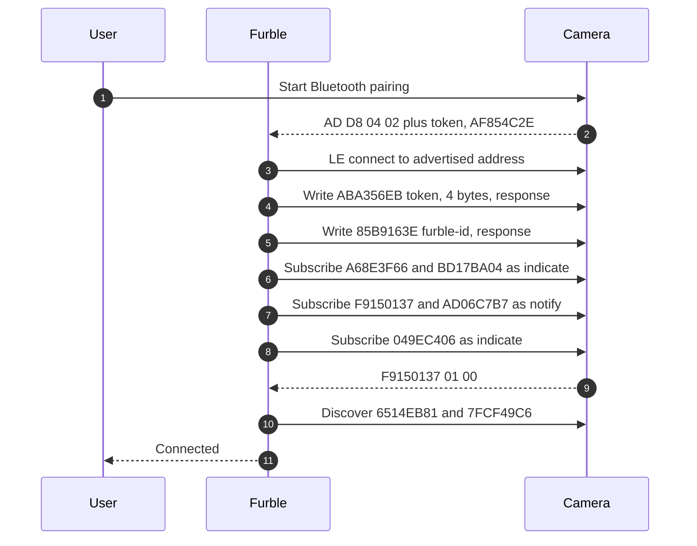

#### 1.7.2 Saved reconnect

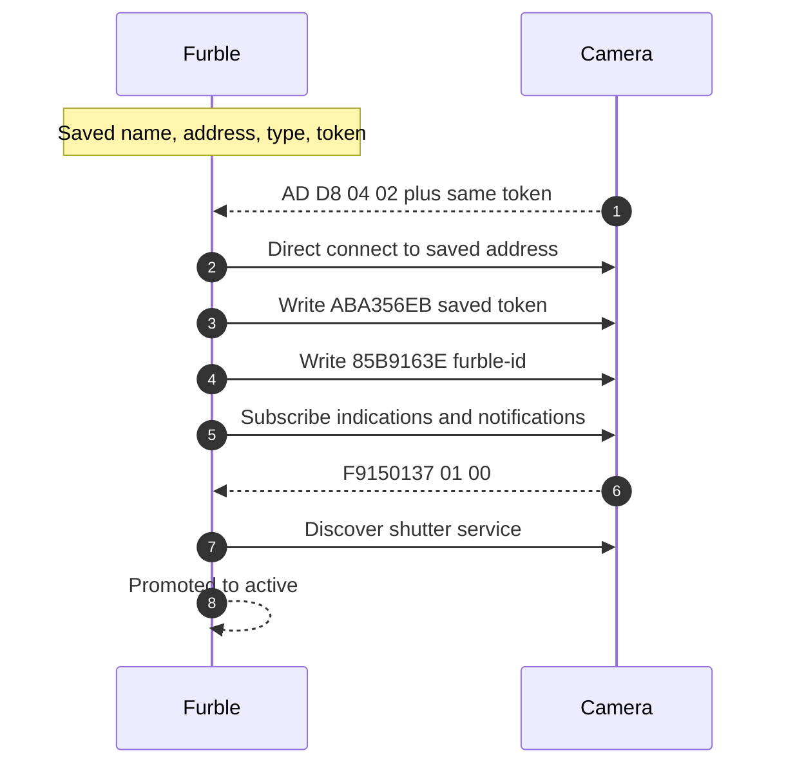

#### 1.7.3 Token loss and failure recovery

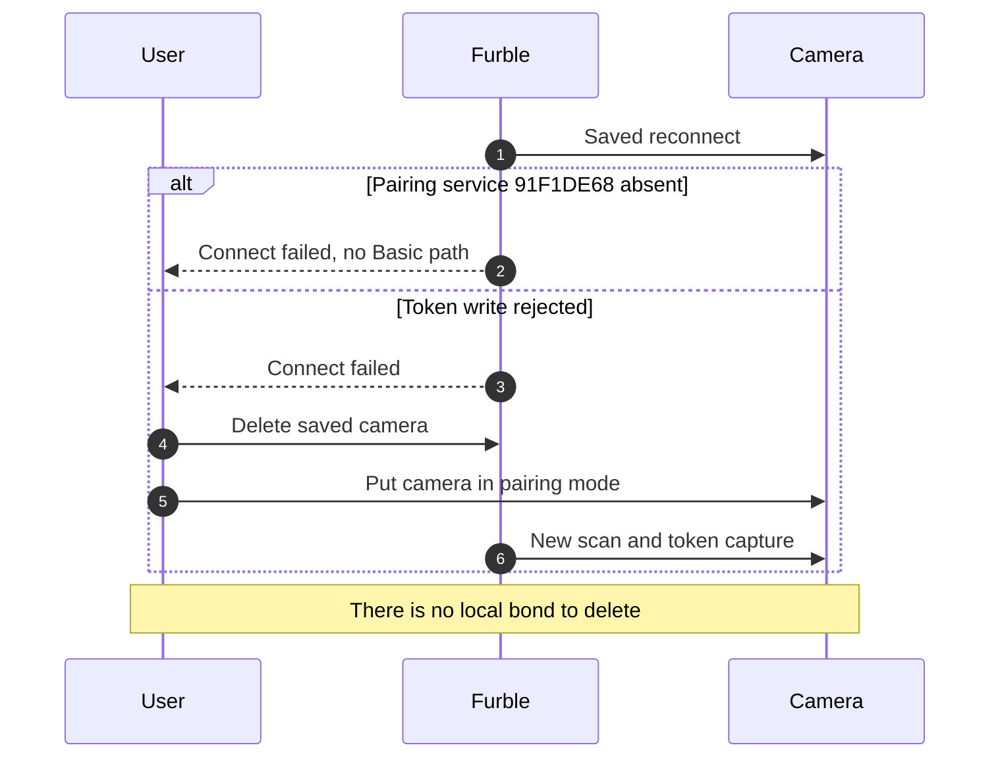

### 1.8 Prerequisites matrix

| Prerequisite | Required value | Current state | Evidence |
| :--- | :--- | :--- | :--- |
| Advertisement match | 7 bytes, company `0x04D8`, type `0x02`, 4-byte token, service `AF854C2E` or `117C4142`. | `implemented` | `public-source`, `FujifilmProtocol.cpp` |
| Pairing service | `91F1DE68` present. | `blocked` on X100VI 1.31, X-S20 3.30, X-E5 1.12 | `firmware-static`, RE corpus section 10.2 and X-E5 scan |
| Token write | `ABA356EB`, 4 bytes, with response. | `implemented` | `public-source`, `FujifilmBasic.cpp` |
| Identity write | `85B9163E`, name, with response. | `implemented` | `public-source`, `FujifilmBasic.cpp` |
| Registration gate | `F9150137` `01 00` or `02 00`, 25 s. | `implemented` | `public-source`, `Fujifilm.cpp` |
| Required subscriptions | `A68E3F66`, `BD17BA04`, `049EC406` indicate; `F9150137`, `AD06C7B7` notify. | `implemented` | `public-source`, `FujifilmBasic.cpp` |
| Shutter | `6514EB81` / `7FCF49C6`, two writes with response. | `implemented` | `public-source`, `FujifilmProtocol.cpp` |
| Bond | No bond. Token is identity. | `implemented` as designed | `public-source`, RE corpus section 7.2 |
| MTU | At least 26 for a 23-byte geotag in one write. | `unknown` | `inference` |
| Hardware certification | A Basic-only body capture. | `unknown`, no capture in the corpus | `unknown` |

## 2. Fujifilm Secure v4.0

### 2.1 Scope and status

This profile covers X100VI 1.31 and X-S20 3.30. The two images carry the same
70-entry ASCII UUID table, 13 services, 69 characteristics, and 21 CCCDs. The
handle, role, and property binding comes from the MIT fffw `ad14d4` profile and
matches the exact firmware record set, so a UUID to handle binding is
`public-source` plus `inference`, not a runtime capture. The link and
registration behaviour is `hardware-capture` on X100VI 1.32 and Furble bench
logs, and `public-source` from GeoShutter and the ESP32 port.

### 2.2 Advertisement identity

| Item | Value | Evidence |
| :--- | :--- | :--- |
| Company ID | `0x04D8`, FUJIFILM Corporation, on air `D8 04`. | `public-source`, Bluetooth SIG; `public-source`, `FujifilmProtocol.h` |
| Manufacturer data | Exactly 8 bytes: `D8 04 01 S0 S1 S2 S3 S4`. Byte 2 is type `0x01`. Bytes 3 to 7 are five serial characters. | `hardware-capture`, X100VI 1.32; `public-source`, RE corpus section 6.3 |
| Advertised service UUIDs | Unregistered: `A9D2B304-E8D6-4902-8336-352B772D7597`. Registered: `123D8F06-62A1-4935-9322-833C531EE225` plus the serial. Pre-first-registration variant: `804DAA8E-FFEB-4AB3-8E75-6EDD7303208D` with a 7-byte payload. | `hardware-capture`, GeoShutter; `public-source`, RE corpus section 6.4 |
| Local name | The camera advertises the bare model, for example `X100VI`. Furble appends the five serial characters for display, for example `X100VI 1C4F9`. The suffix is not sent on air. | `public-source`, `FujifilmProtocol::deviceName`; `hardware-capture`, X100VI bench |
| Address type | Before registration, a public address in the pre-first-registration variant. After registration, a resolvable private address. | `hardware-capture`, RE corpus section 6.6 |
| RPA and identity | The bond maps the current RPA to the camera identity address. Each new registration creates a new identity address. Three registrations produced three addresses on one X100VI. | `hardware-capture`, RE corpus section 6.6 |
| Pairing mode trigger | Camera Bluetooth pairing menu. X100VI shows a six-digit code that must be confirmed with MENU/OK within 30 s. | `hardware-capture`, GeoShutter; `public-source`, X100VI manual |
| Advertising duration | About 6 to 10 s after power-on. Stops while connected. Stops about 30 s after losing a link. Not continuous while idle. | `hardware-capture`, X100VI 1.32; `unknown` for X-S20 3.30 |
| Reconnect advertising | A registered body advertises `123D8F06` plus the serial from an RPA. Furble accepts either the pairing service or the Secure service and compares the serial. | `hardware-capture`, RE corpus section 6.4; `public-source`, `FujifilmSecure::onResult` |

### 2.3 Link security

| Item | Current implementation | Camera-side prerequisite and evidence |
| :--- | :--- | :--- |
| Just Works | Furble requests DisplayYesNo, not Just Works. The ESP32 port at S8 allows an encrypted Just Works fallback if the camera cannot do numeric comparison. Camera acceptance of Just Works is not proven. | `public-source`, RE corpus section 7.1; `unknown` for camera acceptance |
| Passkey entry | Not selected by Furble. | The X100VI uses numeric comparison, not central-entered passkey. `hardware-capture` |
| Passkey display | The remote can display the six digits because the IO capability is DisplayYesNo. The camera also displays the code. | `hardware-capture`, X100VI shows a six-digit code confirmed with MENU/OK within 30 s |
| Numeric comparison | Yes, through DisplayYesNo and the NimBLE confirm callback. Furble auto-confirms in its callback because the camera-side confirmation is the user gate. | `hardware-capture`, X100VI 1.32; `public-source`, S8 X-E5 hardware report |
| OOB | None. | No OOB path is evidenced. `unknown` |
| LE Secure Connections | Requested by `setSecurityAuth(true, true, true)` and by `secureConnection()`. | `hardware-capture`, LE Secure Connections on X100VI |
| MITM flag | Set. | Numeric comparison provides the MITM property. `hardware-capture` |
| Key size | Not set or checked by Furble. | `unknown`. A 16-byte key is likely but not proven for this family. |
| Bonding | Yes. `secureConnection()` and the bond store are used. | `hardware-capture`, a saved reconnect does not repeat the numeric comparison |
| Key distribution | Furble distributes ENC and ID. | `public-source`, RE corpus section 7.3; the camera-side distribution set is `unknown` |
| Identity address and IRK | Furble reads `getConnInfo().getIdAddress()` after connect and uses it for `isBonded()` and `deleteBond()`. | The camera advertises an RPA and the bond is keyed on the identity address. A remote-side IRK mismatch can make a healthy bond look stale. `hardware-capture`, `public-source` S8 |
| Bond storage | Furble NVS. The camera stores up to seven paired devices according to the Fujifilm manual cited by GeoShutter. That camera-side count is not independently verified here. | `public-source`, RE corpus section 7.4; `unknown` for exact camera capacity |
| Stale bond detection | Two consecutive security failures on an attempt that started bonded. The local identity bond is deleted, then one fresh pair attempt is made. On NimBLE the delete terminates the link, so the fresh attempt fails and `setNeedsRepair()` is raised. | `public-source`, `FujifilmSecure.cpp` lines 240 to 292; `hardware-capture`, X100VI bench logs rc=13 and rc=520 |
| Unpair behaviour | Deleting the saved camera uses the advertised address, not the identity address. The stale-bond path uses the identity address. | `public-source`, `CameraList.cpp`; `inference` that the UI forget can leave an RPA-keyed bond |
| Reconnect behaviour | Scan up to 60 s for the serial and the pairing or Secure service. Connect, secure with the saved bond, read and ack status, write the name, subscribe, wait for NOT1 or a geotag request, write the sync interval, discover the shutter, request FAST. | `public-source`, `FujifilmSecure::_connect`; `hardware-capture`, X100VI |

### 2.4 App-level registration and authorization

| Step | Value or condition | Timeout or retry | Failure mode | Evidence |
| :--- | :--- | :--- | :--- | :--- |
| Secure link | `secureConnection()` before any vendor GATT read. | NimBLE pairing timeout. | Failure aborts before registration. | `public-source`, `FujifilmSecure.cpp` |
| Status read | Read four bytes from `F557D96B-8284-4667-8793-B971C1DECA2A`. Examples are `16 55 23 00`, `0C 01 00 00`, `CE A6 01 00`, `FC B1 21 00`. | None. | Any length other than four fails. | `hardware-capture`, GeoShutter; `public-source`, `FujifilmSecure.cpp` |
| Status ack | Write the same four bytes with the last byte set to `0x20`, for example `16 55 23 20`. | None. | Write failure fails the connect. | `hardware-capture`, GeoShutter; `public-source`, `FujifilmSecure.cpp` |
| Identity write | Furble name as UTF-8, no NUL terminator, to `85B9163E-62D1-49FF-A6F5-054B4630D4A1`, with response. XApp appends a `00`; the camera does not require it. | None. | Write failure fails the connect. | `public-source`, `FujifilmSecure.cpp`; `hardware-capture`, XApp comparison |
| Required indications | `A68E3F66-0FCC-4395-8D4C-AA980B5877FA` and `BD17BA04-B76B-4892-A545-B73BA1F74DAE`, CCCD writes with response. | None. | Failure fails the connect. A normal X100VI drops the link when these CCCD writes are sent without an ATT response. | `public-source`, `FujifilmSecure.cpp`; `firmware-static`, properties |
| Optional notifications | `F9150137`, `AD06C7B7`, `BF6DC9CF`, `75823784`, `E6692C5C`, `AAB609C4`, `82A9F452`, `C95D91AE`, and absent `2A125640` and `DEEF7187`. CCCD writes without response. | None. | Failure is logged and non-fatal. | `public-source`, `FujifilmSecure.cpp` |
| Registration gate | `F9150137` carrying `01 00`, or `AD06C7B7` carrying `01 00` as a geotag request. The `01 00` on NOT1 is also a date or time request in the official apps, so it is not a proven registration flag. A saved reconnect on X100VI does not resend NOT1 and is promoted by the geotag request. | 25 s, 20 ms poll. | Timeout fails the connect and does not promote the camera. | `public-source`, `Fujifilm.cpp`; `hardware-capture`, 2026-08-28 trace |
| Geotag sync interval | Write little-endian `uint16_t` `0A 00` to `C95D91AE-B247-4D6D-8661-7DD5D6A0F85B` with response. Supported values are 10, 15, 20, 30, 60, 120, 240, 480 seconds and disable. | None. | Write failure fails the connect. | `public-source`, `FujifilmSecure.cpp`; `firmware-static`, characteristic length 2 |
| Shutter discovery | `6514EB81-4E8F-458D-AA2A-E691336CDFAC`, characteristic `7FCF49C6-4FF0-4777-A03D-1A79166AF7A8`. | None. | Missing service or characteristic fails. | `public-source`, `FujifilmSecure.cpp` |
| FAST profile | Requested only after the shutter characteristic exists, then confirmed within 1 s. Requesting FAST before discovery causes some cameras to stop responding and expire at the short supervision timeout. | 1 s, 10 ms poll. | Failure fails the connect. | `public-source`, `FujifilmSecure.cpp`; `hardware-capture`, X100VI trace |

### 2.5 GATT prerequisites

| Phase | Attribute | Properties and write type | CCCD | Ordering | Evidence |
| :--- | :--- | :--- | :--- | :--- | :--- |
| After bonding | `123D8F06` pairing service. | Service. | None. | Before status and name. | `firmware-static`, service `0x4001`; `public-source`, fffw |
| Status | `F557D96B` in `123D8F06`. | Read and write, four bytes, write with response. | None. | Read first, then ack. | `firmware-static`, `0x400E`, max 4; `public-source`, `FujifilmSecure.cpp` |
| Identity | `85B9163E` in `123D8F06`. | Write with response, maximum 30 bytes. | None. | After the status ack. | `firmware-static`, `0x4002`, max 30 |
| Required indications | `A68E3F66`, `BD17BA04` in `4C0020FE`. | Read and indicate, two bytes. | CCCD `0x0002`, write with response. | After the name write. | `firmware-static`, `0x5002`, `0x5005`; `public-source`, `FujifilmSecure.cpp` |
| Required notifications | `F9150137`, `AD06C7B7` in `4C0020FE`. | Read and notify, two bytes. | CCCD `0x0001`, write without response. | After the name write. | `firmware-static`, `0x5008`, `0x500B` |
| Optional indications | `049EC406` in `4C0020FE`. | Read and indicate, two bytes. | CCCD `0x0002`. | With the required subscriptions. | `firmware-static`, `0x500E` |
| Settings notifications | `BF6DC9CF`, `75823784`, `E6692C5C`, `AAB609C4`, `82A9F452`, `C95D91AE`. | Read, write, notify, various lengths. | CCCD `0x0001`. | Best effort. | `firmware-static`, service `0x4501` |
| Shutter | `6514EB81` service, `7FCF49C6`. | Write only, two bytes, write with response. | None. | After registration and sync interval. | `firmware-static`, `0x6006`; `public-source`, `FujifilmProtocol.cpp` |
| Geotag | `3B46EC2B` service, `0F36EC14`. | Write only, 23 bytes, write with response. | None. | After registration, when requested. | `firmware-static`, `0x8002`, max 23 |
| Startup information | `804DAA8E` service, `7170FD5A` remote boot setting. | Read, write, notify. | CCCD `0x0001`. | Not used by Furble. | `firmware-static`, service `0xA001`; `public-source`, XApp |
| MTU | No explicit request. X100VI 1.32 was observed at MTU 255. | A 23-byte geotag fits at that MTU. | Not applicable. | FAST profile only after discovery. | `hardware-capture`, GeoShutter; `unknown` for X-S20 and for Furble's negotiated value |

### 2.6 Errors and recovery

| Condition | Result | Recovery | Evidence |
| :--- | :--- | :--- | :--- |
| Secure handshake fails on an unbonded attempt | Connect fails. No bond is deleted. | Put the camera in pairing mode and retry. | `public-source`, `FujifilmSecure.cpp` |
| Secure handshake fails once on a bonded attempt | Connect fails. The failure count increments but the bond is kept. | Retry. A single lost pairing PDU is ordinary radio noise. | `public-source`, `FujifilmSecure.cpp` |
| Secure handshake fails twice on a bonded attempt | The identity bond is deleted, a fresh pair is attempted, and `setNeedsRepair()` is raised when the fresh pair fails. | The UI prompts for camera-side pairing mode. Retrying without that cannot recreate the pairing. | `public-source`, `FujifilmSecure.cpp`; `hardware-capture`, X100VI bench |
| Camera deleted its bond | The link may come up and the handshake then fails with `rc=13` after about 30 s or `rc=520` after about 5 s. There is no refusal PDU in the captured signature. | Two strikes then delete the local identity bond and prompt. | `hardware-capture`, X100VI 2026-09-02 bench run |
| Fresh bond without registration setup | The camera refuses the client for about four and a half minutes. Status reads `xx 8A 01 00` or `xx 8A 21 00`; acking it can drop the link with reason `0x13` about 160 ms later. | Run registration on the same connection as the bond. Wait out the window and retry. | `hardware-capture`, GeoShutter |
| Wrong six-digit code | SMP fails. | Retry the pairing. If bonded before, the failure counts toward the two-strike limit. | `inference` from the SMP path |
| Status read returns not four bytes | Connect fails. | Reconnect and retry. Capture the actual status length. | `public-source`, `FujifilmSecure.cpp` |
| Status ack write fails | Connect fails. | Retry. | `public-source`, `FujifilmSecure.cpp` |
| Name write fails | Connect fails. | Retry. | `public-source`, `FujifilmSecure.cpp` |
| Required indication CCCD fails | Connect fails. | Retry. Do not downgrade the required indications to unacknowledged writes. | `public-source`, `FujifilmSecure.cpp` |
| Optional CCCD fails | Logged, connect continues. | None. The camera may still hold the prior subscription. | `public-source`, `FujifilmSecure.cpp` |
| NOT1 and geotag both absent | 25 s registration timeout, connect fails. | Put the camera in pairing mode and retry. | `public-source`, `Fujifilm.cpp` |
| Sync interval write fails | Connect fails. | Retry. | `public-source`, `FujifilmSecure.cpp` |
| Shutter service or characteristic missing | Connect fails. | Capture the exact GATT table. | `public-source`, `FujifilmSecure.cpp` |
| FAST profile not applied within 1 s | Connect fails. | Retry. Do not request FAST before discovery. | `public-source`, `FujifilmSecure.cpp` |

### 2.7 Flows

#### 2.7.1 First pairing

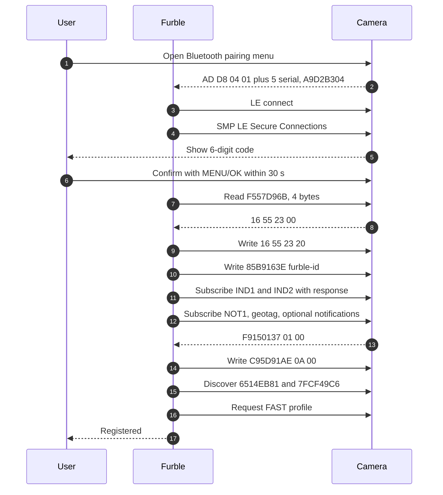

#### 2.7.2 Saved reconnect

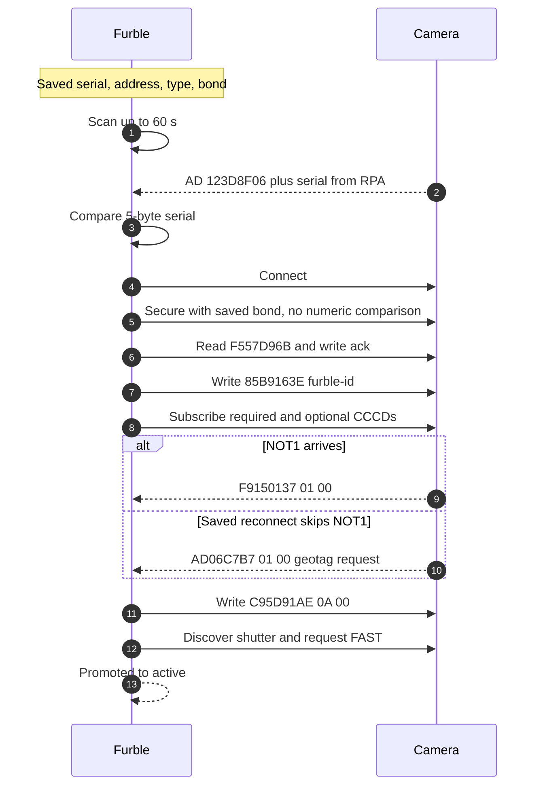

#### 2.7.3 Stale bond, camera-side deletion, and recovery

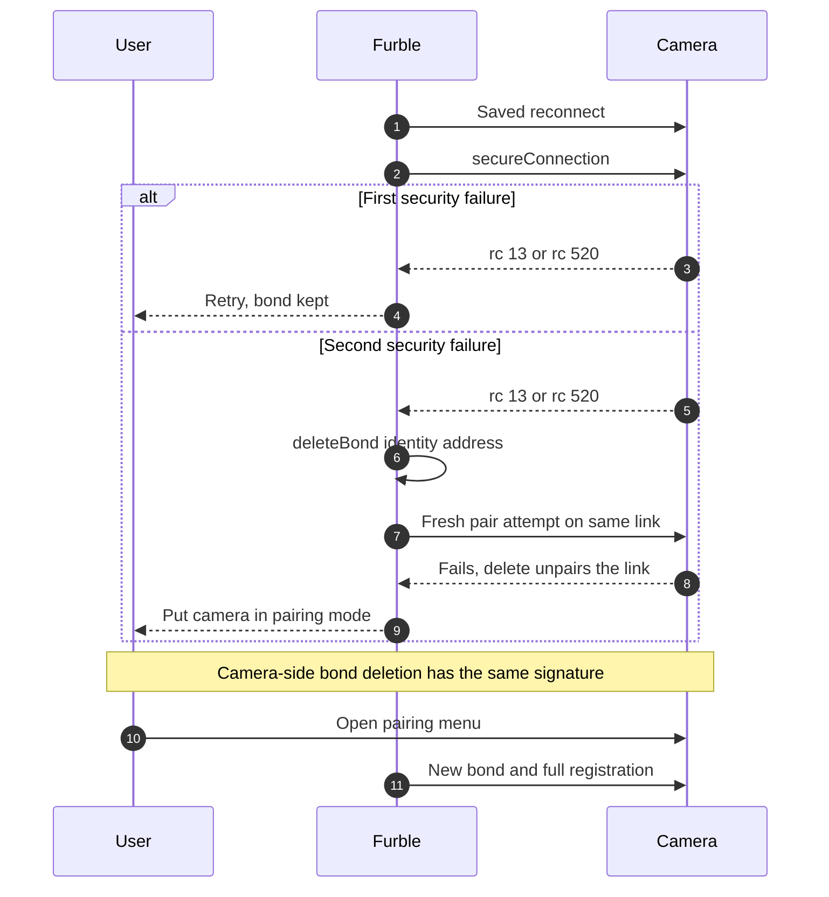

### 2.8 Prerequisites matrix

| Prerequisite | Required value | Current state | Evidence |
| :--- | :--- | :--- | :--- |
| Advertisement match | 8 bytes, company `0x04D8`, type `0x01`, 5 serial bytes, service `A9D2B304` or `123D8F06`. | `implemented`, type byte not validated | `public-source`, `FujifilmProtocol.cpp` |
| Link security | LE Secure Connections, numeric comparison, MITM, bond. | `implemented`; camera behaviour `hardware-capture` on X100VI | `public-source`, `FujifilmSecure.cpp`; `hardware-capture` |
| Identity address | Read `getIdAddress()` after connect for bond lookup and deletion. | `implemented` | `public-source`, `FujifilmSecure.cpp` |
| Status read and ack | `F557D96B`, 4 bytes, last byte to `0x20`. | `implemented` | `firmware-static`, `0x400E`; `hardware-capture` |
| Identity write | `85B9163E`, UTF-8 name, with response. | `implemented` | `firmware-static`, `0x4002` |
| Required indications | `A68E3F66`, `BD17BA04`, CCCD with response. | `implemented` | `firmware-static`, `0x5002`, `0x5005` |
| Registration gate | NOT1 `01 00` or geotag `01 00`, 25 s. | `implemented`, NOT1 semantics `unknown` | `public-source`, `Fujifilm.cpp` |
| Sync interval | `C95D91AE`, `0A 00`, with response. | `implemented` | `firmware-static`, `0x450F` |
| Shutter | `6514EB81` / `7FCF49C6`, two writes with response. | `implemented` | `firmware-static`, `0x6006` |
| FAST profile | After shutter discovery, 1 s confirmation. | `implemented`, X100VI-specific | `public-source`, `FujifilmSecure.cpp` |
| Stale bond | Two failures, identity delete, repair prompt. | `implemented` | `public-source`, `FujifilmSecure.cpp` |
| MTU | 255 observed; 23-byte geotag needs at least 26. | `partial`, no explicit request | `hardware-capture`; `inference` |
| X-S20 3.30 runtime | Same profile as X100VI 1.31. | `unknown`, no X-S20 capture | `inference` from the identical static table |
| Hardware certification | X100VI and X-S20 raw HCI plus physical shutter. | `partial`, X100VI bench only | `hardware-capture` |

## 3. Fujifilm Secure v4.1

### 3.1 Scope and status

This section covers X-E5 firmware 1.12, `FWUP0036.DAT`, SHA-256
`0982ffa51332e148134df378ecd3e485e798eeb4ce91738509bfa0b6629e1e52`. The
version is available in the RE corpus and was decoded for this reference. The
v4.1 label is this document's generation label. The corpus has not published a
separate v4.1 profile name. Fujifilm's X-E5 firmware page records 1.10 as the
wireless security and pairing change for that body, so 1.12 is a v4.1-era
image.

The image carries the same services and the same Furble-relevant UUIDs as
X100VI 1.31 and X-S20 3.30. It carries 71 ASCII UUID table entries instead of
70. The extra entry is `8B5ECF55-FC6B-40D0-B4C1-76F64E5453C7`, inserted between
`CAE8C738-4BB6-4605-98C1-58331C87F3B6` and
`EB4166B0-9CCA-445E-A4E4-75B3817FD57A` in the table order. Its role is
`unknown`. The Basic pairing service `91F1DE68` is absent.

### 3.2 Advertisement identity

| Item | Value | Evidence |
| :--- | :--- | :--- |
| Company ID | `0x04D8`, FUJIFILM Corporation. | `public-source`, Bluetooth SIG; `firmware-static`, same table family |
| Manufacturer data | Expected 8 bytes `D8 04 01` plus five serial characters, same as v4.0. No X-E5 capture is present. | `inference` from the v4.0 capture; `unknown` for the exact X-E5 advertisement |
| Advertised service UUIDs | `A9D2B304` and `123D8F06` are present in the image. The pre-registration service state is `unknown`. | `firmware-static`, X-E5 section scan; `public-source`, S8 X-E5 report |
| Local name | Expected bare model, for example `X-E5`, with Furble appending the serial for display. | `inference` from v4.0 and S8 |
| Address type | `unknown`. The v4.0 RPA behaviour is not proven for X-E5. | `unknown` |
| RPA and identity | `unknown`. The v4.0 identity-address rule should be assumed only after a capture. | `unknown` |
| Pairing mode trigger | Camera Bluetooth pairing menu. X-E5 1.10 changed the pairing procedure. | `public-source`, Fujifilm X-E5 firmware page |
| Advertising duration | `unknown`. | `unknown` |
| Reconnect advertising | Expected `123D8F06` plus serial. | `inference` |

### 3.3 Link security

| Item | Current implementation | Camera-side prerequisite and evidence |
| :--- | :--- | :--- |
| Just Works | Same as v4.0, Furble requests DisplayYesNo. | `unknown` for X-E5 acceptance |
| Passkey entry | Not selected. | `unknown` |
| Passkey display | Furble can display the code. | S8 reports a six-digit numeric comparison on X-E5. `public-source` |
| Numeric comparison | Yes, through the same Furble path. | `public-source`, S8 X-E5 hardware-tested port with DisplayYesNo and six-digit numeric comparison |
| OOB | None. | `unknown` |
| LE Secure Connections | Requested. | `inference` from v4.0 and the shared stack strings |
| MITM flag | Set. | `public-source`, S8 |
| Key size | Not checked. | `unknown` |
| Bonding | Yes. | `public-source`, S8 reports bond handling |
| Key distribution | ENC and ID from Furble. | `unknown` camera-side |
| Identity address and IRK | Same code path as v4.0. | `unknown` for X-E5 runtime |
| Bond storage | Furble NVS. | `unknown` camera-side capacity |
| Stale bond detection | Same two-strike path as v4.0. | `inference` |
| Unpair behaviour | Same forget path. | `unknown` for RPA behaviour |
| Reconnect behaviour | Same scan and registration sequence as v4.0. | `inference`; no X-E5 capture |

### 3.4 Static differences that matter

| Difference | Value | Consequence | Evidence |
| :--- | :--- | :--- | :--- |
| UUID table count | 71 entries, not 70. | A table-length assumption copied from v4.0 is wrong. | `firmware-static`, X-E5 `011a00a8.bin` ASCII table |
| Extra UUID | `8B5ECF55-FC6B-40D0-B4C1-76F64E5453C7`, between `CAE8C738` and `EB4166B0`. | Role and properties are `unknown`. It sits in the camera-information run, so a handle shift after it is plausible. | `firmware-static`, X-E5 table order |
| Handle binding | The v4.0 fffw `ad14d4` handle map cannot be copied across the insertion. | Re-derive handles from the X-E5 image or use UUID-based discovery. Furble uses UUIDs, so its lookup is not affected. | `inference` |
| Security strings | `sys_bt_passkey_certification`, `boPasskeyRejectFlg`, `SMP:FULL`, `SMP:FAIL`, `SMP!FULL`, and `A&W Accordo2` are present. | The same SMP stack family is present. Presence does not prove the IO method or key size. | `firmware-static`, X-E5 strings |
| Basic service | `91F1DE68` absent. | No Basic path on X-E5 1.12. | `firmware-static`, X-E5 scan |
| Furble UUIDs | `A9D2B304`, `123D8F06`, `F557D96B`, `85B9163E`, `7FCF49C6` present. | The Secure UUID set remains applicable. | `firmware-static`, X-E5 scan |

### 3.5 Flows

The v4.1 flow is the v4.0 flow with the following substitutions:

- The advertised name is `X-E5`.
- The serial and advertisement bytes must be captured. Do not copy the X100VI
  `1C4F9` example.
- The extra UUID `8B5ECF55` must be treated as unknown until a capture assigns
  it a role.
- Handle-based logic must be re-derived. UUID-based logic is unchanged.

No separate X-E5 sequence diagram is included because the sequence is not
distinct in the reviewed evidence. The first-pairing, saved-reconnect, and
stale-bond diagrams in section 2.7 apply with the substitutions above.

### 3.6 Prerequisites matrix

| Prerequisite | Required value | Current state | Evidence |
| :--- | :--- | :--- | :--- |
| Advertisement | 8-byte Secure form with X-E5 serial. | `unknown`, no capture | `unknown` |
| Link security | Numeric comparison, LE Secure Connections, bond. | `partial`, S8 reports numeric comparison on X-E5 | `public-source`, S8 |
| Status and ack | `F557D96B`, 4 bytes, `0x20` ack. | `implemented` by shared path | `firmware-static`, UUID present |
| Identity | `85B9163E`. | `implemented` by shared path | `firmware-static`, UUID present |
| Registration | NOT1 or geotag, 25 s. | `implemented` by shared path, X-E5 semantics `unknown` | `inference` |
| Shutter | `7FCF49C6`. | `implemented` by shared path | `firmware-static`, UUID present |
| Extra UUID | `8B5ECF55` role. | `unknown` | `firmware-static`, table entry |
| Handle map | Re-derive after the inserted record. | `partial`, UUID lookup avoids the issue | `inference` |
| Basic fallback | `91F1DE68`. | `blocked`, absent | `firmware-static`, X-E5 scan |
| Hardware certification | X-E5 1.12 raw HCI plus physical shutter. | `unknown` | `unknown` |

## 4. Ricoh GR III and GR IIIx

### 4.1 Scope and status

GR III and GR IIIx share the Ricoh BLE service and characteristic UUID set with
GR IV, but they are a separate pairing generation. GR III 2.20 firmware has
`BleServer::OnPasskeyNotify` and no numeric-comparison confirmation path. The
camera displays a dynamic six-digit code and the central enters it. GR IIIx
hardware reports the same passkey-entry shape, with model-specific power and
WLAN behaviour. Furble's `Ricoh` class is documented as GR IV-only, but its
matcher accepts GR III and GR IIIx services and names. That broad match is not
a compatibility claim.

### 4.2 Advertisement identity

| Item | Value | Evidence |
| :--- | :--- | :--- |
| Company ID | `0x065F`, Ricoh Company Ltd, on air `5F 06`. | `app-static`, Image Sync advertisement parser; `public-source`, Bluetooth SIG |
| Manufacturer data | Format byte `0xDA`, then TLVs: `0x01` model code (1 byte), `0x02` serial number (4 bytes little-endian, displayed as seven decimal digits), `0x03` camera power (1 byte, `0` off, `1` on). Example observed payload: `5F 06 DA 01 03 02 EC 78 00 00 03 00`. | `app-static`, Image Sync; `hardware-capture`, GR IIIx rotation example in RE corpus |
| Advertised service UUIDs | `9A5ED1C5-74CC-4C50-B5B6-66A48E7CCFF1` and `0F291746-0C80-4726-87A7-3C501FD3B4B6`. Image Sync scans for exactly these two. | `app-static`, Image Sync; `public-source`, `Ricoh::matches` also accepts Camera and Shooting services |
| Local name | `GR_XXXXXX` in the captured examples. Image Sync rejects a result whose name does not start with `GR` or `PENTAX`. Furble accepts `RICOH`, `PENTAX`, `GR`, `GR `, `GRIII`, and `GR III` prefixes. | `app-static`, Image Sync; `public-source`, `AdvertisementProtocol::matchesRicohName` |
| Address type | Public address in the author-reported GR III and GR IIIx examples, for example `44:91:60:1D:BF:6D` and `04:C4:61:D4:81:52`. RPA use is not reported for this generation. | `hardware-capture (author-reported)`, RE corpus section 4.8 |
| RPA and identity | No IRK or identity-address handling is evidenced. Furble stores the advertised address and type. | `public-source`, `Ricoh.h` `ricoh_t`; `unknown` for the camera |
| Pairing mode trigger | Menu: Bluetooth Setting, Action Mode, Pairing, Execute Pairing. | `public-source`, GR III and GR IIIx manuals |
| Advertising duration | Advertisements rotate between manufacturer-data payloads roughly every few seconds while asleep. The last byte is a service rotation, not a power bit. A full advertising window duration is `unknown`. | `hardware-capture (author-reported)`, RE corpus section 4.8 |
| Reconnect advertising | The same name and services, with the rotating manufacturer payload. With BLE Enable Condition `On anytime`, the camera advertises while switched off and a GATT connect can wake it. | `hardware-capture (author-reported)`, RE corpus sections 4.8 and 6.4 |

### 4.3 Link security

| Item | Current implementation | Camera-side prerequisite and evidence |
| :--- | :--- | :--- |
| Just Works | Not acceptable for protected operations. A display/confirm capability produced an encrypted but unauthenticated bond on GR III 2.00, and protected WLAN reads then failed with insufficient authentication. | `hardware-capture (author-reported)`, RE corpus section 5.3 |
| Passkey entry | Yes. `securityMode()` is `SECURE_KEYBOARD_DISPLAY`. `onPassKeyEntry()` injects the fixed fallback `123456`, which is not the camera-displayed code. | `public-source`, `Ricoh.cpp`; `hardware-capture`, GR III 1.92/2.10 and 2.00 reports |
| Passkey display | `onPassKeyDisplay()` returns `123456`. The camera is the display side in the GR III model, so this return value is a fallback, not the official code. | `public-source`, `Ricoh.cpp`; `inference` |
| Numeric comparison | `onConfirmPasskey()` always confirms. GR III firmware has no `OnNCConfirmNotify` or `SetNumericComparisonConfirmResult` path, so numeric comparison is not the GR III method. | `firmware-static`, GR III 2.20 `bled`; `public-source`, `Ricoh.cpp` |
| OOB | None. | `unknown` |
| LE Secure Connections | Requested by the common baseline and `secureConnection()`. | `public-source`, `Camera.cpp`; `hardware-capture`, authenticated LE bond reports |
| MITM flag | Set. The GR III profile requires authenticated bonding, not encrypted-only Just Works. | `public-source`, `Ricoh.cpp`; `hardware-capture`, RE corpus section 5.3 |
| Key size | Furble does not set a minimum. Hardware reports `key_size=16` on GR III 2.00 and GR IIIx 1.60. | `hardware-capture (author-reported)`, RE corpus section 5.3 |
| Bonding | Yes. Furble calls `secureConnection()` and then requires encrypted, authenticated, and bonded. | `public-source`, `Ricoh.cpp`; `hardware-capture`, bond is mandatory |
| Key distribution | Furble distributes ENC and ID. The public GR III profile reports ENC, ID, and SIGN. Furble does not request SIGN. | `public-source`, `Device.cpp`; `public-source`, RE corpus section 5.3; `unknown` whether the camera requires SIGN |
| Identity address and IRK | No identity-address read and no IRK handling in the Ricoh path. GR III examples use public addresses, so the omission may be harmless on GR III. | `public-source`, `Ricoh.cpp`; `unknown` for a body that uses an RPA |
| Bond storage | Furble NVS. The camera-side paired-device list holds up to six devices. | `public-source`, GR III/GR IIIx manuals; `firmware-static`, `PairedDeviceTable` |
| Stale bond detection | On a `PairType::NEW` attempt that was bonded before, a security failure deletes the local bond and returns failure. Saved reconnects keep the bond across transient failures. | `public-source`, `Ricoh.cpp` lines 190 to 202 |
| Unpair behaviour | Deleting the saved camera removes the local bond by the advertised address. The camera-side pairing must be deleted from its menu. The public workaround is camera-side first, then local. | `public-source`, `CameraList.cpp`; `firmware-static`, paired-device cache and DDB; `public-source`, RE corpus section 5.5 |
| Reconnect behaviour | Direct connect to the saved address, `secureConnection()` with the stored bond, then GATT discovery and the state probe. No numeric comparison or passkey on a healthy saved bond. | `public-source`, `Ricoh::_connect`; `hardware-capture (author-reported)`, saved bonds reconnect without a new passkey |

### 4.4 App-level registration and authorization

| Step | Value or condition | Timeout or retry | Failure mode | Evidence |
| :--- | :--- | :--- | :--- | :--- |
| Bond first | Image Sync calls `createBond()` before `connectGatt()` and waits for `BOND_BONDED`. | 45,000 ms bond timeout, 10,000 ms connection timeout. | Bond failure aborts. | `app-static`, Image Sync `com.ricoh.camera.sdk.wireless.impl.ble.core.a` |
| Furble ordering | Furble connects first, then calls `secureConnection()`. | No vendor timeout in Furble. | A camera that requires a bond before GATT discovery can fail at the first protected read. | `public-source`, `Ricoh.cpp`; `inference` |
| Service discovery | Image Sync waits 600 ms after connection, then discovers. | 600 ms delay. | Missing service aborts. | `app-static`, Image Sync |
| MTU | Image Sync requests 512. GR III 2.00 reports 255; GR IIIx 1.41 reports 255. | Android MTU callback. | A 32-byte GPS packet needs at least 35 bytes of ATT MTU in one write. | `app-static`, Image Sync; `hardware-capture (author-reported)` |
| GATT serialization | Image Sync serializes reads and writes on one executor and treats a 5,000 ms operation as failed. | 5,000 ms per operation. | Timeout aborts the operation. | `app-static`, Image Sync |
| Registration | No separate application registration exchange is evidenced. The bond is the authorization gate. | Not applicable. | An unbonded protected operation fails with `0x0E`. | `hardware-capture (author-reported)`, GR III 1.92/2.10 |
| Identity or name write | `FE3A32F8-A189-42DE-A391-BC81AE4DAA76` Paired Device Name is write-only. Furble does not write it. | None. | Not a connection gate in Furble. | `firmware-static`, `bled`; `app-static`, Image Sync |
| Capture authorization | Furble reads Operation Mode and allows capture only on `0x00` CAPTURE when the characteristic exists. | Fresh read per shutter. | Missing Operation Mode allows capture. Non-CAPTURE refuses. | `public-source`, `Ricoh::captureAllowed` |

### 4.5 GATT prerequisites

| Phase | Attribute | Properties and write type | CCCD | Ordering | Evidence |
| :--- | :--- | :--- | :--- | :--- | :--- |
| After bonding | Camera Information `9A5ED1C5`, Model Number `35FE6272`. | Read. | None. | After security, before control. | `firmware-static`, shared table; `app-static` |
| Camera state | `4B445988`, Camera Power `B58CE84C`, Operation Mode `1452335A`, GEO Tag `A36AFDCF`. | Read, write, notify; one byte; write with response. | CCCD `0x0001`. | After security. | `firmware-static`, shared table |
| Shooting control | `9F00F387`, Drive Mode `B29E6DE3`, Operation Request `559644B8`, Capture Status `B5589C08`, Self Timer `009A8E70`. | Drive Mode and Operation Request write; Capture Status and Self Timer notify. Operation Request is two bytes, write with response. | CCCD `0x0001` for status. | Operation Request after Drive Mode. | `firmware-static`, shared table; `public-source`, RE corpus |
| GPS | `84A0DD62`, GPS Information `28F59D60`. | Read and write, 32 bytes, write with response. Three byte-swapped float64 values, little-endian year, month/day/hour/minute/second, WGS84 datum `0`. | None. | Enable GEO Tag `A36AFDCF` before the first GPS write. | `firmware-static`; `app-static`, Image Sync; `public-source`, `Ricoh.h` |
| Bluetooth control | `0F291746`, Paired Device Name `FE3A32F8`. | Write-only name. | None. | Not used by Furble. | `firmware-static`, `bled` |
| Operation gate | Operation Mode `1452335A`. | Read, one byte. | None. | Fresh read before every capture. | `public-source`, `Ricoh::captureAllowed` |
| MTU | Image Sync 512, observed 255. | 32-byte GPS needs at least 35. | Not applicable. | Before large GPS writes. | `app-static`; `hardware-capture (author-reported)` |

### 4.6 Errors and recovery

| Condition | Result | Recovery | Evidence |
| :--- | :--- | :--- | :--- |
| Unbonded GATT operation | Protected operations return `0x0E` UNLIKELY_ERROR and the camera disconnects. | Bond first. | `hardware-capture (author-reported)`, GR III 1.92/2.10 |
| Wrong six-digit code | SMP fails and no authenticated bond exists. | Re-enter the camera-displayed code within the window. | `inference` from passkey entry |
| Fixed `123456` fallback | The injected value will not match a dynamic camera code. | Use a user-entered code or a saved-bond-only policy. | `public-source`, `Ricoh.cpp`; `hardware-capture`, dynamic code |
| Pairing window expires | The camera abandons the ceremony after roughly one minute. The passkey entry window was about 45 s on GR IIIx 1.60. | Restart pairing from the camera menu. | `hardware-capture (author-reported)`, RE corpus section 5.4 |
| Camera-side bond deleted, local bond kept | Saved reconnect fails security. Furble keeps the saved bond and does not auto-repair. | Delete the camera-side pairing, then forget the camera locally, then re-pair. | `public-source`, `Ricoh.cpp`; `firmware-static`, paired-device cache |
| Local bond deleted, camera still lists device | A new pairing may be treated as a pairing request from an already-paired device and disconnected. | Delete the camera-side pairing first. | `firmware-static`, `public-source`, `inference` |
| Network Type write `1` on GR III | Application error `0x80` on GR III 1.92/2.10 under every tested precondition. A two-byte value is rejected for length. | Do not treat Wi-Fi wake as universal. Capture the exact model and firmware. | `hardware-capture (author-reported)`, RE corpus section 5.4 |
| Disconnect reason `0x208` | Supervision timeout. | Reconnect. | `hardware-capture (author-reported)` |
| Disconnect reason `0x213` | Normal remote-initiated disconnect on GR III. It is not specific to power-off. | Do not delete a bond on this reason alone. | `hardware-capture (author-reported)` |
| Disconnect reason `0x215` | Power-off or shutdown candidate. | Reconnect after wake. | `public-source` |
| Disconnect reason `0x216` | Connection establishment failure, seen during fast reconnect churn. | Slow the reconnect cadence. | `hardware-capture (author-reported)` |
| Operation Mode `0x02` BLE_STARTUP | Furble refuses capture because a capture write in this state can cold boot the camera and wedge the firmware on GR IV. | Reconnect after the camera wakes. | `public-source`, `Ricoh.cpp`; `public-source`, GR IV reports |
| Operation Mode `0x03` OTHER | Furble refuses capture. On GR IIIx 1.60 this can be a normal ready state on the first post-pairing check. | A generation-specific allowlist is needed. | `hardware-capture (author-reported)` |

### 4.7 Flows

#### 4.7.1 First pairing

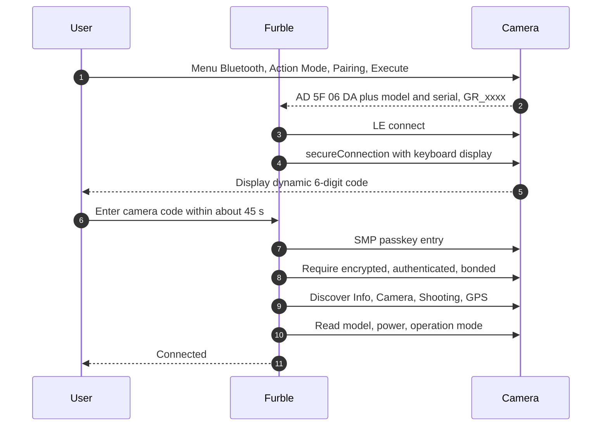

#### 4.7.2 Saved reconnect

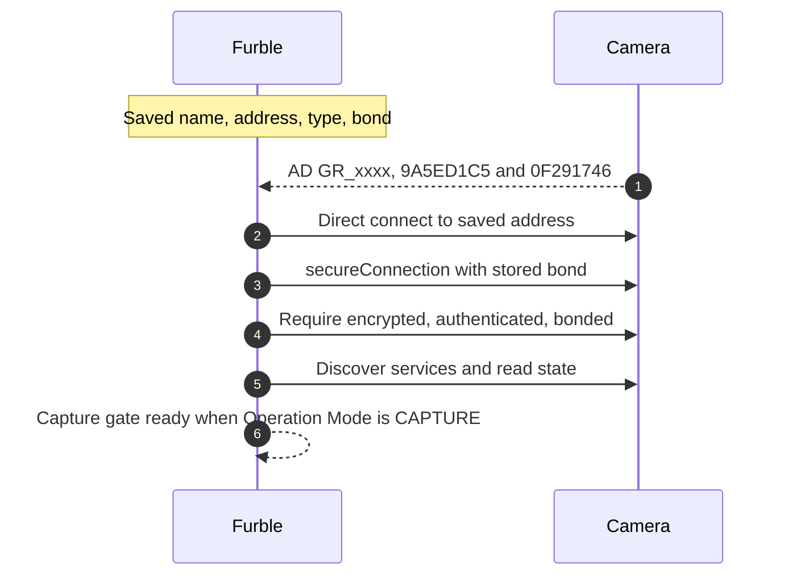

#### 4.7.3 Camera-side bond deletion and failure recovery

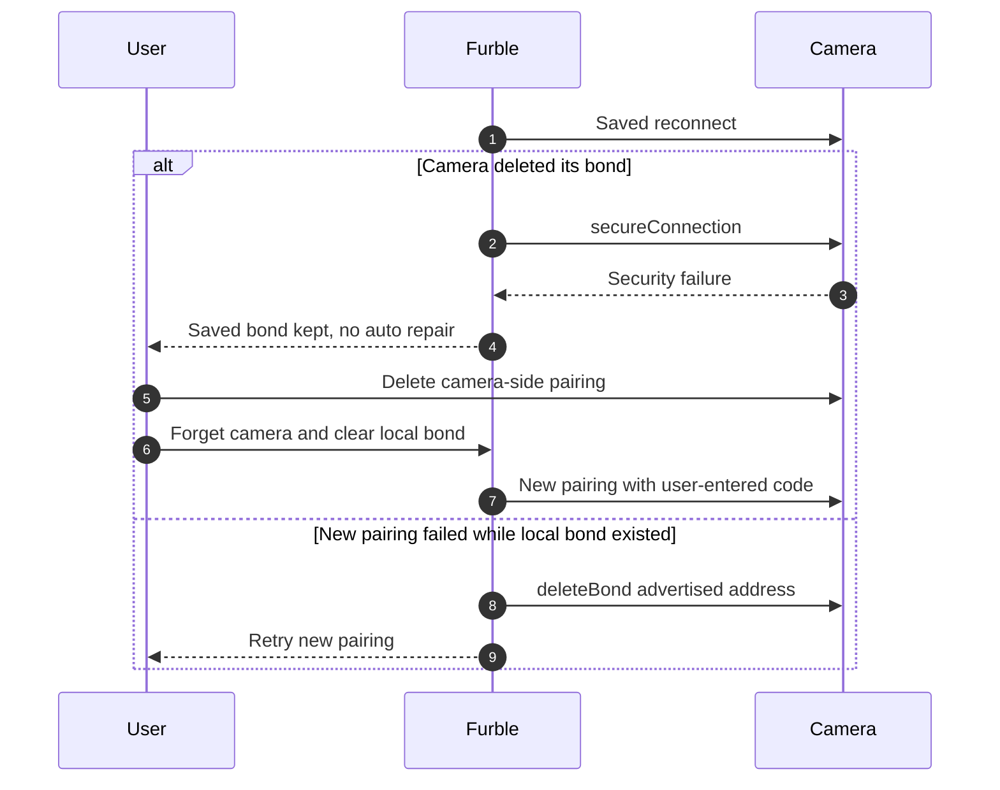

### 4.8 Prerequisites matrix

| Prerequisite | Required value | Current state | Evidence |
| :--- | :--- | :--- | :--- |
| Advertisement match | Company `0x065F`, format `0xDA`, name `GR_...`, service `9A5ED1C5` or `0F291746`. | `implemented`, matcher broader than official app | `app-static`; `public-source`, `Ricoh.cpp` |
| Link security | Passkey entry, camera displays dynamic six digits, authenticated bond, key size 16. | `partial`, fixed `123456` fallback and auto-confirm | `hardware-capture`; `public-source`, `Ricoh.cpp` |
| Bond first | Bond before protected GATT operations. | `partial`, Furble connects then secures | `app-static`, Image Sync; `hardware-capture` |
| Identity | No app-level identity handle is required in the reviewed evidence. | `implemented` | `hardware-capture` |
| Capture gate | Fresh Operation Mode read. | `implemented`, CAPTURE-only is too strict for GR IIIx OTHER | `public-source`, `Ricoh.cpp`; `hardware-capture` |
| GATT notifications | Power, Operation Mode, Capture Status. | `implemented` | `firmware-static`; `public-source` |
| MTU | 512 requested by Image Sync, 255 observed, 35 needed for GPS. | `partial`, Furble does not request | `app-static`; `hardware-capture` |
| Stale bond | Detect camera-side deletion. | `missing` for saved reconnects | `public-source`, `Ricoh.cpp` |
| Pairing window | About 45 s code entry, about 1 min ceremony. | `unknown` to Furble, no UI timer | `hardware-capture` |
| Hardware certification | GR III and GR IIIx raw HCI plus physical shutter. | `unknown` | `unknown` |

## 5. Ricoh GR IV and GR IV HDF

### 5.1 Scope and status

GR IV and GR IV HDF firmware 1.20 share the Ricoh UUID set and add 14
GR IV-only UUIDs. The pairing generation is numeric comparison, not passkey
entry. GR IV 1.20 `bled` has `BleServer::OnNCConfirmNotify`,
`SetNumericComparisonConfirmResult`, and `BleServerManager::RecvSetBleNCConfirmResult`,
and no `OnPasskeyNotify`. The official manual describes a code shown on both
camera and app with a user confirmation. Furble's fixed `123456` fallback and
automatic confirmation are not supported by that evidence.

### 5.2 Advertisement identity

| Item | Value | Evidence |
| :--- | :--- | :--- |
| Company ID | `0x065F` is the Image Sync value for the GR III family. GR WORLD does not expose a numeric company ID, so the GR IV value is `unknown`. The shared Ricoh stack makes `0x065F` likely, but it is not proven for GR IV. | `app-static`, Image Sync; `unknown` for GR WORLD and GR IV |
| Manufacturer data | Expected format `0xDA` with model, serial, and power TLVs, inherited from the Ricoh family. The GR IV model code is not exposed by GR WORLD. | `app-static`, Image Sync; `unknown` for GR IV values |
| Advertised service UUIDs | The same six Ricoh services, including `9A5ED1C5` and `0F291746`. GR IV adds 14 GR IV-only characteristics, not new services. | `firmware-static`, GR IV 1.20 `bled` |
| Local name | `GR_XXXXXX` in the family. The camera name `MY GR IV` is a separate Camera Name characteristic, not the BLE name. | `public-source`, GR IV manual; `firmware-static`, `CameraService::CameraName` |
| Address type | RPA per the public GR IV profile, which uses `RPA public default`. | `public-source`, sky18 GR IV profile |
| RPA and identity | RPA is used. The identity binding and IRK behaviour are not proven by a capture. | `public-source`, `unknown` for the exact identity address |
| Pairing mode trigger | Menu: Wireless Communication, Action Mode, Pairing, Execute Pairing. The camera and app both show an authentication code; the user confirms on both. | `public-source`, GR IV manual |
| Advertising duration | `unknown`. The camera advertises in BLE standby and with `Connection While Power Off` enabled. | `public-source`, RE corpus section 6.5 |
| Reconnect advertising | The same Ricoh services and name. BLE standby can report Camera Power `01` and Operation Mode `0x02` BLE_STARTUP. | `public-source`, RE corpus section 6.5 |

### 5.3 Link security

| Item | Current implementation | Camera-side prerequisite and evidence |
| :--- | :--- | :--- |
| Just Works | `securityMode()` returns keyboard display, not display/confirm. `onConfirmPasskey()` auto-confirms. A Just Works bond is not proven acceptable. | `public-source`, `Ricoh.cpp`; `unknown` |
| Passkey entry | `onPassKeyEntry()` injects `123456`. GR IV firmware has no `OnPasskeyNotify` path. | `firmware-static`, GR IV `bled`; `public-source`, `Ricoh.cpp` |
| Passkey display | `onPassKeyDisplay()` returns `123456`. The official flow is a code shown on both sides, not a fixed value. | `public-source`, `Ricoh.cpp`; `public-source`, GR IV manual |
| Numeric comparison | Firmware exposes `OnNCConfirmNotify` and `SetNumericComparisonConfirmResult`. Furble auto-confirms through `onConfirmPasskey()`. | `firmware-static`, GR IV `bled`; `public-source`, `Ricoh.cpp` |
| OOB | None. | `unknown` |
| LE Secure Connections | Requested by the common baseline and `secureConnection()`. | `public-source`, `Camera.cpp` |
| MITM flag | Set. | `public-source`, `Camera.cpp` |
| Key size | Furble does not set a minimum. GR III reports 16 bytes; GR IV is `unknown`. | `hardware-capture` for GR III; `unknown` for GR IV |
| Bonding | Yes. Furble requires encrypted, authenticated, and bonded. | `public-source`, `Ricoh.cpp` |
| Key distribution | Furble ENC and ID. The public GR IV profile reports ENC and ID. | `public-source`, `Device.cpp`; `public-source`, sky18 |
| Identity address and IRK | RPA is used. Furble stores the advertised address and never reads the identity address. | `public-source`, `Ricoh.cpp`; `inference` that a saved record can diverge from the bond after RPA rotation |
| Bond storage | Furble NVS. The camera-side paired-device list holds up to six devices. | `public-source`, GR IV manual; `firmware-static`, paired-device table |
| Stale bond detection | Only on a `PairType::NEW` attempt that was bonded before. Saved reconnects keep the bond. | `public-source`, `Ricoh.cpp` lines 190 to 202 |
| Unpair behaviour | Deleting the saved camera removes the local bond by the advertised RPA. The camera-side deletion is a menu action. | `public-source`, `CameraList.cpp`; `inference` for the RPA consequence |
| Reconnect behaviour | Direct connect to the saved address, secure with the stored bond, GATT discovery, fresh Operation Mode read. No numeric comparison on a healthy bond. | `public-source`, `Ricoh::_connect`; `hardware-capture (author-reported)`, saved bonds reconnect without a new code |

### 5.4 App-level registration and authorization

| Step | Value or condition | Timeout or retry | Failure mode | Evidence |
| :--- | :--- | :--- | :--- | :--- |
| Bond first | GR WORLD relies on the Android bond and the camera-side prompt. It does not inject a passkey. | Android and camera timing. | No bond, no protected control. | `app-static`, GR WORLD; `public-source`, RE corpus section 5.3 |
| Camera-side confirmation | Both sides show an authentication code and the user confirms. | `unknown` camera window. | Wrong or missed confirmation fails the bond. | `public-source`, GR IV manual |
| Registration | No separate application registration exchange is evidenced. The bond is the gate. | Not applicable. | Protected GATT operations fail before bonding. | `firmware-static`, `bled`; `inference` |
| Identity or name write | Furble does not write Paired Device Name. GR WORLD can list and delete paired devices. | None. | Not a connection gate. | `firmware-static`, `BlePairedDevicesChanged`, `GetBlePairedDevices`, `DeleteBlePairedDevice` |
| Capture authorization | Fresh Operation Mode read, CAPTURE only when the characteristic exists. | Per shutter. | BLE_STARTUP, PLAYBACK, OTHER, and POWER_OFF_TRANSFER refuse. | `public-source`, `Ricoh::captureAllowed` |
| Power state | Camera Power `01` can be reported in standby. It is not proof of readiness. | None. | A capture write in BLE_STARTUP can cold boot the camera. | `public-source`, RE corpus section 6.5 |

### 5.5 GATT prerequisites

| Phase | Attribute | Properties and write type | CCCD | Ordering | Evidence |
| :--- | :--- | :--- | :--- | :--- | :--- |
| After bonding | Camera Information `9A5ED1C5`, Model Number `35FE6272`. | Read. | None. | After security. | `firmware-static`, shared table |
| Camera state | `4B445988`, Power `B58CE84C`, Operation Mode `1452335A`, GEO Tag `A36AFDCF`. | Read, write, notify. | CCCD `0x0001`. | Before capture gate. | `firmware-static`, shared table |
| Shooting | `9F00F387`, Drive Mode `B29E6DE3`, Operation Request `559644B8`. | Write with response. Operation Request is two bytes. | None. | Drive Mode before Operation Request. | `firmware-static`; `public-source` |
| Capture status | `B5589C08`. | Read and notify. | CCCD `0x0001`. | Subscribe for status. | `firmware-static` |
| GPS | `84A0DD62`, GPS Information `28F59D60`. | Read and write, 32 bytes. | None. | Enable GEO Tag before first write. | `firmware-static`; `app-static`, Image Sync |
| GR IV-only | Camera Name `EF437870`, firmware update `5F0A7BA9`, `39879AAC`, `F759F4DD`, End Screen `E450ED9B`, WLAN Security `63BC8463`, Available 5GHz `460828AC`, Wlan Frequency `C4B7DFC0`, Image Control custom slots. | Roles and properties are `inference` from class order. | `unknown`. | Outside Furble's current path. | `firmware-static`, `bled` class names; `inference` for assignment |
| MTU | Image Sync requests 512, observed 255. | 32-byte GPS needs at least 35. | Not applicable. | Before GPS. | `app-static`; `hardware-capture (author-reported)` |

### 5.6 Errors and recovery

| Condition | Result | Recovery | Evidence |
| :--- | :--- | :--- | :--- |
| Fixed `123456` used against a dynamic code | Numeric comparison or passkey entry fails. | Show the actual code and require user confirmation. | `public-source`, `Ricoh.cpp`; `public-source`, GR IV manual |
| Auto-confirm without user check | The MITM property is defeated even if the bond succeeds. | Require a user-visible match or confirm. | `inference` |
| Camera-side bond deleted, local bond kept | Saved reconnect fails security. Furble does not auto-repair. | Delete the camera-side pairing, forget locally, re-pair. | `public-source`, `Ricoh.cpp` |
| RPA rotation after re-pair | The saved advertised address may not match the new identity. | Read the identity address from the live link or re-scan by name and serial. | `inference` from RPA behaviour |
| BLE_STARTUP capture write | The camera can cold boot, extend the lens, or wedge. | Refuse capture unless a fresh Operation Mode read is CAPTURE. | `public-source`, `Ricoh::captureAllowed` |
| Operation Mode OTHER | Furble refuses capture. On GR IIIx OTHER can be ready; GR IV context is `unknown`. | Capture the exact GR IV state machine. | `hardware-capture` for GR IIIx; `unknown` for GR IV |
| Disconnect `0x208`, `0x213`, `0x215`, `0x216` | Same family meanings as GR III. | Do not delete a bond on a single generic reason. | `hardware-capture (author-reported)`; `unknown` for exact mapping |
| Paired-device list full | Camera holds up to six devices. | Delete an old pairing from the camera menu. | `public-source`, GR IV manual |

### 5.7 Flows

#### 5.7.1 First pairing

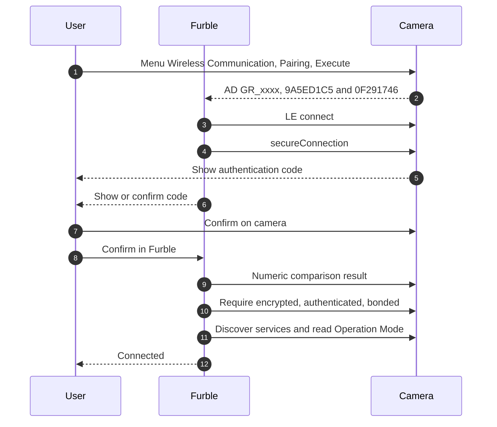

#### 5.7.2 Saved reconnect

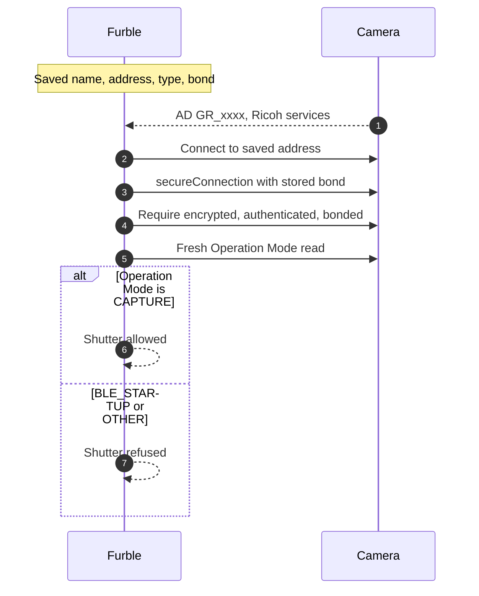

#### 5.7.3 Camera-side bond deletion and failure recovery

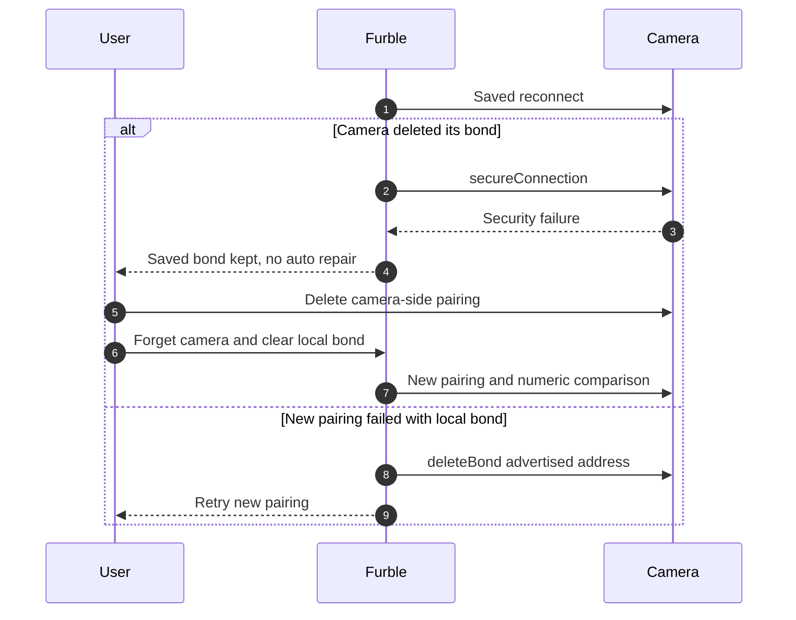

### 5.8 Prerequisites matrix

| Prerequisite | Required value | Current state | Evidence |
| :--- | :--- | :--- | :--- |
| Advertisement match | Ricoh name and Ricoh services. | `implemented`, matcher broad | `public-source`, `Ricoh.cpp` |
| Link security | Numeric comparison, user-confirmed, authenticated bond. | `partial`, fixed `123456` and auto-confirm | `firmware-static`; `public-source`, GR IV manual |
| Bond first | Bond before protected GATT. | `partial`, connect then secure | `public-source` |
| Identity address | RPA identity resolution. | `missing` | `public-source`, sky18; `inference` |
| Capture gate | Fresh Operation Mode read, CAPTURE only. | `implemented` | `public-source`, `Ricoh.cpp` |
| GATT notifications | Power, Operation Mode, Capture Status. | `implemented` | `firmware-static` |
| MTU | 512 requested by app, 255 observed, 35 needed. | `partial` | `app-static`; `hardware-capture` |
| Stale bond | Detect camera-side deletion on saved reconnect. | `missing` | `public-source`, `Ricoh.cpp` |
| GR IV-only UUIDs | Role and properties. | `unknown` | `firmware-static`; `inference` |
| Hardware certification | GR IV and HDF raw HCI plus physical shutter. | `partial`, GR IV HDF code path only | `unknown` |

## 6. Canon EOS Smart

### 6.1 Scope and status

Canon Smart is the Camera Connect role. The official app is documented under
`com.canon.eos` in the RE corpus. It delegates bonding to Android, then writes
the name and a 16-byte initiator UUID, waits for a pairing result indication,
commits the pairing, and switches the camera mode. Furble implements the same
UUID family but writes identity before the pair result, uses write commands
where the app uses write requests, and treats a saved local bond as pair
acceptance. No Canon firmware image is analysed in the corpus.

### 6.2 Advertisement identity

| Item | Value | Evidence |
| :--- | :--- | :--- |
| Company ID | `0x01A9`, Canon Inc., on air `A9 01`. | `app-static`, Camera Connect 3.6.11.7 `getManufacturerSpecificData(425)`; `public-source`, Bluetooth SIG |
| Manufacturer data | Payload after the company ID starts with `0x01`, then a product ID little-endian in two bytes. Two forms: 19 bytes with a 16-byte client UUID (pairing form), or 6 bytes with a two-byte UUID suffix and one status byte (reconnect form). Any other length is ignored. | `app-static`, `com.canon.eos.d.onScanResult` |
| Advertised service UUIDs | `00010000-0000-1000-0000-d8492fffa821`. The app scan filter uses this service. | `app-static`, `com.canon.eos.f.i(boolean)` |
| Local name | No name gate. Furble uses the advertised name for display only. | `app-static`; `public-source`, `CanonEOSSmart.cpp` |
| Address type | `unknown`. The Android app delegates addressing and bonding. Furble stores the NimBLE address type. | `unknown` |
| RPA and identity | The application identity is the 16-byte `initiatorGUID`, not an IRK identity address. RPA behaviour is `unknown`. | `app-static`, `AESDKSettings` / `initiatorGUID` |
| Pairing mode trigger | Camera Connect pairing or add-device flow on the camera. | `public-source`, Canon manuals |
| Advertising duration | `unknown`. The pairing form uses the full 16-byte UUID; the reconnect form uses the short suffix and status. | `app-static`; `unknown` for duration |
| Reconnect advertising | 6-byte form with the short UUID and status. The status byte carries a bit-0 boolean of `unknown` meaning and power bits `0` auto power off, `1` power on, `2` power switch off. | `app-static`, `com.canon.eos.d.onScanResult` |

### 6.3 Link security

| Item | Current implementation | Camera-side prerequisite and evidence |
| :--- | :--- | :--- |
| Just Works | The Furble source comment says Just Works. The common baseline sets DisplayYesNo, so the actual method depends on the camera. | `public-source`, `CanonEOSSmart.cpp`; `inference` for the negotiated method |
| Passkey entry | The official app does not call `setPin`, `setPasskey`, or `setPairingConfirmation`. | `app-static`, Camera Connect |
| Passkey display | Furble's default callback can return a value if NimBLE asks. The app has no explicit display path. | `public-source`, `Camera.h`; `app-static` |
| Numeric comparison | Possible because Furble requests DisplayYesNo. The app delegates to Android and does not enforce a method. | `inference` |
| OOB | None. | `unknown` |
| LE Secure Connections | Requested by the common baseline and `secureConnection()`. Android's own default is not proven for the camera. | `public-source`, `Camera.cpp`; `unknown` camera-side |
| MITM flag | Set by Furble. | `public-source`, `Camera.cpp` |
| Key size | Not set or checked. | `unknown` |
| Bonding | Yes. The app calls `createBond()` when the device is `BOND_NONE`; Furble calls `secureConnection()`. | `app-static`, `com.canon.eos.b.onServicesDiscovered`; `public-source`, `CanonEOSSmart.cpp` |
| Key distribution | Furble ENC and ID. | `public-source`, `Device.cpp`; `unknown` camera-side |
| Identity address and IRK | The app-level identity is a random 16-byte UUID stored in `AESDKSettings` under `initiatorGUID`. It is not an IRK identity address. | `app-static` |
| Bond storage | Android OS bond store. Camera-side capacity is `unknown`. | `app-static`; `unknown` |
| Stale bond detection | `NimBLEDevice::isBonded(m_Address)` is treated as pair acceptance before connect. A saved local bond is accepted even if the camera deleted its side. A pair reject `03` deletes the local bond. | `public-source`, `CanonEOSSmart.cpp` |
| Unpair behaviour | The official app leaves the OS bond when the camera rejects application pairing. Furble deletes the bond on `03`. Deleting the saved camera uses the advertised address. | `app-static`; `public-source`, `CameraList.cpp` |
| Reconnect behaviour | Connect, secure, subscribe to `00010006`, write the name and identity, skip the 60 s wait because the local bond preset `m_PairResult` to accept, commit `01`, write mode `02`. | `public-source`, `CanonEOSSmart.cpp` |

### 6.4 App-level registration and authorization

| Step | Value or condition | Timeout or retry | Failure mode | Evidence |
| :--- | :--- | :--- | :--- | :--- |
| Pair name | Write `01` plus the client name to `00010006-0000-1000-0000-d8492fffa821`. The name is US-ASCII, truncated to 16 characters in the app. | None. | Write failure aborts. | `app-static`, Camera Connect; `public-source`, `CanonEOSSmart.cpp` |
| Pair result | Indication on `00010006`. `0x02` is accepted; any other value is an error. The app uses SDK error `0x10000003` for any non-`0x02` value. | 60 s user decision wait in Furble. | Timeout or non-`0x02` fails. Furble deletes the bond on `03`. | `app-static`; `public-source`, `CanonEOSSmart.cpp` |
| Identity UUID | Write `03` plus the 16-byte client UUID to `0001000a`. The app reverses the UUID bytes relative to the UUID string. | None. | Write failure aborts. | `app-static`, `com.canon.eos.p.B()` |
| Identity name | Write `04` plus the client name to `0001000a`. | None. | Write failure aborts. | `app-static` |
| Client type | Write `05` plus `02` to `0001000a`. | None. | Write failure aborts. | `app-static` |
| Pairing commit | Write `01` to `0001000a`. The app writes it later in the Wi-Fi handover path. Whether it is a generic handover success or a pairing commit is `unknown`. | None. | Write failure aborts in Furble. | `app-static`; `unknown` semantics |
| Mode | Write `02` to `00030010` for shooting. | None. | Write failure aborts. | `app-static`; `public-source`, `CanonEOSSmart.cpp` |
| Ordering difference | The app waits for the `00010006` indication before the `0001000a` identity writes. Furble subscribes, writes the name, then writes identity before the result. | None. | A camera that requires the result first may reject or not persist the client. | `app-static`; `public-source`; `inference` |
| CCCD difference | The app's pairing branch writes `00010006` before any visible CCCD subscription. The only `setCharacteristicNotification` call is in the initialisation branch after `0001000b`. Furble subscribes before writing. | None. | Whether the camera needs a CCCD write before the indication is `unknown`. | `app-static`; `unknown` |

### 6.5 GATT prerequisites

| Phase | Attribute | Properties and write type | CCCD | Ordering | Evidence |
| :--- | :--- | :--- | :--- | :--- | :--- |
| Pairing | `00010000` service, `00010006` name and pair result. | Write and indicate. The app uses write request; Furble `writePrefix` uses write command. | Indication CCCD `0x0002`. | Subscribe before the name write in Furble; the app's order is not visibly subscribed. | `app-static`; `public-source`, `CanonEOS.cpp` |
| Identity | `0001000a` in `00010000`. | Write. App uses write request; Furble uses write command. | None. | After the pair result in the app; before it in Furble. | `app-static`; `public-source` |
| Capability | `0001000b` in `00010000`. | Read, four-byte little-endian mask. | None. | After pairing. Furble does not read it. | `app-static` |
| Power | `00010005` in `00010000`. | Read and notify, one byte. | CCCD `0x0001`. | After pairing. Furble does not read it. | `app-static` |
| Mode | `00030010` in `00030000`. | Write, one byte. | None. | After identity and pairing commit. | `app-static`; `public-source` |
| Shutter | `00030030` in `00030000`. | Write, two bytes. `00 01` AF plus release on, `00 02` AF plus release off. | None. | After mode `02`. | `app-static`; `public-source` |
| GPS | `00040000` service, `00040002` write, `00040003` indicate, `00040001` read and notify. | `00040002` write with response, 20-byte payload. `00040003` indicate. | Indication CCCD `0x0002`. | After pairing, if the service exists. | `app-static`; `public-source` |
| MTU | The app does not call `requestMtu`. | The 20-byte GPS payload fits a default 23-byte ATT MTU. | Not applicable. | No explicit ordering. | `app-static`, `com.canon.eos.f.e` |

### 6.6 Errors and recovery

| Condition | Result | Recovery | Evidence |
| :--- | :--- | :--- | :--- |
| Bond fails | Connect fails before vendor registration. | Re-pair through Android and the camera menu. | `public-source`, `CanonEOSSmart.cpp` |
| Pair result `03` | Furble deletes the local bond and fails. The app reports an error and leaves the OS bond. | Re-pair. | `public-source`; `app-static` |
| Pair result other than `02` or `03` | Furble treats it as not accepted after the 60 s wait. | Re-pair. | `public-source`, `CanonEOSSmart.cpp` |
| 60 s user decision expires | `m_PairResult` stays `0x00`, Furble fails. | Retry and confirm on the camera. | `public-source` |
| Name write fails | Connect fails. | Retry. | `public-source` |
| Identity write fails | Connect fails. | Retry. | `public-source` |
| Mode write fails | Connect fails. | Retry. | `public-source` |
| Camera-side bond deleted, local bond kept | `isBonded()` is true, so `m_PairResult` is preset to accept. `secureConnection()` then fails, and Furble does not re-enter the app pairing branch. | Delete the camera-side pairing, forget locally, re-pair. | `public-source`; `inference` |
| Camera registered to another phone | The advertised UUID is non-zero, so the app treats it as a reconnect and skips the pairing exchange. The OS bond is the only gate. Furble does not parse the UUID at all. | Remove the other registration on the camera. | `app-static`; `inference` |
| GPS service absent | Furble skips GPS. | None. | `public-source` |
| GPS timestamp uses `mktime` | The result depends on the runtime timezone. | Use a UTC epoch or capture the timezone rule. | `public-source`, `CanonEOSSmart.cpp`; `inference` |

### 6.7 Flows

#### 6.7.1 First pairing

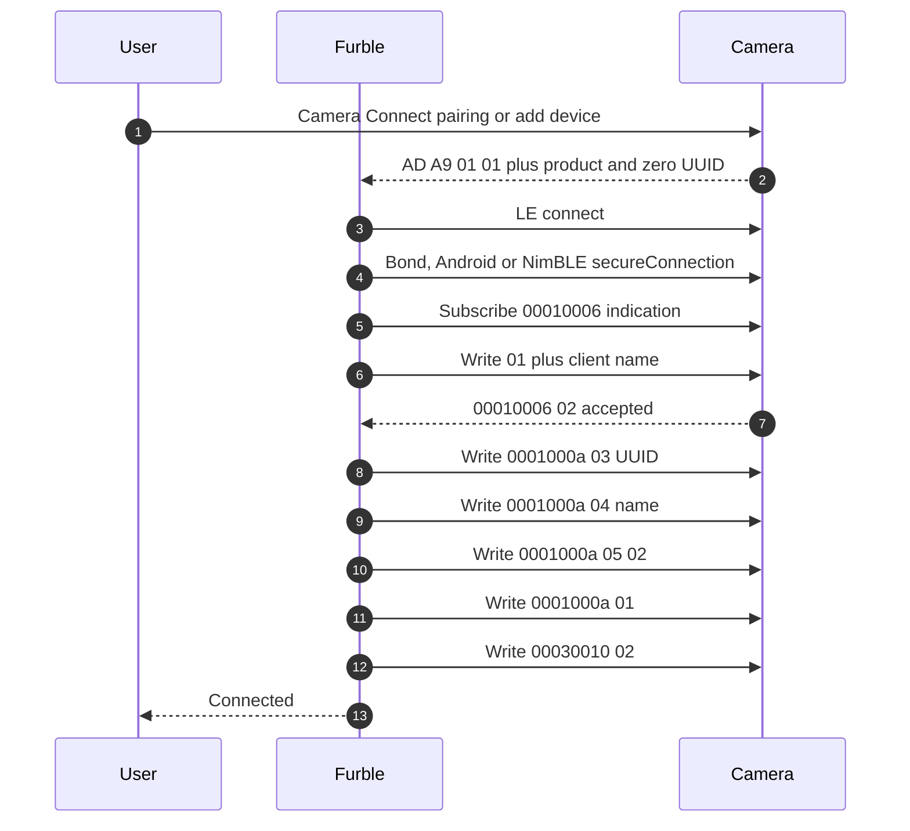

#### 6.7.2 Saved reconnect

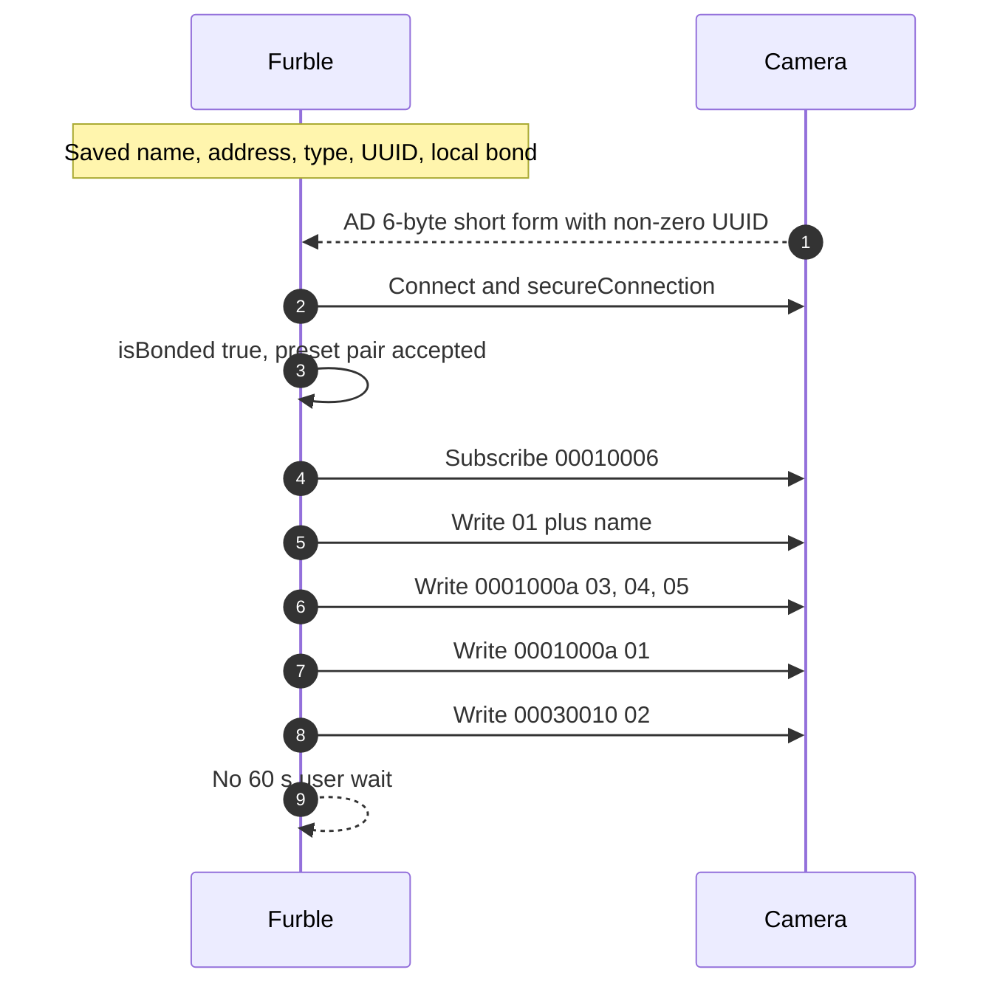

#### 6.7.3 Bond loss and failure recovery

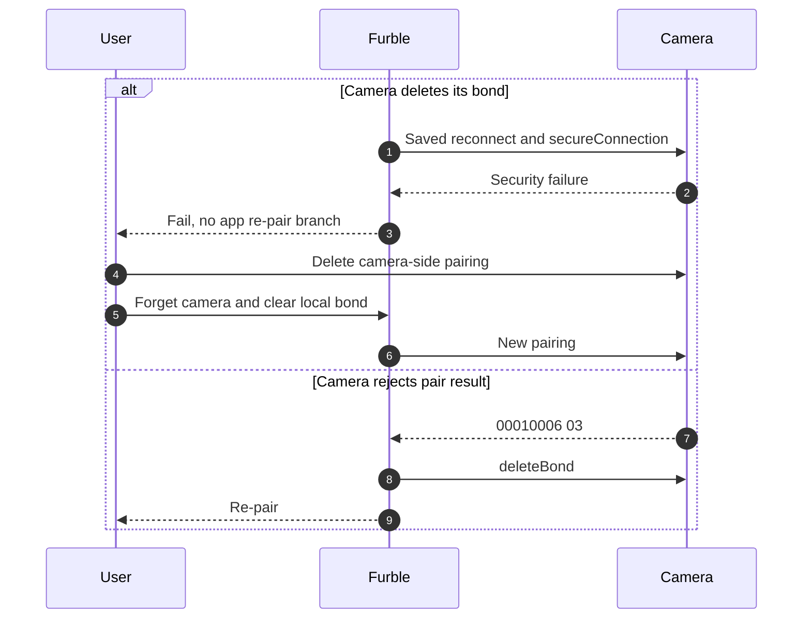

### 6.8 Prerequisites matrix

| Prerequisite | Required value | Current state | Evidence |
| :--- | :--- | :--- | :--- |
| Advertisement match | Service `00010000`; parse product ID and UUID form. | `partial`, matcher checks only the first service UUID, no manufacturer parse | `app-static`; `public-source`, `CanonEOSSmart.cpp` |
| Link security | Bond, method `unknown`, possibly Just Works or numeric comparison. | `partial`, DisplayYesNo request but source comment says Just Works | `public-source`; `app-static` |
| App pairing | `01` plus name, wait `02`. | `implemented`, 60 s wait | `app-static`; `public-source` |
| Identity | `03` UUID, `04` name, `05 02`, after the pair result. | `partial`, Furble writes before the result | `app-static`; `public-source` |
| Commit | `01` on `0001000a`. | `implemented`, semantics `unknown` | `app-static`; `unknown` |
| Mode | `02` on `00030010`. | `implemented` | `app-static` |
| CCCD | `00010006` indication, `00040003` indication. | `implemented` | `public-source` |
| Write type | App uses write request; Furble uses write command for name and identity. | `partial` | `app-static`; `public-source` |
| MTU | No explicit request. | `unknown` | `app-static` |
| Stale bond | Detect camera-side deletion on saved reconnect. | `missing` | `public-source` |
| Hardware certification | EOS M6, RP, R6 Mark II, G9 X Mark II raw HCI. | `unknown` | `unknown` |

## 7. Canon EOS Remote

### 7.1 Scope and status

Canon Remote is the BR-E1-style role. It advertises the `00050000` service,
accepts a name write, and takes one-byte focus and shutter commands on
`00050003`. It has no GPS and no application pair result. Furble implements
the role from public sources. No Canon firmware image or BR-E1 capture is
analysed in the corpus.

### 7.2 Advertisement identity

| Item | Value | Evidence |
| :--- | :--- | :--- |
| Company ID | Expected Canon `0x01A9`, but the Remote matcher does not parse manufacturer data. | `inference`; `public-source`, `CanonEOSRemote.cpp` |
| Manufacturer data | Not parsed by Furble. Exact layout `unknown`. | `unknown` |
| Advertised service UUIDs | `00050000-0000-1000-0000-d8492fffa821`. The matcher requires this as the first advertised service. | `public-source`, `CanonEOSRemote.cpp` |
| Local name | No name gate. Display only. | `public-source` |
| Address type | `unknown`. | `unknown` |
| RPA and identity | `unknown`. Furble stores the advertised address and type. | `public-source`, `CanonEOS.h` |
| Pairing mode trigger | Camera menu: add a wireless remote device, then hold the BR-E1 W and T buttons together for at least three seconds. | `public-source`, Canon R6 Mark II BR-E1 instructions |
| Advertising duration | `unknown`. | `unknown` |
| Reconnect advertising | `unknown`. The service is expected, but the exact advertisement form is not captured. | `unknown` |

### 7.3 Link security

| Item | Current implementation | Camera-side prerequisite and evidence |
| :--- | :--- | :--- |
| Just Works | The source does not state a method. `secureConnection()` is used. The common base requests DisplayYesNo. | `public-source`, `CanonEOSRemote.cpp`; `unknown` |
| Passkey entry | No explicit callback in the Remote class. | `unknown` |
| Passkey display | No explicit display value. | `unknown` |
| Numeric comparison | Possible through the common base. | `unknown` |
| OOB | None. | `unknown` |
| LE Secure Connections | Requested by the common baseline and `secureConnection()`. | `public-source`; `unknown` camera-side |
| MITM flag | Set. | `public-source`, `Camera.cpp` |
| Key size | Not set or checked. | `unknown` |
| Bonding | Yes, through `secureConnection()`. | `public-source` |
| Key distribution | Furble ENC and ID. | `public-source`, `Device.cpp` |
| Identity address and IRK | `unknown`. Furble stores the advertised address. | `unknown` |
| Bond storage | OS or NimBLE bond store. Camera-side capacity `unknown`. | `unknown` |
| Stale bond detection | None. A failed secure connection simply fails. | `public-source` |
| Unpair behaviour | Forget the saved camera. Camera-side removal is a menu action. | `public-source`, `CameraList.cpp` |
| Reconnect behaviour | Direct connect, secure, write `03` plus name, resolve `00050003`. No camera acknowledgement. | `public-source`, `CanonEOSRemote.cpp` |

### 7.4 App-level registration and authorization

| Step | Value or condition | Timeout or retry | Failure mode | Evidence |
| :--- | :--- | :--- | :--- | :--- |
| Name write | Prefix `03` plus the Furble name to `00050002-0000-1000-0000-d8492fffa821`. | None. | Write failure aborts. | `public-source`, `CanonEOSRemote.cpp` |
| Registration result | No result characteristic and no acknowledgement. | None. | Furble treats the name write and control lookup as success. | `public-source` |
| Control | `00050003-0000-1000-0000-d8492fffa821`. | None. | Missing characteristic aborts. | `public-source` |
| Mode | No separate mode write. | None. | Not applicable. | `public-source` |
| GPS | Not supported in this role. | Not applicable. | `updateGeoData` is a no-op. | `public-source`, `CanonEOSRemote.cpp` |

### 7.5 GATT prerequisites

| Phase | Attribute | Properties and write type | CCCD | Ordering | Evidence |
| :--- | :--- | :--- | :--- | :--- | :--- |
| Pairing | `00050000` service. | Service. | None. | Before name write. | `public-source` |
| Name | `00050002`. | Write, prefix `03` plus name, write command. | None. | Before control. | `public-source` |
| Control | `00050003`. | Write with response, one byte. `8C` press, `0C` release, `4C` focus press, `0C` focus release. | None. | After name. | `public-source`; `public-source`, `eos-remote-web` |
| MTU | No explicit request. | One-byte commands. | Not applicable. | None. | `public-source` |

### 7.6 Errors and recovery

| Condition | Result | Recovery | Evidence |
| :--- | :--- | :--- | :--- |
| Secure connection fails | Connect fails. | Re-pair through the camera menu and the remote. | `public-source` |
| Name write fails | Connect fails. | Retry. | `public-source` |
| Control characteristic missing | Connect fails. | Capture the exact Remote GATT table. | `public-source` |
| Camera-side bond deleted | Secure connection fails with no specific branch. | Unpair and re-pair. | `inference` |
| Sleep or reconnect failure after a working session | A public report required unpairing and a camera power cycle. | Treat as a report, not a universal defect. | `public-source`, `eos-remote-web` README |
| No pair acknowledgement | A successful ATT write is not proof of camera acceptance. | Capture a physical shutter outcome. | `inference` |

### 7.7 Flows

#### 7.7.1 First pairing

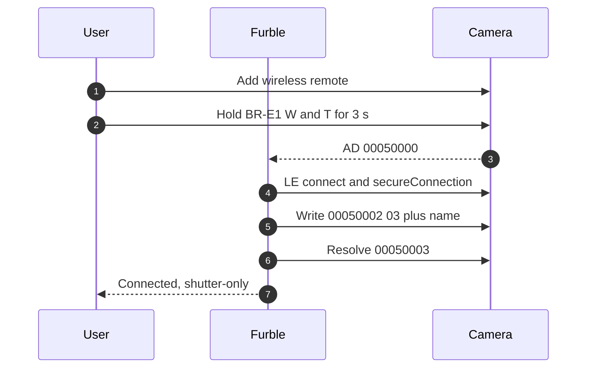

#### 7.7.2 Saved reconnect

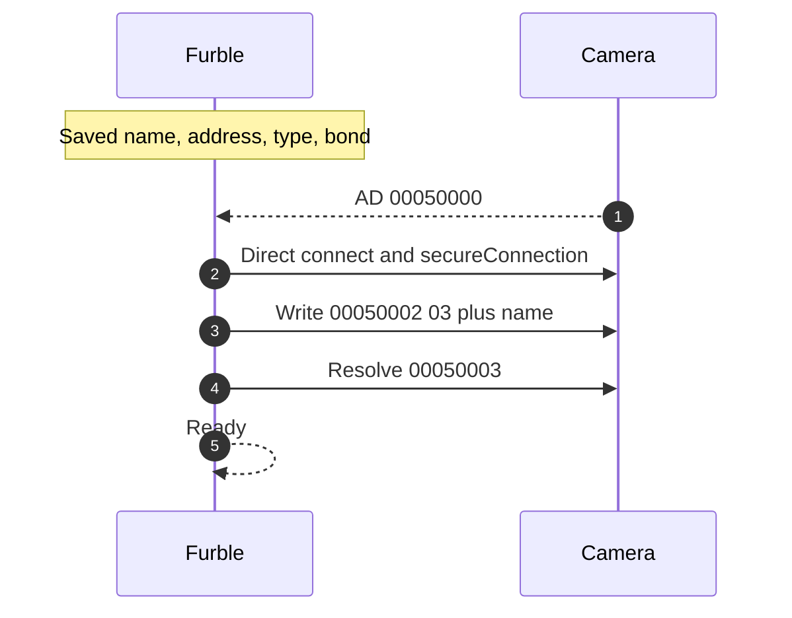

#### 7.7.3 Bond loss and failure recovery

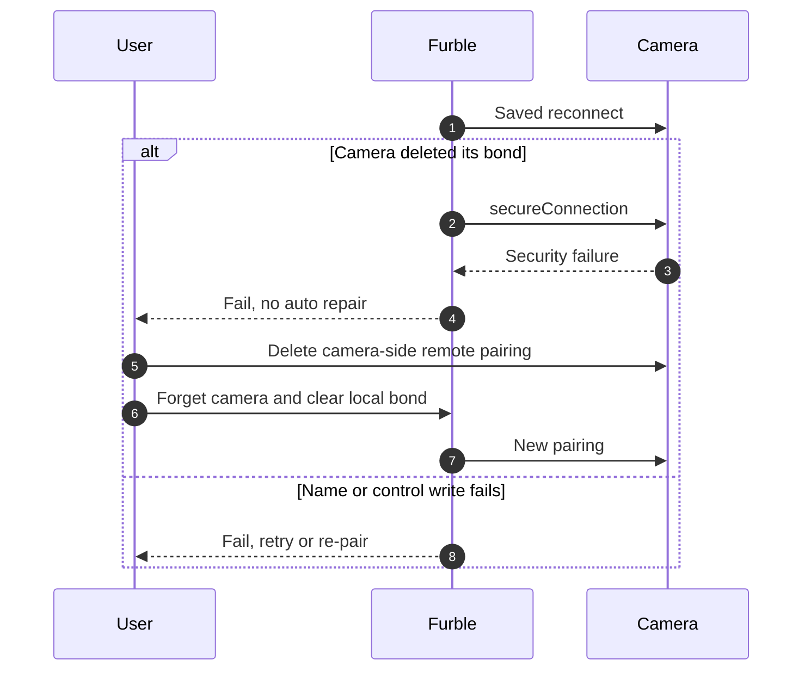

### 7.8 Prerequisites matrix

| Prerequisite | Required value | Current state | Evidence |
| :--- | :--- | :--- | :--- |
| Advertisement match | Service `00050000`. | `implemented`, first-service only | `public-source` |
| Link security | Secure bond, method `unknown`. | `partial` | `public-source` |
| Name write | `00050002`, prefix `03`. | `implemented` | `public-source` |
| Pair result | None. | `unknown` whether the camera needs one | `public-source` |
| Control | `00050003`, one-byte commands. | `implemented` | `public-source` |
| GPS | Not supported. | `implemented` as a no-op | `public-source` |
| MTU | No explicit request. | `unknown` | `public-source` |
| Stale bond | Detect camera-side deletion. | `missing` | `public-source` |
| Hardware certification | BR-E1 and EOS body raw HCI plus physical shutter. | `unknown` | `unknown` |

## 8. Nikon Remote (ML-L7 style)

### 8.1 Scope and status

Nikon Remote is the ML-L7-style role. The camera advertises the `de00` service
with no manufacturer data during discovery, and a seven-byte manufacturer
record during reconnect. The pairing is an application-level four-stage
handshake, not an SMP bond in the reviewed path. Furble does not call
`secureConnection()` for Nikon. The source comments and public references scope
this to shutter-only, with no focus and no GPS.

### 8.2 Advertisement identity

| Item | Value | Evidence |
| :--- | :--- | :--- |
| Company ID | `0x0399`, Nikon Corporation, on air `99 03`. | `public-source`, Bluetooth SIG; `public-source`, `AdvertisementProtocol.h` |
| Manufacturer data | Discovery: no manufacturer data, service `0000DE00` present. Reconnect: 7 bytes, `99 03` plus a four-byte device ID plus a trailing `00`. | `public-source`, `AdvertisementProtocol.cpp`; `public-source`, `Nikon.cpp` |
| Advertised service UUIDs | `0000DE00-3DD4-4255-8D62-6DC7B9BD5561`. | `public-source`, `NikonBase.h` |
| Local name | No name gate. Display only. | `public-source` |
| Address type | `unknown`. The saved address is updated from a matching reconnect advertisement. | `public-source`, `Nikon::onResult` |
| RPA and identity | The application identity is the four-byte device ID plus a nonce, not an IRK. RPA behaviour is `unknown`. | `public-source`, `NikonBase.h` |
| Pairing mode trigger | Camera menu: Save wireless remote controller, then hold the ML-L7 power button for more than three seconds. | `public-source`, Nikon Z6 III ML-L7 manual |
| Advertising duration | `unknown`. | `unknown` |
| Reconnect advertising | Seven-byte form with the persisted device ID and trailing zero. The saved address is replaced by the matching advertisement address. | `public-source`, `Nikon.cpp` |

### 8.3 Link security

| Item | Current implementation | Camera-side prerequisite and evidence |
| :--- | :--- | :--- |
| Just Works | Not applicable. No `secureConnection()` call. | `public-source`, `Nikon.cpp` |
| Passkey entry | None. | `unknown` |
| Passkey display | None. | `unknown` |
| Numeric comparison | None. | `unknown` |
| OOB | None. | `unknown` |
| LE Secure Connections | Not initiated. | `unknown` |
| MITM flag | Set globally but never used to initiate security. A camera request on a protected attribute could still trigger it. | `public-source`, `Camera.cpp`; `inference` |
| Key size | Not applicable. | `unknown` |
| Bonding | No bond in the reviewed path. The device ID and nonce are the application identity. | `public-source`, `Nikon.cpp`; `unknown` whether the camera also bonds |
| Key distribution | Not applicable. | `unknown` |
| Identity address and IRK | Device ID and nonce, not an IRK. | `public-source`, `NikonBase.h` |
| Bond storage | Furble stores the name, address, type, and device ID. The camera remembers one remote and the last paired remote wins. | `public-source`, `Nikon.h`; `public-source`, Nikon ML-L7 manual |
| Stale bond detection | No bond. A device ID mismatch makes the reconnect scan fail. | `public-source`, `Nikon::onResult` |
| Unpair behaviour | Delete the camera-side remote registration, then forget the camera locally. | `public-source`, Nikon manual |
| Reconnect behaviour | Scan for the device ID, connect, subscribe to the pair indications, and run the four-stage handshake again. | `public-source`, `Nikon::_connect`; `NikonBase::connect` |

### 8.4 App-level registration and authorization

| Step | Value or condition | Timeout or retry | Failure mode | Evidence |
| :--- | :--- | :--- | :--- | :--- |
| Pre-subscribe | Indication on `00002084-3DD4-4255-8D62-6DC7B9BD5561` before the handshake. | None. | Subscription failure aborts. | `public-source`, `NikonRemote::preSubscribe` |
| Pair subscribe | Indication on `00002087-3DD4-4255-8D62-6DC7B9BD5561`. | None. | Subscription failure aborts. | `public-source`, `NikonBase::subscribePair` |
| Message | 17 bytes: one stage byte, an eight-byte timestamp, and either two 32-bit IDs or an eight-byte serial. | None. | Stage mismatch aborts. | `public-source`, `NikonBase.h` |
| Stage 1 to 2 | Send stage 1, wait for a stage 2 response matching the expected IDs. | 10 s, 250 ms poll. | Mismatch or timeout aborts. | `public-source`, `NikonBase::handshake4Stage` |
| Stage 3 to 4 | Send stage 3, wait for a stage 4 response with the expected timestamp and serial. | 10 s, 250 ms poll. | Mismatch or timeout aborts. | `public-source` |
| Stage 5 | A stage 5 template exists but the current base loop does not emit it. | None. | Not used. | `public-source`, `NikonRemote::RemotePairing` |
| Device ID | A saved session reuses the stored device ID and nonce. A new session randomizes them and forces the first wire byte to `01`. | None. | A changed ID invalidates the saved scan match. | `public-source`, `Nikon.cpp` |
| Shutter | `02 02` press and `02 00` release to `00002083`. | None. | Write failure is not converted into a camera result. | `public-source`, `NikonRemote.cpp` |

### 8.5 GATT prerequisites

| Phase | Attribute | Properties and write type | CCCD | Ordering | Evidence |
| :--- | :--- | :--- | :--- | :--- | :--- |
| Discovery | `0000DE00` service. | Service. | None. | Before pair characteristic selection. | `public-source` |
| Remote pair | `00002087`. | Write, 17-byte message, with response. | None. | After the pair indication subscription. | `public-source` |
| Pair indication | `00002084`. | Indicate. | CCCD `0x0002`. | Before the handshake. | `public-source` |
| Shutter | `00002083`. | Write, two bytes, with response. | None. | After the handshake. | `public-source` |
| MTU | No explicit request. | The 17-byte message fits a default 23-byte ATT MTU. | Not applicable. | None. | `public-source` |

### 8.6 Errors and recovery

| Condition | Result | Recovery | Evidence |
| :--- | :--- | :--- | :--- |
| Pair indication subscription fails | Connect fails. | Retry or re-pair. | `public-source` |
| Stage response mismatch | Connect fails. | Re-enter the camera pairing mode. | `public-source` |
| Stage timeout | 10 s per stage, connect fails. | Retry, then re-pair. | `public-source` |
| Saved device ID not advertised | 60 s scan timeout. | Re-scan in pairing mode and save again. | `public-source`, `Nikon.cpp` |
| Camera forgot the remote | The handshake fails or the camera does not respond. | Delete the camera-side remote registration and pair again. | `inference` |
| Camera-side one-remote policy | The last paired remote wins. | Pair the intended remote again. | `public-source`, Nikon manual |
| Shutter write succeeds but no photo | ATT success is not a physical outcome. | Capture the physical result. | `inference` |

### 8.7 Flows

#### 8.7.1 First pairing

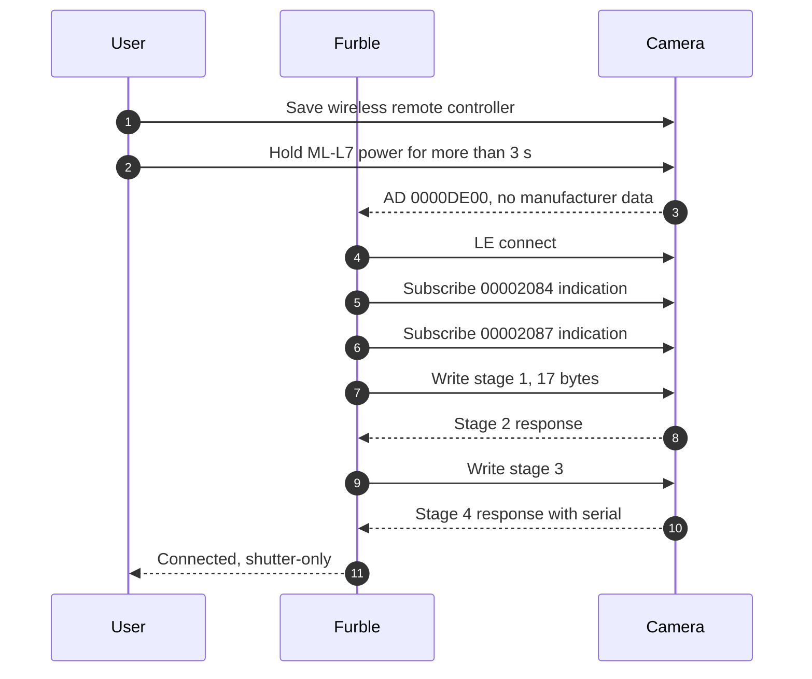

#### 8.7.2 Saved reconnect

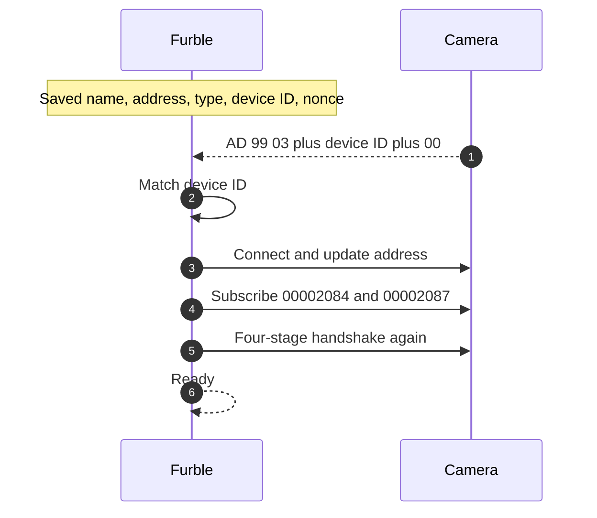

#### 8.7.3 Camera-side deletion and failure recovery

```mermaid
sequenceDiagram
    autonumber
    participant U as User
    participant F as Furble
    participant C as Camera
    F->>C: Saved reconnect
    alt Device ID not advertised
        F-->>U: 60 s scan timeout
        U->>C: Save wireless remote controller again
        F->>C: New scan and handshake
    else Handshake mismatch or timeout
        F-->>U: Fail
        U->>C: Delete camera-side remote registration
        U->>F: Forget camera
        F->>C: New pairing
    end
```

### 8.8 Prerequisites matrix

| Prerequisite | Required value | Current state | Evidence |
| :--- | :--- | :--- | :--- |
| Advertisement match | No manufacturer data plus `DE00`, or 7-byte device ID form. | `implemented`, first-service only on discovery | `public-source` |
| Link security | Unknown whether SMP is required. | `partial`, no `secureConnection()` | `public-source` |
| Pair handshake | Four stages, 17-byte messages, 10 s each. | `implemented` | `public-source` |
| Device identity | Device ID plus nonce. | `implemented` | `public-source` |
| Pair indication | `00002084`, CCCD. | `implemented` | `public-source` |
| Shutter | `00002083`, `02 02` and `02 00`. | `implemented` | `public-source` |
| Focus | Not supported by ML-L7. | `implemented` as no-op | `public-source`, Nikon manual |
| MTU | Default 23 is enough. | `implemented` by payload size | `public-source` |
| Stale bond | Device ID mismatch. | `partial`, scan timeout only | `public-source` |
| Hardware certification | B600 1.1 and Z6 III raw HCI plus physical shutter. | `unknown` | `unknown` |

## 9. Nikon Smart (SnapBridge LSS style)

### 9.1 Scope and status

Nikon Smart is the SnapBridge LSS role. Furble selects it when the `de00`
service has a `00002000` pair characteristic instead of the Remote `00002087`.
The BLE handshake uses a Blowfish-derived eight-salt validation. After the BLE
exchange, Nikon requires a Bluetooth Classic bond and a user-confirmed numeric
passkey. Furble is LE-only. `NikonSmart::connectFinalise()` writes the client
name and then returns false unconditionally. The mode is intentionally
non-functional.

### 9.2 Advertisement identity

| Item | Value | Evidence |
| :--- | :--- | :--- |
| Company ID | `0x0399`, Nikon Corporation. | `public-source`, Bluetooth SIG; `AdvertisementProtocol.h` |
| Manufacturer data | Same discovery and reconnect forms as Nikon Remote. The role is selected by the GATT pair characteristic, not by the advertisement. | `public-source`, `Nikon.cpp` |
| Advertised service UUIDs | `0000DE00-3DD4-4255-8D62-6DC7B9BD5561`. | `public-source` |
| Local name | No name gate. | `public-source` |
| Address type | `unknown`. | `unknown` |
| RPA and identity | The BLE identity is the device ID and nonce. The Classic identity is separate and is not recovered by Furble. | `public-source`, RE corpus `fuji-canon-nikon.md` |
| Pairing mode trigger | SnapBridge pairing on the camera. | `public-source`, SnapBridge workflow |
| Advertising duration | `unknown`. | `unknown` |
| Reconnect advertising | Same seven-byte form as Remote. | `public-source` |

### 9.3 Link security

| Item | Current implementation | Camera-side prerequisite and evidence |
| :--- | :--- | :--- |
| Just Works | No. | `public-source`, RE corpus section on Nikon Smart |
| Passkey entry | None in the BLE path. | Classic SSP numeric passkey is required after the BLE exchange. `public-source`, `nsg` protocol document |
| Passkey display | None. | The phone or Classic stack displays the numeric value. `public-source` |
| Numeric comparison | Not in the BLE path. | Classic SSP numeric comparison with user confirmation. `public-source`, `nsg` |
| OOB | None. | `unknown` |
| LE Secure Connections | Not the gate. | The required bond is Classic BR/EDR, not LE SC. `public-source`, `nsg` |
| MITM flag | Set globally, but the BLE path never initiates security. | Classic numeric passkey provides MITM for the Classic bond. `public-source` |
| Key size | Not applicable to the BLE path. | Classic key size `unknown`. |
| Bonding | No LE bond. | A Classic bond after writing the identity is required. Furble cannot create it. |
| Key distribution | Not applicable. | `unknown` |
| Identity address and IRK | BLE device ID and Classic address are separate. | `public-source`, `nsg` reports a separate Classic address |
| Bond storage | For the BLE handshake, name, address, type, device ID, nonce. The Classic bond would be OS-owned. | `public-source`; `unknown` |
| Stale bond detection | Not reached because the mode always fails. | `unknown` |
| Unpair behaviour | Remove the camera-side SnapBridge pairing and the OS Classic bond. | `inference` |
| Reconnect behaviour | Same BLE handshake, then Classic continuation. Furble stops before the Classic step. | `public-source`, `NikonSmart.cpp` |

### 9.4 App-level registration and authorization

| Step | Value or condition | Timeout or retry | Failure mode | Evidence |
| :--- | :--- | :--- | :--- | :--- |
| Pair subscribe | Notification on `00002008`. | None. | Subscription failure aborts. | `public-source`, `NikonSmart::preSubscribe` |
| Pair characteristic | `00002000`. | None. | Missing characteristic aborts. | `public-source` |
| BLE stages | Four-stage 17-byte exchange. The Smart variant derives stage 3 from the validated camera response using the eight salts and Blowfish. | 10 s per stage. | Stage mismatch or timeout aborts. | `public-source`, `NikonSmart::SmartPairing` |
| Final OK | Notification `01 00` on `00002008`. | 1 s, 250 ms poll. | Timeout is expected on Z-series bodies and still fails. | `public-source`, `NikonSmart::connectFinalise` |
| Identity write | Write the client name to `00002002`. | None. | Write failure aborts. | `public-source` |
| Classic continuation | Nikon requires a BR/EDR bond and numeric passkey after the BLE exchange. | Not implemented. | The mode returns false unconditionally. | `public-source`, `NikonSmart.h`, `NikonSmart.cpp`; `public-source`, `nsg` |
| Shutter, focus, GPS | All no-ops in the final path. | Not applicable. | No control surface. | `public-source`, `NikonSmart.cpp` |

### 9.5 GATT prerequisites

| Phase | Attribute | Properties and write type | CCCD | Ordering | Evidence |
| :--- | :--- | :--- | :--- | :--- | :--- |
| Pair | `00002000` in `DE00`. | Write, 17-byte stage messages. | None. | After pair notification subscription. | `public-source` |
| Success | `00002008`. | Notify. | CCCD `0x0001`. | Before and after the stages. | `public-source` |
| Identity | `00002002`. | Write, name. | None. | After the final OK. | `public-source` |
| Location | `00002007`. | Write, 41-byte payload. | None. | Not reachable on the failing path. | `public-source` |
| Time | `00002006`. | Write. | None. | Not reachable on the failing path. | `public-source` |
| Classic | BR/EDR bond. | Numeric passkey. | Not applicable. | After BLE identity. | `public-source`, `nsg` |

### 9.6 Errors and recovery

| Condition | Result | Recovery | Evidence |
| :--- | :--- | :--- | :--- |
| Any successful BLE stage | `connectFinalise` still returns false. | None. The mode is blocked. | `public-source`, `NikonSmart.cpp` |
| No final `01 00` | 1 s timeout, fail. | Expected on Z-series. | `public-source` |
| No Classic bond | BLE half cannot complete the Nikon flow. | A Classic-capable implementation is required. | `public-source`, `nsg` |
| Wrong Classic passkey | Classic SSP fails. | Retry the Classic pairing. | `inference` |
| Camera-side SnapBridge deletion | BLE handshake or Classic bond fails. | Re-pair in SnapBridge. | `inference` |

### 9.7 Flows

#### 9.7.1 First pairing

```mermaid
sequenceDiagram
    autonumber
    participant U as User
    participant F as Furble
    participant C as Camera
    U->>C: SnapBridge pairing
    C-->>F: AD 0000DE00, no manufacturer data
    F->>C: LE connect
    F->>C: Subscribe 00002008 notify
    F->>C: Subscribe 00002000 pair
    F->>C: Stage 1
    C-->>F: Stage 2
    F->>F: Blowfish salt validation and stage 3
    F->>C: Stage 3
    C-->>F: Stage 4
    C-->>F: 00002008 01 00 if sent
    F->>C: Write 00002002 name
    Note over F,C: Nikon requires Classic BR/EDR bond and numeric passkey
    F-->>U: Fail, LE-only
```

#### 9.7.2 Saved reconnect

```mermaid
sequenceDiagram
    autonumber
    participant F as Furble
    participant C as Camera
    Note over F: Saved device ID, nonce, name, address
    C-->>F: AD 99 03 plus device ID plus 00
    F->>C: Connect and repeat BLE handshake
    F->>C: Write name
    F-->>F: Returns false before Classic continuation
```

#### 9.7.3 Failure recovery

```mermaid
sequenceDiagram
    autonumber
    participant U as User
    participant F as Furble
    participant C as Camera
    F->>C: Smart pairing attempt
    alt BLE half succeeds
        F-->>U: Still fails, Classic bond missing
        U->>C: Use SnapBridge or a Classic-capable remote
    else BLE stage fails
        F-->>U: Pairing failed
        U->>C: Re-enter SnapBridge pairing
    end
```

### 9.8 Prerequisites matrix

| Prerequisite | Required value | Current state | Evidence |
| :--- | :--- | :--- | :--- |
| Advertisement match | `DE00` service and 7-byte reconnect form. | `implemented` | `public-source` |
| BLE handshake | Four stages with eight salts and Blowfish. | `implemented` | `public-source` |
| Final OK | `00002008` `01 00`. | `implemented`, 1 s, not required by all bodies | `public-source` |
| Identity | `00002002` name. | `implemented` | `public-source` |
| Classic bond | BR/EDR plus numeric passkey. | `blocked` | `public-source`, `nsg` |
| Shutter | LSS key events. | `missing` | `public-source`, SnapBridge app |
| GPS | `00002007` 41-byte packet. | `missing` on the failing path | `public-source` |
| Hardware certification | B600 and Z6 III BLE plus Classic capture. | `unknown` | `unknown` |

## 10. Sony

### 10.1 Scope and status

Sony uses manufacturer-data matching, the `8000FF00` control service, the
`8000DD00` location service, and the `8000EE00` pairing service. Furble
implements control and location but does not write the vendor pairing command
`EE01` or handle the `EE03` pairing result. The official app delegates bonding
to Android and uses `EE01` as the application registration trigger. This is a
likely registration gap, not a proven runtime failure.

### 10.2 Advertisement identity

| Item | Value | Evidence |
| :--- | :--- | :--- |
| Company ID | `0x012D`, Sony Corporation, on air `2D 01`. | `app-static`, Sony `ManufacturerData`; `public-source`, Bluetooth SIG |
| Manufacturer data | At least 13 bytes: company `2D 01`, device type `03 00`, protocol version two bytes big-endian, model code two ASCII bytes, then tag/value records from offset 8. `0x22` is pairing and location state; `0x21` is power and Wi-Fi state. | `app-static`, `ManufacturerData` in Imaging Edge Mobile 7.8.6 and Creators' App 3.6.0 |
| Advertised service UUIDs | No service filter in the vendor scanner. Furble requires no advertised service. `8000EE00` is a GATT pairing service, not an advertisement gate. | `app-static`; `public-source`, `Sony.cpp` |
| Local name | No name gate. The model code is in the manufacturer data, not the name. | `app-static`; `public-source` |
| Address type | `unknown`. | `unknown` |
| RPA and identity | `unknown`. Furble stores the advertised address and type. | `public-source`, `Sony.h` |
| Pairing mode trigger | Camera menu: Bluetooth Function on, Bluetooth Rmt Ctrl on, Bluetooth Pairing, then confirm the camera prompt. | `public-source`, Sony ZV-1F Help Guide |
| Advertising duration | `unknown`. | `unknown` |
| Reconnect advertising | Same manufacturer record. The pairing scan requires tag `0x22` bit 6; the power scan requires tag `0x21` bit 7 and either camera-on or an existing bond. | `app-static` |

### 10.3 Link security

| Item | Current implementation | Camera-side prerequisite and evidence |
| :--- | :--- | :--- |
| Just Works | The vendor app does not set a passkey and delegates to Android. Furble requests DisplayYesNo. The method is `unknown`. | `app-static`; `inference` |
| Passkey entry | No explicit app path. | `unknown` |
| Passkey display | No explicit app path. | `unknown` |
| Numeric comparison | Possible through Android and the Furble DisplayYesNo request. | `inference` |
| OOB | None. | `unknown` |
| LE Secure Connections | Requested by the common baseline and `secureConnection()`. | `public-source`; `unknown` camera-side |
| MITM flag | Set by Furble. | `public-source` |
| Key size | Not set or checked. | `unknown` |
| Bonding | Yes. The app relies on the Android bond; Furble calls `secureConnection()`. | `app-static`; `public-source` |
| Key distribution | Furble ENC and ID. | `public-source`; `unknown` camera-side |
| Identity address and IRK | `unknown`. Furble stores the advertised address. | `unknown` |
| Bond storage | OS bond store. Camera-side capacity `unknown`. The official guide says one remote at a time and pairing is deleted on camera initialization. | `public-source`, Sony ZV-1F Help Guide |
| Stale bond detection | None. A failed secure connection fails the connect. | `public-source`, `Sony.cpp` |
| Unpair behaviour | Forget the saved camera. The camera deletes pairing on initialization. | `public-source`, Sony help guide; `CameraList.cpp` |
| Reconnect behaviour | Direct connect, secure, control service, optional location service. No `EE01` registration write. | `public-source`, `Sony.cpp` |

### 10.4 App-level registration and authorization

| Step | Value or condition | Timeout or retry | Failure mode | Evidence |
| :--- | :--- | :--- | :--- | :--- |
| Pairing command | Write `06 08 01 00 00 00 00` to `EE01` in `8000EE00`. | None visible. | Missing write likely leaves the camera unregistered. | `app-static`, `PairingState.java`; `inference` |
| Pairing state | Subscribe `EE03` notifications. Eight-byte frame: byte 0 `7`, bytes 1 to 2 `00 00`, byte 3 `01` state or `02` result, bytes 4 to 7 a big-endian value. | `unknown`. | The app reports state and result. | `app-static` |
| State values | `1` BLE request received, `2` BLE auth permitted, `3` BLE auth rejected, `4` Classic enabled, `5` Classic request, `6` Classic auth permitted, `7` Classic auth rejected, `8` Classic pairing success, `9` user cancel. | `unknown`. | A state outside the expected sequence fails. | `app-static` |
| Result values | `1` success, `2` BLE auth rejected, `3` BLE pairing failed, `4` Classic auth rejected, `5` Classic pairing failed, `6` user cancel, `7` not ready, `8` MFi rejected, `9` random number mismatch, `10` pair registration failure. | `unknown`. | The app maps these to errors. | `app-static` |
| Camera information | Read `EE04` TLV: firmware version length and bytes, then model name length and bytes. | `unknown`. | Optional in Creators' App. | `app-static` |
| MTU | Vendor app requests 158. | Android MTU callback. | A 95-byte GPS payload needs at least 98 bytes of ATT MTU in one write. | `app-static` |

### 10.5 GATT prerequisites

| Phase | Attribute | Properties and write type | CCCD | Ordering | Evidence |
| :--- | :--- | :--- | :--- | :--- | :--- |
| Pairing | `8000EE00`, `EE01`. | Write, seven bytes. | None. | Before control, if the vendor registration is required. | `app-static` |
| Pairing state | `EE03`. | Notify, eight bytes. | CCCD `0x0001`. | After `EE01`. | `app-static` |
| Camera info | `EE04`. | Read, TLV. | None. | Optional. | `app-static` |
| Control | `8000FF00`, `FF01`. | Write, two bytes little-endian. `01 07` focus down, `01 06` focus up, `01 09` shutter down, `01 08` shutter up. | None. | After pairing and security. | `public-source`, `Sony.cpp` |
| Status | `FF02`. | Notify. `02 3f 00/20` focus, `02 a0 00/20` shutter, `02 d5 00/20` recording. | CCCD `0x0001`. | Furble does not subscribe. | `public-source`, Freemote |
| Location | `8000DD00`, `DD01` notify, `DD11` write, `DD21` read, `DD30`/`DD31` read and write. | `DD11` 95-byte write with response; `DD30`/`DD31` one-byte writes without response. | `DD01` CCCD if used. | Read `DD30` and `DD31`, enable, then write `DD11`. | `app-static`; `public-source`, `Sony.cpp` |
| MTU | Vendor app 158. | 95-byte GPS needs at least 98. | Not applicable. | Before GPS writes. | `app-static`; `inference` |

### 10.6 Errors and recovery

| Condition | Result | Recovery | Evidence |
| :--- | :--- | :--- | :--- |
| `EE01` not written | The camera may not register the client. Control may still be accepted on some bodies, but this is unproven. | Add the vendor pairing command and `EE03` result handling. | `app-static`; `inference` |
| `EE03` result `2`, `3`, `4`, `5`, `8`, `9`, or `10` | Pairing failed at the corresponding stage. | Re-pair from the camera menu. | `app-static` |
| `EE03` result `6` | User cancelled. | Retry. | `app-static` |
| `EE03` result `7` | Not ready for pairing. | Put the camera in pairing mode. | `app-static` |
| Secure connection fails | Connect fails, no stale-bond branch. | Re-pair. | `public-source` |
| Control service or `FF01` missing | Connect fails. | Capture the exact model GATT. | `public-source` |
| Location service missing | GPS is skipped. | None. | `public-source` |
| FF02 status not subscribed | No focus or shutter status, and no remote-disabled detection. | Subscribe and handle the status values. | `public-source`, Freemote |
| Camera initialization deletes pairing | Saved reconnect fails. | Re-pair after camera initialization. | `public-source`, Sony help guide |

### 10.7 Flows

#### 10.7.1 First pairing

```mermaid
sequenceDiagram
    autonumber
    participant U as User
    participant F as Furble
    participant C as Camera
    U->>C: Bluetooth Function on, Rmt Ctrl on, Pairing
    C-->>F: AD 2D 01 03 00 plus model and tags
    F->>C: LE connect and secureConnection
    F->>C: Discover FF00 and FF01
    Note over F,C: Vendor app writes EE01 06 08 01 00 00 00 00
    F-->>U: Furble has no EE01 registration write
    F->>C: Control writes may still be attempted
```

#### 10.7.2 Saved reconnect

```mermaid
sequenceDiagram
    autonumber
    participant F as Furble
    participant C as Camera
    Note over F: Saved name, address, type, bond
    C-->>F: AD 22 pairing enabled and 21 power state
    F->>C: Direct connect and secureConnection
    F->>C: Discover FF00 and FF01
    F->>C: Optional DD00 location
    F-->>F: No EE01 and no EE03 handling
```

#### 10.7.3 Pairing rejection and failure recovery

```mermaid
sequenceDiagram
    autonumber
    participant U as User
    participant F as Furble
    participant C as Camera
    alt Camera requires EE01 registration
        F->>C: No EE01 write
        C-->>F: Control rejected or session not registered
        F-->>U: Add EE01 and EE03 handling
    else Secure connection fails
        F->>C: secureConnection
        C-->>F: Failure
        F-->>U: Re-pair from camera menu
    else EE03 reports rejection
        C-->>F: EE03 result 2, 3, 4, 5, 8, 9, or 10
        F-->>U: Re-pair
    end
```

### 10.8 Prerequisites matrix

| Prerequisite | Required value | Current state | Evidence |
| :--- | :--- | :--- | :--- |
| Advertisement match | Company `0x012D`, type `0003`, tag `0x22` pairing bits. | `partial`, Furble requires bits 7, 6, and 1; vendor defines 7 and 6 | `app-static`; `public-source`, `Sony.cpp` |
| Link security | Bond, method `unknown`. | `partial` | `app-static`; `public-source` |
| App registration | `EE01 06 08 01 00 00 00 00`. | `missing` | `app-static` |
| Pairing result | `EE03` eight-byte frame. | `missing` | `app-static` |
| Camera info | `EE04` TLV. | `missing` | `app-static` |
| Control | `FF00` / `FF01`. | `implemented` | `public-source` |
| Status | `FF02`. | `missing` | `public-source`, Freemote |
| GPS | `DD00`, `DD11`, `DD21`, `DD30`, `DD31`. | `partial`, no `DD21` read, no lock release | `app-static`; `public-source` |
| MTU | 158 requested by app; 98 needed for 95-byte GPS. | `missing` explicit request | `app-static`; `inference` |
| Stale bond | Detect camera-side deletion. | `missing` | `public-source` |
| Hardware certification | ZV-1F and one Alpha body raw HCI plus physical shutter. | `unknown` | `unknown` |

## 11. Panasonic LUMIX

### 11.1 Scope and status

LUMIX is an application-level registration protocol, not a bonded BLE
protocol in the reviewed evidence. The official app does not call
`createBond`, `setPin`, or `setPasskey`. It writes a 16-byte MEI0 identity and
an ASCII controller name, then uses a Confirm and Start handshake on the
one-byte control characteristic. Furble implements the legacy MEI0 path from
S5II and BGH1 traces. It does not implement the newer APS identity path, the
Confirm and Start handshake, or the readiness notifications. No LUMIX model is
in the Furble tested list.

There was a documentation defect in the existing research note. The note said
company ID `0x0376`. The current Furble matcher uses `0x003A`, and the
Bluetooth SIG assignment for `0x003A` is Panasonic Holdings Corporation.
`0x0376` is Electronic Temperature Instruments Ltd. The note has been corrected
to `0x003A`. The numeric value is settled; the manufacturer-data layout beyond
the company ID still needs a raw advertisement capture.

### 11.2 Advertisement identity

| Item | Value | Evidence |
| :--- | :--- | :--- |
| Company ID | `0x003A`, Panasonic Holdings Corporation, on air `3A 00`. The existing research note's `0x0376` is not the Panasonic assignment. | `public-source`, Bluetooth SIG; `public-source`, `AdvertisementProtocol.h` |
| Manufacturer data | At least 8 bytes: company ID two bytes, one flags byte, and a five-byte address fragment. Furble parses the flags and fragment but does not use a model string. | `public-source`, `parseLumixAdvertisement` |
| Advertised service UUIDs | `054AC620-3214-11E6-AC0D-0002A5D5C51B`. | `public-source`, `Lumix.cpp`; `app-static`, LUMIX Sync |
| Local name | `S5-XXXXXX` and similar anchors in the public S5 report. No name gate in Furble. | `public-source`, RE corpus; `public-source` |
| Address type | RPA with a reported rotation of about 15 minutes on S5. Furble stores the advertised address and does not resolve an identity address. | `public-source`, S5 report; `inference` for the saved-address risk |
| RPA and identity | The application identity is the MEI0 seed, not an IRK. RPA rotation is separate from the MEI0 identity. | `app-static`, MEI0 seed; `public-source` |
| Pairing mode trigger | Camera Bluetooth remote registration, usually through LUMIX Sync. The app-level identity is written on connect. | `app-static`; `public-source`, Panasonic S-series page |
| Advertising duration | `unknown`. The app recognises `sleep_pow_on`, `sleep_pow_off`, `sleep_pow_on_fast`, `sleep_pow_off_fast`, and `wakeup` advertisement states. | `app-static` |
| Reconnect advertising | The sleep and wakeup states above. Wake is a BLE connection in a wakeup advertising state followed by the Wi-Fi start sequence. | `app-static`; `public-source` |

### 11.3 Link security

| Item | Current implementation | Camera-side prerequisite and evidence |
| :--- | :--- | :--- |
| Just Works | Not applicable. `Lumix::_connect()` never calls `secureConnection()`. | `public-source`, `Lumix.cpp` |
| Passkey entry | None. | The app has no `setPin` or `setPasskey`. `app-static` |
| Passkey display | None. | `app-static` |
| Numeric comparison | None. | `app-static` |
| OOB | None. | `unknown` |
| LE Secure Connections | Not initiated. | `unknown` whether a protected attribute triggers it |
| MITM flag | Set globally but not initiated. | `public-source`; `unknown` camera-side |
| Key size | Not applicable. | `unknown` |
| Bonding | No bond in Furble or the official app. The registration is application-level. | `app-static`; `public-source` |
| Key distribution | Not applicable. | `unknown` |
| Identity address and IRK | No IRK. The MEI0 seed is the application identity. | `app-static`, `Dlna_UUID_Seed` |
| Bond storage | Furble stores name, address, and type. The camera-side registration is the MEI0 seed. | `public-source`, `Lumix.h`; `app-static` |
| Stale bond detection | No bond. A changed MEI0 seed can make the camera reject or hang up. | `app-static`; `public-source` S5 report; `inference` |
| Unpair behaviour | Remove the camera-side registration and forget the saved camera. | `inference` |
| Reconnect behaviour | Re-write MEI0 and the name on every connect, then discover control. No bond to reuse. | `public-source`, `Lumix.cpp` |

### 11.4 App-level registration and authorization

| Step | Value or condition | Timeout or retry | Failure mode | Evidence |
| :--- | :--- | :--- | :--- | :--- |
| MEI0 identity | 16 bytes to `8D08A420-3213-11E6-8ACA-0002A5D5C51B`. The app's prefix is ten bytes `4D 45 49 30 01 00 10 00 80 01`; the remaining six bytes are the per-install DLNA UUID seed, not a fixed protocol suffix. Furble uses `4D 45 49 30 01 00 10 00 80 01 02 00 00 01 00 00`. | None. | Write failure aborts. A different seed may be rejected. | `app-static`, `p202z5` / `N5.l.A`; `public-source`, `Lumix.h` |
| APS path | 20-byte identity `BB5D2A8C-5D3B-43AD-BFC3-470CAD55C1CA` and 20-byte name `7B61774F-EFB4-44C6-A66D-C69E3B384C4A` on newer bodies. | None. | Furble does not implement it. | `app-static` |
| Name | ASCII controller name to `CD7A71A0-3213-11E6-8F56-0002A5D5C51B`. | None. | Write failure aborts. | `app-static`; `public-source` |
| Confirm | Write `01` to `7BE5FD56-475B-11E7-A919-92EBCB67FE33`. | Wait for `7BE5FE6E` value `00`. | Furble does not send it. | `app-static` |
| Start | Write `02` to the same characteristic. | After Confirm readiness. | Furble does not send it. | `app-static` |
| Shutter | Write `04` press and `05` release. | None. | A bare `04` may be ignored if Confirm and Start are required. | `app-static`; `inference` |
| Readiness notifications | Subscribe `7BE5FE6E`, `37701B80`, `4CF487C0` before control. | `unknown`. | Furble subscribes to none. | `app-static` |
| Location | Write 16 bytes to `DAFF1BC0-3216-11E6-91C8-0002A5D5C51B`; the camera may request a resend on `37701B80` value `03`. | `unknown`. | Furble writes without a readiness wait. | `app-static`; `public-source` |
| Clock | Write 10 bytes to `EAD55E60-3216-11E6-A42E-0002A5D5C51B` when `4CF487C0` requests it. | `unknown`. | Furble writes after GPS without the request. | `app-static`; `public-source` |

### 11.5 GATT prerequisites

| Phase | Attribute | Properties and write type | CCCD | Ordering | Evidence |
| :--- | :--- | :--- | :--- | :--- | :--- |
| Session | `054AC620` service, `8D08A420` MEI0, `CD7A71A0` name. | Write with response. | None. | MEI0 before name. | `public-source`; `app-static` |
| Control | `7BE5FAAE` service, `7BE5FD56` command, `7BE5FE6E` notify. | Command one byte write with response; notify readiness. | CCCD `0x0001`. | Confirm `01`, wait `00`, Start `02`, then shutter `04`/`05`. | `app-static`; `public-source` |
| Location | `1D74AFE0` service, `DAFF1BC0` write, `37701B80` notify. | 16 bytes write with response. | CCCD `0x0001`. | After readiness. | `app-static` |
| Clock | `34738720` service, `EAD55E60` write, `4CF487C0` notify. | 10 bytes write with response. | CCCD `0x0001`. | On clock request. | `app-static` |
| MTU | No explicit request. | 16-byte GPS and 10-byte clock fit a default 23-byte ATT MTU. | Not applicable. | None. | `public-source`; `inference` |
| Wi-Fi | `5AE57260` service, `0D6F1880`, `18345BE0`, `E182EC40`. | Write and notify. | CCCD `0x0001`. | Only after the BLE identity session. | `app-static` |

### 11.6 Errors and recovery

| Condition | Result | Recovery | Evidence |
| :--- | :--- | :--- | :--- |
| Session service missing | Connect fails. | Wrong generation or model. | `public-source`, `Lumix.cpp` |
| MEI0 write fails | Connect fails. | Retry, then re-register the camera. | `public-source` |
| Name write fails | Connect fails. | Retry. | `public-source` |
| Control service missing | Connect fails. | Capture the exact GATT. | `public-source` |
| New APS body | Plain MEI0 is ignored; the body expects `BB5D2A8C`. | Implement the APS path. | `app-static`; `inference` |
| MEI0 seed differs from the camera registration | The camera may reject or hang up. | Persist and reuse the seed, or implement the vendor registration. | `public-source` S5 report; `inference` |
| Bare `04` shutter | The camera may ignore it if Confirm and Start are required. | Send `01`, wait `00`, send `02`, then `04`. | `app-static`; `inference` |
| GPS write before readiness | The camera may drop the link. | Wait for `37701B80` value `01`. | `public-source` S5 report; `app-static` |
| Clock timezone field | Furble writes zero. The app writes an offset then a DST byte. | Correct the field order and fill the offset. | `app-static`; `public-source` |
| No bond | There is no bond to go stale. | Re-register on the camera. | `public-source`; `app-static` |

### 11.7 Flows

#### 11.7.1 First pairing and registration

```mermaid
sequenceDiagram
    autonumber
    participant U as User
    participant F as Furble
    participant C as Camera
    U->>C: Enable Bluetooth remote registration
    C-->>F: AD 3A 00 flags and address, 054AC620
    F->>C: LE connect, no secureConnection
    F->>C: Write 8D08A420 MEI0, 16 bytes
    F->>C: Write CD7A71A0 controller name
    F->>C: Discover 7BE5FAAE and 7BE5FD56
    Note over F,C: Vendor app writes 01 Confirm, waits 7BE5FE6E 00, writes 02 Start
    F-->>U: Furble writes 04 directly
```

#### 11.7.2 Saved reconnect

```mermaid
sequenceDiagram
    autonumber
    participant F as Furble
    participant C as Camera
    Note over F: Saved name, address, type
    C-->>F: AD sleep or wakeup state
    F->>C: Direct connect, no bond
    F->>C: Write same MEI0 and name
    F->>C: Discover control and optional location or clock
    F-->>F: Ready, bare shutter write
```

#### 11.7.3 Registration rejection and failure recovery

```mermaid
sequenceDiagram
    autonumber
    participant U as User
    participant F as Furble
    participant C as Camera
    alt Camera expects APS identity
        F->>C: Write plain MEI0
        C-->>F: Ignore or reject
        F-->>U: Implement BB5D2A8C and 7B61774F
    else MEI0 seed mismatch
        F->>C: Write fixed seed
        C-->>F: Hang up
        F-->>U: Persist and reuse the registered seed
    else Camera requires Confirm and Start
        F->>C: Bare 04 shutter
        C-->>F: Ignore
        F-->>U: Send 01, wait 00, send 02, then 04
    end
```

### 11.8 Prerequisites matrix

| Prerequisite | Required value | Current state | Evidence |
| :--- | :--- | :--- | :--- |
| Advertisement match | Company `0x003A`, session service `054AC620`. | `implemented`, but research note says `0x0376` | `public-source`; `app-static` |
| Link security | No bond in the official app. | `implemented` as open link | `app-static`; `public-source` |
| MEI0 | 16-byte identity with per-install seed. | `partial`, fixed seed | `app-static`; `public-source` |
| APS identity | `BB5D2A8C` and `7B61774F`. | `missing` | `app-static` |
| Name | `CD7A71A0`. | `implemented` | `public-source` |
| Confirm and Start | `01`, readiness `00`, `02`. | `missing` | `app-static` |
| Control | `7BE5FD56`, `04`/`05`. | `implemented` | `public-source` |
| Readiness | `7BE5FE6E`, `37701B80`, `4CF487C0`. | `missing` | `app-static` |
| MTU | Default 23 is enough. | `implemented` by payload size | `inference` |
| Stale bond | MEI0 seed mismatch. | `partial` | `app-static`; `public-source` |
| Hardware certification | S5II and BGH1 raw HCI plus physical shutter. | `unknown` | `unknown` |

## 12. DJI Osmo Action 4 and Action 5 Pro

### 12.1 Scope and status

DJI Osmo uses the FFF0 service and the DJI R SDK frame format. The camera
advertises manufacturer data beginning `AA 08`, and the model discriminator is
in bytes 2 and 3. Furble accepts only camera IDs `0x33FF0000` and `0x44FF0000`
after the protocol handshake. The official demo does not make SMP calls and
relies on the application-level `verify_mode` result. Furble requires an
encrypted and bonded link, uses DisplayYesNo, injects `123456` as a fallback,
and auto-confirms numeric comparison. Those security assumptions have no
vendor support in the reviewed public implementation.

### 12.2 Advertisement identity

| Item | Value | Evidence |
| :--- | :--- | :--- |
| Company ID | `0x08AA`, SZ DJI TECHNOLOGY CO.,LTD, on air `AA 08`. | `public-source`, Bluetooth SIG; `public-source`, `matchesDJIAdvertisement` |
| Manufacturer data | At least 5 bytes: `AA 08` plus a two-byte model discriminator plus `FA` at byte 4. Public project values: Action 3 `12 00`, Action 4 `14 00`, Action 5 Pro `15 00`, Osmo Pocket 3 `20 00`. | `public-source`, `djictl`; `public-source`, DJI Osmo GPS Controller Demo |
| Advertised service UUIDs | No service gate in the Furble matcher. `FFF0` is the GATT target service, not an advertised filter. | `public-source`, `DJIOsmo.cpp` |
| Local name | No name gate. Display only. | `public-source` |
| Address type | `unknown`. | `unknown` |
| RPA and identity | `unknown`. Furble stores the advertised address and type. | `public-source`, `DJIOsmo.h` |
| Pairing mode trigger | Camera setting Bluetooth Remote Controller, with Wake Up Camera enabled. The camera shows a confirmation prompt for a new pairing. | `public-source`, DJI GPS remote guide; `public-source`, protocol demo |
| Advertising duration | `unknown` for the camera. The controller wake advertisement `0A FF 57 4B 50` plus the reversed camera MAC is advertised for 2 s. | `public-source`, DJI demo; `unknown` for camera duration |
| Reconnect advertising | Same `AA 08` form. The application reconnect uses `verify_mode = 0` so the camera decides from saved history whether to prompt. | `public-source`, DJI protocol |

### 12.3 Link security

| Item | Current implementation | Camera-side prerequisite and evidence |
| :--- | :--- | :--- |
| Just Works | Furble requests DisplayYesNo and has a passkey fallback. The official demo performs no SMP pairing. | `public-source`, `DJIOsmo.cpp`; `public-source`, DJI demo; `unknown` camera-side |
| Passkey entry | `onPassKeyEntry()` injects `123456`. | `public-source`; no vendor evidence for the value |
| Passkey display | `onPassKeyDisplay()` returns `123456`. | `public-source`; no vendor evidence |
| Numeric comparison | `onConfirmPasskey()` always confirms. | `public-source`; the confirm value is not shown to the user |
| OOB | None. | `unknown` |
| LE Secure Connections | Requested by the common baseline and `secureConnection()`. | `public-source`; `unknown` camera-side |
| MITM flag | Set by Furble. The code logs authenticated but requires only encrypted and bonded. | `public-source`, `DJIOsmo.cpp` |
| Key size | Not set or checked. | `unknown` |
| Bonding | Furble requires encrypted and bonded. The demo does not bond. | `public-source`; `unknown` camera-side |
| Key distribution | Furble ENC and ID. | `public-source`; `unknown` camera-side |
| Identity address and IRK | `unknown`. Furble stores the advertised address. | `unknown` |
| Bond storage | OS or NimBLE bond store. Camera-side capacity `unknown`. | `unknown` |
| Stale bond detection | None. A failed secure connection fails the connect. | `public-source` |
| Unpair behaviour | Forget the saved camera. Camera-side removal is a menu action. | `public-source`; `unknown` |
| Reconnect behaviour | Direct connect, secure, subscribe FFF4, send `00 19` with `verify_mode = 0`, wait for `verify_mode = 2` and result `0`, ACK, status subscription. | `public-source`, `DJIOsmo.cpp` |

### 12.4 App-level registration and authorization

| Step | Value or condition | Timeout or retry | Failure mode | Evidence |
| :--- | :--- | :--- | :--- | :--- |
| MTU | `NimBLEDevice::setMTU(517)`. | None. | Warning only if it fails. | `public-source`, `DJIOsmo.cpp` |
| Secure link | `secureConnection()`, then require encrypted and bonded. | NimBLE timeout. | Failure aborts. | `public-source` |
| Service | `FFF0`, notify `FFF4`, write `FFF5`. | None. | Missing service or characteristic aborts. | `public-source` |
| Notification | Subscribe `FFF4` with CCCD before the connection request. | None. | Subscription failure aborts. | `public-source` |
| Connection request | CmdSet `0x00`, CmdID `0x19`, CmdType `0x02`, 33-byte payload: controller device ID, `06`, six-byte Bluetooth MAC, reserved, `verify_mode = 1` for new or `0` for saved, and a random four-digit `verify_data` for new or zero for saved. | 30 s, 100 ms poll. | Timeout, negative response, unsupported camera ID, or verification failure aborts. | `public-source`, `DJIOsmo.cpp`; `public-source`, DJI protocol |
| Camera verification | Camera sends its own `00 19` with `verify_mode = 2` and a result. `0` allows, `1` rejects. The camera device ID identifies the model. | Within the 30 s handshake. | `verify_mode != 2` or `verify_data != 0` aborts. | `public-source`, DJI protocol; `public-source`, `DJIOsmo.cpp` |
| ACK | CmdType `0x20`, same sequence, controller ID and zero result. | None. | Write failure aborts. | `public-source` |
| Status subscription | CmdSet `0x1D`, CmdID `0x05`, payload `03 14 00 00 00 00`. | None. | Failure is logged and does not fail the connection. | `public-source` |
| Record | CmdSet `0x1D`, CmdID `0x03`, type `0x01`, nine-byte payload with camera device ID and record control `0` start / `1` stop. | None. | Write failure does not change the local recording state. | `public-source` |

### 12.5 GATT prerequisites

| Phase | Attribute | Properties and write type | CCCD | Ordering | Evidence |
| :--- | :--- | :--- | :--- | :--- | :--- |
| Service | `FFF0`. | Service. | None. | After security. | `public-source` |
| Notify | `FFF4`. | Notify. | CCCD `0x0001`. | Before the connection request. | `public-source` |
| Write | `FFF5`. | Write or write without response. Furble prefers write with response when both are present. | None. | After FFF4 subscription. | `public-source` |
| Connection | CmdSet `0x00`, CmdID `0x19`. | Write, 33-byte payload. | None. | First protocol frame. | `public-source` |
| Status | CmdSet `0x1D`, CmdID `0x05`, push `0x02`. | Write and notify. | FFF4 CCCD. | After the ACK. | `public-source` |
| Record | CmdSet `0x1D`, CmdID `0x03`. | Write, nine-byte payload. | None. | After protocol ready. | `public-source` |
| MTU | Request 517. | A 48-byte GPS payload plus 16 bytes of frame overhead is 64 bytes. Status push is 54 bytes. A negotiated MTU above roughly 67 is needed for a single unfragmented notification. | Not applicable. | Before the frames. | `public-source`; `inference` |

### 12.6 Errors and recovery

| Condition | Result | Recovery | Evidence |
| :--- | :--- | :--- | :--- |
| MTU request fails | Warning, connect continues. | Capture the negotiated MTU. | `public-source` |
| Secure connection fails | Connect fails. | Re-pair. | `public-source` |
| Link not encrypted or not bonded | Connect fails. | Re-pair. | `public-source` |
| FFF0 or FFF4 missing | Connect fails. | Capture the exact GATT. | `public-source` |
| FFF4 subscription fails | Connect fails. | Retry. | `public-source` |
| Camera rejects connection | Negative `00 19` response. | Re-pair or check camera state. | `public-source` |
| Unsupported camera ID | Furble rejects anything other than `0x33FF0000` or `0x44FF0000`. | Capture the exact ID and extend the table only with evidence. | `public-source` |
| `verify_mode` not `2` | Verification failure. | Re-pair. | `public-source` |
| Verification result not `0` | Camera rejected the code. | Re-pair. | `public-source` |
| 30 s handshake timeout | Connect fails. | Retry. | `public-source` |
| Invalid CRC or length | Frame is rejected. | Capture the exact frame. | `public-source` |
| Status subscription fails | Connect continues, local recording state can go stale. | Treat recording state as unknown. | `public-source` |
| Camera-side bond deleted | Secure connection fails, no specific branch. | Re-pair. | `inference` |

### 12.7 Flows

#### 12.7.1 First pairing

```mermaid
sequenceDiagram
    autonumber
    participant U as User
    participant F as Furble
    participant C as Camera
    U->>C: Bluetooth Remote Controller and Wake Up Camera on
    C-->>F: AD AA 08 14 00 FA for Action 4
    F->>C: Request MTU 517
    F->>C: LE connect and secureConnection
    F->>C: Require encrypted and bonded
    F->>C: Discover FFF0, FFF4, FFF5
    F->>C: Subscribe FFF4 notify
    F->>C: 00 19 request, verify_mode 1, random code
    C-->>U: Show confirmation prompt
    C-->>F: 00 19 verify_mode 2, result 0
    F->>C: 00 19 ACK, type 20
    F->>C: 1D 05 status subscription
    F-->>U: Connected
```

#### 12.7.2 Saved reconnect

```mermaid
sequenceDiagram
    autonumber
    participant F as Furble
    participant C as Camera
    Note over F: Saved name, address, type, bond
    C-->>F: AD AA 08 plus model plus FA
    F->>C: MTU 517, connect, secureConnection
    F->>C: Subscribe FFF4
    F->>C: 00 19 request, verify_mode 0, verify_data 0
    C-->>F: 00 19 verify_mode 2, result 0
    F->>C: ACK type 20
    F->>C: Status subscription
    F-->>F: Ready
```

#### 12.7.3 Bond loss, rejection, and failure recovery

```mermaid
sequenceDiagram
    autonumber
    participant U as User
    participant F as Furble
    participant C as Camera
    alt Camera deleted its bond
        F->>C: secureConnection
        C-->>F: Security failure
        F-->>U: Fail, no auto repair
        U->>C: Delete camera-side pairing
        U->>F: Forget camera and clear local bond
        F->>C: New pairing
    else Camera rejects verification
        C-->>F: 00 19 verify_mode 2, result 1
        F-->>U: Fail, re-pair
    else Handshake timeout
        F-->>U: Fail after 30 s
    end
```

### 12.8 Prerequisites matrix

| Prerequisite | Required value | Current state | Evidence |
| :--- | :--- | :--- | :--- |
| Advertisement match | `AA 08` plus model bytes plus `FA`. | `implemented`, model bytes not gated at scan | `public-source`; `public-source`, `djictl` |
| Link security | Unknown whether SMP is required. | `partial`, requires encrypted and bonded | `public-source`; `public-source`, DJI demo |
| MTU | 517 requested, above 67 needed. | `implemented` | `public-source`; `inference` |
| Service | `FFF0`, `FFF4`, `FFF5`. | `implemented` | `public-source` |
| Notification | `FFF4` CCCD. | `implemented` | `public-source` |
| Connection request | 33-byte `00 19`, verify mode 1 or 0. | `implemented` | `public-source` |
| Camera verification | `verify_mode 2`, result 0. | `implemented` | `public-source` |
| ACK | Type `0x20`, same sequence. | `implemented` | `public-source` |
| Status | `1D 05` subscription, `1D 02` push. | `implemented`, failure non-fatal | `public-source` |
| Record | `1D 03`, start or stop. | `implemented`, toggle only | `public-source` |
| Stale bond | Detect camera-side deletion. | `missing` | `public-source` |
| Hardware certification | Action 4 and Action 5 Pro raw HCI plus physical recording. | `unknown` | `unknown` |

## 13. Cross-family bond-loss summary

| Family | Local bond exists | Stale local bond detection | Camera-side deletion detection | Automatic recovery | Manual recovery |
| :--- | :--- | :--- | :--- | :--- | :--- |
| Fujifilm Basic | No | Not applicable | Not applicable | No | Delete saved camera, re-scan token |
| Fujifilm Secure v4.0 | Yes | Two consecutive security failures | Same signature as a stale local bond | Delete identity bond, then prompt for camera pairing mode | Camera pairing mode, full registration |
| Fujifilm Secure v4.1 | Yes | Same code path, unproven on X-E5 | Same code path, unproven | Same as v4.0 | Same as v4.0 |
| Ricoh GR III and GR IIIx | Yes | Only on a new pairing attempt that was bonded before | No for saved reconnects | Delete local bond on new-pairing failure | Camera-side delete, then local forget, then re-pair |
| Ricoh GR IV and HDF | Yes | Only on a new pairing attempt that was bonded before | No for saved reconnects | Delete local bond on new-pairing failure | Camera-side delete, then local forget, then re-pair |
| Canon EOS Smart | Yes | Pair reject `03` only | No for saved reconnects | Delete local bond on reject | Camera-side delete, local forget, re-pair |
| Canon EOS Remote | Yes | No | No | No | Unpair and re-pair, power cycle if needed |
| Nikon Remote | No | Device ID mismatch only | No | No | Camera-side remote delete, re-pair |
| Nikon Smart | No LE bond | Not reached | Not reached | No | Use Classic-capable SnapBridge |
| Sony | Yes | No | No | No | Camera-side delete, local forget, re-pair |
| Panasonic LUMIX | No | MEI0 seed mismatch | No | No | Camera-side registration delete, re-register |
| DJI Osmo | Yes | No | No | No | Camera-side delete, local forget, re-pair |

Two cross-family cautions follow from this table.

1. A UI "forget camera" deletes the bond by the advertised address. On a
   camera that advertises an RPA, the identity-keyed bond can survive. The
   Fujifilm Secure path already reads the identity address for its own
   recovery, but the catalog removal does not.
2. A camera-side bond deletion is not the same event as a local bond deletion.
   Only Fujifilm Secure turns the camera-side event into a repair prompt. Every
   other family can loop until the user removes both sides manually.

## 14. Unknown prerequisites that must be captured

The following list is the minimum capture set before an implementation can be
called complete. A capture must record model, exact firmware, adapter,
controller stack version, camera menu state, address type, raw advertisement,
SMP packets, ATT operations, disconnect reason, and physical outcome.

### 14.1 Fujifilm

1. Fujifilm Basic on a real Basic body: exact advertisement, token lifetime,
   token rotation, address type, whether the body requests encryption on the
   token write, MTU, and camera-side pairing window.
2. Fujifilm Secure X100VI 1.31: raw SMP IO capability, MITM flag, Secure
   Connections flag, key size, key distribution, Just Works acceptance, and
   numeric-comparison timeout.
3. Fujifilm Secure X-S20 3.30: exact advertisement, serial, service state,
   GATT handles, status values, NOT1 timing, and registration lockout.
4. Fujifilm Secure X-E5 1.12: exact advertisement, the role of
   `8B5ECF55-FC6B-40D0-B4C1-76F64E5453C7`, handle map after the inserted table
   record, numeric-comparison flow, and RPA identity behaviour.
5. Fujifilm registration: whether NOT1 `01 00` is registration, a time request,
   or both. Record the camera clock before and after. Record whether `02 00`
   ever appears on v4.0 or v4.1.
6. Fujifilm lockout: bond without registration, measure the refusal window,
   the exact status bytes, and the disconnect reason. Reproduce the
   `xx 8A 01 00` and `0x13` behaviour on X-S20.
7. Fujifilm RPA: address type before and after bonding, identity address per
   registration, behaviour after XApp registers, and whether a local IRK
   mismatch produces a false stale bond.
8. Fujifilm MTU: negotiated value on each body and whether the 23-byte geotag
   is sent as one write or a long write.

### 14.2 Ricoh

9. GR III and GR IIIx: SMP IO capability, passkey direction, key size, key
   distribution including SIGN, RPA use, and bond persistence across firmware
   update.
10. GR III and GR IIIx: camera-side bond deletion, local-only deletion, and the
    exact order that avoids the "pairing request from paired device" refusal.
11. GR III and GR IIIx: pairing window, passkey entry timeout, wrong-code
    behaviour, and retry limit.
12. GR IV and HDF: numeric-comparison flow, whether a fixed `123456` ever
    matches, key size, RPA identity address, and camera-side bond deletion.
13. GR IV and HDF: GR IV advertisement company ID, format byte, model code, and
    whether GR IV and HDF differ on air.
14. Ricoh: ATT security level per characteristic, MTU, and whether some reads
    are allowed on an encrypted but unauthenticated link.

### 14.3 Canon

15. Canon Smart: SMP method and IO capability on EOS M6, RP, R6 Mark II, and
    G9 X Mark II. The app delegates to Android, so the camera decides.
16. Canon Smart: whether the `00010006` indication requires a CCCD write before
    the name write, and whether the camera accepts identity writes before the
    pair result.
17. Canon Smart: camera-side pairing window, advertisement duration, RPA use,
    bond capacity, and behaviour after a camera-side bond deletion.
18. Canon Smart: exact write type expected on `00010006` and `0001000a`, write
    request versus write command, and the consequence of the wrong type.
19. Canon Remote: advertisement form, manufacturer data, SMP method, pair
    acknowledgement, camera-side pairing window, and reconnect after sleep.
20. Canon Remote: whether the BR-E1 role uses a bond at all, and whether the
    `03` name write is the only registration step.

### 14.4 Nikon

21. Nikon Remote: advertisement duration, device ID persistence, nonce rules,
    whether the camera bonds at the BLE layer, and the effect of a camera-side
    remote deletion.
22. Nikon Remote: exact stage 5 semantics and whether any body requires it.
23. Nikon Remote: MTU, disconnect reasons, retry limit, and physical shutter
    outcome on B600 1.1 and Z6 III.
24. Nikon Smart: the BLE-to-Classic transition, Classic address discovery,
    numeric passkey UI, bond storage, and exact post-Classic writes.
25. Nikon Smart: whether any BLE-only path can ever complete, or whether the
    Classic bond is mandatory on every body.

### 14.5 Sony

26. Sony: SMP IO capability, passkey or numeric-comparison method, key size,
    RPA use, and bond persistence on ZV-1F and one Alpha body.
27. Sony: whether `EE01` is mandatory before `FF01` control, and whether
    `EE03` result handling is required for a saved reconnect.
28. Sony: the meaning of advertisement tag `0x22` bit 1, which Furble requires
    but the vendor decoder does not define.
29. Sony: camera-side pairing window, advertisement duration, disconnect
    reasons, and physical shutter outcome.
30. Sony: MTU negotiation and the 89-byte versus 95-byte GPS packet variant.

### 14.6 Panasonic LUMIX

31. LUMIX: company ID is resolved to `0x003A` by the Bluetooth SIG registry.
    Capture the advertisement on an S5II, BGH1, and G9II to confirm the rest of
    the manufacturer-data layout.
32. LUMIX: whether the camera ever requests SMP security, and whether Furble's
    global security flags cause an unnecessary exchange.
33. LUMIX: whether the MEI0 seed must match a prior Wi-Fi registration on every
    reconnect or only on first pairing.
34. LUMIX: the APS identity path on newer bodies, and which body introduced it.
35. LUMIX: Confirm and Start readiness, `7BE5FE6E` values, GPS readiness, clock
    request handling, and the link-drop precondition.
36. LUMIX: RPA rotation, identity persistence, camera-side registration
    deletion, and physical shutter outcome.

### 14.7 DJI

37. DJI: whether Action 4 or Action 5 Pro requires SMP bonding, or accepts an
    open link with only the application verification.
38. DJI: if SMP is required, the IO capability, passkey or numeric-comparison
    method, key size, and bond persistence.
39. DJI: whether the camera-side verification code is fixed, random per
    pairing, or derived from the controller `verify_data`.
40. DJI: FFF4 and FFF5 properties on each model, whether FFF5 accepts write with
    response, and the negotiated ATT MTU.
41. DJI: exact advertisement payload, model bytes, TX power byte, service list,
    advertising duration, and wake behaviour.
42. DJI: camera-side bond deletion, disconnect reasons, status push cadence,
    and physical recording outcome.

### 14.8 Cross-family

43. Bond capacity and eviction policy on every camera. Furble allows 15 local
    bonds. Fujifilm claims seven, Ricoh six, Nikon one remote, Sony one remote.
    The rest are `unknown`.
44. Local IRK persistence across Furble reboot and OTA. The ESP32 port at S8
    found that a missing local IRK made a healthy bond look stale.
45. Address type and RPA policy for Canon, Nikon, Sony, and DJI.
46. Minimum key size enforcement per camera. Only Ricoh has a reported 16-byte
    key. The rest are `unknown`.
47. ATT security level per characteristic. A family may allow a read on an
    encrypted-only link and reject a write until authenticated.
48. Exact disconnect reason mapping per family. Do not delete a bond on a
    single generic reason.
49. Physical outcome for every shutter path: still image, focus result, movie
    start and stop, and whether an ATT success corresponds to a file.
50. Camera-side pairing window and wrong-code behaviour for every family. Only
    Fujifilm and Ricoh have usable timing evidence.

## 15. Source index

### 15.1 Furble source

- `lib/furble/Camera.h`, `lib/furble/Camera.cpp`
- `lib/furble/Device.cpp`
- `lib/furble/Fujifilm.h`, `lib/furble/Fujifilm.cpp`
- `lib/furble/FujifilmBasic.h`, `lib/furble/FujifilmBasic.cpp`
- `lib/furble/FujifilmSecure.h`, `lib/furble/FujifilmSecure.cpp`
- `lib/furble/Ricoh.h`, `lib/furble/Ricoh.cpp`
- `lib/furble/CanonEOS.h`, `lib/furble/CanonEOS.cpp`
- `lib/furble/CanonEOSSmart.h`, `lib/furble/CanonEOSSmart.cpp`
- `lib/furble/CanonEOSRemote.h`, `lib/furble/CanonEOSRemote.cpp`
- `lib/furble/Nikon.h`, `lib/furble/Nikon.cpp`
- `lib/furble/NikonBase.h`, `lib/furble/NikonBase.cpp`
- `lib/furble/NikonRemote.h`, `lib/furble/NikonRemote.cpp`
- `lib/furble/NikonSmart.h`, `lib/furble/NikonSmart.cpp`
- `lib/furble/Sony.h`, `lib/furble/Sony.cpp`
- `lib/furble/Lumix.h`, `lib/furble/Lumix.cpp`
- `lib/furble/DJIOsmo.h`, `lib/furble/DJIOsmo.cpp`
- `lib/furble/CameraList.cpp`
- `lib/furble/protocol/FujifilmProtocol.h`, `.cpp`
- `lib/furble/protocol/AdvertisementProtocol.h`, `.cpp`
- `src/FurbleControl.cpp`
- `include/FurbleReconnectBackoff.h`
- `sdkconfig.m5stick-s3`

### 15.2 RE corpus

- `docs/research/fujifilm-ble-ecosystem.md`
- `docs/research/fujifilm-android-apps.md`
- `docs/research/fujifilm-firmware-structure.md`
- `docs/research/ricoh-ble-ecosystem.md`
- `docs/research/ricoh-android-apps.md`
- `docs/research/ricoh-firmware-structure.md`
- `docs/research/canon-android-apps.md`
- `docs/research/sony-android-apps.md`
- `docs/research/panasonic-android-apps.md`
- `docs/research/dji-firmware.md`
- `docs/research/feature-gap-matrix.md`
- `docs/research/independent-verification.md`
- `analysis/x100vi-131-gatt.md`, `analysis/x100vi-131-gatt.json`
- `analysis/x-s20-330-gatt.md`, `analysis/x-s20-330-gatt.json`
- `analysis/ricoh-gr3-bled-symbols.txt`, `analysis/ricoh-gr4-bled-symbols.txt`
- `work/xe5-112/manifest.json`, `work/xe5-112/sections/011a00a8.bin`

### 15.3 Public sources

- Bluetooth SIG assigned company identifiers:
  `https://bitbucket.org/bluetooth-SIG/public/src/main/assigned_numbers/company_identifiers/company_identifiers.yaml`
- Fujifilm X100VI firmware page:
  `https://www.fujifilm-x.com/en-us/support/download/firmware/cameras/x100vi/`
- Fujifilm X-S20 firmware page:
  `https://www.fujifilm-x.com/en-us/support/download/firmware/cameras/x-s20/`
- Fujifilm X-E5 firmware page:
  `https://www.fujifilm-x.com/en-us/support/download/firmware/cameras/x-e5/`
- Fujifilm X100VI smartphone app manual:
  `https://fujifilm-dsc.com/en/manual/x100vi/connections/usage_smartphone_app/`
- Fujifilm X-E5 smartphone app manual:
  `https://fujifilm-dsc.com/en-int/manual/x-e5/connections/usage_smartphone_app/`
- Ricoh GR III manual:
  `https://www.ricoh-imaging.co.jp/english/support/man-pdf/gr-3.pdf`
- Ricoh GR IIIx manual:
  `https://www.ricoh-imaging.co.jp/english/support/man-pdf/gr-3x.pdf`
- Ricoh GR IV manual:
  `https://www.ricoh-imaging.co.jp/resources/english/support/man-pdf/gr-4_en.pdf`
- Canon R6 Mark II BR-E1 pairing:
  `https://cam.start.canon/fr/C012/manual/html/UG-07_Network_0040.html`
- Nikon Z6 III ML-L7:
  `https://onlinemanual.nikonimglib.com/z6III/en/compatible_accessories_380.html`
- Sony ZV-1F Bluetooth Rmt Ctrl:
  `https://helpguide.sony.net/dc/2210/v1/en/contents/TP1000931171.html`
- Panasonic S-series smartphone operation:
  `https://help.na.panasonic.com/answers/how-to-operate-the-camera-with-a-smartphone-lumix-s-series/`
- DJI Osmo GPS Bluetooth Remote Controller:
  `https://repair.dji.com/help/content?customId=01700008289&lang=en&paperDocType=ARTICLE&re=US&spaceId=17`
- `tiredboffin/fffw`, commit `ccee949884a6dad10095231441e4d608c10e59f0`
- `sarmadjari/GeoShutter`, commit `b8e2dd3443b0c3740861f6d4beeac56101bd3686`
- `copfee/camera-rc-1.43c`, commit `489007fe47892c9683dfb38f207e0e103706cebc`
- `RReverser/eos-remote-web`, commit `707c05d5dd19040f27782d039f07e0a46fa6febe`
- `3bl3gamer/canon-bluetooth-control`, commit `d029deac13b1ab91c813e667af0d67e3b9ed168a`
- `robot9706/CanonBLEIntervalometer`, commit `c230a7ad3b9fde569289b63272f46097bb8c2531`
- `attilaolah/birdcam`, commit `93ffc86a85a474dd884e4ac0168a991c1fdb1822`
- `hurui200320/nsg`, commit `5a9117def8fad5b75771a52837562ae02b9c80c8`
- `coral/freemote`, commit `9dad4c257af19c9274a70f8affd74b8b3243d8a6`
- `Staacks/alpharemote`, commit `93972e53d1f8333e431762a7c25322f2f489a8ad`
- `dm-zharov/ricoh-gr-bluetooth-api`, commit `8c55b79928295f4c0f9a8b0f6f4e1015aeb3d016`
- `Nielk74/ricoh-gr3-android`, commit `2da1a822e2945da507ead5dfd2d4ed95dee26bda`
- `ndreij/RICOH-GR-Live-View-Shooting`, commit `0384176cbd3420a9e630b0264239e26387933333`
- `sky18Dragon/RICOH-GR-Live-View-Shooting`, commit `8c4fc0f768b8a14369b9b2a426d90177d7405efb`
- `tobiasbrummer/lux-lat-long-log`, commit `87e51686c8496ca20fa8b14433ba548383f8da5b`
- `Aikhjarto/LUMIX-G9II-Remote-Control`, commit `25c91ebebd5d27ecf531405ee49b6d27e2c085d8`
- `dji-sdk/Osmo-GPS-Controller-Demo`, commit `92fe23e5a749f189593f980a26a105c3bb66aa1c`

Retrieved 2026-11-01. Vendor firmware is retained privately under the RE
corpus and is not redistributed here.


