# Camera state machine and command flow reference

Scope: every camera family Furble implements, at the tree this file was written
against. The families are Fujifilm Basic, Fujifilm Secure, Ricoh GR III and
GR IIIx, Ricoh GR IV and GR IV HDF, Canon EOS Smart, Canon EOS Remote, Nikon
Remote (ML-L7 style), Nikon Smart (SnapBridge LSS style), Sony, Panasonic
LUMIX, and DJI Osmo Action 4 and Action 5 Pro.

This is a reference, not a certification. A code path that exists in this
repository is not proof that a camera accepts it. A byte string that exists in
a vendor image is not proof that a camera emits or accepts it at runtime. The
evidence column on every table says which kind of claim a row is.

Related documents, which this file does not replace:

- `docs/camera-research/fuji-canon-nikon.md`
- `docs/camera-research/fujifilm-secure-gatt.md`
- `docs/camera-research/ricoh.md`
- `docs/camera-research/sony-lumix-dji.md`
- `docs/supported-hardware.md`
- `plans/95-engineering-lessons.md` (Fujifilm X100VI Secure golden handshake)
- `lib/furble/CLAUDE.md` (connection, cancellation, bond, and journal rules)

## 0. How to read this file

### 0.1 Evidence labels

| Label | Meaning |
| :--- | :--- |
| `furble-source` | Read from this repository's C++ at the audited tree. Proves the code path exists, nothing about camera acceptance. |
| `firmware-static` | Observed in a decoded vendor image held in the private RE corpus (Fujifilm X100VI 1.31, X-S20 3.30, Ricoh GR III 2.20, GR IV and GR IV HDF 1.20). Addresses, offsets, and extraction commands live in that corpus. Not runtime observation. |
| `app-static` | Read from official Android app code: XApp 2.7.6, Camera Remote 4.10.2, Image Sync 2.1.32, GR WORLD 2.0.0. Not runtime observation. |
| `hardware-capture` | Observed on a real camera link and published by a cited party. Not produced for this document. |
| `public-source` | Public implementation, vendor manual, or public analysis. Includes the vendor manuals and the open-source implementations pinned in the research notes. |
| `official-semantic` | A vendor documents the user-visible feature but not the private bytes. |
| `inference` | A reasoned conclusion that is not directly proven by image, app, or capture. |
| `unknown` | Explicitly unresolved. |

Two rules govern every claim below.

1. Static presence is not reachability. `firmware-static` means the handler or
   UUID exists in the image. It does not mean the handler is reachable from a
   given camera menu state, and it does not mean the camera will honour it.
2. An ATT success is not a physical outcome. A write that returns success can
   still be ignored by the camera firmware, and a shutter write that returns
   success is not a recorded image.

### 0.2 Implementation status markers

Capture rows carry one of these:

| Marker | Meaning |
| :--- | :--- |
| `Y` | Implemented in Furble and reachable from the UI or from a documented control path. |
| `P` | Partial, or implemented but unproven on hardware, or gated on a state Furble cannot observe. A capture-gated row is `P` plus an evidence label that does not yet certify the behaviour. |
| `N` | Not implemented. The camera surface may exist; Furble does not use it. |

### 0.3 Source index

Furble code:

- `lib/furble/Camera.h`, `lib/furble/Camera.cpp`
- `lib/furble/Fujifilm.h`, `lib/furble/Fujifilm.cpp`
- `lib/furble/FujifilmBasic.h`, `lib/furble/FujifilmBasic.cpp`
- `lib/furble/FujifilmSecure.h`, `lib/furble/FujifilmSecure.cpp`
- `lib/furble/Ricoh.h`, `lib/furble/Ricoh.cpp`
- `lib/furble/CanonEOS.h`, `lib/furble/CanonEOS.cpp`
- `lib/furble/CanonEOSSmart.h`, `lib/furble/CanonEOSSmart.cpp`
- `lib/furble/CanonEOSRemote.h`, `lib/furble/CanonEOSRemote.cpp`
- `lib/furble/Nikon.h`, `lib/furble/Nikon.cpp`
- `lib/furble/NikonBase.h`, `lib/furble/NikonBase.cpp`
- `lib/furble/NikonRemote.h`, `lib/furble/NikonRemote.cpp`
- `lib/furble/NikonSmart.h`, `lib/furble/NikonSmart.cpp`
- `lib/furble/Sony.h`, `lib/furble/Sony.cpp`
- `lib/furble/Lumix.h`, `lib/furble/Lumix.cpp`
- `lib/furble/DJIOsmo.h`, `lib/furble/DJIOsmo.cpp`
- `lib/furble/protocol/FujifilmProtocol.h`, `.cpp`
- `lib/furble/protocol/AdvertisementProtocol.h`, `.cpp`
- `lib/furble/CameraList.h`, `.cpp`
- `lib/furble/Scan.h`, `.cpp`
- `src/FurbleControl.cpp`, `include/FurbleControl.h`
- `include/FurbleReconnectBackoff.h`
- `src/FurbleUI.cpp`, `include/FurbleUI.h`
- `src/FurbleGPS.cpp`, `include/FurbleGPS.h`

Vendor images and corpus documents are named per claim. They are not part of
this repository.

External pins used for the `public-source` claims are listed in the four
`docs/camera-research/` files above; this file repeats only the source that a
row depends on.

---

## 1. Shared machinery, all families

Every family is driven by the same outer machine. Read this once, then read the
per-family section for the vendor-specific middle.

### 1.1 Control state machine

`Control::state_t` in `include/FurbleControl.h`:

| State | Meaning |
| :--- | :--- |
| `STATE_IDLE` | No targets, waiting for `CMD_CONNECT`. |
| `STATE_CONNECT` | A connect cycle is requested. Waits while a prior teardown still drains. |
| `STATE_CONNECTING` | `connectAll()` is running on the control task. |
| `STATE_CONNECT_FAILED` | The cycle ended and retrying cannot fix it, currently only a camera that needs re-pairing. |
| `STATE_ACTIVE` | At least one target exists and every target reports connected. |
| `STATE_DISCONNECTING` | `Control::disconnect()` owns the machine. |

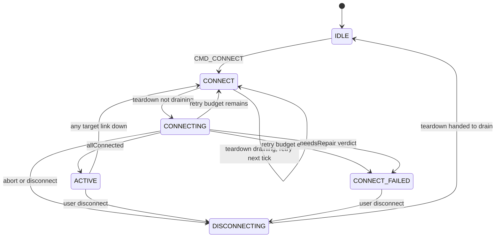

Evidence: `furble-source` (`src/FurbleControl.cpp`, `include/FurbleControl.h`).

Notes that matter for every family:

- `STATE_ACTIVE` requires `m_Targets` to be non-empty. An empty selection is not
  vacuously connected (`Control::allConnected()`).
- `setState()` is the only place the light-sleep lock changes. `STATE_ACTIVE`
  holds `NO_LIGHT_SLEEP` unless `Settings::sleepConnEffective()` is true.
- `STATE_CONNECT_FAILED` is not retried. The only producer today is
  `needsRepair()`, which means the camera dropped its side of the bond.

### 1.2 Per-camera link attempt

`Camera::connect(power, timeout)` in `lib/furble/Camera.cpp` is the single entry
point. It holds `m_Mutex` for the whole attempt.

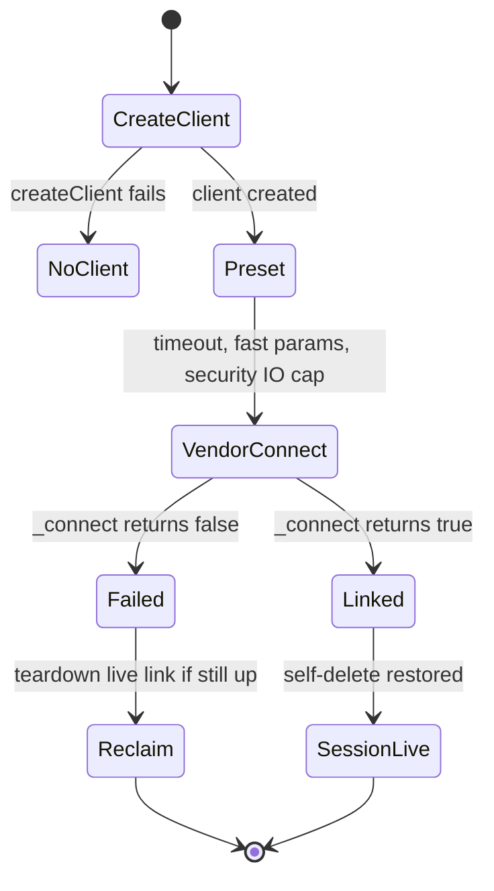

Facts that apply to every family:

| Item | Value | Evidence |
| :--- | :--- | :--- |
| Pre-connect interval | `BLE_GAP_INITIAL_CONN_ITVL_MIN` to `BLE_GAP_INITIAL_CONN_ITVL_MAX` | `furble-source` |
| Pre-connect latency | 1 | `furble-source` |
| Pre-connect supervision timeout | `2 * BLE_GAP_INITIAL_SUPERVISION_TIMEOUT` | `furble-source` |
| Security request | bond, MITM, secure connections all true, then per-camera IO capability | `furble-source` |
| Default IO capability | `BLE_HS_IO_DISPLAY_YESNO` | `furble-source` |
| Per-attempt cancel token | `m_ConnectCancelled`, polled by long vendor waits | `furble-source` |
| Cancel wake for a blocked NimBLE call | `abortBlockingConnect()` terminates the in-flight client's link | `furble-source` |
| Connect timeout | caller supplies; `Control` passes 30 s, or 5 s in infinite-reconnect mode | `furble-source` |
| Failure teardown | live link is disconnected, then the client is either armed for delete-on-disconnect or freed with `deleteClient()` | `furble-source` |

### 1.3 Link profile: active, idle, peer

`Camera::ConnProfile` has `FAST`, `IDLE`, `PEER`. The experimental connection
saver moves a live link between them.

| Profile | Interval | Latency | Supervision | Requested when |
| :--- | :--- | :--- | :--- | :--- |
| `FAST` | `BLE_GAP_INITIAL_CONN_ITVL_MIN` to `MAX` | 1 | `2 * BLE_GAP_INITIAL_SUPERVISION_TIMEOUT` | connect, first shutter or focus press after quiet, explicit re-enable |
| `IDLE` | 200 to 240 (250 to 300 ms) | 0 | 700 (7 s) | 10 s without activity, saver enabled, shutter not held, no peer override, no connect in progress |
| `PEER` | whatever the camera asked for | peer | peer | reported only; the peer override is accepted except for an over-cap supervision timeout |

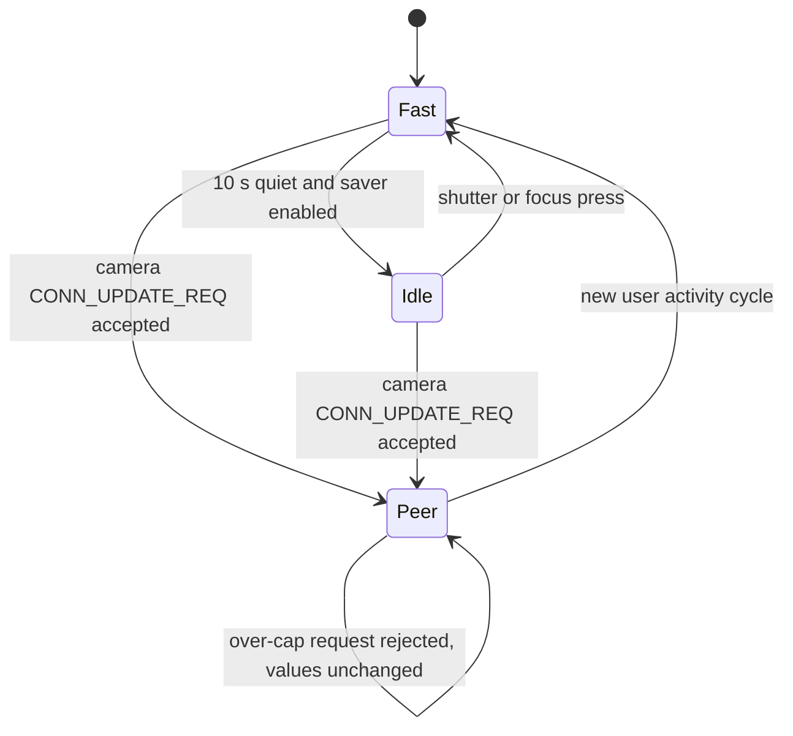

Evidence: `furble-source` (`Camera::maybeSetIdle`, `setConnProfile`,
`onConnParamsUpdateRequest`).

Guard rails worth stating:

- The idle profile is never requested while a connect is in progress
  (`m_ConnectInProgress`). Discovery and subscriptions at a 250 ms to 300 ms
  interval stretch a 2 s connect into minutes.
- A peer supervision timeout above 700 is rejected in steady state, because the
  supervision timeout is also the dead-link detector. The single exception is
  the Fujifilm Secure registration window.
- `confirmFujifilmSecureFastProfile()` requires the exact FAST values, not any
  value under the cap.

### 1.4 Capture command path

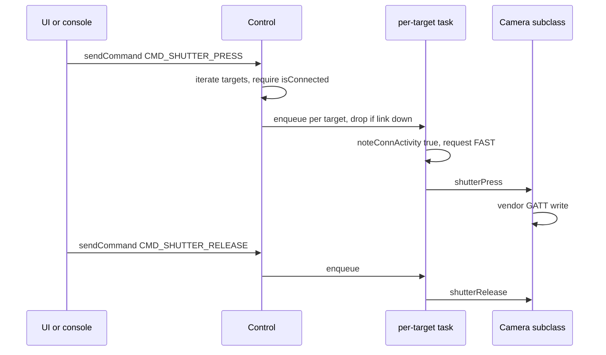

Evidence: `furble-source` (`Control::sendCommand`, `Control::Target::task`).

Consequences, all of them deliberate:

- A press issued while a target link is down is dropped for that target. It is
  never buffered and replayed after reconnect.
- A camera that is still connected in a multi-camera session keeps firing while
  another target reconnects.
- `CMD_DISCONNECT` is never dropped. It resets the target queue and goes to the
  front.
- The per-target task's 50 ms `CMD_ERROR` tick is reused as the idle-profile
  timer and the connection-statistics sampler.

### 1.5 Reconnect and backoff

`connectAll()` retries when the cycle is infinite, or while fewer than two
consecutive cycles have failed. The delay comes from
`ReconnectBackoff::delayMs(attempt, backoffEnabled)`:

| Attempt | Delay with backoff off | Delay with backoff on |
| :--- | :--- | :--- |
| 0 | 2500 ms | 2500 ms |
| 1 | 5000 ms | 10000 ms |
| 2 | 5000 ms | 20000 ms |
| 3 | 5000 ms | 40000 ms |
| 4 | 5000 ms | 80000 ms |
| 5 and later | 5000 ms | 120000 ms cap |

The wait is sliced at 100 ms so a disconnect request interrupts it. Evidence:
`furble-source` (`include/FurbleReconnectBackoff.h`, `Control::connectAll()`).

### 1.6 Disconnect, drain, reclaim

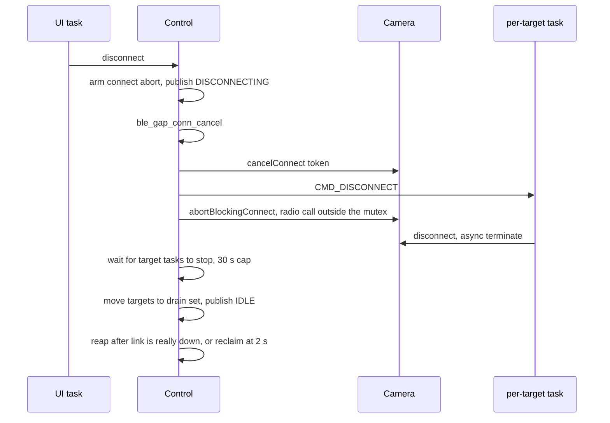

Evidence: `furble-source` (`Control::disconnect`, `reapZombieTargets`,
`Camera::reclaimClient`).

Why this is a state machine and not a call: `ble_gap_terminate` is asynchronous.
A live peer clears `isConnected()` through `onDisconnect`, which also self-deletes
the client. A powered-off or out-of-range peer may never fire `onDisconnect`, so
the drain set reclaims the client at the 2 s bound and frees the target.

### 1.7 Timeout budget, all families

| Timer | Value | Where | Evidence |
| :--- | :--- | :--- | :--- |
| Control connect timeout, normal | 30000 ms | `Control::TIMEOUT_DEFAULT_MS` | `furble-source` |
| Control connect timeout, infinite reconnect | 5000 ms | `Control::TIMEOUT_INFINITE_MS` | `furble-source` |
| Interactive disconnect wait cap | 30000 ms | `Control::DISCONNECT_WAIT_MAX_MS` | `furble-source` |
| Disconnect wait slice | 20 ms | `Control::DISCONNECT_WAIT_SLICE_MS` | `furble-source` |
| Drain reclaim bound | 2000 ms | `Control::DISCONNECT_DRAIN_RECLAIM_MS` | `furble-source` |
| Link supervision, idle profile | 700 (7 s) | `Camera::m_IdleTimeout` | `furble-source` |
| Connection statistics sample | 1000 ms | `Camera::m_ConnStatsIntervalMs` | `furble-source` |
| Conn saver inactivity threshold | 10000 ms | `Camera::m_ConnSaverIdleMs` | `furble-source` |
| Connection parameter retry guard | 3000 ms, IDLE only | `Camera::m_ConnParamsUpdateGuardMs` | `furble-source` |
| GPS service tick | 1000 ms | `GPS::SERVICE_MS` | `furble-source` |

---

## 2. Fujifilm Basic

Class: `FujifilmBasic`, `Camera::Type::FUJIFILM_BASIC = 1`, base class
`Fujifilm`.

### 2.1 Connection and power state machine

Basic is the only Fujifilm profile that pairs with a rotating four-byte token
instead of an SMP bond plus registration handshake. It never scans on a saved
reconnect: it connects to the stored address directly.

Camera-side advertisement states, from the research notes:

| State | Advertised service | Manufacturer data | Evidence |
| :--- | :--- | :--- | :--- |
| Basic pairing | `AF854C2E-B214-458E-97E2-912C4ECF2CB8` or `117C4142-EDD4-4C77-8696-DD18EEBB770A` | `D8 04 02` plus 4-byte token | `public-source`, 7 bytes exactly |
| Connected | advertising stops | none | `public-source` |

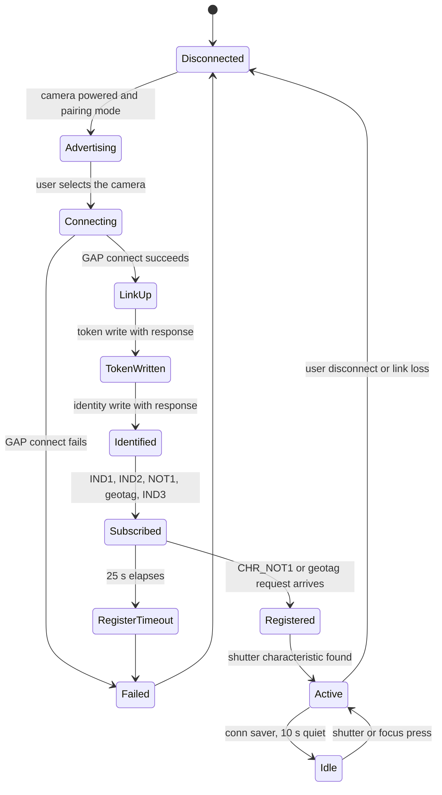

Implementation detail, `furble-source`:

| Step | Action | Progress |
| :--- | :--- | :--- |
| 1 | `m_Client->connect(m_Address)` | 10 to 20 |
| 2 | get `SVC_PAIR_UUID`, get `CHR_PAIR_UUID`, require writable | 20 |
| 3 | write 4-byte token with response | 30 |
| 4 | get `CHR_IDEN_UUID`, require writable, write `Device::getStringID()` with response | 40 |
| 5 | subscribe IND1 and IND2 as indications, unacknowledged CCCD | 50 |
| 6 | subscribe NOT1 as notification, unacknowledged | 60 to 70 |
| 7 | subscribe `GEOTAG_UPDATE` as notification, unacknowledged | 70 to 80 |
| 8 | subscribe IND3 as indication, unacknowledged | 80 |
| 9 | `waitForRegistration(85, cancelOnInactive)` | 85 |
| 10 | get shutter service and characteristic | 90 to 100 |

UUIDs, `furble-source`:

| Role | UUID |
| :--- | :--- |
| Pair service | `91F1DE68-DFF6-466E-8B65-FF13B0F16FB8` |
| Pair/token characteristic | `ABA356EB-9633-4E60-B73F-F52516DBD671` |
| Identity characteristic | `85B9163E-62D1-49FF-A6F5-054B4630D4A1` |
| Configuration service | `4C0020FE-F3B6-40DE-ACC9-77D129067B14` |
| IND1 | `A68E3F66-0FCC-4395-8D4C-AA980B5877FA` |
| IND2 | `BD17BA04-B76B-4892-A545-B73BA1F74DAE` |
| NOT1 | `F9150137-5D40-4801-A8DC-F7FC5B01DA50` |
| IND3 | `049EC406-EF75-4205-A390-08FE209C51F0` |
| Geotag request | `AD06C7B7-F41A-46F4-A29A-712055319122` |
| Shutter service | `6514EB81-4E8F-458D-AA2A-E691336CDFAC` |
| Shutter characteristic | `7FCF49C6-4FF0-4777-A03D-1A79166AF7A8` |
| Geotag payload | `3B46EC2B-48BA-41FD-B1B8-ED860B60D22B` / `0F36EC14-29E5-411A-A1B6-64EE8383F090` |

Advertisement parse, `furble-source` and `firmware-static`:

- Company ID `0x04D8` little-endian on the wire (`D8 04`).
- Type byte `0x02`.
- Exactly 7 bytes total. A different length fails `parseBasicAdvertisement()`.
- A Basic match also requires the advertised CR service or XApp service.

Critical closure: `91F1DE68` is absent from X100VI 1.31 and X-S20 3.30
(`firmware-static`), so Basic cannot pair with those two bodies. Basic support is
retained for older firmware only.

### 2.2 Camera mode state machine

Furble Basic exposes no mode read and no mode write. There is no Basic
characteristic in the `furble-source` path that reports capture, playback, menu,
or movie.

| Mode surface | Implemented | Evidence |
| :--- | :--- | :--- |
| Mode read | `N` | `furble-source` |
| Mode write | `N` | `furble-source` |
| Movie command | `N` | `furble-source` |
| Power control | `N` | `furble-source` |
| Menu or playback navigation | `N` | `furble-source` |

The firmware image does carry control surfaces that Furble does not use. They
are listed here so a future change has a starting point, and all of them are
`firmware-static` presence only, not reachability:

| Surface | UUID | Length | Evidence |
| :--- | :--- | :--- | :--- |
| Power control request | `43070F6C-51E0-4887-86A7-5F762BDA5791` | 2 | `firmware-static` |
| WiFi launch trigger | `600655E6-3637-42F1-8FB2-44EFC5C63B13` | 2 | `firmware-static` |
| Remote boot setting | `7170FD5A-56D9-4C19-B043-7A7047D8E1A0` | 2 | `firmware-static` |
| Power key state | `F90F7D3A-3B64-45C6-AB21-933900184837` | 2 | `firmware-static` |
| Camera vital state | `E6692C5C-B7CD-44F4-95FC-EDA07CE32560` | 2 | `firmware-static` |

Camera-side power key values reported in the ecosystem (not proven on a Basic
body in this corpus): `01 02` on and awake, `00 02` off, `01 01` asleep in
background, `00 01` switched off in background. Evidence: `hardware-capture` and
`public-source` per `docs/camera-research/fuji-canon-nikon.md`.

### 2.3 Capture state machine

`Fujifilm::sendShutterCommand()` is shared by Basic and Secure. It writes the
command frame and then the parameter frame, both with ATT response, only if the
shutter characteristic exists and `canWrite()`.

| Transition | Bytes | Status | Evidence |
| :--- | :--- | :--- | :--- |
| Press | `01 00` then `02 00` | `Y` | `app-static` corroborates for XApp and Camera Remote, `hardware-capture` for X100VI |
| Release | `01 00` then `00 00` | `Y` | `app-static`, `hardware-capture` |
| Focus press | `01 00` | `Y` | `firmware-static` parser accepts `1`; `app-static` |
| Focus release | `00 00` | `Y` | `firmware-static` parser accepts `0`; `app-static` |
| Bulb hold | press, wait, release | `P` | local hold; no BLE bulb opcode |
| Self-timer | no command | `N` | `furble-source` |
| Interval | orchestrated by UI, per-shot press and release | `P` | `furble-source` |
| Movie start or stop | no command | `N` | `furble-source` |
| Recording toggle | no command | `N` | `furble-source` |
| Capture status feedback | none | `N` | `furble-source` |

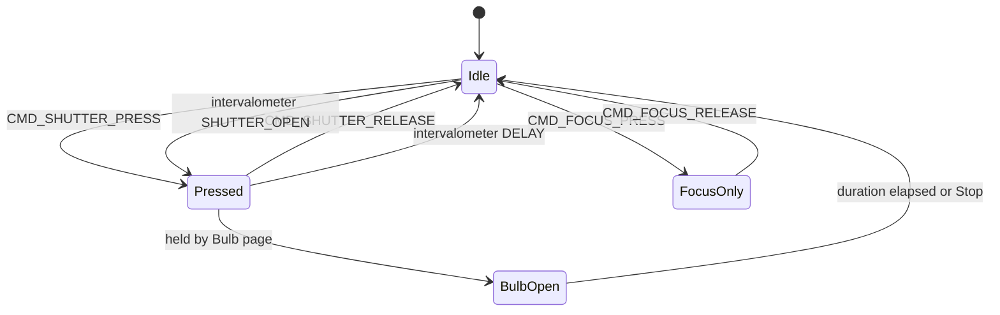

Bulb and interval are Furble-side state machines on top of the same pair of
writes. There is no distinct camera opcode for either, and the camera decides
whether a held press is a bulb exposure.

### 2.4 GPS and clock state machine

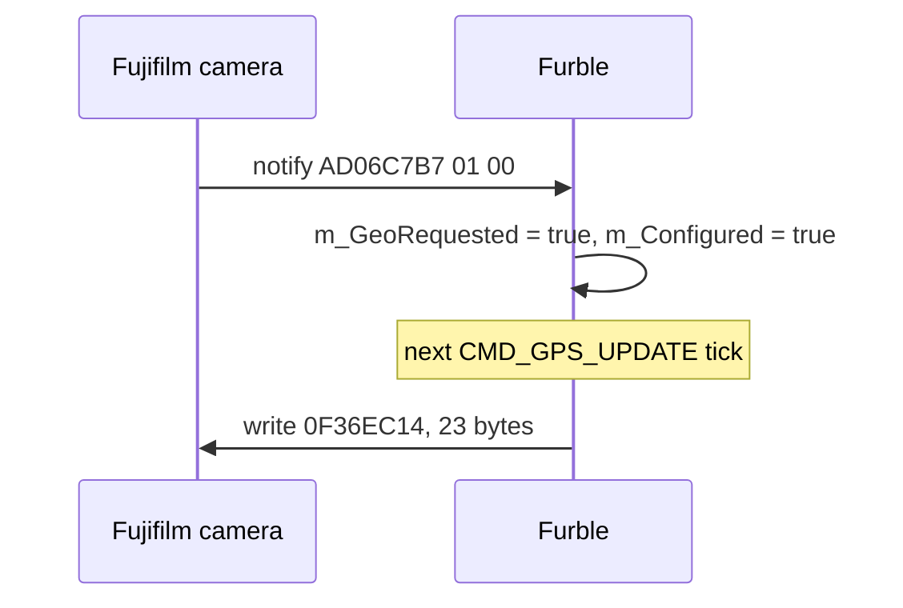

| Step | Action | Guard | Evidence |
| :--- | :--- | :--- | :--- |
| Enable | none; Basic has no enable characteristic write | n/a | `furble-source` |
| Geotag request | accept only `01 00` on `AD06C7B7` | `isGeotagRequest()` | `furble-source`, `hardware-capture` |
| Packet | 23 bytes; lat, lon, altitude int32 LE at 1e-7 or metres, year uint16 LE, month to second | camera asked | `furble-source`, `app-static` |
| Reserved bytes 12 to 15 | written zero (official apps write a speed field) | n/a | `app-static` |
| Clock request | `01 00` on NOT1 is treated as registration, not as a time request | n/a | `app-static` conflict, see below |
| Time packet | not sent | `N` | `furble-source` |
| Timezone and DST | not carried | `N` | `furble-source` |
| Retry | one write per request; no retry | n/a | `furble-source` |
| Sync interval | none for Basic; `GEOTAG_SYNC_INTERVAL` is a Secure-class write | n/a | `furble-source` |

The NOT1 conflict: `F9150137` `01 00` is used by official apps as a date or time
request, and by Furble as an operational registration confirmation. It is not a
proven registration flag. The 12-byte time packet on `C52EDBCE` and the 7-byte
local packet on `B9BFD37F` are the actual clock surfaces, and Furble sends
neither. Evidence: `app-static` plus `hardware-capture`, per
`docs/camera-research/fuji-canon-nikon.md`.

Geotag payload layout, `furble-source`:

| Offset | Field | Encoding |
| :--- | :--- | :--- |
| 0 to 3 | latitude | `int32(latitude * 10000000)`, little-endian |
| 4 to 7 | longitude | `int32(longitude * 10000000)`, little-endian |
| 8 to 11 | altitude | `int32(altitude)`, little-endian |
| 12 to 15 | speed | zero |
| 16 to 17 | year | `uint16`, little-endian |
| 18 | month | `uint8` |
| 19 | day | `uint8` |
| 20 | hour | `uint8` |
| 21 | minute | `uint8` |
| 22 | second | `uint8` |

### 2.5 Transfer and maintenance state machine

| Surface | Status | Notes | Evidence |
| :--- | :--- | :--- | :--- |
| Image transfer | `N` | `AF854C2E` is the Basic match service and also the Secure equipment-status and backup service | `furble-source`, `firmware-static` |
| Live view | `N` | WiFi, not BLE | `public-source` |
| Backup | `N` | `C922AC69`, `AC0C799A`, `68052E8A`, `2E27ED9F` exist on Secure firmware | `firmware-static` |
| Firmware update | `N` | `049EC406` is subscribed as IND3 but not used to start an update | `furble-source` |
| Paired device management | `P` | `CameraList::save`, `remove`, `deleteBond`, and the NVS index | `furble-source` |
| Battery read | `N` | no Basic path | `furble-source` |
| Storage read | `N` | no Basic path | `furble-source` |
| Model and serial read | `N` | Basic persists name, address, type, token only | `furble-source` |

### 2.6 Error and recovery state machine

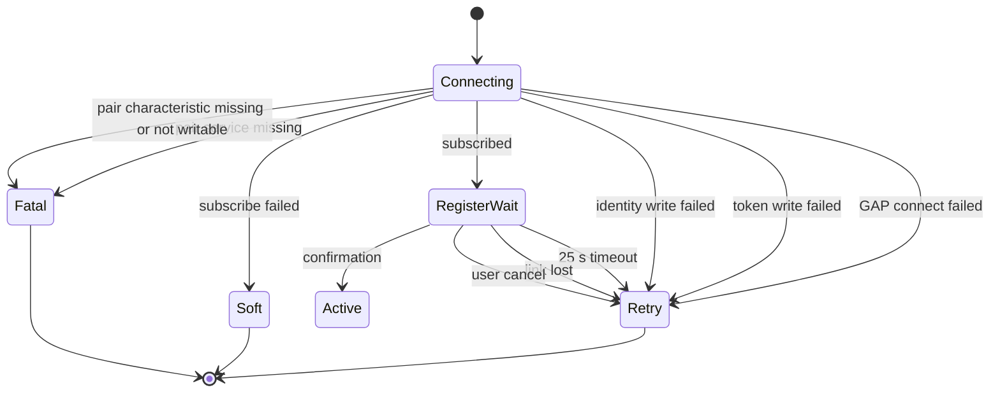

| Failure | Furble behavior | Evidence |
| :--- | :--- | :--- |
| GAP connect failure | return false, base reclaims the client | `furble-source` |
| `91F1DE68` absent | `getService` returns null, return false, no retry inside the class | `furble-source`, `firmware-static` |
| CCCD subscribe failure | fatal for Basic, return false | `furble-source` |
| Registration timeout | return false after 25000 ms, log asks for pairing mode | `furble-source` |
| User cancel during registration | return false within one 20 ms poll | `furble-source` |
| Link loss during registration | return false at the next 20 ms poll | `furble-source` |
| Stale bond | no Basic bond; token mismatch surfaces as a failed write | `furble-source` |
| ATT error code | not decoded; only the boolean write result | `furble-source` |

Basic has no stale-bond recovery, no security-failure counter, and no
`needsRepair()` verdict, because it does not use SMP bonding.

### 2.7 Transition table

| ID | Trigger | Guard or precondition | Action and bytes | Expected response | Timeout | Evidence |
| :--- | :--- | :--- | :--- | :--- | :--- | :--- |
| FB-01 | User selects a scanned Basic camera | Manufacturer data is 7 bytes, company `0x04D8`, type `0x02`, CR or XApp service advertised | construct `FujifilmBasic`, persist token | camera appears in the saved list | n/a | `furble-source`, `public-source` |
| FB-02 | Connect requested | target not already in `m_Targets` | `Camera::connect` presets fast parameters and DISPLAY_YESNO | link up | 30000 ms or 5000 ms | `furble-source` |
| FB-03 | Link up | none | `getService(91F1DE68)` | service object | n/a | `furble-source` |
| FB-04 | Service found | characteristic writable | write token, 4 bytes, with response | ATT write response | n/a | `furble-source` |
| FB-05 | Token accepted | characteristic writable | write identity string, with response | ATT write response | n/a | `furble-source` |
| FB-06 | Identified | IND1 and IND2 present | subscribe indications, unacknowledged CCCD | CCCD write sent | n/a | `furble-source` |
| FB-07 | Configured | NOT1 and geotag present | subscribe notifications, unacknowledged | CCCD write sent | n/a | `furble-source` |
| FB-08 | Awaiting registration | link up, not cancelled, attempt began active implies `isActive()` | poll `m_Configured` every 20 ms | `01 00` or `02 00` on NOT1 | 25000 ms | `furble-source`, `hardware-capture` |
| FB-09 | Registration confirmed | shutter service present | get shutter characteristic | characteristic object | n/a | `furble-source` |
| FB-10 | Shutter press | link up, characteristic writable | write `01 00`, then `02 00`, both with response | ATT write responses | n/a | `furble-source`, `app-static` |
| FB-11 | Shutter release | same | write `01 00`, then `00 00` | ATT write responses | n/a | `furble-source`, `app-static` |
| FB-12 | Focus press | same | write `01 00` | ATT write response | n/a | `firmware-static`, `app-static` |
| FB-12a | Focus release | same | write `00 00` | ATT write response | n/a | `firmware-static`, `app-static` |
| FB-13 | Geotag request | `01 00` on `AD06C7B7` | set `m_GeoRequested` | camera waits for a packet | up to the next GPS tick | `furble-source`, `hardware-capture` |
| FB-14 | GPS update tick | `m_GeoRequested` true, characteristic writable | write 23-byte geotag packet | ATT write response | n/a | `furble-source` |
| FB-15 | Disconnect | `m_Connected` true | `m_Client->disconnect()` | link down, `onDisconnect` clears state | supervision or immediate | `furble-source` |

### 2.8 Unknowns

1. Whether any Basic-only body in the supported list still exposes `91F1DE68`
   at its current firmware. No Basic image is in the corpus.
2. Whether `01 00` alone leaves the camera in a half-press state on every
   body. The parser accepts `1`, but only the full shutter sequence has app
   corroboration, and `03` is rejected.
3. What the camera does with a token that no longer matches, including the ATT
   status it returns and whether it drops the link.
4. The exact ATT status for a missing pair service, and whether the camera
   advertises a different service set when it has a stale Basic registration.
5. Whether bulb mode requires anything beyond a held press, and what the camera
   does if the release never arrives.
6. Whether a Basic body ever emits `02 00` on NOT1 as a registration flag.
7. The camera-side power key values on a Basic body specifically, as opposed to
   the Xiaomi and XApp captures in the research notes.

---

## 3. Fujifilm Secure

Class: `FujifilmSecure`, `Camera::Type::FUJIFILM_SECURE = 8`, base class
`Fujifilm`, also a `NimBLEScanCallbacks` for saved reconnects.

This is the firmware generation from the July 2025 security change: X100VI 1.30
and later, X-S20 3.30, X-E5 1.10 and later. Both audited images carry the same
70-entry UUID table, 13 services, 69 characteristics, 21 CCCDs, and the same
handles and maximum lengths (`firmware-static`).

### 3.1 Connection and power state machine

Camera-side advertising states, from `hardware-capture` on X100VI 1.32 and
`public-source` corroboration:

| State | Advertised service | Payload | Address |
| :--- | :--- | :--- | :--- |
| Unregistered | `A9D2B304-E8D6-4902-8336-352B772D7597` | `D8 04 01` plus 5 serial bytes | resolvable private address during registration |
| Pre-first-registration variant | `804DAA8E-FFEB-4AB3-8E75-6EDD7303208D` | 7 bytes described as `01`, serial, `00` | public address, layout `unknown` |
| Registered | `123D8F06-62A1-4935-9322-833C531EE225` plus serial | `D8 04 01` plus 5 serial bytes | resolvable private address |
| Connected | advertising stops | none | n/a |
| Disconnected, window open | as registered or unregistered | as above | as above |
| Window closed after link loss | advertising stops about 30 s after the drop | none | n/a |

Advertising duration after power-on is about 6 to 10 seconds on X100VI 1.32.
The camera does not advertise continuously while idle. That is a capture
observation for one model and firmware, not a rule for every Secure body.

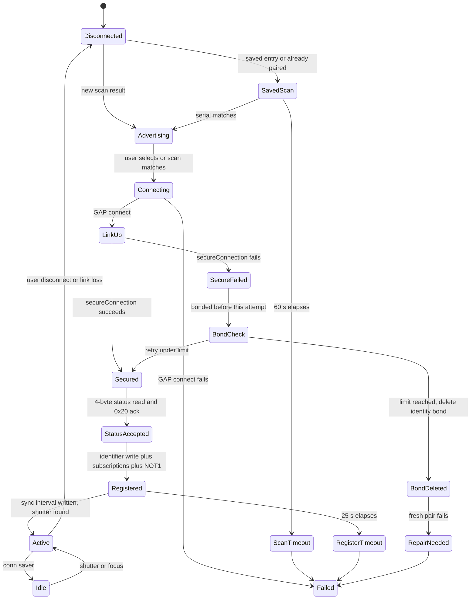

Sequence, fresh pairing:

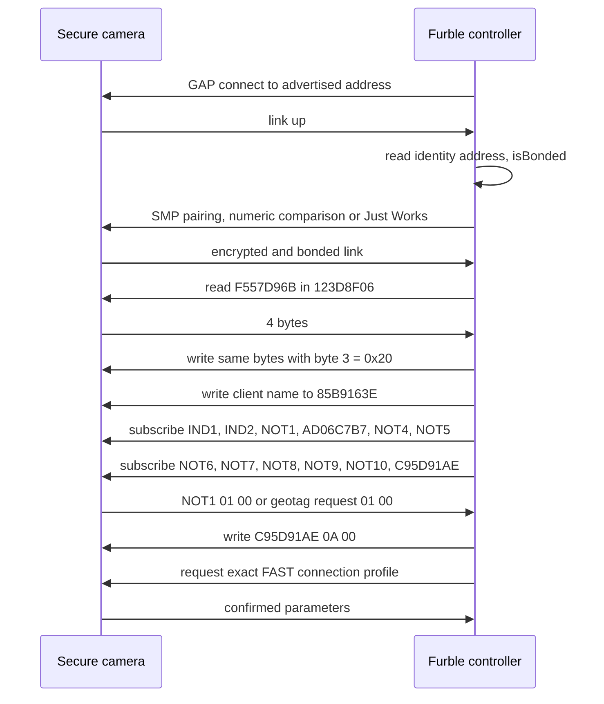

Sequence, saved reconnect with a stale bond:

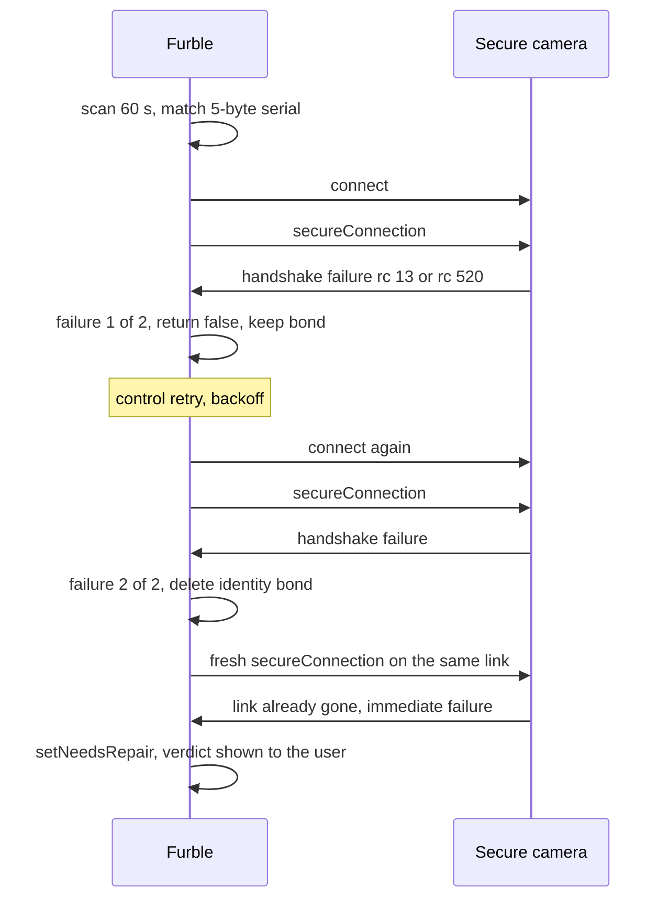

The exact failure shape matters: after the camera deleted its side of the bond,
the X100VI bench produced rc=13 (`0x0D`, operation timed out) after about 30 s,
or rc=520 (`0x208`, connection timeout) after about 5 s, with no refusal PDU.
Link state does not separate them, because rc=520 wakes the connect task with the
disconnect event still queued. Evidence: `hardware-capture` 2026-09-02 bench,
recorded in `lib/furble/FujifilmSecure.cpp` and `lib/furble/CLAUDE.md`.

Registration state values, `furble-source` plus captures:

| Signal | Payload | Furble meaning |
| :--- | :--- | :--- |
| `F9150137` NOT1 | `01 00` | registration confirmed, also a date or time request in official apps |
| `F9150137` NOT1 | `02 00` | legacy registration accepted, never seen on X100VI |
| `AD06C7B7` | `01 00` | send a geotag, and on a saved reconnect also confirms registration |
| `C95D91AE` | the written value | sync interval echo |
| `A68E3F66` IND1 | 2 bytes, first byte 0 busy, nonzero ready | AP or WiFi state |
| `BD17BA04` IND2 | 2 bytes | transfer state |
| `E6692C5C` NOT6 | 2 bytes | camera vital state |
| `049EC406` IND3 | 2 bytes | firmware update state |

Registration progress steps, `furble-source`:

| Step | Value | Note |
| :--- | :--- | :--- |
| scan | +5 | saved entry or `m_Paired` only |
| connect | +5 | |
| secured | +5 | after `secureConnection()` and `clearSecureFailures()` |
| status | +5 | read and ack |
| identified | +5 | identifier write |
| subscriptions | +5 each | 12 entries, failures non-fatal |
| registration wait | 85 | `waitForRegistration(85, cancelOnInactive)` |
| sync interval | +5 | `0A 00` |
| shutter service | +5 | |
| fast profile | 100 | only after the shutter characteristic exists |

### 3.2 Camera mode state machine

Furble Secure does not read or write a camera mode. The mode-bearing
characteristics exist in the image but are not on the Furble path.

| Mode surface | UUID | Furble status | Evidence |
| :--- | :--- | :--- | :--- |
| Power key state | `F90F7D3A-3B64-45C6-AB21-933900184837` | `N` | `firmware-static` |
| Remote boot setting | `7170FD5A-56D9-4C19-B043-7A7047D8E1A0` | `N`, not subscribed | `firmware-static` |
| Power control request | `43070F6C-51E0-4887-86A7-5F762BDA5791` | `N` | `firmware-static` |
| WiFi launch trigger | `600655E6-3637-42F1-8FB2-44EFC5C63B13` | `N` | `firmware-static` |
| Firmware update state | `049EC406-EF75-4205-A390-08FE209C51F0` | `P`, subscribed, not interpreted | `furble-source` |
| Disconnect reason | `7EDE1988-B27E-43FC-80F4-6FEC994F0552` | `N` | `firmware-static` |

Camera-side power key values reported in the ecosystem: `01 02` on and awake,
`00 02` off, `01 01` asleep in background, `00 01` switched off in background.
Evidence: `hardware-capture` and `public-source`. Writing `00 00` or `01 00` to
`7170FD5A` is reported to change the camera's CONNECT WHILE POWER OFF menu
setting, which is a camera setting write, not a wake command.

Mode legality for the commands Furble does send:

| Furble command | Legal in capture | Legal in playback | Legal in menu or movie | Evidence |
| :--- | :--- | :--- | :--- | :--- |
| Shutter `7FCF49C6` | reported working | not reported | not reported | `hardware-capture` on X100VI |
| Geotag `0F36EC14` | reported accepted | not reported | not reported | `hardware-capture`, `app-static` |
| Sync interval `C95D91AE` | accepted | not reported | not reported | `hardware-capture` |
| WiFi trigger `600655E6` | stayed busy in shooting mode | `04 00` worked in playback | not reported | `hardware-capture` on X100VI 1.32 |

The WiFi trigger row is the one documented mode-dependence: in shooting mode
IND1 stayed busy, in playback the sequence worked. Evidence: `hardware-capture`
reported in the ecosystem dossier (`petabyt/libfuji` issue 6).

### 3.3 Capture state machine

Same wire bytes as Basic. The Secure path additionally gates promotion to active
on registration, so a shutter write before confirmation is impossible through
`Control`.

| Transition | Bytes | Status | Evidence |
| :--- | :--- | :--- | :--- |
| Half-press or focus | `01 00` | `Y` | `firmware-static`; `app-static` |
| Focus release | `00 00` | `Y` | `firmware-static`; `app-static` |
| Full press | `01 00` then `02 00` | `Y` | `app-static`, `hardware-capture` |
| Release | `01 00` then `00 00` | `Y` | `app-static`, `hardware-capture` |
| Bulb hold | press, wait, release | `P` | local hold only |
| Self-timer | no command | `N` | `furble-source` |
| Interval | press and release per shot | `P` | `furble-source` |
| Movie start or stop | no command | `N` | `furble-source` |
| Recording toggle | no command | `N` | `furble-source` |
| Shutter discovery gate | service `6514EB81`, characteristic `7FCF49C6` | `Y` | `furble-source`, `firmware-static` |
| Capture status | none consumed | `N` | `furble-source` |

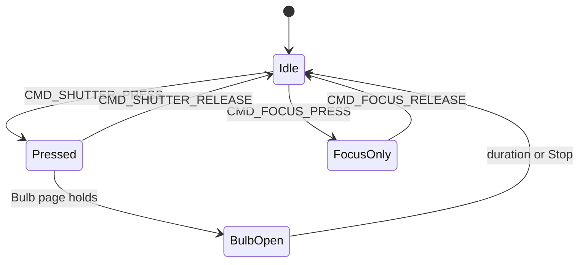

Capture is possible only after the whole registration state machine completes.
A GATT link plus successful ATT writes is explicitly not enough: `waitForRegistration`
exists to prevent a bare secure link from being promoted to an active shutter
target. Evidence: `furble-source` and `lib/furble/CLAUDE.md`.

### 3.4 GPS and clock state machine

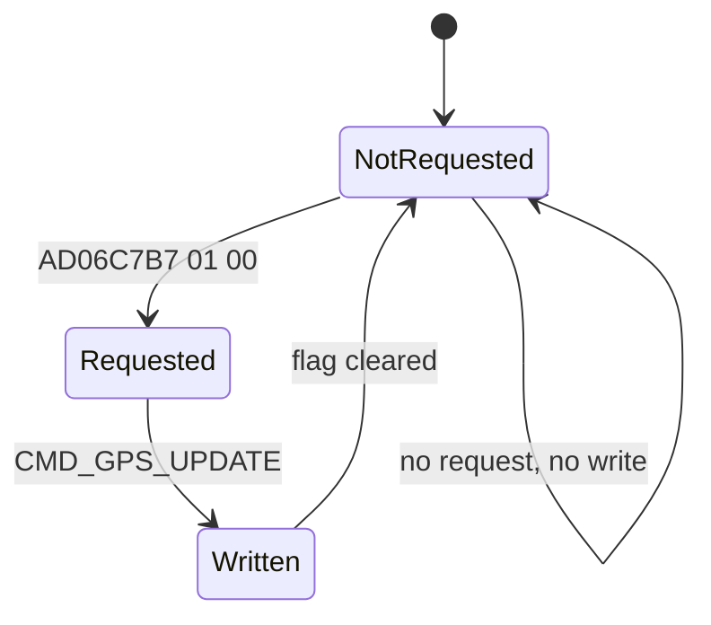

| Step | Action | Value | Evidence |
| :--- | :--- | :--- | :--- |
| Sync interval enable | write `C95D91AE` with response | `0A 00` (10 s, little-endian uint16) | `furble-source`, `app-static` |
| Supported interval values | camera accepts | 10, 15, 20, 30, 60, 120, 240, 480 seconds, plus disable | `firmware-static` |
| Geotag request | notification on `AD06C7B7` | `01 00` | `hardware-capture` |
| Geotag packet | write `0F36EC14` with response | 23 bytes | `furble-source`, `app-static` |
| Speed field | bytes 12 to 15 | zero, official apps write a value, unit unknown | `app-static` |
| Clock request | NOT1 `01 00` | treated as registration confirmation | `app-static` conflict |
| Time packet | write `C52EDBCE` | not implemented, 12 bytes per `app-static` | `firmware-static` length 12 |
| Local time packet | write `B9BFD37F` | not implemented, 7 bytes per `app-static` | `firmware-static` length 7 |
| Timezone and DST | 12-byte packet carries int32 offset and one DST flag | not implemented | `app-static` |
| Retry | one write per request, no retry, request flag cleared after write | n/a | `furble-source` |
| Stale fix | camera ignores non-newer timestamps and locations older than about 3 hours | not enforced by Furble | `public-source` |

The geotag request cadence is camera-driven. Furble writes the interval once per
connect, then answers each request. It does not poll and does not resend.

### 3.5 Transfer and maintenance state machine

| Surface | Furble status | Known surface | Evidence |
| :--- | :--- | :--- | :--- |
| Image transfer | `N` | `98934B2C` transfer setting ex, `CAEDB497` transfer setting, IND2 transfer state | `firmware-static`, `app-static` |
| Live view | `N` | camera WiFi AP, not BLE | `public-source` |
| Backup | `N` | `C922AC69` file info, `AC0C799A` file data, `68052E8A` mode, `2E27ED9F` notify | `firmware-static` |
| Firmware update | `N` | `049EC406` state, `UPDATE_BLE_FWUP` string in image | `firmware-static` |
| Paired device management | `P` | serial in NVS, `CameraList`, `deleteBond` on the identity address | `furble-source` |
| Battery read | `N` | none in the 70-entry table that Furble uses | `firmware-static` |
| Storage read | `N` | none | `firmware-static` |
| Lens identity | `N` | `68887A7A` name, `621A98D8` firmware version | `firmware-static` |
| Model identity | `N` | `A9D2B304` service, camera information characteristics | `firmware-static` |

The Secure path deliberately writes only one setting: the geotag sync interval.
Everything else in the 70-entry table is unused by Furble.

### 3.6 Error and recovery state machine

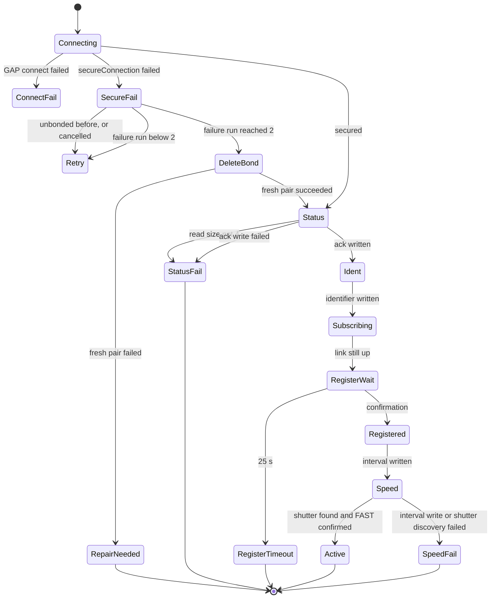

| Failure | Behavior | Evidence |
| :--- | :--- | :--- |
| GAP connect failure | return false, no security counter change | `furble-source` |
| Security failure, unbonded before | clear the failure run, return false | `furble-source` |
| Security failure, bonded before, first | log 1 of 2, return false, keep bond | `furble-source` |
| Security failure, bonded before, second | `deleteBond(identity address)`, clear run, one fresh `secureConnection()` | `furble-source` |
| Fresh pair fails | `setNeedsRepair()`, log asks for pairing mode, cycle ends in `STATE_CONNECT_FAILED` | `furble-source` |
| No identity address on the link | log warning, bond state unreadable this attempt, run resets | `furble-source` |
| Status read not 4 bytes | return false, log "Failed to request status" | `furble-source` |
| Status ack write fails | return false, log "Failed to write status response" | `furble-source` |
| Identifier write fails | return false | `furble-source` |
| Any subscribe fails | non-fatal, log and continue | `furble-source` |
| Registration timeout | return false, 25000 ms | `furble-source` |
| Link lost during handshake | abort at the next boundary check | `furble-source` |
| User cancel | abort at the next boundary check or 20 ms poll | `furble-source` |
| Sync interval write fails | return false | `furble-source` |
| Shutter service or characteristic missing | return false | `furble-source` |
| FAST profile request or confirm fails | return false, 1000 ms confirm window | `furble-source` |
| Peer supervision timeout above 700 during registration | accepted, exception is scoped to the identifier write and the handshake | `furble-source` |
| ATT error code | not decoded; only the boolean result and the NimBLE log line | `furble-source` |

The identity address rule is load-bearing: bond lookups and deletion use
`getConnInfo().getIdAddress()`, never the advertised address. A Secure body
advertises a resolvable private address, so `isBonded(advertised)` returns false
and the stale bond survives every recovery attempt. Evidence: `furble-source`
plus `lib/furble/CLAUDE.md`.

### 3.7 Transition table

| ID | Trigger | Guard or precondition | Action and bytes | Expected response | Timeout | Evidence |
| :--- | :--- | :--- | :--- | :--- | :--- | :--- |
| FS-01 | Saved reconnect requested | `PairType::SAVED` or `m_Paired` | reset queue, clear scan, start scan | advertisements | 60000 ms | `furble-source` |
| FS-02 | Advertisement during saved scan | 8-byte manufacturer data parses, advertises `123D8F06` or `A9D2B304`, serial matches | enqueue match | connect attempt proceeds | within scan window | `furble-source`, `hardware-capture` |
| FS-03 | Scan window ends | no match | log timeout, return false | n/a | 60000 ms | `furble-source` |
| FS-04 | GAP connect | not cancelled | `m_Client->connect(m_Address)` | link up | caller timeout | `furble-source` |
| FS-05 | Link up | none | read `getConnInfo().getIdAddress()`, `isBonded` | bond verdict | n/a | `furble-source` |
| FS-06 | Bonded before | not cancelled | `secureConnection()` | encrypted and bonded | NimBLE security timeout | `furble-source` |
| FS-07 | Security failure | bonded before, run below 2 | increment run, return false | retry by Control | n/a | `furble-source` |
| FS-08 | Security failure | bonded before, run reached 2 | `deleteBond(identity)` | keys removed, link terminated by unpair | n/a | `furble-source` |
| FS-09 | Bond deleted | link still up on a host whose unpair keeps it | `secureConnection()` once | success on such a host | n/a | `furble-source` |
| FS-10 | Fresh pair failed | none | `setNeedsRepair()` | `STATE_CONNECT_FAILED` with a re-pair prompt | n/a | `furble-source` |
| FS-11 | Secured | link up | read `F557D96B` in `123D8F06` | 4-byte status | n/a | `furble-source` |
| FS-12 | Status read | size is 4 | write first 3 bytes plus `0x20`, with response | ATT write response | n/a | `furble-source`, `app-static` |
| FS-13 | Status acked | link up | write identifier to `85B9163E`, with response | ATT write response | n/a | `furble-source`, `app-static` |
| FS-14 | Identified | none | subscribe IND1, IND2 with ATT response; NOT1, `AD06C7B7`, NOT4, NOT5 without | CCCD results | n/a | `furble-source` |
| FS-15 | First group done | none | subscribe NOT6, NOT7, NOT8, NOT9, NOT10, `C95D91AE` without | CCCD results, failures non-fatal | n/a | `furble-source` |
| FS-16 | Subscribed | link up, not cancelled | poll `m_Configured` | NOT1 `01 00` or geotag `01 00` | 25000 ms, poll 20 ms | `furble-source`, `hardware-capture` |
| FS-17 | Registration confirmed | link up | write `C95D91AE` = `0A 00`, with response | ATT write response, camera echoes | n/a | `furble-source`, `app-static` |
| FS-18 | Interval accepted | link up | get `6514EB81`, get `7FCF49C6` | characteristic object | n/a | `furble-source` |
| FS-19 | Shutter found | link up | request FAST profile and confirm exact values | confirmed parameters | 1000 ms, poll 10 ms | `furble-source` |
| FS-20 | Active | link up | shutter `01 00` then `02 00` | ATT write responses | n/a | `furble-source`, `app-static` |
| FS-21 | Active | link up | shutter `01 00` then `00 00` | ATT write responses | n/a | `furble-source`, `app-static` |
| FS-22 | Geotag request | `01 00` on `AD06C7B7` | set request flag and registration flag | next GPS tick writes 23 bytes | one GPS tick | `furble-source`, `hardware-capture` |
| FS-23 | User disconnect | `m_Connected` true | token set, `abortBlockingConnect`, vendor disconnect | link down | 30000 ms cap | `furble-source` |

### 3.8 Unknowns

1. Whether NOT1 `01 00` is registration acceptance, a time request, or both. The
   current gate cannot distinguish them without a capture that varies the two
   independently.
2. The exact content and the camera's acceptance window for the 12-byte time
   packet on `C52EDBCE`, including timezone and DST encoding.
3. Whether the 7-byte local time packet on `B9BFD37F` is ever required.
4. Whether the client name needs a NUL terminator. Furble writes UTF-8 without
   one; XApp appends `00`.
5. Whether the Secure advertisement type byte is always `0x01`. Furble does not
   validate it.
6. Per-characteristic security. The decoded table carries maximum lengths and a
   handle and type stream, not a per-attribute security bitmap.
7. Which optional subscriptions succeed on which body, and whether a failed CCCD
   write ever changes camera behaviour.
8. The unit and meaning of the geotag speed field in bytes 12 to 15.
9. The camera's behaviour when the registration write sequence is replayed on a
   stale session where the camera still holds the previous CCCDs.
10. The exact ATT status for a read of `F557D96B` with a wrong length.
11. Whether `43070F6C` power off and `0100` wake are accepted on X100VI 1.31 or
    X-S20 3.30, and what the camera does to its link.
12. The latency budget from identifier write to NOT1 on X-S20 3.30. The 12 s
    figure is an X100VI observation.

---

## 4. Ricoh GR III and GR IIIx

Class: `Ricoh`, `Camera::Type::RICOH = 9`. Furble does not have a generation
split, so this section and section 5 describe the same code with different
camera-side values.

Furble's own class documentation says GR IV only, and `docs/supported-hardware.md`
says GR III and GR IIIx are uncertified because power and WLAN behaviour differ.
The matcher still accepts them, because it matches service UUIDs and names.

### 4.1 Connection and power state machine

| Camera-side value | Characteristic | Meaning | Evidence |
| :--- | :--- | :--- | :--- |
| Power `0x00` | `B58CE84C-0666-4DE9-BEC8-2D27B27B3211` | off | `public-source`, `firmware-static` |
| Power `0x01` | same | on | same |
| Power `0x02` | same | sleep | same |
| Mode `0x00` | `1452335A-EC7F-4877-B8AB-0F72E18BB295` | capture | `firmware-static`, `public-source` |
| Mode `0x01` | same | playback | same |
| Mode `0x02` | same | BLE startup | same |
| Mode `0x03` | same | other | same |
| Mode `0x04` | same | power-off transfer | same |

Generation-specific observations that change the state machine:

| Observation | Model and firmware | Evidence |
| :--- | :--- | :--- |
| Camera Power reads `01` and Operation Mode reads `02` while the body is switched off | GR IIIx 1.41 | `hardware-capture` |
| A GATT connect appears to wake the camera, so a session cannot observe Off | GR IIIx 1.41 | `hardware-capture`, `inference` |
| A held link latches `BLE_STARTUP` for the life of the connection, even after the user powers on | GR IIIx 1.50 and 1.60 | `hardware-capture` |
| Operation Mode notify never fired across 161 s and 76 polls during a power-on event | GR IIIx 1.50 and 1.60 | `hardware-capture` |
| A fresh reconnect after power-on reads `CAPTURE`; a new connection while asleep reads `BLE_STARTUP` | GR IIIx 1.50 and 1.60 | `hardware-capture` |
| At about an 8 s reconnect cadence, detection works with about 9 s latency; at 2 s the camera stays in BLE_STARTUP and links fail with reason 534 (`0x216`) | GR IIIx | `hardware-capture` |
| Power `01`, Mode `03` OTHER on the first post-pairing read, then `00` CAPTURE later in the same session | GR IIIx 1.60 | `hardware-capture` |
| Power `01`, Mode `00` when ready, `03` OTHER during normal shutdown, Power notify `00` works | GR III 2.00 | `hardware-capture` |
| A GR IIIx body advertises while switched off when BLE Enable Condition is On anytime, and a GATT connect wakes it; reconnecting after power-off reads Power `01` and Mode `02` | GR IIIx | `hardware-capture` |

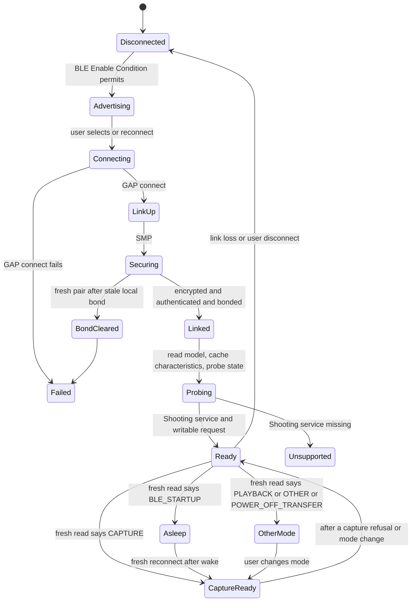

Ricoh is the only family where Furble actively refuses a capture based on a
fresh camera mode read. Everything else either has no mode surface or trusts the
user.

### 4.2 Camera mode state machine

`Ricoh::captureAllowed()` performs a fresh read of `1452335A` on every press. The
cached `m_LastOperationMode` is diagnostic only and is never consulted, because
a held connection can latch a stale value for its whole lifetime.

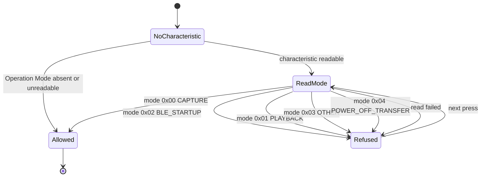

Command legality, per mode:

| Command | CAPTURE `0x00` | PLAYBACK `0x01` | BLE_STARTUP `0x02` | OTHER `0x03` | POWER_OFF_TRANSFER `0x04` | Evidence |
| :--- | :--- | :--- | :--- | :--- | :--- | :--- |
| Drive Mode `B29E6DE3` write | allowed | refused by Furble | refused | refused | refused | `furble-source` |
| Operation Request `{01 01}` | allowed | refused | refused | refused | refused | `furble-source` |
| GPS Information write | attempted, not mode-gated | attempted | attempted | attempted | attempted | `furble-source` |
| GEO Tag enable write | attempted, first GPS write only | attempted | attempted | attempted | attempted | `furble-source` |
| OperationMode read | yes | yes | yes | yes | yes | `furble-source` |

The refusal is a Furble safety policy, not an official byte-level rule for every
generation. It exists because a GR IV in BLE standby keeps the link up and
reports Camera Power On while Operation Mode is BLE_STARTUP, and a capture write
in that state can cold boot the camera and wedge its firmware. Evidence:
`public-source` and the Furble source comment.

The CAPTURE-only rule is too strict for GR IIIx 1.60, which can report OTHER
while ready. A generation-specific allowlist of CAPTURE, PLAYBACK, and OTHER,
excluding BLE_STARTUP and POWER_OFF_TRANSFER, would match the public GR III
policy better. Evidence: `hardware-capture`, `inference`.

### 4.3 Capture state machine

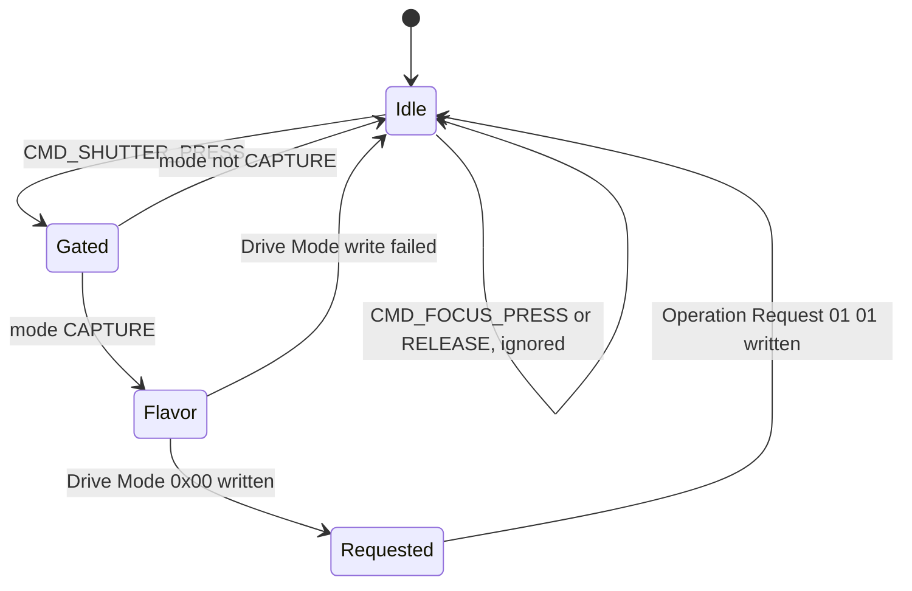

| Transition | Bytes | Status | Evidence |
| :--- | :--- | :--- | :--- |
| Drive Mode write | `00` to `B29E6DE3` | `Y` | `furble-source`, `app-static` |
| Start with autofocus | `01 01` to `559644B8` | `Y` | `furble-source`, `app-static`, `hardware-capture` |
| Start without autofocus | `01 00` | `N` in Furble | `public-source` |
| Stop | `02 00` | `N` in Furble, unused enum value | `furble-source`, `public-source` |
| Half-press | none | `N` | `furble-source` |
| Shutter release | ignored, single-write capture | `N` by design | `furble-source` |
| Focus release | ignored | `N` by design | `furble-source` |
| Bulb hold | not supported, no camera opcode | `N` | `furble-source` |
| Self-timer 10 s | Drive Mode `1`, not used | `N` | `firmware-static`, `app-static` |
| Self-timer 2 s | Drive Mode `2`, enum exists, not used | `N` | `furble-source` |
| Interval | UI cadence, one Operation Request per shot | `P` | `furble-source` |
| Movie start | OperationCode 1 with a movie drive mode, not implemented | `N` | `inference` |
| Movie stop | `02 00`, not implemented | `N` | `public-source` |
| Capture status | subscribed, logged, not interpreted | `P` | `furble-source` |

Generation-specific shutter sequence, which a future split must implement:

| Generation | Sequence | Evidence |
| :--- | :--- | :--- |
| GR III and IIIx | Operation Request `{01 01}` alone. A Drive Mode pre-write can swallow the first shot. | `public-source`, `hardware-capture` |
| GR IV and HDF | Drive Mode `00`, then `{01 01}` | `hardware-capture` |
| Furble today | Drive Mode `00`, then `{01 01}` for every body the matcher accepts | `furble-source` |

Capture status fields, for a future confirmation path. `B5589C08` is read and
notify. The documented field meanings are `public-source` from
`dm-zharov/ricoh-gr-bluetooth-api`; the four-byte capture is confirmed on GR IIIx
1.41 and 1.60.

| Field | Values |
| :--- | :--- |
| Capturing | 0 not capturing, 1 capturing |
| Countdown | 0 none, 1 self-timer, 2 waiting |
| Still | 0 other, 1 continuous, 2 bracket, 3 multiple exposure, 4 interval, 5 interval composite |
| Movie | 0 other, 1 recording |
| Type3 state | 0 waiting, 1 pre-capture, 2 main capture |
| Type3 pre-capture result | 0 no error, 1 motion detection failure, 2 exposure time error |
| Astro tracking time | uint16 |

A valid confirmation requires a `Capturing=1` transition followed by a return to
0, and still needs a physical image or EXIF check for certification. Evidence:
`inference` from the capture field list plus the false-confirmation reports.

### 4.4 GPS and clock state machine

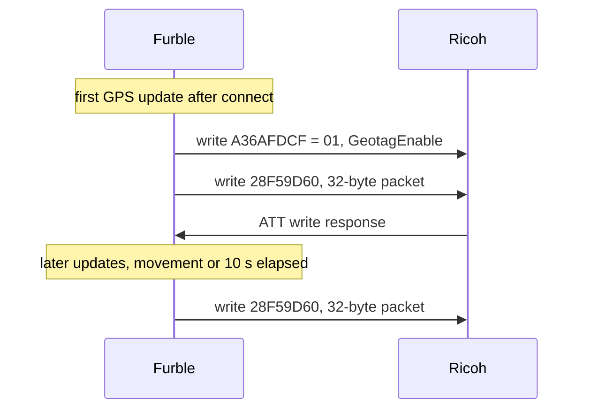

| Step | Action | Value | Evidence |
| :--- | :--- | :--- | :--- |
| Location enable | write `A36AFDCF` | `01`, once, before the first packet | `furble-source`, `app-static` |
| Enable disable value | write `A36AFDCF` | `00`, unused by Furble | `public-source` |
| Packet characteristic | write `28F59D60` in `84A0DD62` | 32 bytes | `furble-source`, `firmware-static` |
| Latitude, longitude, altitude | three byte-swapped float64 | big-endian on the wire | `firmware-static` |
| Year | little-endian uint16 | `year_lsb`, `year_msb` | `firmware-static` |
| Month to second | one byte each | UTC | `firmware-static` |
| Final byte | WGS84 datum selector | `0` | `app-static`, `firmware-static` |
| Validation | finite coordinates and altitude, year 2000 to 2099, month 1 to 12, day 1 to 31, hour at most 23, minute at most 59, second at most 60, centisecond at most 99 | reject otherwise | `furble-source` |
| Movement threshold | 0.00001 degrees or 1.0 m altitude | skip unchanged fixes | `furble-source` |
| Minimum interval | 10000 ms | skip faster updates | `furble-source` |
| Retry | none; a failed write leaves `m_HasGpsWrite` false so the next tick retries | n/a | `furble-source` |
| Clock request | no clock characteristic used | `N` | `furble-source` |
| Timezone and DST | not carried in this packet | `N` | `app-static` |
| Read back | Furble does not read GPS Information | `N` | `furble-source` |

The final byte was previously written as a centisecond. It is the WGS84 datum
selector, and both official apps write `0`. That is the single most important
Ricoh payload correction in this tree. Evidence: `app-static`, `firmware-static`.

### 4.5 Transfer and maintenance state machine

| Surface | Furble status | Known surface | Evidence |
| :--- | :--- | :--- | :--- |
| Image transfer | `N` | WiFi AP and HTTP `/v1/photos` | `public-source` |
| Live view | `N` | WiFi and HTTP `/v1/liveview` | `public-source` |
| WiFi wake | `N` | Network Type `9111CDD0`, value `1`; GR III 1.92 and 2.10 rejected with application error `0x80` | `hardware-capture` |
| Clock sync | `N` | Image Sync exposes date and time, not implemented in Furble | `app-static` |
| Firmware update | `N` | `FirmwareUpdateStart`, `FirmwareUpdateResult` strings | `firmware-static` |
| Paired device management | `P` | `FE3A32F8` Paired Device Name exists, never written | `furble-source`, `firmware-static` |
| Battery read | `N` | none in the BLE path | `firmware-static` |
| Storage read | `N` | none in the BLE path | `firmware-static` |
| Model read | `Y` | `35FE6272` read during connect, replaces the advertised name | `furble-source` |

The Paired Device Name write is a missing low-risk surface: the characteristic is
write-only and named, and the official apps use it, but Furble does not.

### 4.6 Error and recovery state machine

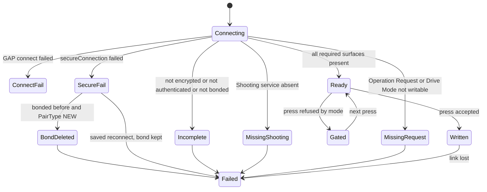

| Failure | Behavior | Evidence |
| :--- | :--- | :--- |
| GAP connect failure | return false | `furble-source` |
| Security failure, fresh pairing, bond existed | `deleteBond(advertised address)`, return false so the next bounded retry can do numeric comparison | `furble-source` |
| Security failure, saved reconnect | keep the bond, return false | `furble-source` |
| Link not encrypted, authenticated, and bonded | log "secure link incomplete", return false | `furble-source` |
| Camera service missing | log, continue, power and mode pointers stay null | `furble-source` |
| Shooting service missing | return false | `furble-source` |
| Operation Request missing or not writable | return false | `furble-source` |
| Drive Mode missing or not writable | return false | `furble-source` |
| GPS service missing | log, continue, GPS writes skipped | `furble-source` |
| Bluetooth Control service missing | log, continue | `furble-source` |
| Mode read failed | refuse capture, log | `furble-source` |
| Drive Mode write failed | skip Operation Request | `furble-source` |
| Operation Request write failed | log, no retry | `furble-source` |
| GPS write failed | leave the last-write state clean so the next tick retries | `furble-source` |
| Disconnect reason `0x208`, `0x213`, `0x215`, `0x216`, `0x20A`, `0x218` | not interpreted; the link layer reports it, Furble does not classify it | `hardware-capture`, `unknown` |
| Passkey display or entry | inject or return `123456`, auto-confirm numeric comparison | `furble-source`, `public-source` |

The fixed `123456` fallback is a documented compatibility and security risk. GR
III and IIIx display a camera-side code, and GR IV firmware exposes
numeric-comparison confirmation. The official apps rely on the Android bond and
the camera prompt, not a fixed passkey. Evidence: `app-static`, `firmware-static`,
`hardware-capture`.

### 4.7 Transition table, GR III and GR IIIx

| ID | Trigger | Guard or precondition | Action and bytes | Expected response | Timeout | Evidence |
| :--- | :--- | :--- | :--- | :--- | :--- | :--- |
| R3-01 | Scan match | advertises `9A5ED1C5`, `4B445988`, `9F00F387`, `0F291746`, or a Ricoh-like name | construct `Ricoh` | saved or connectable entry | n/a | `furble-source` |
| R3-02 | Connect | not cancelled | GAP connect to the stored address | link up | caller timeout | `furble-source` |
| R3-03 | Link up | bond may exist | `secureConnection()`, IO capability keyboard and display | encrypted, authenticated, bonded | NimBLE security timeout | `furble-source` |
| R3-04 | Security failed | fresh pairing and bonded before | `deleteBond(advertised)` | local key removed | n/a | `furble-source` |
| R3-05 | Security failed | saved reconnect | keep bond, return false | Control retry | n/a | `furble-source` |
| R3-06 | Secured | none | verify encrypted, authenticated, bonded | pass or fail | n/a | `furble-source` |
| R3-07 | Secured | Camera Information service present | read `35FE6272` | model string, replaces name | n/a | `furble-source` |
| R3-08 | Model read | Camera service present | cache Power, Operation Mode, GEO Tag pointers | pointers set or null | n/a | `furble-source` |
| R3-09 | Shooting service | present | cache Drive Mode, Operation Request, Capture Status, Self Timer | Operations Request and Drive Mode must be writable | n/a | `furble-source` |
| R3-10 | Shooting ready | GPS service present | cache GPS Information | pointer | n/a | `furble-source` |
| R3-11 | Ready | compatible body | read Power, Mode, Drive Mode, Operation Request, Capture Status, Self Timer, GPS, GEO Tag, Paired Device Name | log values, no policy | n/a | `furble-source` |
| R3-12 | Ready | characteristic notifies | subscribe Capture Status, Self Timer, Power, Operation Mode | notifications update the diagnostic cache | n/a | `furble-source` |
| R3-13 | Shutter press | connected | fresh read of `1452335A` | mode byte | n/a | `furble-source` |
| R3-14 | Shutter press | mode is not `0x00` | refuse, log `BLE_STARTUP` or the mode name | no write | n/a | `furble-source` |
| R3-15 | Shutter press | mode is `0x00`, Drive Mode writable | write `00` to `B29E6DE3` | ATT write response | n/a | `furble-source` |
| R3-16 | Drive Mode written | Operation Request present | write `01 01` to `559644B8` | ATT write response | n/a | `furble-source` |
| R3-17 | Shutter release | any | log ignored, no write | n/a | n/a | `furble-source` |
| R3-18 | Focus press or release | any | log ignored, no write | n/a | n/a | `furble-source` |
| R3-19 | First GPS update | connected, characteristic writable | write `01` to `A36AFDCF` | ATT write response | n/a | `furble-source`, `app-static` |
| R3-20 | GPS update | moved or 10 s elapsed, valid fields | write 32 bytes to `28F59D60`, datum `0` | ATT write response | n/a | `furble-source`, `app-static`, `firmware-static` |
| R3-21 | Link drop | reason not interpreted | Control returns to `STATE_CONNECT`, backoff | reconnect attempt | 2500 ms first, then 5 s | `furble-source` |

### 4.8 Unknowns, GR III and GR IIIx

1. Exact GATT properties, CCCD requirements, and handles per firmware. The UUIDs
   are shared with GR IV; properties and generation-specific state are not
   proven by UUID presence.
2. Exact SMP association per generation: passkey direction, numeric comparison,
   bond persistence, key size, and behaviour on a camera-side bond reset.
3. Whether Operation Mode `0x03` OTHER means ready or shutting down, and whether
   it is ever stable.
4. Whether Operation Mode notify fires at all on GR IIIx 1.60. A fresh reconnect
   appears to be the only reliable re-sample.
5. The reconnect cadence that avoids a latched BLE_STARTUP on GR IIIx, including
   whether 8 s is generally safe.
6. Whether the Drive Mode pre-write is harmful on every GR III body or only the
   ones that reported a swallowed first shot.
7. Exact capture status bytes and CCCD requirements, and whether `Capturing=1`
   is reliable.
8. The `0x80` application error on Network Type: universal, state-dependent, or
   an official-app session requirement.
9. Whether the fixed `123456` fallback is ever the real camera-side code.
10. Whether GR III exposes the same power-off standby that GR IV documents.

---

## 5. Ricoh GR IV and GR IV HDF

Same class and same UUID set as section 4. The differences are camera-side
behaviour, not wire format.

### 5.1 Connection and power state machine

| Observation | Model and firmware | Evidence |
| :--- | :--- | :--- |
| BLE standby reports Power `01` and Mode `02` BLE_STARTUP | GR IV | `public-source`, `hardware-capture` |
| A capture write in BLE standby can cold boot the camera, extend the lens, and wedge the firmware | GR IV | `public-source` |
| `Connection While Power Off` On keeps the camera in standby and lets GR WORLD turn it on; Off ignores app signals | GR IV and HDF 1.20 | `public-source` (vendor) |
| GR IV firmware exposes numeric-comparison confirmation APIs | GR IV 1.20 | `firmware-static` |
| GR IV uses an NXP `nw61x` combo instead of the GR III Broadcom part | GR IV 1.20 | `firmware-static` |
| GR IV fixed handle profile uses `0x00EB` power state and `0x00EC` CCCD | GR IV | `public-source` |

```mermaid
stateDiagram-v2
  [*] --> Off
  Off --> Standby: Connection While Power Off is On
  Off --> Off: Connection While Power Off is Off, app ignored
  Standby --> Advertising: BLE layer up
  Advertising --> Connecting: GR WORLD or Furble connects
  Connecting --> LinkUp
  LinkUp --> Secured: numeric comparison or Just Works
  Secured --> Ready: mode read says CAPTURE
  Secured --> Asleep: mode read says BLE_STARTUP
  Asleep --> Woken: fresh reconnect after power on
  Woken --> Ready
  Ready --> Capture: capture allowed
  Ready --> Off: user powers off, reason 0x215 candidate
  Capture --> Ready
```

The distinction from GR III is that GR IV can genuinely be off while the BLE
layer answers, so Camera Power `01` is even less usable as a body-power sensor.
Evidence: `public-source`, `inference`.

### 5.2 Camera mode state machine

Identical values to section 4.1. The generation-specific rule that matters:

| Furble command | CAPTURE | PLAYBACK | BLE_STARTUP | OTHER | POWER_OFF_TRANSFER |
| :--- | :--- | :--- | :--- | :--- | :--- |
| Drive Mode write | allowed | refused | refused | refused | refused |
| Operation Request | allowed | refused | refused | refused | refused |
| GPS write | attempted | attempted | attempted | attempted | attempted |

Refusal in BLE_STARTUP is the firmware-wedge guard. It is safe on GR IV and a
compatibility cost on GR IIIx. Evidence: `furble-source` plus `public-source`
for the wedge report.

Mode-list characteristic `430B80A3-CC2E-4EC2-AACD-08610281FF38` exists and can
report permitted modes. GR IIIx 1.41 read `02 00 01 00 00 00`, which could be
modes 0 and 1 followed by terminators. Furble does not use it. Evidence:
`hardware-capture`, `unknown`.

### 5.3 Capture state machine

Same two writes as section 4.3, and GR IV is the generation those writes were
verified on:

| Transition | Bytes | Status | Evidence |
| :--- | :--- | :--- | :--- |
| Drive Mode write | `00` to `B29E6DE3` | `Y` | `hardware-capture`, `public-source` |
| Start with autofocus | `01 01` to `559644B8` | `Y` | `hardware-capture`, `app-static` |
| Release | none | `N` by design | `furble-source` |
| Focus | none | `N` by design | `furble-source` |
| Movie | Drive Mode plus Operation Request, not implemented | `N` | `inference` |
| Self-timer 2 s | Drive Mode `2`, unused | `N` | `furble-source` |
| Capture status | subscribed, not interpreted | `P` | `furble-source` |

```mermaid
sequenceDiagram
  participant F as Furble
  participant Cam as GR IV
  F->>Cam: read 1452335A Operation Mode
  Cam->>F: 00 CAPTURE
  F->>Cam: write B29E6DE3 00
  F->>Cam: write 559644B8 01 01
  Cam->>Cam: autofocus then expose
  Cam->>F: notify B5589C08 capturing transitions
```

### 5.4 GPS and clock state machine

Identical to section 4.4. GR IV adds no clock characteristic on the Furble path,
and the 32-byte packet with datum `0` is shared. Evidence: `firmware-static`
confirms the same parse in both images.

### 5.5 Transfer and maintenance state machine

| Surface | Furble status | Known GR IV surface | Evidence |
| :--- | :--- | :--- | :--- |
| Image transfer | `N` | WiFi and HTTP, GR WORLD | `public-source` |
| Live view | `N` | WiFi | `public-source` |
| WiFi wake | `N` | WLAN Control `F37F568F`, Network Type `9111CDD0` | `firmware-static` |
| Clock sync | `N` | GR WORLD exposes it; no BLE write in Furble | `app-static` |
| Firmware update | `N` | GR WORLD exposes it | `public-source` |
| Paired device management | `P` | `FE3A32F8`, never written | `furble-source` |
| Model read | `Y` | `35FE6272` | `furble-source` |
| Battery read | `N` | no BLE path in Furble | `firmware-static` |
| Storage read | `N` | no BLE path in Furble | `firmware-static` |

### 5.6 Error and recovery state machine

Identical to section 4.6. GR IV-specific additions:

| Failure | Behavior | Evidence |
| :--- | :--- | :--- |
| Mode read says BLE_STARTUP | refuse capture, no write, no automatic reconnect | `furble-source`, `public-source` |
| Link stays latched in BLE_STARTUP | no recovery inside the session; a reconnect is required and Furble does not force one | `inference` |
| Stale local bond, fresh pairing | delete bond on the advertised address, rely on the next retry | `furble-source` |
| Stale bond, saved reconnect | keep bond, fail, let Control retry | `furble-source` |
| Numeric comparison prompt | auto-confirm with `injectConfirmPasskey(true)` | `furble-source` |
| Passkey display | return `123456` | `furble-source`, risk |
| Disconnect reason `0x215` | shutdown candidate, not acted on | `public-source` |

### 5.7 Transition table, GR IV and HDF

The rows are the same as R3-01 to R3-21 with these deltas:

| ID | Trigger | Guard or precondition | Action and bytes | Expected response | Timeout | Evidence |
| :--- | :--- | :--- | :--- | :--- | :--- | :--- |
| R4-01 | Camera off, Connection While Power Off On | camera setting enabled | camera stays in standby and advertises | connectable | n/a | `public-source` |
| R4-02 | Camera off, Connection While Power Off Off | camera setting disabled | camera ignores app signals | no connect | n/a | `public-source` |
| R4-03 | Shutter press in BLE_STARTUP | mode read is `0x02` | refuse, log "camera asleep" | no write, firmware protected | n/a | `furble-source` |
| R4-04 | Reconnect after user powers on | link down, camera advertising | new GATT session, fresh mode read | CAPTURE | scan or connect window | `hardware-capture` |
| R4-05 | Numeric comparison requested | camera sends the SMP prompt | `injectConfirmPasskey(true)` | bond completes | NimBLE security timeout | `furble-source`, `firmware-static` |
| R4-06 | First GPS update | connected | GEO Tag `A36AFDCF` = `01`, then 32-byte packet | ATT write response | n/a | `furble-source`, `app-static` |

### 5.8 Unknowns, GR IV and HDF

1. Whether `Connection While Power Off` is stored in the BLE Enable Condition
   characteristic, a separate camera property, or a daemon policy. No
   `ConnectionWhilePowerOff` string or class was found in `bled`.
2. Whether GR IV HAL and the non-HDF GR IV differ in standby, wake, or capture
   timing. They share the 1.20 image.
3. Exact disconnect reason mapping. `0x215` is a shutdown candidate, not proven.
4. Whether a held link ever leaves BLE_STARTUP without a reconnect.
5. Whether the GR IV GPS characteristic expects the same datum and speed variant
   as GR III.
6. Whether the mode-list characteristic can be used as a safe policy source.
7. Whether the camera accepts a Drive Mode write in PLAYBACK.
8. The ATT status the camera returns for a capture write in a refused mode.

---

## 6. Canon EOS Smart

Class: `CanonEOSSmart`, `Camera::Type::CANON_EOS_SMART = 2`, base
`CanonEOS`. Smart is the Camera Connect style profile. It supports GPS and has
no focus control.

### 6.1 Connection and power state machine

```mermaid
stateDiagram-v2
  [*] --> Disconnected
  Disconnected --> Advertising: camera in Smart pairing
  Advertising --> Connecting: user selects
  Connecting --> LinkUp: GAP connect
  Connecting --> Failed: GAP connect fails
  LinkUp --> Secured: NimBLE secure connection, Just Works
  Secured --> Ident1: prefix 01 plus name
  Ident1 --> Ident2: prefix 03 plus 16-byte UUID
  Ident2 --> Ident3: prefix 04 plus name
  Ident3 --> Ident4: prefix 05 plus 02
  Ident4 --> PairWait: subscribe pairing indication
  PairWait --> PairAccepted: indication 02
  PairWait --> PairRejected: indication 03
  PairWait --> PairTimeout: 60 s
  PairAccepted --> GeoSubscribed: location service and indication
  GeoSubscribed --> Committed: write 01 to CHR_IDEN
  Committed --> Active: mode 02 to CHR_MODE
  PairRejected --> BondDeleted: delete local bond
  BondDeleted --> Failed
  PairTimeout --> Failed
  Active --> Idle: conn saver
  Idle --> Active: shutter or focus
  Active --> Disconnected: link loss or user disconnect
```

Pairing result values, `furble-source`:

| Value | Constant | Meaning |
| :--- | :--- | :--- |
| `0x00` | none | no response yet |
| `0x02` | `PAIR_ACCEPT` | camera accepted |
| `0x03` | `PAIR_REJECT` | camera rejected |

A saved local bond is treated as acceptance before the connect
(`NimBLEDevice::isBonded(m_Address)` sets `PAIR_ACCEPT`). That is an inference
from bond presence, not a camera confirmation.

### 6.2 Camera mode state machine

Furble writes the mode once per connect and never reads it.

| Constant | Value | Used by Furble | Evidence |
| :--- | :--- | :--- | :--- |
| `MODE_PLAYBACK` | `0x01` | `N`, constant only | `furble-source` |
| `MODE_SHOOT` | `0x02` | `Y`, written once after the pair commit | `furble-source`, `public-source` |
| `MODE_WAKE` | `0x03` | `N`, constant only | `furble-source` |
| suspend | `0x05` | `N`, not present in code | `public-source` |

Mode characteristic is `00030010-0000-1000-0000-d8492fffa821` in service
`00030000-0000-1000-0000-d8492fffa821`. The write is unacknowledged
(`response = false`), so a successful call does not prove the camera applied it.

Command legality:

| Command | Shooting `0x02` | Playback `0x01` | Wake `0x03` | Suspend `0x05` |
| :--- | :--- | :--- | :--- | :--- |
| Shutter `00030030` | reported working | not reported | not reported | not reported |
| GPS `00040002` | reported accepted after enable | not reported | not reported | not reported |
| Mode write | yes | not used | not used | not used |

Evidence: `furble-source` for the path, `public-source` for the mode names.
Runtime legality per mode is `unknown`.

### 6.3 Capture state machine

```mermaid
stateDiagram-v2
  [*] --> Idle
  Idle --> Pressed: bytes 00 01, unacknowledged
  Pressed --> Idle: bytes 00 02, unacknowledged
  Idle --> Focused: bytes 00 03, unacknowledged
  Focused --> Idle: bytes 00 04, unacknowledged
```

| Transition | Bytes | Status | Evidence |
| :--- | :--- | :--- | :--- |
| Press | `00 01` to `00030030` | `Y` | `furble-source`, `public-source` |
| Release | `00 02` | `Y` | `furble-source`, `public-source` |
| Half-press or focus | `00 03` AF_ON and `00 04` AF_OFF | `Y`, app-static | `furble-source`, `app-static` |
| Bulb hold | press, wait, release | `P` | `public-source` documents BR-E1 bulb; Furble has no dedicated path |
| Self-timer | no command | `N` | `furble-source` |
| Interval | press and release per shot | `P` | `furble-source` |
| Movie start or stop | no command | `N` | `furble-source` |
| Recording toggle | no command | `N` | `furble-source` |
| Capture status | no subscription | `N` | `furble-source` |

Both writes are unacknowledged. There is no camera-side confirmation of any
kind, so "implemented" here means "a write is issued", not "the camera fired".

### 6.4 GPS and clock state machine

```mermaid
sequenceDiagram
  participant Cam as Canon
  participant F as Furble
  F->>Cam: subscribe indication 00040003
  Cam->>F: 03 GEO_REQUEST
  F->>Cam: write 01 to 00040002
  Cam->>F: 02 GEO_SUCCESS
  Note over F: m_GeoEnabled = true
  F->>Cam: write 20-byte location packet to 00040002
```

| Step | Action | Value | Evidence |
| :--- | :--- | :--- | :--- |
| Subscribe | indication `00040003` in `00040000` | acknowledge CCCD | `furble-source` |
| Request | camera indication `0x03` | write `{01}` to `00040002` | `furble-source` |
| Success | camera indication `0x02` | set `m_GeoEnabled` | `furble-source` |
| Packet header | byte 0 | `0x04` | `furble-source` |
| Latitude direction | byte 1 | `N` or `S` | `furble-source` |
| Latitude | bytes 2 to 5 | absolute float32 degrees | `furble-source` |
| Longitude direction | byte 6 | `E` or `W` | `furble-source` |
| Longitude | bytes 7 to 10 | absolute float32 degrees | `furble-source` |
| Elevation sign | byte 11 | `+` or `-` | `furble-source` |
| Elevation | bytes 12 to 15 | absolute float32 metres | `furble-source` |
| Timestamp | bytes 16 to 19 | uint32 seconds since the Unix epoch, from `mktime` | `furble-source` |
| Gating | updates only when `m_GeoEnabled` | otherwise no write | `furble-source` |
| Timezone and DST | `mktime` interprets the struct as local time, so the result depends on the runtime TZ | certification gap | `furble-source`, `inference` |
| Retry | none | n/a | `furble-source` |

`mktime` with `tm_isdst = -1` and zeroed `tm_wday` and `tm_yday` uses the host
timezone and DST rules. On a device whose TZ is unset this yields UTC; on one
with a TZ it yields local time. The camera expects seconds since the epoch, so
the correct behaviour is to treat the tuple as UTC and convert without a local
timezone. This is a certification gap, not a proven bug, until a capture in a
non-UTC timezone exists.

### 6.5 Transfer and maintenance state machine

| Surface | Furble status | Known surface | Evidence |
| :--- | :--- | :--- | :--- |
| Image transfer | `N` | Camera Connect handles it over WiFi | `public-source` |
| Live view | `N` | WiFi | `public-source` |
| Backup | `N` | none identified in the BLE path | `unknown` |
| Firmware update | `N` | none in the BLE path | `unknown` |
| Paired device management | `P` | `CameraList`, `deleteBond` on pair reject | `furble-source` |
| Battery read | `N` | none | `furble-source` |
| Storage read | `N` | none | `furble-source` |
| GPS enable state | `P` | in-memory only, re-negotiated every connect | `furble-source` |

### 6.6 Error and recovery state machine

| Failure | Behavior | Evidence |
| :--- | :--- | :--- |
| GAP connect failure | return false | `furble-source` |
| Security failure | return false, no bond deletion | `furble-source` |
| Pairing indication `0x03` | `deleteBond(m_Address)`, return false | `furble-source` |
| Pairing wait times out after 60 s | `m_PairResult` stays `0x00`, falls into the reject branch, deletes the bond, return false | `furble-source` |
| User cancel during the 60 s wait | return false at the next 1 s poll | `furble-source` |
| Mode write fails | return false | `furble-source` |
| Commit write `{01}` fails | return false | `furble-source` |
| Location service missing | connect still succeeds, GPS stays disabled | `furble-source` |
| Location indication missing | connect still succeeds, no GPS | `furble-source` |
| GPS request arrives | write `{01}` only if `m_Geo` exists and is writable | `furble-source` |
| Camera sleep or standby | no Furble keepalive, no wake command, reconnect relies on the link supervision timeout | `inference` |
| ATT error code | not decoded | `furble-source` |

The pairing wait is 60 s and `Camera::connect()` holds `m_Mutex` for all of it.
The cancel poll is what keeps an interactive disconnect bounded.

### 6.7 Transition table

| ID | Trigger | Guard or precondition | Action and bytes | Expected response | Timeout | Evidence |
| :--- | :--- | :--- | :--- | :--- | :--- | :--- |
| CS-01 | Scan match | advertised service `00010000-0000-1000-0000-d8492fffa821` | construct camera | entry in the list | n/a | `furble-source` |
| CS-02 | Connect | none | GAP connect | link up | caller timeout | `furble-source` |
| CS-03 | Link up | none | `secureConnection()` | encrypted link | NimBLE security timeout | `furble-source` |
| CS-04 | Secured | `canIndicate()` on `00010006` | subscribe pairing indication | CCCD write response | n/a | `furble-source` |
| CS-05 | Secured | always | write `01` plus name to `00010006`, unacknowledged | none | n/a | `furble-source` |
| CS-06 | Identified | always | write `03` plus 16-byte UUID to `0001000a` | none | n/a | `furble-source` |
| CS-07 | Identified | always | write `04` plus name to `0001000a` | none | n/a | `furble-source` |
| CS-08 | Identified | always | write `05 02` to `0001000a` | none | n/a | `furble-source` |
| CS-09 | Pair request sent | saved bond sets `PAIR_ACCEPT` before connect | poll `m_PairResult` every 1 s | `02` accept or `03` reject | 60000 ms | `furble-source` |
| CS-10 | Pair rejected | none | `deleteBond(m_Address)`, return false | bond removed | n/a | `furble-source` |
| CS-11 | Pair accepted | location service present | read `00040002`, subscribe `00040003` | indication subscription | n/a | `furble-source` |
| CS-12 | Geo subscribed | none | write `{01}` to `0001000a`, unacknowledged | none | n/a | `furble-source` |
| CS-13 | Committed | none | write `02` to `00030010`, unacknowledged | none | n/a | `furble-source` |
| CS-14 | Active | link up | write `00 01` to `00030030` | none | n/a | `furble-source` |
| CS-15 | Active | link up | write `00 02` to `00030030` | none | n/a | `furble-source` |
| CS-16 | Camera requests location | indication `03` on `00040003` | write `{01}` to `00040002` | none | n/a | `furble-source` |
| CS-17 | Camera confirms location | indication `02` | set `m_GeoEnabled` | GPS updates begin | n/a | `furble-source` |
| CS-18 | GPS update tick | `m_GeoEnabled`, characteristic writable | write 20-byte packet | ATT write response | n/a | `furble-source` |
| CS-19 | User disconnect | link up | `m_Client->disconnect()` | link down | supervision or immediate | `furble-source` |

The GPS rows CS-16 and CS-17 describe the current Furble code, not confirmed
camera behavior. Camera Connect 3.6.11.7 uses `00040001` read and notify for
the data request, answers with the 8-byte `05 00 ...` command, starts GPS with
8-byte `01` or `02`, and selects a source with `06`. The one-byte `{01}` write
and the `03` request interpretation are not app-corroborated. `app-static`.

### 6.8 Unknowns

1. Whether a saved local bond really implies camera acceptance, or whether a
   camera can hold a bond and still refuse the app.
2. Whether the pairing indication arrives as an indication or a notification on
   every body. `pairCallback` only records a value when `!isNotify`.
3. The exact 60 s user decision timeout on the camera side, and what the camera
   displays.
4. Whether the mode write `02` needs to be repeated after a camera-side mode
   change.
5. Whether `MODE_WAKE 0x03` and suspend `0x05` are usable wake and sleep
   commands, and on which bodies.
6. Whether the camera requires the UTF-8 name with a terminator.
7. Whether the 20-byte GPS packet timestamp is UTC or local, proven only by a
   capture in a non-UTC timezone.
8. Whether `mktime` on the device has a usable TZ at all, and whether the
   current output is therefore accidentally UTC.
9. Whether GPS is available while any Canon remote role is paired. Canon's
   official documentation says the two conflict.
10. The ATT status for a write while the camera is in playback or powered off.

---

## 7. Canon EOS Remote

Class: `CanonEOSRemote`, `Camera::Type::CANON_EOS_REMOTE = 3`, base
`CanonEOS`. Remote is the BR-E1 style profile. It supports focus and has no GPS.

### 7.1 Connection and power state machine

```mermaid
stateDiagram-v2
  [*] --> Disconnected
  Disconnected --> Advertising: camera in remote pairing
  Advertising --> Connecting: user selects
  Connecting --> LinkUp: GAP connect
  Connecting --> Failed
  LinkUp --> Secured: secure connection
  Secured --> Identified: write 03 plus name
  Identified --> ControlFound: get 00050003
  ControlFound --> Active
  Active --> Idle: conn saver
  Idle --> Active: press
  Active --> Disconnected: link loss or user disconnect
```

| Step | Action | Evidence |
| :--- | :--- | :--- |
| Match | advertised service `00050000-0000-1000-0000-d8492fffa821` | `furble-source` |
| Secure | `secureConnection()` | `furble-source` |
| Identify | `03` plus name to `00050002`, unacknowledged | `furble-source`, `public-source` |
| Control | `00050003`, one-byte writes with response | `furble-source`, `public-source` |

There is no pairing-acceptance wait and no camera confirmation. The connect
completes as soon as the control characteristic exists.

### 7.2 Camera mode state machine

Furble Remote exposes no mode surface at all.

| Mode surface | Status | Evidence |
| :--- | :--- | :--- |
| Mode read | `N` | `furble-source` |
| Mode write | `N` | `furble-source` |
| Power control | `N` | `furble-source` |
| Wake | `N` | `furble-source` |
| Movie mode | `N` | `furble-source` |

Canon's official semantics for the physical BR-E1 are still the reference:
still and movie operation, about 5 m range, bulb start and stop, and extra
battery use. None of that is a BLE mode state.

### 7.3 Capture state machine

```mermaid
stateDiagram-v2
  [*] --> Idle
  Idle --> FocusHeld: 0x4C
  FocusHeld --> Pressed: 0x8C
  Pressed --> FocusHeld: 0x0C
  FocusHeld --> Idle: 0x0C
  Idle --> Pressed: 0x8C direct
  Pressed --> Idle: 0x0C
```

| Transition | Byte | Status | Evidence |
| :--- | :--- | :--- | :--- |
| Focus press | `0x4C`, which is `FOCUS 0x40` plus `CTRL 0x0C` | `Y` | `furble-source`, `public-source` |
| Focus release | `0x0C`, which is `CTRL` | `Y`, same as shutter release | `furble-source` |
| Shutter press | `0x8C`, which is `SHUTTER 0x80` plus `CTRL 0x0C` | `Y` | `furble-source`, `public-source` |
| Shutter release | `0x0C` | `Y` | `furble-source`, `public-source` |
| Immediate release | `0x8C` then `0x0C` | `Y` | `public-source` |
| Bulb hold | `0x8C`, wait, `0x0C` | `P`, camera decides | `public-source` |
| Self-timer | no command | `N` | `furble-source` |
| Interval | press and release per shot | `P` | `furble-source` |
| Movie start or stop | no command | `N` | `furble-source` |
| Capture status | none | `N` | `furble-source` |

All writes use ATT response, so a failed write is visible as a boolean. There is
still no camera-side capture confirmation.

### 7.4 GPS and clock state machine

Not implemented and officially conflicting: pairing a physical remote ends
smartphone GPS acquisition on the camera. `CanonEOSRemote::updateGeoData()` is a
no-op.

| Surface | Status | Evidence |
| :--- | :--- | :--- |
| GPS service | not used | `furble-source` |
| Clock | not used | `furble-source` |
| Timezone | not used | `furble-source` |
| Retry | n/a | `furble-source` |

### 7.5 Transfer and maintenance state machine

| Surface | Status | Evidence |
| :--- | :--- | :--- |
| Image transfer | `N` | `furble-source` |
| Live view | `N` | `furble-source` |
| Backup | `N` | `furble-source` |
| Firmware update | `N` | `furble-source` |
| Paired device management | `P` | `furble-source` |
| Battery or storage | `N` | `furble-source` |

### 7.6 Error and recovery state machine

| Failure | Behavior | Evidence |
| :--- | :--- | :--- |
| GAP connect failure | return false | `furble-source` |
| Security failure | return false, bond kept | `furble-source` |
| Name write fails | return false | `furble-source` |
| Control service or characteristic missing | return false | `furble-source` |
| Camera sleep | no wake command, link drops at supervision timeout | `inference` |
| Reconnect after sleep | reported to require unpair and power cycle on one camera | `public-source` report, not universal |

The reported sleep and reconnect failure is one author's observation on one body.
It is not a Canon defect claim.

### 7.7 Transition table

| ID | Trigger | Guard or precondition | Action and bytes | Expected response | Timeout | Evidence |
| :--- | :--- | :--- | :--- | :--- | :--- | :--- |
| CR-01 | Scan match | advertised service `00050000` | construct camera | list entry | n/a | `furble-source` |
| CR-02 | Connect | none | GAP connect | link up | caller timeout | `furble-source` |
| CR-03 | Link up | none | `secureConnection()` | encrypted | NimBLE security timeout | `furble-source` |
| CR-04 | Secured | none | write `03` plus name to `00050002` | none | n/a | `furble-source` |
| CR-05 | Identified | service present | get `00050003` | pointer | n/a | `furble-source` |
| CR-06 | Active | control present | write `0x8C` with response | ATT write response | n/a | `furble-source` |
| CR-07 | Pressed | control present | write `0x0C` with response | ATT write response | n/a | `furble-source` |
| CR-08 | Focus press | control present | write `0x4C` with response | ATT write response | n/a | `furble-source` |
| CR-09 | Focus release | control present | write `0x0C` | ATT write response | n/a | `furble-source` |
| CR-10 | User disconnect | link up | `m_Client->disconnect()` | link down | supervision or immediate | `furble-source` |

### 7.8 Unknowns

1. Whether `0x0C` alone is a complete release after a focus press, or whether the
   camera expects a focus-specific release byte.
2. Whether bulb mode needs a distinct start or stop byte.
3. Whether the camera exposes a movie control byte on this characteristic.
4. The exact ATT status for a write during a camera-side sleep.
5. Whether the reported unpair requirement after sleep is model-specific,
   firmware-specific, or universal.
6. Whether the camera requires the name write on every reconnect or only on
   first pairing.
7. Whether the remote role blocks GPS on every body, or only on the ones Canon
   documents.

---

## 8. Nikon Remote

Class: `NikonRemote`, reached through `Nikon`, `Camera::Type::NIKON = 6`, with
the shared `NikonBase` middle layer. Remote is the ML-L7 style profile.

### 8.1 Connection and power state machine

```mermaid
stateDiagram-v2
  [*] --> Disconnected
  Disconnected --> DiscoveryScan: new camera
  Disconnected --> SavedScan: saved entry
  DiscoveryScan --> Advertising: name and service
  SavedScan --> Advertising: manufacturer device ID matches
  Advertising --> Connecting
  Connecting --> LinkUp: GAP connect
  Connecting --> Failed
  LinkUp --> PairSubscribed: indication on pair characteristic
  PairSubscribed --> Stage1: send stage 1
  Stage1 --> Stage2: stage 2 matches template
  Stage2 --> Stage3: send stage 3
  Stage3 --> Stage4: stage 4 timestamp matches
  Stage4 --> Active: connectFinalise
  Stage1 --> StageTimeout: 10 s
  Stage3 --> StageTimeout: 10 s
  PairSubscribed --> PairFail: subscribe failed
  Active --> Idle: conn saver
  Idle --> Active: press
  Active --> Disconnected: link loss or user disconnect
```

The Nikon handshake sends only two of the four stages from the base loop: stage 1
then expect 2, stage 3 then expect 4. A stage 5 template exists in
`NikonBase::Pairing` and is never emitted.

Saved reconnect uses the advertisement, not a direct connect:

| Field | Value | Evidence |
| :--- | :--- | :--- |
| Manufacturer length | 7 bytes | `furble-source` |
| Company ID | `0x0399` little-endian | `furble-source` |
| Device ID | persisted 4 bytes, byte order native | `furble-source` |
| Trailing byte | ignored | `furble-source` |
| Scan window | 60000 ms, 1000 ms receive slices | `furble-source` |
| Address update | the matching advertisement's address replaces the stored one | `furble-source` |

### 8.2 Camera mode state machine

Nikon control modes exist as constants and only one is used.

| Constant | Value | Used | Evidence |
| :--- | :--- | :--- | :--- |
| `MODE_SHUTTER` | `0x02` | `Y` | `furble-source` |
| `MODE_VIDEO` | `0x03` | `N` | `furble-source` |
| `MODE_MENU` | `0x04` | `N` | `furble-source` |
| `MODE_PLAYBACK` | `0x05` | `N` | `furble-source` |

Command legality:

| Command | Shutter mode `0x02` | Video `0x03` | Menu `0x04` | Playback `0x05` |
| :--- | :--- | :--- | :--- | :--- |
| `{02 02}` press | `Y` | `N` | `N` | `N` |
| `{02 00}` release | `Y` | `N` | `N` | `N` |
| `{03 xx}` video | `N` | `N` | `N` | `N` |
| `{04 xx}` menu | `N` | `N` | `N` | `N` |
| `{05 xx}` playback | `N` | `N` | `N` | `N` |

Furble never changes the mode selector. It always sends mode `0x02`.

Nikon's official ML-L7 documentation says the remote supports still and video,
cannot half-press, cannot hold for burst, is limited to one remembered remote,
and cannot be used during another Bluetooth or WiFi connection, USB data
exchange, or airplane mode. Evidence: `official-semantic`.

### 8.3 Capture state machine

```mermaid
stateDiagram-v2
  [*] --> Idle
  Idle --> Pressed: 02 02
  Pressed --> Idle: 02 00
  Idle --> Idle: focus press or release, no-op
```

| Transition | Bytes | Status | Evidence |
| :--- | :--- | :--- | :--- |
| Press | `02 02` to `00002083`, with response | `Y` | `furble-source`, `public-source` |
| Release | `02 00` | `Y` | `furble-source`, `public-source` |
| Half-press | none | `N`, and the physical remote has none either | `official-semantic` |
| Focus press or release | no-op | `N` | `furble-source` |
| Bulb hold | press, wait, release | `P` | camera decides, no BLE opcode |
| Self-timer | no command | `N` | `furble-source` |
| Interval | press and release per shot | `P` | `furble-source` |
| Movie | `03 xx`, not implemented | `N` | `furble-source` |
| Capture status | indication `00002084` subscribed, not interpreted | `P` | `furble-source` |

The indication subscription on `00002084` is for diagnostics only. Its payload is
logged and discarded.

### 8.4 GPS and clock state machine

Remote does not support geotagging. `NikonRemote::updateGeoData()` is a no-op.

| Surface | Status | Evidence |
| :--- | :--- | :--- |
| GPS service | not used | `furble-source` |
| Clock | not used | `furble-source` |
| Timezone or DST | not used | `furble-source` |
| Retry | n/a | `furble-source` |

### 8.5 Transfer and maintenance state machine

| Surface | Status | Evidence |
| :--- | :--- | :--- |
| Image transfer | `N` | `furble-source` |
| Live view | `N` | `furble-source` |
| Backup | `N` | `furble-source` |
| Firmware update | `N` | `furble-source` |
| Paired device management | `P` | device ID persisted in NVS, one remote remembered by the camera |
| Battery or storage | `N` | `furble-source` |

The camera remembers only the last paired remote. A second pairing evicts the
first, which is a camera-side policy and not something Furble can query.

### 8.6 Error and recovery state machine

| Failure | Behavior | Evidence |
| :--- | :--- | :--- |
| Discovery matcher | requires no manufacturer data plus the de00 service | `furble-source` |
| Saved reconnect | 60 s scan, device ID must match | `furble-source` |
| Connect failure | return false | `furble-source` |
| de00 service missing | return false | `furble-source` |
| Neither pair characteristic present | return false | `furble-source` |
| Pair indication subscribe failure | return false | `furble-source` |
| Stage 2 mismatch | indication handler sends `false` to the queue | `furble-source` |
| Stage 4 timestamp mismatch | same | `furble-source` |
| Stage response timeout | 10000 ms per stage, 250 ms slices | `furble-source` |
| User cancel during a stage | return false within one 250 ms slice | `furble-source` |
| Shutter write failure | boolean result lost, no retry | `furble-source` |
| Stale bond | no bond handling at all in the remote path | `furble-source` |

### 8.7 Transition table

| ID | Trigger | Guard or precondition | Action and bytes | Expected response | Timeout | Evidence |
| :--- | :--- | :--- | :--- | :--- | :--- | :--- |
| NR-01 | New scan match | no manufacturer data and service `0000de00-3dd4-4255-8d62-6dc7b9bd5561` | construct camera, random timestamp and ID, force ID first wire byte to `01` | list entry | n/a | `furble-source`, `public-source` |
| NR-02 | Saved reconnect | manufacturer 7 bytes, company `0x0399`, device ID match | update address, enqueue match | connect proceeds | 60000 ms | `furble-source` |
| NR-03 | Connect | none | GAP connect | link up | caller timeout | `furble-source` |
| NR-04 | Link up | service present | get `00002087` remote pair characteristic, else try `00002000` smart | pair characteristic | n/a | `furble-source` |
| NR-05 | Pair characteristic | remote chosen | subscribe indication `00002084` | CCCD write result | n/a | `furble-source` |
| NR-06 | Subscribed | pair characteristic present | subscribe indication on the pair characteristic | CCCD write result | n/a | `furble-source` |
| NR-07 | Handshake start | queue ready | write 17-byte stage 1 with response | stage 2 indication | 10000 ms | `furble-source` |
| NR-08 | Stage 2 received | payload equals the stage 2 template byte for byte, stage byte `02` plus sixteen zero bytes | write the template held in `m_Stage[2]`, whose stage byte is `03` | stage 4 indication | 10000 ms | `furble-source` |
| NR-09 | Stage 4 received | timestamp equals the sent timestamp | log serial, write stage 4 | connectFinalise returns true | n/a | `furble-source` |
| NR-10 | Handshake complete | none | set progress 100 | active target | n/a | `furble-source` |
| NR-11 | Shutter press | link up | write `02 02` to `00002083` with response | ATT write response | n/a | `furble-source` |
| NR-12 | Shutter release | link up | write `02 00` | ATT write response | n/a | `furble-source` |
| NR-13 | User disconnect | link up | `m_Client->disconnect()` | link down | supervision or immediate | `furble-source` |

### 8.8 Unknowns

1. The exact stage 2 acceptance rule. Furble requires byte equality with its own
   stage 2 template, `02` plus sixteen zero bytes, which is a stronger constraint
   than validating the fields.
2. Whether stage 5 is ever needed, and what it carries.
3. Whether the camera requires the random timestamp or accepts any value.
4. Whether the device ID's first wire byte must be `01`, or whether that is one
   body's convention.
5. Whether the video, menu, and playback control modes are usable and what their
   second byte means.
6. The effect of a failed pair subscribe on the camera's pairing state.
7. Whether the camera keeps the link during a long interval wait.
8. The disconnect reason mapping and whether the camera reports a low battery
   reason before dropping.

---

## 9. Nikon Smart

Class: `NikonSmart`, reached through `Nikon`, `Camera::Type::NIKON = 6`, with
`NikonBase`. Smart is the SnapBridge LSS style profile. It is explicitly
non-functional in Furble because Nikon requires a Bluetooth Classic continuation
after the BLE exchange, and the ESP32 stack here is LE only.

### 9.1 Connection and power state machine

```mermaid
stateDiagram-v2
  [*] --> Disconnected
  Disconnected --> Advertising
  Advertising --> Connecting
  Connecting --> LinkUp
  LinkUp --> Not1Subscribed: subscribe 00002008
  Not1Subscribed --> Stage1: send stage 1
  Stage1 --> SaltSearch: stage 2 with camera timestamp
  SaltSearch --> Stage2: salt index found
  SaltSearch --> StageFail: no salt match
  Stage2 --> Stage4: timestamp echoed
  Stage4 --> FinalWait: build stage 4
  FinalWait --> FinalOk: 01 00 on 00002008
  FinalWait --> FinalMissing: 1000 ms
  FinalOk --> Identity: write name to 00002002
  Identity --> Unsupported: return false
  FinalMissing --> Unsupported
  StageFail --> Failed
  Unsupported --> [*]
```

The last step is the important one for every diagram and every operator:
`connectFinalise()` logs that Bluetooth Classic is required, waits for a final OK
that no known body sends, writes the controller name if it did arrive, and then
returns `false` unconditionally. Smart can never reach `STATE_ACTIVE`.

### 9.2 Camera mode state machine

There is no reachable mode surface, because the connection never completes.

| Surface | Status | Evidence |
| :--- | :--- | :--- |
| Mode read | `N` | `furble-source` |
| Mode write | `N` | `furble-source` |
| Power control | `N` | `furble-source` |
| Wake | `N` | `furble-source` |
| Video, menu, playback | `N` | `furble-source` |

### 9.3 Capture state machine

```mermaid
stateDiagram-v2
  [*] --> Unreachable
  Unreachable --> Unreachable: shutterPress no-op
  Unreachable --> Unreachable: shutterRelease no-op
  Unreachable --> Unreachable: focus no-op
```

| Transition | Bytes | Status | Evidence |
| :--- | :--- | :--- | :--- |
| Press | none | `N`, method is empty | `furble-source` |
| Release | none | `N` | `furble-source` |
| Focus | none | `N` | `furble-source` |
| Movie, bulb, self-timer, interval, status | none | `N` | `furble-source` |

The methods exist only to satisfy the abstract interface. `shutterPress()`,
`shutterRelease()`, `focusPress()`, and `focusRelease()` all have empty bodies.

### 9.4 GPS and clock state machine

GPS encoding exists and is unreachable. `NikonSmart::updateGeoData()` builds a
41-byte packet and writes it to `00002007`, but the class never becomes an active
target, so `Control` never sends `CMD_GPS_UPDATE` to it.

| Step | Field | Value |
| :--- | :--- | :--- |
| 0 to 1 | header | `0x7F 0x00` as a little-endian `0x007F` |
| 2 | latitude direction | `N` or `S` |
| 3 to 6 | latitude degrees, minutes, subminute 1, subminute 2 | degrees and minutes plus two base-100 fractions |
| 7 | longitude direction | `E` or `W` |
| 8 to 11 | longitude degrees, minutes, subminute 1, subminute 2 | same encoding |
| 12 | satellites | `uint8` |
| 13 | altitude reference | `P` positive, `M` negative |
| 14 to 15 | altitude | `uint16` metres, truncated |
| 16 to 22 | time | `uint16` year, month, day, hour, minute, second |
| 23 | subseconds | `centisecond` |
| 24 | valid | `0x01` |
| 25 to 30 | standard | `WGS-84` |
| 31 to 40 | pad | zeros |

Evidence: `furble-source`. Field semantics are `public-source`, and the whole
path is `N` in practice.

A 10-byte timesync message struct with `dst_offset`, `tz_offset_hours`, and
`tz_offset_minutes` is declared and unused. That is the only Nikon Smart
timezone surface, and it is not on any wire.

### 9.5 Transfer and maintenance state machine

| Surface | Status | Evidence |
| :--- | :--- | :--- |
| Image transfer | `N` | `furble-source` |
| Live view | `N` | `furble-source` |
| Backup | `N` | `furble-source` |
| Firmware update | `N` | `furble-source` |
| Paired device management | `N`, unusable | `furble-source` |
| Battery or storage | `N` | `furble-source` |

### 9.6 Error and recovery state machine

| Failure | Behavior | Evidence |
| :--- | :--- | :--- |
| Salt not found in the eight-entry table | return null from `processMessage`, queue gets `false`, handshake fails | `furble-source` |
| Stage 2 timestamp mismatch on stage 4 | same | `furble-source` |
| Final OK absent | 1000 ms wait, then false | `furble-source` |
| Final OK present | writes name, then false anyway | `furble-source` |
| Bluetooth Classic requirement | not recoverable on an LE-only stack | `furble-source`, `public-source` |
| Retry | Control retries the whole cycle, which cannot succeed | `furble-source` |

### 9.7 Transition table

| ID | Trigger | Guard or precondition | Action and bytes | Expected response | Timeout | Evidence |
| :--- | :--- | :--- | :--- | :--- | :--- | :--- |
| NS-01 | Remote pair characteristic absent | `00002000` present | build `NikonSmart`, Blowfish key and salts | object | n/a | `furble-source` |
| NS-02 | Link up | service present | subscribe notification `00002008` | CCCD write result | n/a | `furble-source` |
| NS-03 | Subscribed | none | subscribe indication on `00002000` | CCCD write result | n/a | `furble-source` |
| NS-04 | Handshake start | none | write stage 1, 17 bytes, with response | stage 2 | 10000 ms | `furble-source` |
| NS-05 | Stage 2 received | salt index found by hashing camera and local timestamps | build the message in `m_Stage[2]`, stage byte `03`, with the derived ID, send it | stage 4 | 10000 ms | `furble-source` |
| NS-06 | Stage 4 received | timestamp equals the stage 3 timestamp | build stage 4 | final notification | 10000 ms | `furble-source` |
| NS-07 | Stage 4 sent | none | wait for `01 00` on `00002008` | success flag | 1000 ms | `furble-source` |
| NS-08 | Final OK | queue received | write controller name to `00002002` | ATT write response | n/a | `furble-source` |
| NS-09 | Finalise end | always | log Classic requirement, return false | connect fails | n/a | `furble-source` |
| NS-10 | Shutter, focus, GPS | never reached | no-op | none | n/a | `furble-source` |

### 9.8 Unknowns

1. The exact Bluetooth Classic continuation: service, address, and numeric
   passkey flow.
2. Whether the BLE half completes cleanly on any body, and what the camera shows
   after it.
3. Whether stage 5 is required and what it carries.
4. Whether the final `01 00` is a success, an ack, or a request for another step.
5. Whether the eight-salt table is complete for every Nikon generation.
6. Whether the 41-byte GPS packet would be accepted after a Classic bond.
7. Whether the camera ends the BLE link when the Classic step is missing, and
   with which reason.

---

## 10. Sony

Class: `Sony`, `Camera::Type::SONY = 7`. Sony has focus, shutter, and GPS, and
no power control.

### 10.1 Connection and power state machine

```mermaid
stateDiagram-v2
  [*] --> Disconnected
  Disconnected --> Advertising
  Advertising --> Connecting: user selects
  Connecting --> LinkUp
  Connecting --> Failed
  LinkUp --> Secured: secureConnection
  Secured --> Control: get 8000ff00 and ff01
  Control --> GeoOptional: get 8000dd00
  GeoOptional --> Active
  Control --> Failed: service or characteristic missing
  Active --> Idle: conn saver
  Idle --> Active: press
  Active --> Disconnected: link loss or user disconnect
```

| Step | Action | Evidence |
| :--- | :--- | :--- |
| Match | manufacturer at least 13 bytes, company `0x012D`, type `0x0003`, `mode22` bits 7, 6, 1 set | `furble-source` |
| Secure | `secureConnection()` | `furble-source` |
| Control service | `8000FF00-FF00-FFFF-FFFF-FFFFFFFFFFFF` | `furble-source`, `public-source` |
| Control characteristic | `0xFF01`, a 16-bit UUID expanded by NimBLE | `furble-source` |
| Location service | `8000DD00-DD00-FFFF-FFFF-FFFFFFFFFFFF`, optional | `furble-source` |
| Registration acknowledgement | none | `furble-source` |
| FF02 status subscription | none | `furble-source` |
| Power command | none | `furble-source` |

Sony's official semantics say the remote link is active only while operating the
remote, and that camera initialization deletes the pairing. Both are consistent
with the absence of a registration step and with the absence of a keepalive.

Camera power state is only visible in the advertisement, and Furble does not
retain it:

| Field | Meaning | Evidence |
| :--- | :--- | :--- |
| `mode21` bit 6 | powered on versus networked standby | `public-source` |
| `mode21` bit 7 | remote power-on support | `public-source` |
| `mode22` bits 7, 6, 1 | required for the matcher, meaning otherwise undocumented | `furble-source`, `public-source` |

Furble does not gate a connect on `mode21`, so a networked-standby body is
treated exactly like an awake one.

### 10.2 Camera mode state machine

| Surface | Status | Evidence |
| :--- | :--- | :--- |
| Mode read | `N` | `furble-source` |
| Mode write | `N` | `furble-source` |
| Recording state | `N`, FF02 not subscribed | `furble-source` |
| Focus state | `N`, FF02 not subscribed | `furble-source` |
| Power or standby | `N` | `furble-source` |

The documented FF02 notifications are the closest thing to a mode surface and
are all `public-source`:

| Notification | Meaning |
| :--- | :--- |
| `02 3F 00` | focus lost |
| `02 3F 20` | focus acquired |
| `02 A0 00` | shutter ready |
| `02 A0 20` | shutter active |
| `02 D5 00` | recording stopped |
| `02 D5 20` | recording started |

Command legality by camera state is `unknown`. Furble sends the same writes in
every state.

### 10.3 Capture state machine

```mermaid
stateDiagram-v2
  [*] --> Idle
  Idle --> FocusHeld: 01 07 half down
  FocusHeld --> Pressed: 01 09 full down
  Pressed --> FocusHeld: 01 08 full up
  FocusHeld --> Idle: 01 06 half up
  Idle --> Pressed: 01 09 direct
  Pressed --> Idle: 01 08
```

| Transition | Constant | Wire bytes | Status | Evidence |
| :--- | :--- | :--- | :--- | :--- |
| Focus press | `0x0701` | `01 07` | `Y` | `furble-source`, `public-source` |
| Focus release | `0x0601` | `01 06` | `Y` | `furble-source`, `public-source` |
| Shutter press | `0x0901` | `01 09` | `Y` | `furble-source`, `public-source` |
| Shutter release | `0x0801` | `01 08` | `Y` | `furble-source`, `public-source` |
| Full ordered action | half-down, full-down, full-up, half-up | four writes | `N` for the shutter API alone; the UI can produce it only if the user focuses first | `public-source` |
| Bulb hold | n/a | `01 09`, wait, `01 08` | `P`, camera decides | `furble-source` |
| Self-timer | n/a | no command | `N` | `furble-source` |
| Interval | n/a | press and release per shot | `P` | `furble-source` |
| Movie start or stop | n/a | no command | `N` | `furble-source` |
| Recording toggle | n/a | no command | `N` | `furble-source` |
| Capture status | n/a | FF02 not subscribed | `N` | `furble-source` |

The public Freemote and AlphaRemote implementations model a full shutter action
as half-down, full-down, full-up, half-up, and Freemote warns that skipping the
sequence can leave a camera inoperable. Furble's `shutterPress()` sends only
full-down. That is a source-level conflict, not an accepted Furble bug, and it is
capture-gated.

### 10.4 GPS and clock state machine

```mermaid
sequenceDiagram
  participant F as Furble
  participant Cam as Sony
  F->>Cam: read dd30 allow
  F->>Cam: read dd31 enable
  alt allow is not 01
    F->>Cam: write dd30 01 unacknowledged
    F->>Cam: read dd30
  end
  alt enable is not 01
    F->>Cam: write dd31 01 unacknowledged
    F->>Cam: read dd31
  end
  F->>Cam: write dd11 95-byte packet with response
```

| Step | Action | Value | Evidence |
| :--- | :--- | :--- | :--- |
| Allow read | read `0xDD30` | 1 byte | `furble-source`, `public-source` |
| Enable read | read `0xDD31` | 1 byte | `furble-source`, `public-source` |
| Allow write | write `01` to `0xDD30` when not already allowed | unacknowledged | `furble-source` |
| Enable write | write `01` to `0xDD31` when not already enabled | unacknowledged | `furble-source` |
| Order | DD30 then DD31 | reported requirement for firmware protocol 65 and camera firmware 3.02 and later | `public-source` |
| Packet | write `0xDD11` | 95 bytes, with response | `furble-source` |
| Prefix | bytes 0 to 10 | `00 5D 08 02 FC 03 00 00 10 10 10` | `furble-source` |
| Latitude | bytes 11 to 14 | int32 big-endian, degrees times 1e7 | `furble-source` |
| Longitude | bytes 15 to 18 | int32 big-endian, degrees times 1e7 | `furble-source` |
| Year | bytes 19 to 20 | uint16 big-endian | `furble-source` |
| Date and time | bytes 21 to 25 | month, day, hour, minute, second | `furble-source` |
| Padding | bytes 26 to 90 | 65 zero bytes | `furble-source` |
| UTC offset | bytes 91 to 92 | big-endian `0x0000` | `furble-source` |
| Trailer | bytes 93 to 94 | two zero bytes | `furble-source` |
| Timezone and DST | zero offset, no DST flag | `N` | `furble-source` |
| Configuration read | `0xDD21` not read | `N`, and bit 2 may control the timezone and DST fields | `public-source` |
| Status read | `0xDD01` not subscribed | `N` | `furble-source` |
| Retry | `locationEnabled()` re-runs the whole read and write sequence on every update | `P`, no backoff | `furble-source` |
| Interval | none; driven by the 1 Hz GPS service tick | `N` | `furble-source` |

The 89-byte and 95-byte variants and the DD21 bit 2 semantics are described
inconsistently in the public source. Furble writes 95 bytes and does not read
DD21. Both are capture-gated.

### 10.5 Transfer and maintenance state machine

| Surface | Furble status | Known surface | Evidence |
| :--- | :--- | :--- | :--- |
| Image transfer | `N` | Imaging Edge over WiFi | `public-source` |
| Live view | `N` | WiFi | `public-source` |
| Backup | `N` | none identified | `unknown` |
| Firmware update | `N` | none in the BLE path | `unknown` |
| Paired device management | `P` | address plus generated UUID persisted, one remote at a time on the camera | `furble-source`, `official-semantic` |
| Battery read | `N` | none | `furble-source` |
| Storage read | `N` | none | `furble-source` |
| Location configuration | `P` | DD30 and DD31 read and write, DD21 unread | `furble-source` |

Sony's official documentation says the camera accepts one remote at a time and
deletes the pairing on initialization. That makes the persisted address a weak
identity, and Furble does not implement a name or IRK resolution fallback.

### 10.6 Error and recovery state machine

| Failure | Behavior | Evidence |
| :--- | :--- | :--- |
| GAP connect failure | return false | `furble-source` |
| Security failure | return false, bond kept | `furble-source` |
| Control service missing | return false | `furble-source` |
| `0xFF01` missing | return false | `furble-source` |
| Location service missing | connect succeeds, GPS skipped | `furble-source` |
| DD30 or DD31 read yields 0 bytes | `locationEnabled()` returns false, no GPS write | `furble-source` |
| DD30 or DD31 write fails | value stays unchanged, `locationEnabled()` returns false | `furble-source` |
| GPS write fails | boolean result logged, no retry | `furble-source` |
| Camera refuses the remote | reported as Android status 144 by AlphaRemote, not handled by Furble | `public-source` |
| Camera in networked standby | no detection, connect attempted | `public-source` advertisement bit, `N` in Furble |
| Camera deletes pairing on initialization | stale bond, no recovery path | `official-semantic`, `inference` |
| ATT error code | not decoded | `furble-source` |

### 10.7 Transition table

| ID | Trigger | Guard or precondition | Action and bytes | Expected response | Timeout | Evidence |
| :--- | :--- | :--- | :--- | :--- | :--- | :--- |
| SY-01 | Scan match | 13 or more manufacturer bytes, company `0x012D`, type `0x0003`, `mode22` bits set | construct camera, generate 16-byte UUID | list entry | n/a | `furble-source` |
| SY-02 | Connect | none | GAP connect | link up | caller timeout | `furble-source` |
| SY-03 | Link up | none | `secureConnection()` | encrypted | NimBLE security timeout | `furble-source` |
| SY-04 | Secured | service present | get `8000FF00`, get `0xFF01` | pointer | n/a | `furble-source` |
| SY-05 | Control found | service present | get `8000DD00` | pointer or null | n/a | `furble-source` |
| SY-06 | Focus press | control present | write `01 07` with response | ATT write response | n/a | `furble-source` |
| SY-07 | Focus release | control present | write `01 06` with response | ATT write response | n/a | `furble-source` |
| SY-08 | Shutter press | control present | write `01 09` with response | ATT write response | n/a | `furble-source` |
| SY-09 | Shutter release | control present | write `01 08` with response | ATT write response | n/a | `furble-source` |
| SY-10 | GPS update | geo service present | read `DD30` and `DD31` | one byte each | n/a | `furble-source` |
| SY-11 | Allow not set | read succeeded | write `01` to `DD30`, read back | value becomes 1 | n/a | `furble-source` |
| SY-12 | Enable not set | read succeeded | write `01` to `DD31`, read back | value becomes 1 | n/a | `furble-source` |
| SY-13 | Both set | geo service present | write 95 bytes to `DD11` with response | ATT write response | n/a | `furble-source` |
| SY-14 | GPS update | not enabled | no write | none | n/a | `furble-source` |
| SY-15 | User disconnect | link up | `m_Client->disconnect()` | link down | supervision or immediate | `furble-source` |

### 10.8 Unknowns

1. Whether the ordered half-down, full-down, full-up, half-up sequence is required
   for a full shutter action on any body Furble supports.
2. Whether `01 09` alone can leave a camera in a state that needs a recovery.
3. The meaning of `mode22` bits 7, 6, and 1 beyond matcher acceptance.
4. Whether `mode21` bit 6 can be used to skip a connect in networked standby.
5. Whether DD21 bit 2 must be set before the timezone and DST fields are honoured.
6. Whether the correct packet is 89 or 95 bytes for each firmware.
7. What the DDR fields mean on bodies that accept them.
8. The camera's response to a GPS write while in playback.
9. Whether FF02 notifications are required before the camera accepts a shutter
   write.
10. The exact ATT status when the camera has deleted its pairing but the remote
    still holds a bond.
11. Whether a name-based or IRK-based reconnect is possible after the camera
    rotates its address.

---

## 11. Panasonic LUMIX

Class: `Lumix`, `Camera::Type::PANASONIC_LUMIX = 10`. The implementation is the
MEI0 session path from S5II and BGH1 HCI snoop logs. G9II generation XOR login is
explicitly not implemented.

### 11.1 Connection and power state machine

LUMIX is the only family in this tree that never calls `secureConnection()` and
never bonds.

```mermaid
stateDiagram-v2
  [*] --> Disconnected
  Disconnected --> Advertising: camera in Bluetooth remote mode
  Advertising --> Connecting
  Connecting --> LinkUp: GAP connect, no security
  Connecting --> Failed
  LinkUp --> SessionInit: get 054ac620 and write MEI0
  SessionInit --> Named: write device name
  Named --> Control: get 7be5faae and 7be5fd56
  Control --> OptionalServices: location and clock lookups
  OptionalServices --> Active
  SessionInit --> Failed: service or characteristic missing
  Named --> Failed: write failed
  Control --> Failed: control not writable
  Active --> Idle: conn saver
  Idle --> Active: press
  Active --> Disconnected: link loss or user disconnect
```

| Step | Action | Bytes or UUID | Evidence |
| :--- | :--- | :--- | :--- |
| Match | manufacturer at least 8 bytes, company ID per code, session service advertised | `054AC620-3214-11E6-AC0D-0002A5D5C51B` | `furble-source` |
| Session init | write 16-byte MEI0 with response | `4D 45 49 30 01 00 10 00 80 01 02 00 00 01 00 00` to `8D08A420-3213-11E6-8ACA-0002A5D5C51B` | `furble-source` |
| Device name | write ASCII controller name with response | `CD7A71A0-3213-11E6-8F56-0002A5D5C51B` | `furble-source` |
| Control service | get and require | `7BE5FAAE-475B-11E7-A919-92EB67FE33` | `furble-source` |
| Control characteristic | get and require writable | `7BE5FD56-475B-11E7-A919-92EB67FE33` | `furble-source` |
| Location | optional | `1D74AFE0-3214-11E6-8AB4-0002A5D5C51B` / `DAFF1BC0-3216-11E6-91C8-0002A5D5C51B` | `furble-source` |
| Clock | optional | `34738720-3214-11E6-B66B-0002A5D5C51B` / `EAD55E60-3216-11E6-A42E-0002A5D5C51B` | `furble-source` |
| Security | none | n/a | `furble-source` |
| Readiness notifications | not subscribed | `37701B80` and `4CF487C0` per the public report, both `01` | `public-source` |
| Power or wake | no command | n/a | `furble-source` |
| Model identity | not read | n/a | `furble-source` |

Company ID, resolved:

- `lib/furble/protocol/AdvertisementProtocol.h` defines
  `PANASONIC_COMPANY_ID = 0x003A`.
- The Bluetooth SIG assigned-numbers registry assigns `0x003A` to Panasonic
  Holdings Corporation and `0x0376` to Electronic Temperature Instruments.
- The earlier `0x0376` value in `docs/camera-research/sony-lumix-dji.md` was a
  documentation error and has been corrected to `0x003A`.

The numeric value is therefore settled. The manufacturer-data layout beyond
the company ID still needs a raw advertisement capture.

### 11.2 Camera mode state machine

| Surface | Status | Evidence |
| :--- | :--- | :--- |
| Mode read | `N` | `furble-source` |
| Mode write | `N` | `furble-source` |
| Recording state | `N` | `furble-source` |
| Focus state | `N` | `furble-source` |
| Power or sleep | `N` | `furble-source` |
| Video toggle | `N` in Furble; the G9II public implementation uses `06` and `07` at a different handle | `public-source` |

Panasonic's official semantics say Bluetooth shutter remote control cannot turn
the camera on, and that Remote Wakeup must be enabled with Auto Transfer off to
cancel sleep. Neither is a BLE mode state Furble can read.

All command bytes are one-byte writes and Furble has no mode gate:

| Command | Value |
| :--- | :--- |
| Focus press | `0x01` |
| Focus release | `0x02` |
| Shutter press | `0x04` |
| Shutter release | `0x05` |

### 11.3 Capture state machine

```mermaid
stateDiagram-v2
  [*] --> Idle
  Idle --> FocusHeld: 01
  FocusHeld --> Pressed: 04
  Pressed --> FocusHeld: 05
  FocusHeld --> Idle: 02
  Idle --> Pressed: 04 direct
  Pressed --> Idle: 05
```

| Transition | Byte | Status | Evidence |
| :--- | :--- | :--- | :--- |
| Focus press | `01` | `Y` | `furble-source`, `public-source` |
| Focus release | `02` | `Y` | `furble-source` |
| Shutter press | `04` | `Y` | `furble-source`, `public-source` |
| Shutter release | `05` | `Y` | `furble-source` |
| Full still sequence | `01`, `02`, `04`, `05` | `N` as a single action; only reachable if the user focuses first | `public-source` |
| Bulb hold | `04`, wait, `05` | `P`, camera decides | `official-semantic` |
| Self-timer | no command | `N` | `furble-source` |
| Interval | press and release per shot | `P` | `furble-source` |
| Video toggle | `06` or `07` at handle `0x0068` in the G9II report | `N`, different generation and transport shape | `public-source` |
| Capture status | no subscription | `N` | `furble-source` |

All writes use ATT response through `m_Control->writeValue`, which bypasses the
`Camera::gattWrite` journal seam. That means LUMIX traffic does not appear in the
console GATT journal. This is a real observation from `furble-source`, not a
camera behaviour.

### 11.4 GPS and clock state machine

```mermaid
sequenceDiagram
  participant F as Furble
  participant Cam as LUMIX
  F->>Cam: write 16-byte location packet to daff1bc0
  Cam->>F: ATT write response
  alt location write succeeded
    F->>Cam: write 10-byte clock packet to ead55e60
    Cam->>F: ATT write response
  end
```

| Step | Action | Value | Evidence |
| :--- | :--- | :--- | :--- |
| Location packet size | 16 bytes | little-endian | `furble-source` |
| GPS time | uint32 seconds since 1980-01-06 | `unixTime - 315964800` | `furble-source` |
| Latitude, longitude | int32 degrees times 1e7 | signed | `furble-source` |
| Altitude | int16 metres | signed, truncated | `furble-source` |
| Fix | `0x41` | valid NMEA fix | `furble-source`, `public-source` |
| Reserved | `0x00` | constant | `furble-source` |
| Clock packet size | 10 bytes | little-endian | `furble-source` |
| Year | uint16 | full year | `furble-source` |
| Month to second | one byte each | local tuple as supplied | `furble-source` |
| Timezone offset | int16 minutes at bytes 7 to 8 | always `0` | `furble-source` |
| DST | byte 9 | always `0` | `furble-source` |
| Ordering | clock written only after a successful location write | enforced | `furble-source` |
| Time validity | `unixTime` must be at least the GPS epoch offset | otherwise skip both writes | `furble-source` |
| Readiness gate | none; the two documented readiness notifications are not awaited | `N` | `public-source`, `furble-source` |
| Retry | none; next GPS tick retries the whole pair | `P` | `furble-source` |


The readiness notifications matter. The S5 report documents two notifications,
`37701B80` and `4CF487C0`, both `01`, before time and GPS, and warns that a
shortened MEI0-to-GPS sequence can make the camera drop the link. Furble does not
wait for them. Evidence: `public-source`.

### 11.5 Transfer and maintenance state machine

| Surface | Furble status | Known surface | Evidence |
| :--- | :--- | :--- | :--- |
| Image transfer | `N` | LUMIX Sync over WiFi | `official-semantic` |
| Live view | `N` | WiFi | `official-semantic` |
| Backup | `N` | none identified | `unknown` |
| Firmware update | `N` | none in the BLE path | `unknown` |
| Paired device management | `P` | address and type in NVS, no name identity | `furble-source` |
| Battery read | `N` | none | `furble-source` |
| Storage read | `N` | none | `furble-source` |
| Session identity | `P` | fixed MEI0 payload, no counter or checksum | `furble-source` |

The public S5 report describes a rotating resolvable private address with about a
15 minute period and name anchors such as `S5-XXXXXX`. Furble persists only the
address, so a rotated address breaks a saved reconnect. That is `public-source`
and `inference`, not a Furble-source claim.

### 11.6 Error and recovery state machine

| Failure | Behavior | Evidence |
| :--- | :--- | :--- |
| GAP connect failure | return false | `furble-source` |
| Session service missing | return false | `furble-source` |
| Session characteristic missing or not writable | return false | `furble-source` |
| MEI0 write fails | return false | `furble-source` |
| Device name write fails | return false | `furble-source` |
| Control service missing | return false | `furble-source` |
| Control characteristic missing or not writable | return false | `furble-source` |
| Location service missing | connect succeeds, GPS skipped | `furble-source` |
| Clock service missing | connect succeeds, clock skipped | `furble-source` |
| Location write fails | clock write skipped | `furble-source` |
| Camera drops the link after a short MEI0 to GPS sequence | not detected, no readiness wait, no retry inside the class | `public-source` |
| Address rotation | saved reconnect fails, no name or IRK fallback | `public-source`, `inference` |
| Sleep or standby | no detection, no wake command | `official-semantic` |
| ATT error code | not decoded | `furble-source` |
| G9II generation | matcher accepts, MEI0 path is wrong for the XOR login generation | `furble-source`, `public-source` |

The last row is the most dangerous: the matcher cannot distinguish S5II, BGH1,
G9II, or other bodies, so a G9II user reaches a session path built for a
different generation.

### 11.7 Transition table

| ID | Trigger | Guard or precondition | Action and bytes | Expected response | Timeout | Evidence |
| :--- | :--- | :--- | :--- | :--- | :--- | :--- |
| LX-01 | Scan match | manufacturer at least 8 bytes, company `0x003A`, session service advertised | construct camera | list entry | n/a | `furble-source` |
| LX-02 | Connect | none | GAP connect, no security | link up | caller timeout | `furble-source` |
| LX-03 | Link up | session service present | get `054AC620` | service | n/a | `furble-source` |
| LX-04 | Session service | init characteristic writable | write MEI0, 16 bytes, with response | ATT write response | n/a | `furble-source` |
| LX-05 | MEI0 accepted | name characteristic writable | write ASCII name with response | ATT write response | n/a | `furble-source` |
| LX-06 | Named | control service present | get `7BE5FAAE`, get `7BE5FD56` | pointer, require writable | n/a | `furble-source` |
| LX-07 | Control found | location service present | cache location characteristic | pointer or null | n/a | `furble-source` |
| LX-08 | Control found | clock service present | cache clock characteristic | pointer or null | n/a | `furble-source` |
| LX-09 | Active | link up, control writable | write `01` for focus press | ATT write response | n/a | `furble-source` |
| LX-10 | Active | same | write `02` for focus release | ATT write response | n/a | `furble-source` |
| LX-11 | Active | same | write `04` for shutter press | ATT write response | n/a | `furble-source` |
| LX-12 | Active | same | write `05` for shutter release | ATT write response | n/a | `furble-source` |
| LX-13 | GPS update | connected, location writable, time valid | write 16-byte location packet with response | ATT write response | n/a | `furble-source` |
| LX-14 | Location written | clock writable | write 10-byte clock packet with response | ATT write response | n/a | `furble-source` |
| LX-15 | GPS update | not connected or location missing | log skip, no write | none | n/a | `furble-source` |
| LX-16 | User disconnect | link up | `m_Client->disconnect()` | link down | supervision or immediate | `furble-source` |

### 11.8 Unknowns

1. The real Panasonic company ID for the advertisements Furble accepts. The code
   and the research note disagree.
2. Whether the fixed MEI0 payload is accepted on every S5II and BGH1 firmware, or
   whether the counter and checksum variants are sometimes required.
3. The content and necessity of the `37701B80` and `4CF487C0` readiness
   notifications.
4. Whether a missing readiness wait is what causes the reported link drop.
5. Whether the camera accepts a GATT write while asleep, and what wakes it.
6. Whether the 10-byte clock packet expects a real timezone offset and DST.
7. Whether the clock packet is honoured at all without the readiness handshake.
8. Whether the address rotates on every LUMIX model or only on the S5 family.
9. Whether a name anchor is a stable enough identity for a saved reconnect.
10. Whether the G9II XOR login can be detected from the advertisement, so the
    matcher can refuse it instead of half connecting.
11. The ATT status for a control write in playback or during a card write.

---

## 12. DJI Osmo Action 4 and Action 5 Pro

Class: `DJIOsmo`, `Camera::Type::DJI_OSMO = 11`. This is the DJI R SDK protocol
over the documented FFF0 service. The shutter is a recording toggle, not a still
photo command.

### 12.1 Connection and power state machine

```mermaid
stateDiagram-v2
  [*] --> Disconnected
  Disconnected --> Advertising
  Advertising --> Connecting: user selects
  Connecting --> MTU: request 517
  MTU --> LinkUp: GAP connect
  Connecting --> Failed
  LinkUp --> Secured: secureConnection
  Secured --> SecureIncomplete: not encrypted or not bonded
  SecureIncomplete --> Failed
  Secured --> Discovered: FFF0, FFF4 notify, FFF5 write
  Discovered --> NotifySubscribed: subscribe FFF4
  NotifySubscribed --> Requested: connection request
  Requested --> Waiting: 30 s poll, 100 ms
  Waiting --> Rejected: camera negative response
  Waiting --> TimedOut: no request
  Waiting --> Verified: request received
  Verified --> Failed: unsupported camera ID
  Verified --> Failed: verify mode not 2 or verify data not 0
  Verified --> ProtocolReady: ACK sent
  ProtocolReady --> Active
  Active --> Idle: conn saver
  Idle --> Active: press
  Active --> Disconnected: link loss or user disconnect
```

| Step | Value | Evidence |
| :--- | :--- | :--- |
| Matcher | manufacturer at least 5 bytes, `AA 08 xx xx FA` | `furble-source` |
| MTU request | 517, failure only logs | `furble-source` |
| Security requirement | encrypted and bonded. Authenticated is logged but not required. | `furble-source` |
| Service | `FFF0` | `furble-source`, `public-source` |
| Notify | `FFF4`, must support notify | `furble-source` |
| Write | `FFF5`, write or write-without-response | `furble-source` |
| Write mode | response if `canWrite()`, otherwise no response | `furble-source` |
| Passkey fallback | `123456` injection and auto-confirm | `furble-source`, risk |
| Supported camera IDs | `0x33FF0000` Action 4 and `0x44FF0000` Action 5 Pro; both the demo encoding and the table encoding are accepted because the vendor artifacts disagree | `furble-source`, `public-source` |
| Handshake timeout | 30000 ms, 100 ms polls | `furble-source` |

Camera-side status values parsed from the status push:

| Field | Offset in payload | Furble use |
| :--- | :--- | :--- |
| Camera mode | 0 | used to interpret status 3 |
| Camera status | 1 | recording if `0x05`, or `0x03` with mode not `0x05` |
| Record time | 5 to 6 | logged |
| Remaining capacity | not parsed | none |
| Battery percentage | not parsed | none |
| Temperature warning | not parsed | none |
| Power mode | not parsed, `0` normal and `3` sleep per the official demo | none |

Evidence: `furble-source` for the parse, `public-source` for the field list.

### 12.2 Camera mode state machine

Furble parses camera mode only to disambiguate the recording inference. It never
writes a mode and never gates a command on one.

| Surface | Status | Evidence |
| :--- | :--- | :--- |
| Mode read | `P`, mode byte parsed from status push | `furble-source` |
| Mode write | `N` | `furble-source` |
| Sleep or wake | `N` | `furble-source` |
| Power mode | `N`, field not parsed | `public-source` |
| Recording state | `P`, inferred from status or local toggle | `furble-source` |

Command legality:

| Command | Photo mode | Video mode | Sleep `3` |
| :--- | :--- | :--- | :--- |
| Recording start `0x1D 0x03` payload `0` | toggles recording, mode not checked | toggles recording | protocol must be ready, sleep state not detected |
| Recording stop, payload `1` | same | same | same |
| Status subscription `0x1D 0x05` | sent once per connect | same | same |

Furble does not branch on the mode, so the same command is sent in every state.

### 12.3 Capture state machine

DJI has no still photo command in Furble. The shutter is a recording toggle.

```mermaid
stateDiagram-v2
  [*] --> Idle
  Idle --> Recording: press, local m_Recording false
  Recording --> Idle: press, local m_Recording true
  Recording --> Recording: status push says still recording
  Idle --> Recording: status push says recording
  Idle --> Idle: release, ignored
  Recording --> Recording: release, ignored
```

| Transition | Frame | Status | Evidence |
| :--- | :--- | :--- | :--- |
| Start recording | CmdSet `0x1D`, CmdID `0x03`, type `0x01`, payload camera ID plus `0` | `Y` | `furble-source`, `public-source` |
| Stop recording | same, payload camera ID plus `1` | `Y` | `furble-source` |
| Shutter release | ignored | `N` by design | `furble-source` |
| Focus press or release | ignored | `N` by design | `furble-source` |
| Still photo | no command | `N` | `furble-source` |
| Bulb | no command | `N` | `furble-source` |
| Self-timer | no command | `N` | `furble-source` |
| Interval | UI cadence toggles recording, which is not a still interval | `P`, semantically wrong for stills | `furble-source` |
| Capture status | status push, mode and status only | `P` | `furble-source` |
| Battery and storage | status push carries them, Furble does not parse | `N` | `public-source` |

Recording state has two writers: the local toggle after a successful write, and
the status push. A failed status subscription is non-fatal, so a camera that
does not push status leaves `m_Recording` purely local, and a recording started
outside Furble is invisible.

Like LUMIX, DJI uses `m_Notify->subscribe` and `m_Write->writeValue` directly
rather than `Camera::gattSubscribe` and `Camera::gattWrite`. Its frames therefore
do not appear in the console GATT journal, which matters when a bench capture is
the only evidence path.

### 12.4 GPS and clock state machine

Not implemented. `DJIOsmo::updateGeoData()` discards both arguments. The official
demo defines GPS push as CmdSet `0x00`, CmdID `0x17`, at 10 Hz, with date and
time, longitude and latitude times 1e7, height in millimetres, north, east, and
down speeds, three accuracy fields, and satellite count. That is a capture
target, not a Furble feature.

| Surface | Status | Evidence |
| :--- | :--- | :--- |
| GPS push `0x00 0x17` | `N` | `public-source` |
| Clock write | `N` | `furble-source` |
| Timezone or DST | `N` | `furble-source` |
| Retry | n/a | `furble-source` |

### 12.5 Transfer and maintenance state machine

| Surface | Furble status | Known surface | Evidence |
| :--- | :--- | :--- | :--- |
| Image transfer | `N` | DJI Mimo over WiFi | `public-source` |
| Live view | `N` | WiFi | `public-source` |
| Backup | `N` | none identified | `unknown` |
| Firmware update | `N` | none in the BLE path | `unknown` |
| Paired device management | `P` | address and type in NVS, local device ID derived from the Furble UUID | `furble-source` |
| Battery read | `P` | status push carries battery percentage, not parsed | `public-source` |
| Storage read | `P` | status push carries remaining capacity, not parsed | `public-source` |
| Mode switch | `N` | CmdSet and CmdID exist in the official demo, not implemented | `public-source` |
| Sleep and wake | `N` | power mode `3` in status push, not acted on | `public-source` |

### 12.6 Error and recovery state machine

```mermaid
stateDiagram-v2
  [*] --> Connecting
  Connecting --> Ok
  Connecting --> Fail: connect or secure failed
  Ok --> Discovery: discover FFF0
  Discovery --> Fail: service missing
  Discovery --> SubFail: FFF4 or FFF5 missing
  SubFail --> Fail
  Discovery --> Handshake: subscribed
  Handshake --> Rejected: camera response nonzero
  Handshake --> Timeout: 30 s
  Handshake --> BadId: unsupported camera device ID
  Handshake --> BadVerify: verify mode not 2 or verify data not 0
  Handshake --> Ready: ACK written
  Rejected --> Fail
  Timeout --> Fail
  BadId --> Fail
  BadVerify --> Fail
  Ready --> Active: status subscription best effort
  Active --> Ready: status subscribe failed, local state only
```

| Failure | Behavior | Evidence |
| :--- | :--- | :--- |
| MTU request fails | log, continue | `furble-source` |
| GAP connect failure | return false | `furble-source` |
| Security failure | return false | `furble-source` |
| Link encrypted but not bonded | log "secure link incomplete", return false | `furble-source` |
| FFF0 missing | return false | `furble-source` |
| FFF4 missing or cannot notify | return false | `furble-source` |
| FFF5 missing or not writable | return false | `furble-source` |
| FFF4 subscribe fails | return false | `furble-source` |
| Connection request write fails | return false | `furble-source` |
| Camera sends a negative response | `m_ConnectionRejected`, return false | `furble-source` |
| No camera request within 30 s | return false | `furble-source` |
| User cancel during the handshake | return false within 100 ms | `furble-source` |
| Camera device ID not in the two supported values | return false, log hex ID | `furble-source` |
| Verify mode not 2, or verify data not 0 | return false | `furble-source` |
| ACK write fails | return false | `furble-source` |
| Status subscription fails | log only, connection stays up | `furble-source` |
| Invalid frame or CRC | log rejection, ignore the frame | `furble-source` |
| Shutter before protocol ready | log skip, no write | `furble-source` |
| Record write fails | log, `m_Recording` unchanged | `furble-source` |
| Passkey fallback | `123456`, auto-confirm | `furble-source`, risk |

### 12.7 Transition table

| ID | Trigger | Guard or precondition | Action and bytes | Expected response | Timeout | Evidence |
| :--- | :--- | :--- | :--- | :--- | :--- | :--- |
| DJ-01 | Scan match | manufacturer at least 5 bytes, `AA 08 xx xx FA` | construct camera | list entry | n/a | `furble-source` |
| DJ-02 | Connect | none | request MTU 517, GAP connect | link up | caller timeout | `furble-source` |
| DJ-03 | Link up | none | `secureConnection()`, require encrypted and bonded | encrypted bonded link | NimBLE security timeout | `furble-source` |
| DJ-04 | Secured | FFF0 present | get `FFF4` and `FFF5` | notify and write characteristics | n/a | `furble-source` |
| DJ-05 | Characteristics found | FFF4 notifies | subscribe FFF4 with response | CCCD write result | n/a | `furble-source` |
| DJ-06 | Subscribed | none | send connection request, 33-byte payload, CmdType `0x02` | camera request frame | 30000 ms, 100 ms poll | `furble-source` |
| DJ-07 | Camera rejected | response payload byte 4 nonzero | set rejected flag, return false | none | n/a | `furble-source` |
| DJ-08 | Request received | payload at least 33 bytes | store sequence, device ID, verify mode, verify data | none | n/a | `furble-source` |
| DJ-09 | Request parsed | device ID matches Action 4 or Action 5 Pro in either the demo or the table encoding | continue | none | n/a | `furble-source` |
| DJ-10 | ID supported | verify mode is 2 and verify data is 0 | continue | none | n/a | `furble-source` |
| DJ-11 | Verified | none | ACK frame, CmdType `0x20`, same sequence, 9-byte payload | ATT write or frame sent | n/a | `furble-source` |
| DJ-12 | Protocol ready | none | send status subscription, CmdSet `0x1D`, CmdID `0x05`, payload `03 14 00 00 00 00` | none, best effort | n/a | `furble-source` |
| DJ-13 | Shutter press | protocol ready | send record frame with `start = not m_Recording` | ATT write or frame sent | n/a | `furble-source` |
| DJ-14 | Record write succeeds | none | set `m_Recording = start` | local state | n/a | `furble-source` |
| DJ-15 | Status push received | CmdSet `0x1D`, CmdID `0x02`, at least 7 payload bytes | recompute recording | local state | n/a | `furble-source` |
| DJ-16 | Shutter release | any | log ignored | none | n/a | `furble-source` |
| DJ-17 | Focus press or release | any | log ignored | none | n/a | `furble-source` |
| DJ-18 | GPS update | any | no-op | none | n/a | `furble-source` |
| DJ-19 | User disconnect | link up | clear protocol state, `m_Client->disconnect()` | link down | supervision or immediate | `furble-source` |

### 12.8 Unknowns

1. The exact SMP IO method and whether the camera displays a passkey.
2. Whether the `123456` fallback ever matches a real DJI code.
3. The negotiated MTU on Action 4 and Action 5 Pro, and whether every frame fits
   in one ATT write at the negotiated size.
4. Whether the camera requires write-with-response on FFF5 or accepts both.
5. The cadence and content of status pushes, and whether they are guaranteed.
6. Whether the recording inference `status == 0x05`, or `status == 0x03` with
   mode not `0x05`, is correct for every firmware.
7. What the mode field values mean, and whether a mode switch command is needed
   before recording.
8. The power mode field and the wake procedure from sleep `3`.
9. Whether the camera accepts a second connection request on a saved reconnect,
   and how it treats the saved-device verify mode `0` and verify data `0`.
10. Which device-ID encoding each body actually reports. Furble now accepts both,
    so the ambiguity no longer rejects a connection, but the wire truth is still
    unresolved.
11. Whether Action 6 and Osmo 360 use the same frames with different IDs. Furble
    rejects them by ID.
12. The physical outcome of a start or stop write, which no ATT success proves.

---

## 13. Cross-family summary

### 13.1 Security and registration

| Family | SMP | Vendor registration gate | Camera-side acknowledgement | Evidence |
| :--- | :--- | :--- | :--- | :--- |
| Fujifilm Basic | none, token write | token plus identity write | NOT1 `01 00` or `02 00` | `furble-source`, `hardware-capture` |
| Fujifilm Secure | LE Secure Connections, numeric comparison or Just Works | status read and `0x20` ack, identifier, 12 subscriptions | NOT1 `01 00` or geotag `01 00` | `furble-source`, `hardware-capture` |
| Ricoh GR III and IIIx | LE Secure Connections, keyboard and display, fixed fallback | none beyond the bond | none | `furble-source`, risk |
| Ricoh GR IV and HDF | LE Secure Connections, numeric comparison | none beyond the bond | none | `furble-source`, `firmware-static` |
| Canon EOS Smart | Just Works | pairing indication `02` or `03` | yes, 60 s window | `furble-source` |
| Canon EOS Remote | secure connection | name write | none | `furble-source` |
| Nikon Remote | none in the Furble path | four-stage pairing exchange | stage indications | `furble-source` |
| Nikon Smart | none in the Furble path | four-stage Blowfish exchange | final `01 00`, then always fails | `furble-source` |
| Sony | secure connection | none | none | `furble-source` |
| Panasonic LUMIX | none | MEI0 session init | none | `furble-source` |
| DJI Osmo | secure connection, encrypted and bonded required | protocol connection request and ACK | camera request and verify fields | `furble-source` |

### 13.2 Feature presence, at a glance

`Y` implemented, `P` partial or capture-gated, `N` absent.

| Family | Focus | Bulb | Self-timer | Interval | Movie | GPS | Clock | Status feedback |
| :--- | :--- | :--- | :--- | :--- | :--- | :--- | :--- | :--- |
| Fujifilm Basic | `P` | `P` | `N` | `P` | `N` | `Y` | `N` | `N` |
| Fujifilm Secure | `P` | `P` | `N` | `P` | `N` | `Y` | `N` | `N` |
| Ricoh GR III and IIIx | `N` | `N` | `N` | `P` | `N` | `Y` | `N` | `P` |
| Ricoh GR IV and HDF | `N` | `N` | `N` | `P` | `N` | `Y` | `N` | `P` |
| Canon EOS Smart | `N` | `P` | `N` | `P` | `N` | `Y` | `N` | `N` |
| Canon EOS Remote | `Y` | `P` | `N` | `P` | `N` | `N` | `N` | `N` |
| Nikon Remote | `N` | `P` | `N` | `P` | `N` | `N` | `N` | `P` |
| Nikon Smart | `N` | `N` | `N` | `N` | `N` | `N` | `N` | `N` |
| Sony | `Y` | `P` | `N` | `P` | `N` | `Y` | `N` | `N` |
| Panasonic LUMIX | `Y` | `P` | `N` | `P` | `N` | `Y` | `Y` | `N` |
| DJI Osmo | `N` | `N` | `N` | `P` | `Y`, recording toggle | `N` | `N` | `P` |

Every `P` in this table is a claim that the code path exists, not a claim that a
camera honours it.

### 13.3 Camera busy and back-pressure

No family has a generic "camera busy" status that Furble reads before a command.
The closest signals are vendor specific and none of them gate a write.

| Family | Busy or back-pressure signal | Furble reaction | Evidence |
| :--- | :--- | :--- | :--- |
| Fujifilm Basic and Secure | IND1 `A68E3F66`, first byte 0 busy, nonzero ready, documented for the WiFi AP path | none; the shutter is not gated on it | `public-source`, `hardware-capture` |
| Fujifilm Basic and Secure | no capture or card-busy status on the Furble path | none | `furble-source` |
| Ricoh | Capture Status `B5589C08` capturing and countdown fields | logged only, never used as a gate | `furble-source` |
| Ricoh | Auto Focus Status `CDFC734E` running and in-focus | not subscribed | `firmware-static` |
| Canon EOS Smart | none beyond the pair indication | none | `furble-source` |
| Canon EOS Remote | none | none | `furble-source` |
| Nikon Remote | indication `00002084` payload not interpreted | none | `furble-source` |
| Nikon Smart | success notification `00002008` only | none, unreachable | `furble-source` |
| Sony | FF02 shutter ready and active, focus acquired and lost | not subscribed | `public-source` |
| LUMIX | readiness notifications `37701B80` and `4CF487C0` documented by a third party | not subscribed | `public-source` |
| DJI | status push mode and status, including recording | updates local recording state only | `furble-source` |

Consequence: a second press during an in-flight exposure, a card write, or a
camera-side countdown is sent anyway. The camera decides. This is the largest
single behavioural gap shared by every family, and it cannot be closed without a
per-family busy signal that is proven on hardware.

### 13.4 Unknowns that block a complete implementation

Ordered by which family they block.

Fujifilm Basic and Secure:

1. NOT1 `01 00` semantics, registration versus time request.
2. The 12-byte time packet on `C52EDBCE` in a non-UTC timezone with DST.
3. The 7-byte local packet on `B9BFD37F` and whether it is ever required.
4. The geotag speed field unit.
5. The Secure advertisement type byte on every body.
6. Per-characteristic security.
7. Whether `01 00` alone leaves the camera in a half-press state; `03` is
   rejected by the parser.
8. Power control `43070F6C` values and acceptance.
9. Basic token rejection status and link behaviour.

Ricoh:

10. Generation split between GR III, GR IIIx, GR IV, and HDF, including the
    correct Drive Mode pre-write.
11. Whether OTHER is a ready state on GR IIIx.
12. Operation Mode notify reliability.
13. Capture status bytes and physical confirmation.
14. SMP per generation and whether `123456` is ever correct.
15. Connection While Power Off storage.
16. The `0x80` Network Type application error scope.

Canon:

17. Saved bond versus camera acceptance.
18. GPS timestamp conversion in a non-UTC timezone.
19. Whether mode `03` and suspend `05` are usable.
20. Bulb and movie bytes on the Smart path.

Nikon:

21. The Bluetooth Classic continuation for Smart.
22. Stage 2 acceptance rule and stage 5.
23. Video, menu, and playback control mode bytes.

Sony:

24. Whether the ordered four-step shutter sequence is required.
25. FF02 status gating.
26. DD21 configuration and the 89 or 95 byte packet.
27. Timezone and DST fields.

LUMIX:

28. The real company ID.
29. The readiness notifications and whether they are required.
30. Address rotation and saved reconnect identity.
31. G9II generation detection, so the matcher can refuse it.
32. Real timezone offset in the clock packet.

DJI:

33. SMP method and passkey.
34. Negotiated MTU and frame boundaries.
35. Status push guarantee and recording inference.
36. Mode, power mode, sleep, and wake.
37. Physical recording outcome.

All families:

38. ATT error codes. No vendor class decodes one. Every failure that is not a
    link loss is reported as a boolean write result or a vendor log line.
39. Disconnect reason mapping beyond the generic NimBLE names in
    `btGapReasonName()`: `0x05`, `0x08`, `0x13`, `0x16`, `0x22`, `0x3D`, `0x3E`.
40. Physical capture confirmation. No family reads a camera-side file count or a
    capture status transition as a required success condition.
41. Per-model and per-firmware profile identity. No family stores firmware,
    GATT hash, or profile version, so a saved camera cannot be checked against
    the code path it will use.
