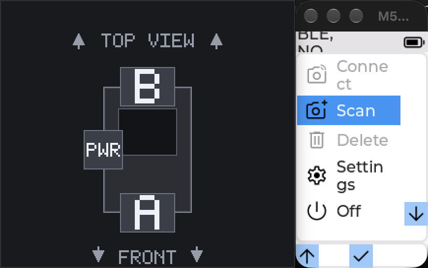
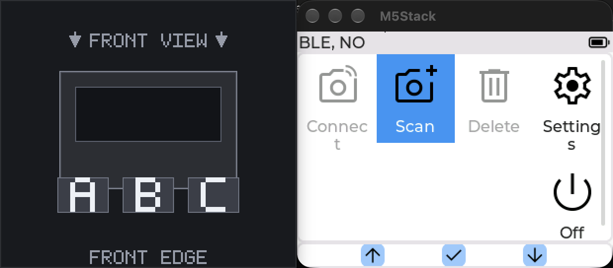

# Host simulator

The simulator is a host-only SDL build of the furble UI. It uses the real UI
and control code with simulator shims and fakes. It does not build firmware or
talk to a radio. The IMU is represented by a deterministic injection seam, so
production level and diagnostics code can be exercised without a physical
sensor. Scripted time comes from the
simulator virtual clock, so scenario runs do not wait on wall-clock time.

## Panels

`sim/build.sh` builds one panel class per invocation. Set both board variables
together:

| Panel | Furble board | M5GFX board |
| --- | --- | --- |
| M5StickC, 80x160 | `FURBLE_M5STICKC` | `board_M5StickC` |
| M5StickS3, 135x240 | `FURBLE_M5STICKS3` | `board_M5StickS3` |
| M5Stack Core, 320x240 | `FURBLE_M5COREX` | `board_M5Stack` |

The default is the M5StickS3 135x240 panel. The Core panel models the 320x240
Core class used by the simulator. A visible interactive run with the on-screen
buttons uses the non-touch physical-button layout so the floating legends are
visible; `FURBLE_SIM_NO_TOUCH=0` keeps the touch device for a deliberate
mixed-input session. A scenario seed of `no_touch true` or
`FURBLE_SIM_NO_TOUCH=1` still forces the physical-button layout.

The SDL panel attaches a mouse-driven touch device by default, so an unseeded
scripted run renders the touch layout on every modeled board. `FURBLE_SIM_NO_TOUCH=1`
or a scenario's `no_touch true` selects the physical-button layout. None of the
three modeled boards has a touch panel. The Sticks and the M5Stack Core Basic
ship the non-touch layout, whose navbar is 26 px high and whose legend buttons
are 24x24 px. On Stick boards Left and OK are bottom-edge indicators; the
default Buttons placement keeps Right partway down the right edge and reserves
its column in page rows. Bottom placement moves Right into the navbar. The
reserve keeps page content clear,
but Buttons placement intentionally draws the Right indicator over the content
area. Only the Core2, which `sim/build.sh` does not model, ships the touch
layout.

`bughunt/stick-notouch-layout-135.txt`, `bughunt/stick-notouch-layout-80.txt`
and `bughunt/core-notouch-layout.txt` seed `no_touch` and are each certified for
exactly one board, so they measure the layout that board really has.
`bughunt/core-connected-grid.txt` and `bughunt/core-connected-grid-large.txt`
are the touch-layout half for the 320x240 panel, which is the layout the
unmodeled Core2 ships, and they open with `assert ui.nav_layout touch` for the
same reason the three above open with `buttons`.
The Remote shutter fit matrix follows the same split: the shared page and
overflow matrices check page identity, complete labels and bounded scrolling,
because narrow Stick touch intentionally wraps its full-size controls. The
certified `bughunt/remote-control-mode.txt` plus its Small and Large variants
keep the physical-button shutter page fit-required on all three modeled boards;
`bughunt/core-touch-remote-shutter-fit.txt` plus its Small and Large variants
keep the 320x240 Core touch shutter fit-required.
`ui.label_overlaps` reports how many pairs of visible labels on the current page
draw through each other, which is the one defect a fit or scroll query cannot
see.
`sim/scripts/run-notouch.sh` runs the whole certified bug-hunt and end-to-end
set for one board in that layout, and CI runs it on all three binaries. See
[`plans/165-sim-no-touch-layout.md`](../plans/165-sim-no-touch-layout.md) and
[`plans/168-notouch-layout-overflows.md`](../plans/168-notouch-layout-overflows.md).

## Production-path parity

The simulator's shared-code boundary is audited in [`sim/CLAUDE.md`](../sim/CLAUDE.md).
In brief, the whole connection stack is production: `Control`, `Camera`,
`CameraList`, `Scan`, `Device` and every vendor class compile into the
simulator over the shared MockNimBLE boundary in `lib/testing/nimble` and the
virtual camera peers in `lib/testing/peer`. Scan startup, generation fencing,
queue draining, advertisement matching, list persistence, display mode/flush
and LVGL timers are all production code. The simulator supplies only the radio
below NimBLE: `sim/BleSim.cpp` runs a virtual radio task that advertises the
seeded peers and models the controller-owned discovery timer, and it injects
faults at the transport only.

M5GFX SDL, FreeRTOS/ESP-IDF calls, the NimBLE transport, UART/GPS
bytes, PMIC/power, NVS, and optional IR/feedback/SD hardware are the remaining
lowest-level host seams. Script actions dispatch real LVGL/control handlers;
`simulatorHome`/`simulatorBack` and timing-sensitive gesture setup are the
explicit deterministic input seams. There is no simulator-only display
rotation or display-policy implementation. Adding a shortcut requires a
contract scenario and an inventory entry.

## Build and run

The direct build uses clang, SDL2, M5GFX, M5Unified, TinyGPSPlus, and LVGL.
By default it looks for the PlatformIO cache at
`.pio/libdeps/m5stick-s3` and the managed LVGL component at
`managed_components/lvgl__lvgl`. Override those locations with
`FURBLE_DEP_ROOT` and `FURBLE_LVGL_DIR`.

If an sdkconfig changed, regenerate the LVGL configuration first:

```sh
python3 tools/gen_lv_conf.py sdkconfig.m5stick-s3 sim/lv_conf.h
sh sim/build.sh
```

The output is `sim/build/furble-sim`. A separate panel build uses a separate
`FURBLE_SIM_BUILD_DIR`:

```sh
FURBLE_SIM_BUILD_DIR=sim/build-stickc \
FURBLE_SIM_FURBLE_BOARD=FURBLE_M5STICKC \
FURBLE_SIM_M5GFX_BOARD=board_M5StickC \
sh sim/build.sh
```

The direct build stores a compiler depfile beside every object in
`<build-dir>/obj`. Incremental runs ask `make -q` to evaluate those depfiles,
so changing a project or dependency header rebuilds every dependent object even
when the including source file itself is unchanged. A missing depfile is
treated as a cache miss. Check this contract with:

```sh
sh sim/scripts/test-build-deps.sh
```

The self-test performs one complete build and one incremental build. It leaves
the project header timestamp unchanged when it exits.

The CMake entry point has the same source and board defaults:

```sh
cmake -S sim -B sim/build-cmake
cmake --build sim/build-cmake
```

### Interactive on-screen buttons

A visible interactive run creates a second, simulator-only control window so
the modeled physical buttons can be clicked instead of typed:

```sh
sh sim/build.sh
sim/build/furble-sim
```

The control window is borderless and is placed left of the panel, falling back
to below, then above, and only then to the right side, with no gap. Its content
height matches the panel's content height (240 points for StickS3/Core, 160 for
StickC) plus a top inset equal to the panel title bar, so the two outer
rectangles share a top and bottom edge and read as one unit when placed side by
side. It does not cover the panel or its button-position overlays. A true single
SDL window is not feasible without vendoring or patching M5GFX: `Panel_sdl`
owns its `SDL_Window` and renderer inside the protected `monitor` member and
exposes no caller-provided window or child-window API, and SDL2 has no public
window-parenting call. The panel keeps its own title bar, and the strip's blank
top inset matches that height, so the combined silhouette is one rectangle
rather than two decorated windows. The window draws a simple top view of the
modeled device and places the buttons where the physical device has them:

| Modeled board | Window title | A | B | Third button |
| --- | --- | --- | --- | --- |
| M5StickC / M5StickS3 | `... - Stick: B top, A front, PWR left` | front/bottom edge, GPIO 39 | top edge, GPIO 38 | PWR on the left side, GPIO 36 |
| M5Stack Core (`FURBLE_M5COREX`) | `... - Core front: A B C` | front edge, GPIO 39 | front edge, GPIO 38 | C on the front edge, GPIO 37 |

StickS3 top view beside the panel, with B on the top edge:



Core front view, with A/B/C along the front edge:



The keyboard letters `a`, `b`, `c` and `p` remain available and select the
same pins (Sticks use `a`, `b`, `p`; Cores use `a`, `b`, `c`). A click and the
matching keyboard letter drive `lgfx::gpio_lo`/`gpio_hi` on the same emulated
GPIO M5Unified's PC build reads, so they share one GPIO input path. The
scenario `btn` verb is a different path: it injects on the UI task through
`UI::simPressButton` and does not toggle these pins. Mouse down and mouse up
model hold and release, and the button renders a pressed state. One click
produces one press/release
transition: a per-button debounce ignores a redelivery inside 120 ms, a second
press on an already held button is a no-op, and a left-button up, a drag out of
the window, focus loss, hidden window, capture loss, or window close releases
the GPIO so it cannot remain latched.

The simulator's encoder input devices use a 1000 ms long-press time and a
250 ms repeat interval (`UI::initInputDevices` under `FURBLE_SIM`). A normal
click is therefore one press/release, and repeats begin only after holding for
about one second. `ui_buttons.cpp` also debounces duplicate mouse events for
120 ms, makes a second press on an already held button a no-op, and holds a
down/up pair for at least 30 ms so a click drained in one UI tick still reaches
the firmware's 10 ms pin debounce. The `btn-hold NAME MS` scenario verb drives
the same LVGL input device for a
virtual hold, so the `button-hold-repeat` scenario proves both the one-event
click and the one-second threshold without a display.

Interactive runs pace `vTaskDelay` with wall time and keep the simulated panel
active while the control window exists, so an idle window does not dim or
sleep between clicks. Scripted, headless and fuzz runs never create the window
and still exercise the real inactivity, dim, sleep and first-press wake
behavior. If the panel is already asleep, the first click wakes it and is
consumed, exactly as on hardware.

The control surface is interactive-only:

- It is not created for a `--script` run or a fuzz run, even when a display is
  available, so scenarios keep a deterministic input stream.
- It is skipped automatically under `SDL_VIDEODRIVER=dummy` or `offscreen`.
- Set `FURBLE_SIM_BUTTONS=0` (also `false`, `no`, or `off`) to keep the
  interactive run but hide the control window.
- If window, renderer or SDL event-filter creation fails, the simulator prints
  one diagnostic and continues without the control surface. Closing the
  control window hides only that window; closing the panel window still exits
  the simulator.

Run one scenario headlessly:

```sh
SDL_VIDEODRIVER=dummy SDL_AUDIODRIVER=dummy \
  sim/build/furble-sim --script sim/scenarios/e2e/connect-flow.txt
```

`sim/scripts/run-e2e.sh` runs every `*.txt` file in its argument directory,
defaulting to `sim/scenarios/e2e`. It exports `FURBLE_SIM_IR`,
`FURBLE_SIM_FEEDBACK`, and `FURBLE_SIM_SD` as optional capabilities for that
run. The capture helpers use `--out` to choose the capture directory.
`sim/scripts/docs-capture.sh` rebuilds the three panel classes and regenerates
the documentation screenshot gallery in each board's physical no-touch layout.
Core2 touch remains a supplemental scenario lane rather than a Core Basic
screenshot. The script uses `FURBLE_SIM_BOARDS` and `FURBLE_SIM_BUILD_ROOT` to
limit the matrix or relocate its build trees.

`sim/scripts/run-notouch.sh` runs the certified bug-hunt and end-to-end sets for
one board with `FURBLE_SIM_NO_TOUCH=1`, so the pages are measured in the layout
that board ships. It takes the same `FURBLE_SIM_BOARD_ID` and `FURBLE_SIM_BIN`
as `run-e2e.sh`. Its header explains which scenarios the physical-button run guards out and why.

The retained M5PM1 watchdog contract has a dedicated gate:
`sim/scripts/run-watchdog.sh` runs the feed, near-boundary, expiry, and
uint32-wrap scenarios against the default, freshly built M5StickS3 binary.
Keep this explicit gate when changing the watchdog timeout or simulator timing
path.

The simulator command-line options are:

| Option | Effect |
| --- | --- |
| `--script FILE` | Run a scenario file. |
| `--out DIR` / `--capture-dir DIR` | Set the PNG capture directory. |
| `--report-dir DIR` | Set the profiler report directory. |
| `--rig` | Start the companion TCP rig on `127.0.0.1`. |
| `--rig-port PORT` | Select the rig listening port. |
| `--ignore-uuid-mismatch` | Accept a rig HELLO with a different service UUID. |
| `--drop-notify` | Drop companion status notifications from the rig. |
| `--delay-ms MS` | Delay each rig outbound frame by the requested milliseconds. |
| `--fuzz` | Run the seeded UI fuzzer instead of a scenario. |
| `--seed N` | Select the UI fuzzer seed and enable it. |
| `--fuzz-steps N` | Set the UI fuzzer event budget and enable it. |
| `--fuzz-verbose` | Enable fuzzing and print each UI fuzzer event. |
| `--help` | Print the option synopsis and exit. |

The UI fuzzer also accepts `FURBLE_FUZZ_SEED` and `FURBLE_FUZZ_STEPS` as
fallbacks. Explicit `--seed` and `--fuzz-steps` values take precedence over
their matching environment variables, even when a wrapper inherits both. The
release fuzzer wrapper is `sim/scripts/run-fuzz.sh`; it uses
`FURBLE_FUZZ_SEEDS`, `FURBLE_FUZZ_XFAIL_SEEDS`, `FURBLE_FUZZ_STEPS`,
`FURBLE_FUZZ_SEED_TIMEOUT`, `FURBLE_FUZZ_REPEAT_SEED`, and `FURBLE_SIM_BIN`.
`sim/scripts/run-fuzz-restart.sh` repeats the measured 135x240 seed 2 walk up
to five times and requires one run to resume after a production UI restart.

A fuzzer event that activates a firmware restart follows the real simulator
reboot path. The process first joins the simulator tasks, keeps the NVS file,
then re-executes the same binary with a private unlinked checkpoint containing
only the fuzzer RNG, phase counters, finding counts, coverage, and the last 20
event names. Firmware RAM and UI objects are not checkpointed, and the event
that requested the restart is not replayed. The final summary reports
`attempted = settled + interrupted_by_restart`; `resumed_boots` records the
number of successful resumed boots. A missing, malformed, oversized, linked,
or wrong-owner checkpoint fails the run rather than starting a new random walk.

After the guarded seeds, `run-fuzz.sh` replays `FURBLE_FUZZ_REPEAT_SEED`
(default: seed 31337, empty to skip) and requires the two runs to
produce identical `FUZZ EVENTS`, `FUZZ COVERAGE` and `FUZZ SUMMARY` lines, with
`observed_delta` and `no_observed_delta` masked. The same seed must drive the
same event stream and reach the same pages.

The comparison stops there on purpose. Firmware behaviour under the fuzzer is
not yet reproducible line for line: two runs of the same seed can differ by one
connect attempt. `Camera::m_Mutex`, the one host mutex a connect holds for its
whole attempt, is scheduler visible since plans/173. Remaining host mutexes
and asynchronous settlement are still under investigation: repeated UI
candidate runs have produced identical event streams but different page counts.
Those runs fail the unchanged replay gate, even when they report zero findings.
Neither a matching replay nor this simulator's finite scenarios certify every
hardware interleaving.

## Wall-clock bounds and the stall watchdog

Every bound inside the simulator except one is denominated in virtual time, so
none of them can see a stall that stops virtual time advancing at all.

`sim/watchdog.cpp` is that one exception. It samples the virtual clock, the
scheduler progress counter and the recorded phase, and if none of them moves
for `FURBLE_SIM_WATCHDOG_SECONDS` host seconds (default 120, `0` disables it
for an interactive debugging session) it prints the phase, the virtual clock,
the scheduler task table and a native backtrace of every registered thread,
then exits non-zero.

A fatal fault is the other thing no virtual-time bound can see. `SIGSEGV`,
`SIGBUS`, `SIGILL` and `SIGFPE` are caught, print `SIM CRASH:` with the
scenario line being executed, the boot phase, the faulting thread and a native
backtrace (`-rdynamic` is on), and are then re-raised so the process still ends
with the real fatal status. Set `FURBLE_SIM_CRASH_STEP=<index>` to fault
deliberately at a script step; that is the self test for the reporter and has
no other use.

`FURBLE_SIM_SDL_STEP_DETECT=1` restores the M5GFX debugger-detector thread,
which is off by default. The detector infers that a debugger has stopped the
process when a 1 ms `SDL_Delay` overshoots 64 ms, which a loaded host does
routinely, and the step-exec mode it then latches deadlocks simulator boot
against the SDL render pump. Turn it on only under an actual debugger.

`sim/scripts/run-e2e.sh`, `sim/scripts/run-notouch.sh` and
`sim/scripts/run-watchdog.sh` bound every scenario
with `timeout -k 10` at `FURBLE_SIM_SCENARIO_TIMEOUT` seconds, default 300. The
per-seed bound in `run-fuzz.sh` is separate and larger, `FURBLE_FUZZ_SEED_TIMEOUT`
seconds, default 600, because one seed is 600 events rather than one scenario. A
wedged run fails its leg instead of hanging the job. All four scripts require
GNU `timeout`, or the coreutils `gtimeout` Homebrew installs on macOS, and fail
with that instruction if neither is present.

For an instrumented UI-fuzzer build, set `FURBLE_SIM_SANITIZE` to a clang
sanitizer list and use a separate `FURBLE_SIM_BUILD_DIR`, for example
`FURBLE_SIM_SANITIZE=address,undefined`.

`FURBLE_SIM_COVERAGE=1` builds with clang source-based coverage instead. Only
firmware translation units are instrumented, so LVGL and M5GFX stay at full
speed. Each run writes a raw profile to the path in `LLVM_PROFILE_FILE`. Use a
separate `FURBLE_SIM_BUILD_DIR` here too. `tools/coverage.py` drives all of
this; see [coverage.md](coverage.md).

Both flags shape the objects, so `build.sh` stamps them in
`$FURBLE_SIM_BUILD_DIR/build-flags` and drops the object cache when they change.
Reusing one build directory with different flags therefore rebuilds rather than
mixing objects.

## Scenario files

Scenario files are line oriented. A `#` starts a comment. Blank lines and the
text after a comment are ignored. Each line starts with one verb.

### Core verbs

| Verb | Form and behavior |
| --- | --- |
| `seed` | `seed NAME VALUE` stores a scenario setting before UI construction. Effective names are listed below. |
| `wait` / `advance` | `wait MS` or `advance MS` advances virtual time. |
| `stall` | `stall MS` advances virtual time without running the platform update loop. On the StickS3 model this can expire the PM1 watchdog; `MS` must be non-zero. |
| `key` / `press` | `key KEY` or `press KEY`, where `KEY` is `up`, `down`, `left`, `right`, `return`, or `enter`. |
| `btn` / `button` | `btn NAME [hold\|long]` or `button NAME [hold\|long]`. Stick boards expose `a`, `b`, and `pwr`; Core exposes `a`, `b`, and `c`. A tap samples one pressed and one released state through the production read callback and LVGL input processing in the device's current mode. The `hold` modifier is the left-button long-press escape and calls `navigateBack()` directly; on other buttons it behaves like a tap because only the left button has that escape. It is not a timed hold. Use `btn-hold` to exercise the repeat cadence. |
| `btn-hold` / `button-hold` | `btn-hold NAME MS` or `button-hold NAME MS` presses a physical button for `MS` virtual milliseconds (1 to 60000), sampling LVGL every 20 ms through the production encoder read path, then releases it. It proves the long-press and repeat timing configured by `UI::initInputDevices`. The board button names match `btn`. |
| `capture` | `capture NAME` writes a PNG under the capture directory. |
| `uart-dump` | Prints captured fake-UART writes as `uart-tx` lines, then clears them. |
| `home` | Goes to the root menu and focuses Scan. |
| `back` | Clicks the LVGL header back button. It fails at the root page. |
| `report` | `report NAME` writes a profiler JSON report. |
| `restart` | Reboots the simulated device: the simulator shuts down in order, re-executes itself, and resumes the script at the next step. RAM state is wiped like an esp_restart(); the per-run NVS preferences file is inherited through `FURBLE_SIM_PREFS` and persists like flash. Seeds are reapplied on the resumed boot. Takes no arguments and must not be the final step. UI-triggered restarts use the same boundary and arm only after the triggering button/action has advanced the script, so that action is not repeated. |
| `action` | `action COMMAND` invokes one of the simulator actions below. The complete action line is parsed once, with whitespace-tolerant tokenization, strict arity, finite numeric validation, and no silently ignored trailing values. Invalid actions fail during script loading with status 2. |
| `print` | `print KEY` prints the resolved scenario query. |
| `assert` | `assert KEY VALUE` aborts with exit status 1 when the resolved value differs. |
| `assert_min` / `assert_max` | `assert_min KEY VALUE` and `assert_max KEY VALUE` resolve the query as a signed integer and abort with exit status 1 when it is below, or above, VALUE. Use these where the assertion is a bound rather than an equality, for example a geometry that differs between the touch and physical-button layouts but must clear the header in both. |
| `assert-eventually` | `assert-eventually TIMEOUT_MS KEY VALUE` polls the resolved value using a monotonic wall-clock timeout while yielding to background simulator tasks. TIMEOUT_MS must be 1 through 60000; a timeout reports the last value and exits 1. |
| `assert-eventually-virtual` | `assert-eventually-virtual TIMEOUT_MS KEY VALUE` polls once per normal UI tick while virtual time, platform updates, and background tasks continue. TIMEOUT_MS must be 1 through 60000 virtual milliseconds; a timeout reports the last value and exits 1. |
| `xassert` | `xassert KEY VALUE` records `XFAIL (WILL_FAIL)` on a mismatch and continues. A match prints `XPASS` and FAILS the run, so a closed gap is promoted back to `assert` deliberately. `xassert board-varies KEY VALUE` is the exception for a gap already closed on some panels: a match there prints and continues. |
| `exit` | Ends the simulator with status 0. |

`FURBLE_SIM_THEME` and `FURBLE_SIM_TEXTSIZE` seed only a fresh simulated
device boot. A production UI restart keeps the setting written by its Restart
button instead of applying the launch environment again.

`assert`, `assert-eventually`, `xassert`, and `print` use the same query namespaces:
`ui.*`, `control.*`, `camera.*`, `gps.*`, `uart.*`, `setting.*`, and `platform.*`.

The `ble_peers` seed selects the virtual radio topology. Its peers advertise to
the production `Scan` and answer the production `Camera` connect paths, so the
`scan-distinct-rows-heartbeat.txt` scenario now proves that two real
advertisements are matched by `CameraList::match` and drained on the UI task
while the watchdog remains armed.

The `clock.ms` query reports the current virtual millisecond clock.

### Effective `seed` names

All listed seeds are applied before simulated `Platform::init()` and before the
UI is constructed. These byte settings are:
`brightness`, `inactivity`, `display_off`, `display_mode` (0 GUI, 1 console),
`gps_rate`, `gps_constel`,
`gps_power`, `gps_duty`, `gps_hold`, `cpu_freq`, `tx_power`, `scan_mode`,
`text_size`, `legend`, `timezone`, `auto_off`, `low_batt`, `fb_output`,
`hw_motion`, `gps_assist`
(0 off, 1 position and time, 2 with ephemeris), `gps_platform` (0 do not send,
1 to 4 the dynamic models), and `imu_wake` (0 off, 1 tap, 2 shake, 3 both).

`clock_ms` seeds the simulator's uint32 millisecond clock before platform
initialization. It is intended for deterministic wrap-boundary scenarios.

Battery seeds select the initial deterministic platform sample:
`battery_level` (0 to 100), `battery_voltage` (millivolts),
`battery_current` (signed milliamps), and `battery_charging` (`true` or
`false`).

These boolean settings are applied before the UI is constructed:
`gps`, `gps_nmea`, `gps_motion`, `fauxny`, `autoconnect`, `reconnect`,
`recon_backoff`, `sleep_conn`, `boot_splash`, `gps_extrap`, `gps_uart_noise`,
`sd_gpx`, `imu`, and `imu_trigger`. `ivl_sleep`, `timed_wake`,
`timed_poweroff_fail`, and `timed_wake_write_fail` drive the intervalometer
deep-sleep scenarios. `ivl_sleep_thr` seeds the Deep Sleep threshold in
seconds (0 to 999). `resume_fixture` selects the saved resume record the
intervalometer scenarios boot with: `invalid`, `stale`, `completed`,
`outofrange`, `mismatched`, `early`, `late`, `wrong_camera`, or
`second_camera`. `auto_off_charging` opts into auto-off while
charging, and `imu_sensor` controls modeled IMU presence. `gps_motion` needs `gps` and `imu`
as well: the detector only runs when the receiver and the sensor are both on.
`gps_motion_prearm` is a regression-only seed that loads GPS before the UI arms
the shared motion source.
The M5StickS3 model also accepts
`watchdog`; other board models reject that seed because they cannot apply it.
`scan_timeout` seeds the discovery scan timeout in seconds; the default 0 scans
until the page is left, so a scenario that asserts a scan-end callback must
seed a bounded value.

The modelled GPS receiver is seeded before boot. `gps_baud` sets the `GPS_BAUD`
setting (`auto`, `0`, `9600` or `115200`). `gps_receiver` says what is on the
Grove port: `any` (the default, answering whatever rate the driver programmed,
which leaves every scenario written before the receiver model unchanged),
`none` for an empty port, or one of `4800`, `9600`, `19200`, `38400`, `57600`,
`115200`, which stays mute until the autobaud ladder reaches it. `gps_sats`
picks the GSV/GSA fixture and `gps_fix_date` picks the fix burst; both are
detailed under the receiver model below. `gps_uart_chunk` serves the burst that
many bytes at a time, paced, so a sentence spans several reads as it does off a
real UART.
All boolean seeds, including `gps_uart_noise`, reject malformed values during
scenario loading.

#### Internal-heap pressure model

The host heap is much larger than a StickS3's internal SRAM, so allocation
failures that boot-loop the device never happen in the simulator by accident.
Two seeds model the measured pool: `heap_internal_free` and
`heap_internal_largest` take byte counts. They describe the device after WiFi,
BLE, the companion service and the display are already resident, which is the
measurement point in `docs/webui.md`. Only the optional services admitted after
that point are charged to it: the WebUI supervisor and HTTPS task, the Furble
MQTT owner task, and the esp-mqtt client task. Boot tasks are part of the
seeded baseline.

`web_ui` enables the WebUI admission model and `webui_password` says the
companion password is set. The `webui_gate` seed value `off` skips the #392
supervisor gate to model the pre-fix 8 KiB allocation. `wifi_connected` makes
the station report a
connected network so the WebUI and MQTT network gates can pass. The model runs
the production gate functions from `include/FurbleWebUIMemory.h` and logs the
production fail-closed sentence; it does not serve HTTPS, generate a TLS
identity, or claim TLS parity. `task_create_fail` takes a FreeRTOS task name or
`all` and fails that task's `xTaskCreate` with the hardware-shaped
`Mem alloc fail` line, so a production failure branch can be exercised without
depending on a heap size. The failure is reported by `heap.alloc_failures` and
`heap.last_failed_task`.

The MQTT scenarios run only against the optional native transport:

```sh
FURBLE_SIM_MQTT=1 FURBLE_SIM_BUILD_DIR=$PWD/sim/build-mqtt sh sim/build.sh
FURBLE_SIM_MQTT_URI=mqtt://127.0.0.1:1 FURBLE_SIM_MQTT_FAST_RECONNECT=1 \
  sim/build-mqtt/furble-sim --script sim/scenarios/e2e/memory-mqtt-unreachable.txt
```

`FURBLE_SIM_MQTT_URI` may name an unreachable broker; no broker is required.
`FURBLE_SIM_MQTT_FAST_RECONNECT` only shortens the host transport's one-second
reconnect cadence so ten refused connections finish inside a bounded scenario.
It does not change the firmware retry limit.

#### Board, PMIC, USB and memory-profile model

`hw_profile` selects a supported board identity from `stickc`, `stickc-plus`,
`stickc-plus2`, `sticks3`, `core`, `core2`, `tough`, `headless-s3`,
`waveshare-s3-eth` or the Core USB-UART fallback. It selects PMIC, gauge, USB,
radio, peripheral and memory-budget rows; it does not replace the compiled SDL
panel class. `psram_mode` is `absent`, `quad`, `octal` or `init_fail`.
`pmic_variant` is `m5pm1`, `axp192`, `axp2101`, `ip5306` or `none`.
`battery_gauge` is `none`, `voltage`, `voltage_current`, `voltage_charge` or
`four_level`. `battery_state` is `present`, `absent`, `charging`, `full` or
`low`. `reset_reason` is `poweron`, `software`, `panic`, `int_wdt`, `task_wdt`,
`tg1wdt`, `other_wdt`, `brownout`, `usb_uart_chip_reset`, `jtag` or
`power_glitch`. `task_stack_region` is `internal` or `psram`.

The MQTT stack model is opt-in with `mqtt_owner_stack` and `mqtt_worker_stack`
byte counts, plus `mqtt_tls`, `mqtt_ha` and `mqtt_buffer`. The model fails
closed when the owner stack is below 10,240 bytes or a buffer is above 2,048
bytes. `mqtt_expect_overflow` set to `true` is the deliberate historical-overflow
override used by the 4 KiB and 6 KiB regression scenarios. `companion_enabled`
seeds the companion state.

`ble_peers` selects the virtual BLE radio topology from a strict allowlist:

| Topology | Peers |
| --- | --- |
| `none` | no peers (the default) |
| `fuji` | one healthy Fujifilm Basic camera |
| `fuji-secure` | one healthy Fujifilm Secure camera, which advertises a serial |
| `fuji-pair` | two healthy Fujifilm Basic cameras |
| `fuji-ricoh-flappy` | one healthy Fujifilm plus a Ricoh GR IV in BLE standby that fails one security handshake the way a supervision timeout does (rc=520) before letting a connect through |
| `fuji-secure-stale` | one Fujifilm Secure body that the central is still bonded to and that no longer holds the pairing, so every security handshake times out and takes the link with it (the 2026-09-02 X100VI bench signature) |
| `ricoh` | one Ricoh GR IV |
| `canon-smart` | one Canon EOS RP in Smart mode |
| `canon-remote` | one Canon EOS RP in Remote mode |
| `nikon-remote` | one Nikon B600 Remote profile peer |
| `nikon-smart` | one Nikon Z6III Smart profile peer |
| `sony` | one Sony ZV-1F |
| `lumix` | one LUMIX S5II |
| `dji` | one DJI Osmo Action 4 |
| `all` | nine peers in this registration order: Fujifilm Secure, Ricoh, Canon Smart, Canon Remote, Nikon Remote, Nikon Smart, Sony, LUMIX, DJI |

`ble.peer.<n>` indexes that registration order. The two Nikon peers are not
persisted by `ble_saved`, because a saved Nikon record carries the pairing
identity that only a real pairing produces; the `peer-nikon-*` scenarios pair
through the production scan row instead.

`ble_saved true` persists the topology's cameras through the production
`CameraList::match` and `CameraList::save`, so the scenario boots with saved
cameras exactly as a device does after the user scanned and connected once.

`ble_max_clients` caps the mock NimBLE client pool the way the board's
`CONFIG_BT_NIMBLE_MAX_CONNECTIONS` caps it, which is 9 on every furble board.
The pool is unlimited by default, so a client leaked once per connect cycle is
invisible; on the device it ends the session for good, because
`NimBLEDevice::createClient()` starts returning nullptr and every later connect
fails until a reboot. `ble_client_selfdelete` models NimBLE freeing a
self-deleting client when its disconnect fires, which is what
`Camera::connect()` arms on a live session. Both are off by default, deliberately: turning them on globally
would change client lifetimes under every existing scenario at once, and two
shapes report a leak that is the model's and not the firmware's (a leg that
severs the link, and any FauxNY leg, which has no radio to deliver the GAP
disconnect its client's self-delete waits on). A scenario that walks many
connect cycles against a peer-backed camera turns both on and bounds
`ble.live_clients`. One limit: the mock frees a self-deleting
client of a link-loss disconnect only when `reapDeferredClients()` is pumped
from a quiescent point, and the simulator has no such point, so the pool guard
is sound on Camera-driven teardowns and not on `action drop`.

`secure_stall_ms` holds every Fujifilm peer inside its security handshake for
N virtual milliseconds (`seed secure_stall_ms N`). `NimBLEClient::secureConnection()` is the one wait in a
Fujifilm Secure connect that takes no cancel token, and `Camera::connect()`
holds `Camera::m_Mutex` across it, so an attempt parked there is uncancellable
and a target task's `Camera::disconnect()` blocks behind it. The virtual peers
answered that call in under a millisecond, so before this seed no scenario could
cancel into a live connect at all. The stall ends early once the link goes down,
which is how a supervision timeout or a central-side terminate releases the real
call. 3500 is the bench signature of a healthy X100VI Secure connect; 32000 is
the link supervision timeout bound that releases a camera which never finishes
the encryption procedure. The default 0 keeps the instant handshake every other
scenario is timed against. The knob is the peer's
`FujifilmVirtualCamera::setSecureConnectionStallMs()`, shared with the host
suite, which spends real milliseconds where the simulator spends virtual ones.

The scenario-only settings are `saved_camera`, `saved_cameras`, `connect_fail`,
`no_touch`, `scan_start_probe`, `ble_saved`, `liveness_check`, and
`liveness_grace_ms`. `saved_camera` adds an
inactive saved camera, while `saved_cameras N` adds N saved FauxNY cameras with
stable names `Sim Camera 1` through `Sim Camera N` for multi-connect selection
scenarios (N is 1 through 8, the selection capacity). `connect_fail` registers
one virtual Fujifilm peer and
makes `NimBLEClient::connect()` fail at the transport (FauxNY has no radio to
fail at), and
`no_touch` selects the physical-button layout. `liveness_check
false` opts a scenario out of the continuous liveness invariant enforcement
(detection still counts violations), and `liveness_grace_ms` overrides the
3000 ms divergence grace period. The interval settings are `interval_count`, `interval_delay`,
`interval_shutter`, and `interval_wait`; `bulb_duration` seeds the bulb timer.
Each takes a count and an optional unit written with no space, `250ms`, `30s` or
`60min`; without one the field keeps its own unit. The unit is how a scenario
reaches a spin value the field's default unit cannot express, which the timer
row width assertions need. An unrecognised suffix is rejected at load.

`gps_stationary` selects the stationary canned NMEA track instead of the
moving one. Both report the same position, but the stationary track reports
0.412 knots rather than 22.678, which is below the speed floor fix hold
extrapolation needs. It is the seed a scenario uses to prove that a parked user
is never dead reckoned.

`gps_uart_mode` selects `ack`, `nack`, `timeout`, `malformed`, `partial`,
`write-error`, or `pause` before the GPS task starts.

`imu_chip` selects `bmi270`, `mpu6886`, or `none` as the internal IMU the
modelled board carries. The motion engines are chip specific, so this is what
decides whether a hardware engine or the software fallback arms. The default is
`none`.

### `action` commands

The fixed action commands are:

```text
action blind
action blind-shutter
action indicator-click-focus
action focus-lock
action capability-refresh
action connect
action connect-two
action disconnect
action ble-kill
action ble-standby
action ble-connect-fail
action ble-connect-ok
action ble-withhold-registration
action ble-allow-registration
action cancel
action motion.arm
action motion.disarm
action imu.enable
action imu.disable
action imu.accel.fail
action imu.accel.recover
action imu.gyro.fail
action imu.gyro.recover
action invalidate.reset
action shutter
action main-press-hold
action main-double-click
action main-click-hold
action select
action intervalometer
action bulb-start
action bulb-stop
action stop
action preset-step-up
action preset-step-down
action companion-pair-request
action companion-accept
action companion-reject
action camera-pair-accept
action camera-pair-reject
action camera-pair-expire
action crash-inject-panic
action crash-inject-task-wdt
action power-single-click
action power-double-click
action power-long-press
action usb-open
action usb-close
action usb-dtr
action usb-rts
action usb-reset
action usb-rom-entry
action usb-esptool-sync
action pmic-charge-on
action pmic-charge-off
action pmic-battery-present
action pmic-battery-absent
action pmic-brownout
action pmic-watchdog-on
action pmic-watchdog-off
action wifi-connect
action wifi-disconnect
action wifi-fail-auth
action wifi-fail-notfound
action wifi-fail-timeout
action wifi-ntp-sync
action wifi-ntp-fail
action ethernet-up
action ethernet-down
action ble-auth-timeout
action ble-gatt-stale
action ble-gatt-fresh
action companion-reidentify
action companion-reconnect
action companion-reject
action audio-overcurrent
action ir-timeout
action sd-present
action sd-absent
action sd-error
action psram-task-start
action heap-leak-probe
action heap-leak-free
action alloc-icon
action ota-rollback
action ota-commit
action ota-update
action flash-write
action crash-inject-tg1wdt
action crash-inject-brownout
action crash-inject-usb-uart
action crash-inject-software
action crash-inject-poweron
```

`crash-inject-panic` and `crash-inject-task-wdt` write a synthetic unclean
previous-boot record for the next `restart` to consume. They model the retained
record, not a real panic: the simulator process stays alive, and the recorded
task and log tail are the injected values. `crash-record-survives-restart.txt`
asserts the one-shot reporting and the consumed-record path.

The parameterized action forms are:

```text
action camera-pair-request confirm|display CODE
action toggle NAME
action nav PAGE
action scan-row N
action scroll top|bottom|next|PIXELS
action page PAGE
action imu.accel X Y Z
action imu.gyro X Y Z
action imu.roll DEGREES
action imu.pitch DEGREES
action memory-dump PATH
```

`memory-dump PATH` writes the static budget, heap state, owner totals, leak list,
task stacks and timeline as JSON. `sim/scripts/run-memory-profile.py` generates
the dumps and compares them with `sim/coverage/memory_budget.json`.

`toggle NAME` accepts `gps`, `gps_nmea`, `gps_motion`, `autoconnect`,
`reconnect`, `multiconnect`, `companion`, `watchdog`, `ir`, `show_title`,
`tx_adaptive`, `conn_saver`, `preset_picker`, and `recon_backoff`.

`scan-row N` activates scan result row N by dispatching that row's own click
handler, which is `UI::beginPairing()`. It exists because focus-driven
activation of a scan row is not reproducible: the row is materialized on the UI
task after the page has already focused its back button, and a key press lands
on it about half the time on a page busy draining advertisements. It reports
`unavailable` when N is past the end of the scan list; both a started connect
and a refused duplicate are `applied`, because both are real outcomes of the
production handler.

`nav PAGE` accepts `connect`, `scan`, `delete`, `power_off`, `bulb_duration`,
`bulb`, `settings`, `display`, `features`, `sensors`, `gestures`, `infrared`,
`gps_rate`, `gps_sentences`, `gps_constellation`, `gps_power`, `gps_assist`,
`gps_hold`, `gps_baud`, `gps_platform`, `gps`, `gps_data`, `time`, `nmea`, `gps_sats`,
`timer`, `theme`, `text_size`, `legend`, `bluetooth`, `tx_power`,
`about`, `power`, `feedback`, `feedback_events`, `feedback_volume`,
`diagnostics`, `device_info`, `power_state`, `ble`, `interval_count`,
`interval_delay`, `interval_shutter`, `interval_wait`, `battery`, `storage`,
`imu`, `level`, and `level_main`.

`page PAGE` accepts `main`, `menu`, `connect`, `scan`, `delete`, `power_off`,
`connected`, `ir`, `shutter`, `bulb`, `bulb_duration`, `bulb_run`, `cameras`,
`remote_timer`, `remote_gps`, `remote_disconnect`, `timer`, `timer_run`,
`settings`, `display`, `features`, `sensors`, `infrared`, `gps_rate`,
`gps_sentences`, `gps_constellation`, `gps_power`, `gps_assist`, `gps_hold`,
`gps_baud`, `gps_platform`, `gps`, `gps_data`, `time`, `nmea`, `gps_sats`, `theme`,
`text_size`, `legend`, `bluetooth`, `tx_power`, `about`,
`power`, `feedback`, `feedback_events`, `feedback_volume`, `storage`,
`diagnostics`, `device_info`, `battery`, `power_state`, `ble`, `interval_count`,
`interval_delay`, `interval_shutter`, and `interval_wait`.

The battery action changes the platform sample at runtime:

```text
action battery LEVEL VOLTAGE_MV CURRENT_MA CHARGING
```

For example, `action battery 80 4000 0 false` simulates a recovered,
discharging pack. The next battery timer sample consumes the new value.

`action drop` severs the live link of every control target. `action drop N`
drops target `N`, using zero-based target numbering. `action connect-two`
selects two cameras for multi-connect coverage: the seeded virtual peers when a
topology is seeded, otherwise the FauxNY test cameras. `action companion-pair-request` injects a
pending companion PIN without a rig TCP peer; `action companion-accept` and
`action companion-reject` click the real pairing dialog buttons.
`action camera-pair-request confirm <code>` or `display <code>` raises a camera
numeric-comparison or passkey-display request. Only the controller event is
substituted: the request goes through the same `publishPairingRequest()` the
production `onConfirmPasskey` calls, against the live client's connection info,
so a scenario with a connected virtual peer drives the real answer path. It
targets the first camera that does not already hold a request, so two calls in
a row model two cameras prompting at once; when every camera already holds one
the request goes to the first, which is the duplicate the production guard has
to refuse. `action camera-pair-accept` and `action camera-pair-reject` click the
modal's real footer buttons, while `action camera-pair-expire` advances the
pending request past its response deadline without a wall-clock wait.

`watchdog` is present in the M5StickS3 build. The lists above are the canonical
toggle, navigation, and page vocabularies.

Actions are parsed into a canonical typed representation before SDL, UI, or
worker startup. Runtime dispatch uses that representation and reports one of
four outcomes to its caller: `APPLIED` after successful handling,
`VALID_NO_EFFECT` for an intentional no-op, `UNAVAILABLE` when a valid route or
capability is absent on the modeled board, and `INVALID` for malformed or
unhandled input. A plain `action COMMAND` requires `APPLIED`; it fails the
scenario if the action has no effect or is unavailable. To assert an intentional
alternative, use `action expect no-effect COMMAND` or `action expect unavailable
COMMAND`. `action expect applied COMMAND` is accepted for clarity. A queued UI
action owns its input and result state, including when the UI request times out.
The root aliases `page main` and `page menu` are both valid and select the root
menu.

The `scroll` action accepts `top`, `bottom`, `next`, or a signed pixel count in
the inclusive range -2147483647 through 2147483647. `-2147483648` is rejected:
the runtime negates pixel counts to form LVGL's signed int32 scroll delta, so
that value cannot be represented safely.
The connected page map includes the run and disconnect transition pages listed
in the canonical `page PAGE` vocabulary above.

### Query keys

The complete `ui.*` query set is:

| Query | Returned value |
| --- | --- |
| `ui.connect_box` | `hidden` or `visible`. |
| `ui.connect_error` | `none`, or the dismissable connect error box's title as one lowercased token: `already_saved`, `pairing_lost`, or `connect_failed`. |
| `ui.modal_overflow` | `yes` when anything on the top layer is drawn outside the display, outside the content box of its own parent, or scrolled out of view (a non-zero scroll extent on any top-layer scrollable). `no` when the top layer was measured and is clean, `none` when the top layer has no visible children, `unknown` with no top layer. Position is compared, never size: two stacked labels can each be smaller than the room their parent has and still not fit together. Pair it with `ui.connect_error`: that one proves the box exists with the right text, this one proves the text was drawn where the user can read it. Limit: a `LV_LABEL_LONG_DOT` label always fits its own box, so an ellipsized label is reported clean by design. The camera name in the connect error box is deliberately dotted, and LVGL rewrites the label's text to insert the ellipsis, so an ellipsized string is also invisible to `ui.connect_error`, which reads that text back. Any label whose truncation must be caught has to be wrapped, not dotted. |
| `ui.indicators_focused` | `yes` or `no`. |
| `ui.bulb_ms` | Persisted bulb duration in milliseconds. |
| `ui.disconnect_calls` | Numeric disconnect count. |
| `ui.reconnecting` | `yes` or `no`. |
| `ui.bt_color` | `hidden`, `red`, or `other`. |
| `ui.status_text` | The current status title, or `none`. |
| `ui.reconnect_count` | `down/total`, such as `1/2`. |
| `ui.remote_status` | `hidden`, `shown`, or the rendered reconnect text. |
| `ui.remote_reconnecting` | `yes` or `no`. |
| `ui.remote_named` | `yes` or `no`. |
| `ui.battery_pinned` | `yes`, `no`, or `unknown`. |
| `ui.bulb_status` | `hidden`, `shown`, or the rendered reconnect text. |
| `ui.bulb_reconnecting` | `yes` or `no`. |
| `ui.bulb_named` | `yes` or `no`. |
| `ui.connect_timer` | `none`, `paused`, or `running`. |
| `ui.connected` | `yes` or `no`. |
| `ui.connect_count` | Number of cameras selected on the multi-connect page. |
| `ui.page` | A page name, or `other`. |
| `ui.back` | `none`, `hidden`, `disabled`, or `visible`. |
| `ui.modal` | `open` or `closed` for either a camera-pairing or companion-pairing dialog. |
| `ui.boot_splash` | `off`, `shown`, or `partial`. |
| `ui.modal_focus` | `closed`, `yes`, or `no`. |
| `ui.modal_count` | Numeric live modal count. |
| `ui.focus` | `none`, `stale`, or `ok`. |
| `ui.focus_on_page` | `yes` or `no`. |
| `ui.row_text` | Text of the focused menu row, or `none`. Every whitespace character is reported as an underscore, so a literal underscore and a space both read as `_`. |
| `ui.row_checked` | `yes`, `no`, or `none`. Checked state of the focused multi-connect checkbox; `none` when the focused object is not a checkbox. |
| `ui.row_scrolling` | `yes`, `no`, or `none`. Whether the focused menu row's label is running LVGL's scroll animation. |
| `ui.diag.about.reset_visible` | About page only: `yes` when the rendered Reset label is visible and fully contained by the page viewport. |
| `ui.overflow` | `unknown`, `yes`, or `no`. |
| `ui.nav_layout` | `touch` or `buttons`. |
| `ui.legend_visible` | `yes` or `no`; Off hides indicator surfaces without disabling physical input targets. |
| `ui.legend_visible_count` | Number of rendered primary left/OK/right indicator objects, measured after hidden ancestors and effective opacity. |
| `ui.legend_band` | The floating right legend's display-coordinate vertical band as `top-bottom`, or `none` without a floating legend. |
| `ui.legend_band_rows` | Number of visible direct page rows whose box intersects `ui.legend_band`. |
| `ui.legend_band_outside_narrowed` | Number of visible direct page rows outside the band that are still narrowed. Must read `0`: rows above and below the band keep the full page width. |
| `ui.legend_band_fit` | `ok` when every visible direct page row is full width outside the band and narrowed by the legend reserve inside it, `bad` otherwise, or `none` without a floating legend. |
| `ui.page_row_widths` | Visible direct page rows as comma-separated `y1-y2:width`, or `none`. |
| `ui.indicator_clearance` | `clear`, `overlap`, or `n/a`. |
| `ui.indicator_overlaps` | Numeric count of widgets under an indicator. |
| `ui.label_overlaps` | Numeric count of visible content-widget pairs on the current page that overlap: labels by their drawn text, plus rollers, sliders, switches, checkboxes and bars. |
| `ui.focus_overlaps` | Numeric count of unrelated visible content leaves intersecting the focused control's body plus main-outline/padding bounds. Excludes its ancestors and descendants; not an exact knob/shadow pixel check. |
| `ui.cut_labels` | Numeric count of visible labels whose wrapped content does not fit or whose drawn box escapes its immediate parent. |
| `ui.clipped_values` | Numeric count of spin-row values drawn outside their row. |
| `ui.min_name_chars` | Fewest characters any spin-row name on the current page still shows in full, or `n/a`. |
| `ui.cut_names` | Numeric count of spin-row names on the current page that lose characters. |
| `ui.scroll_bottom` | Numeric pixels, or `unknown`. |
| `ui.scroll_top` | Numeric pixels, or `unknown`. |
| `ui.display` | Panel sleep state, `on` or `off`. |
| `ui.motion_backend` | Armed motion backend name: `none`, `software`, `bmi270-motion` or `mpu6886-wom`. |
| `ui.motion_state` | Motion source state: `inactive`, `moving` or `stationary`. |
| `ui.motion_wake` | `yes` when the armed backend holds a light-sleep wake source, `no` when it polls. |
| `ui.motion_interrupts` | Motion state transitions the armed backend has reported. |
| `ui.text_size` | Numeric roller selection, or `unknown`. |
| `ui.text_size_options` | Numeric roller option count, or `unknown`. |
| `ui.timezone` | Effective zone name, for example `Europe/Berlin` or `UTC`. |
| `ui.timezone_selection` | `auto` or a manual zone name. |
| `ui.timezone_source` | `manual`, `gps`, or `utc`. |
| `ui.timezone_derived` | Last GPS-derived zone, or `UTC` before the first fix. |
| `ui.interval_state` | `idle`, `wait`, `shutter`, `delay`, `finished`, or `unknown`. |
| `ui.bulb_remaining` | The rendered Bulb countdown, or `unknown`. |
| `ui.bulb_state` | `idle`, `running`, `done`, or `unknown`. |
| `ui.shutter_held` | `yes` while the Bulb shutter lock is held, otherwise `no`. |
| `ui.interval_count_fired` | Numeric count taken from the rendered intervalometer counter. |
| `ui.gps_speed` | Rendered speed value. |
| `ui.gps_lat` | Rendered latitude value. |
| `ui.gps_lon` | Rendered longitude value. |
| `ui.gps_satellites` | Rendered satellite count. |
| `ui.gps_fix` | `yes` when the GPS source is active, otherwise `no`. |
| `ui.gps_fix_state` | Rendered fix hold row: `hidden` while fix hold is off, otherwise `live`, `held`, or `searching`. |
| `ui.gps_hold_remaining` | Rendered seconds left on a held fix, `none` in any other state. |
| `ui.gps_extrap_enabled` | `yes` or `no` for the Extrapolate switch, which is greyed out until fix hold is set. `none` off the GPS settings page. |
| `ui.gps_source` | Rendered fix source, `uart`, `comp`, `none`, or `none` when the row is absent. |
| `ui.gps_link_age` | Rendered sentence age exactly as drawn, such as `3s`, `17m`, `99m+`, or `n/a`. |
| `ui.gps_cycle` | Rendered power cycle state, such as `waiting` or `degraded`. |
| `ui.gps_retries` | Rendered degraded retry count, `0` when the row shows none, `none` when the row is absent. |
| `ui.focus_outline_count` | Numeric outline count, or `none`. |
| `ui.lock_outline` | Numeric outline width, or `none`. |
| `ui.link_alert` | `yes` or `no`. |
| `ui.page_banner` | `none`, `yes`, or `no`. |
| `ui.bt_icon` | `hidden`, `red`, or `plain`. |
| `ui.battery_x` | Numeric header x position, or `none`. |
| `ui.battery_drift` | Numeric x delta from the first read, or `none`. |
| `ui.low_battery` | `none`, `warn`, or `power_off_pending`. |
| `ui.gps_motion_row` | `absent`, `hidden`, `disabled`, or `enabled` for the Settings > GPS motion-adaptive row. |
| `ui.liveness_violations` | Numeric count of continuous liveness invariant firings. Restarts at zero on a boot resumed by `restart`, with the rest of RAM. |
| `ui.pairing_code` | The six-digit code as rendered in the camera pairing modal, or `none`. |
| `ui.pairing_kind` | `confirm` for numeric comparison, `display` for passkey display, or `none`. |
| `ui.pairing_overflow` | `yes` when the pairing modal extends past the panel, its content scrolls, or a footer label is wider than its button, otherwise `no`. |
| `ui.pairing_pending` | `yes` while any camera Control owns holds a pending pairing request, otherwise `no`. |
| `ui.pairing_timer` | `running`, `paused`, or `none`. A request held behind a visible modal needs it running. |

The pairing answer the production `Camera` injected into NimBLE is readable
separately from the modal, because the modal closing says nothing about which
answer reached the stack:

| Query | Meaning |
| --- | --- |
| `ble.pairing_answers` | Count of numeric-comparison answers injected into NimBLE. |
| `ble.pairing_answer` | `accept`, `reject`, or `none` when nothing has been injected. |

`ui.gps_source` and `gps.source` deliberately report different vocabularies.
`gps.source` is `GPS::sourceName()`, the receiver's own state: `uart`,
`companion` or `none`. `ui.gps_source` is what the GPS Data page drew, which is
`GPS::sourceShortName()`: `uart`, `comp` or `none`. The page row is budgeted to
fourteen characters and "companion" does not fit. Assert `gps.source` for what
the receiver is doing and `ui.gps_source` for what the user sees.

`ui.gps_link_age` returns the age token verbatim, unit and all, so a unit or
clamp regression fails the assertion. It still parses as a leading integer, so
`assert_min` and `assert_max` work within one unit. The minute and saturation
clamps are not reachable from a scenario, because the degraded retry re-sends
its configuration and any received byte refreshes the tick; they are unit tested
in `tests/host/gps_format_test.cpp`.

The other namespaces are:

- `heap.free`, `heap.largest`, `heap.minimum`, `heap.active`,
  `heap.alloc_failures` (alias `heap.task_failures`) and
  `heap.last_failed_task` report the modelled internal pool used by the
  heap-pressure seeds. `heap.active` is `yes` once the optional-service
  admission window opens. `heap.spiram_present`, `heap.spiram_mode`,
  `heap.spiram_state`, `heap.spiram_free`, `heap.spiram_largest`,
  `heap.task_stack_region`, `heap.flash_writes` and `heap.flash_unsafe` report
  the external pool and the flash-cache safety model.
- `hw.*` reports profile identity and capabilities (`hw.profile`, `hw.mcu`,
  `hw.flash_kb`, `hw.psram`, `hw.pmic`, `hw.gauge`, `hw.usb`, `hw.display`,
  `hw.touch`, `hw.wifi`, `hw.ethernet`, `hw.ble`, `hw.ir`, `hw.sd`, `hw.audio`,
  `hw.rtc`, `hw.battery`). `pmic.*` reports variant, gauge, battery, charging,
  charger, charge current, watchdog, download lock, power latch, brownouts and
  battery millivolts/percent.
- `power.*` reports the button state machine and one-event counters:
  `power.state`, `power.clicks`, `power.double_clicks`, `power.long_presses`,
  `power.resets`, `power.offs`, `power.downloads` and `power.recoveries`.
- `usb.*` reports `usb.transport`, `usb.mode`, `usb.host`, `usb.console`,
  `usb.ble`, `usb.rom_entries`, `usb.syncs` and `usb.recoveries`.
  `platform.reset_reason` reports the current boot reason.
- `wifi.*` reports state, reason, IP, SSID, RSSI, attempts, retry delay, NTP
  state and NTP offset. `net.ethernet`, `net.link_ups` and `net.link_downs`
  report the wired link model.
- `ble.*` reports bond, auth, GATT cache, auth timeouts and reconnects.
  `companion.*` reports enabled, state, reidentify count and rejected links.
- `audio.*`, `ir.*`, `sd.*` and `alloc.icon` report peripheral fault states.
  `ota.slot`, `ota.rollback`, `ota.updates` and `ota.commits` report the OTA
  slot model.
- `mem.*` is the memory profiler: `mem.profile`, `mem.internal_total`,
  `mem.psram_total`, `mem.flash_kb`, `mem.component.<name>`, `mem.leaks`,
  `mem.leak_report`, `mem.owners`, `mem.timeline_samples`,
  `mem.high_water_free`, `mem.high_water_largest`, `mem.allocations` and
  `mem.tasks`.
- `mqttmodel.*` reports the stack-sizing regression model: `state`, `overflow`,
  `owner_stack`, `worker_stack`, `tls`, `buffer`, `ha`, `ha_peak` and
  `heap_free_after`.
- `webui.supervisor` is `off`, `pending`, `created`, `blocked` or
  `alloc_failed`. `webui.server` is `off`, `pending`, `running`, `blocked` or
  `alloc_failed`. `webui.gate` names the last refusal (`none`,
  `supervisor_memory`, `server_memory`, `supervisor_task` or `server_task`),
  `webui.attempts` counts server admission attempts, `webui.fail_closed` is
  `yes` after a refusal and `webui.gate_message` is the exact production log
  sentence for `print`.
- `mqtt.connected`, `mqtt.task` (`created` or `failed`), `mqtt.connect_failures`
  and `mqtt.blocked` are available only in a `FURBLE_SIM_MQTT=1` build. They read
  the production owner state. The bounded retry limit is
  `MAX_CONNECT_FAILURES`, ten.
- `crash.recovered` is `yes` when this boot found and printed an unclean
  previous-boot record. `crash.pending` is `yes` between a
  `crash-inject-*` action and the reboot that consumes it. `crash.reset`,
  `crash.task`, `crash.uptime`, `crash.heap_free`, `crash.heap_largest`,
  `crash.last_log`, `crash.last_log_present`, `crash.clean` and `crash.summary`
  describe the printed record; `crash.reset` is `none` when no record exists.
- `gps.motion_state` reports the phase 1 motion detector as `off`, `moving`, or
  `stationary`. `off` means the detector is not running, which is the default
  and what every scenario that does not seed `gps_motion` must observe. The
  detector is advisory in this phase: `GPS::isStationary()` has no consumer, so
  a scenario that flips the state must also assert that the receiver did not
  move, with `gps.state`, `power.no_light_sleep` and `uart.count`.

- `platform.battery.level`, `platform.battery.voltage`,
  `platform.battery.current`, and `platform.battery.charging` report the
  current deterministic platform sample.
- `platform.power_off` reports `yes` after production `UI::doPowerOff()` reaches
  the simulator power-off seam. The simulator records the request instead of
  terminating the process, so the scenario can assert shutdown ordering.
- `platform.download_lock` reports the StickS3 PMIC long-press download lock as
  `unlocked` or `locked`. Firmware boot is required to leave this `unlocked`.
- `boot_settings_imu` reports `1` or `0` for the `IMU` setting loaded at the
  simulated platform construction boundary.
- `boot_settings_fb_output` reports the numeric `FB_OUTPUT` value loaded at
  that same boundary. These two queries are boot-input observations used to
  verify settings ordering. They do not report physical M5 configuration: the
  SDL platform still passes `internal_imu=false` and `internal_spk=false` to
  its host `M5.begin()` config.

- `control.state`: `idle`, `connect`, `connecting`, `connect_failed`,
  `active`, `disconnecting`, or `unknown`.
- `control.connected` and `control.targets`: numeric target counts.
- `control.zombies`: number of quarantined targets still draining. A teardown
  that never drains leaves this above zero.
- `control.connect_in_progress` and `control.connect_abort`: `yes` or `no`.
  The 2026-08-28 multi-target wedge was diagnosed from exactly this pair
  (`control.state disconnecting` with `control.connect_in_progress yes`).
- `control.reconnect_attempt`: number of reconnect retries already performed,
  which walks the `ReconnectBackoff::delayMs()` curve.
- `control.reconnect_backoff` and `control.infinite_reconnect`: `yes` or `no`.
- `ble.secure_stall_aborted`: `yes` once a Fujifilm peer's modelled security
  handshake has ended on a link terminate rather than on its own deadline. This
  is provenance a cancel bound cannot give: a bound says the cancel was quick,
  not that it was the cancel that ended the handshake.
- `ble.live_clients`: number of NimBLE clients the mock currently holds. With
  `ble_max_clients` and `ble_client_selfdelete` seeded this is the client-leak
  guard: a session holds one, and anything left over after a settled teardown is
  a client the firmware did not reclaim.
- `control.connecting_camera`: name of the camera currently being connected.
- `camera.count`: numeric camera-list row count, useful for scan de-duplication
  assertions.
- `gpx.points`: track points the firmware has queued for the SD writer. A held
  GPS fix reaches the camera but must never reach the track log, so a scenario
  proves that split by holding this still while `camera.geo_count` climbs.
  Needs `sd_gpx` seeded and the `sd` capability.
- `camera.geo_count`, `camera.geo_lat_e5`, `camera.geo_lon_e5`, and
  `camera.geo_utc_s`: the geotag that last reached the simulated camera through
  the production GPS to camera path. Coordinates are in units of 1e-5 degrees
  and the timestamp is seconds since midnight UTC, both integers, so
  `assert_min` and `assert_max` can bound them. Fix hold exists so these keep
  arriving after the receiver loses its fix, so this is where a hold scenario
  asserts the far end rather than inferring it from the GPS Data page.
- `scan.end_callbacks`: numeric count of scan-end callbacks delivered by the
  current scan. A bounded discovery scan should deliver exactly one callback.
- `scan.advertisements`: number of advertisements the virtual radio has
  delivered.
- `ble.peers`: number of virtual peers registered by the seeded topology.
- `ble.peer.<n>.writes` and `ble.peer.<n>.last_write`: the GATT write journal of
  the peer at index `n` in the seeded topology's registration order. `writes` is
  the journal count since boot and `last_write` is the final payload as
  lowercase hex without separators, or empty when the peer has seen no write.
  Each peer family journals through the same `writes()` API it exposes to the
  host suite, so a scenario proves the far end of a shutter, focus or handshake
  path from the bytes the camera received rather than from a command counter.
  DJI journals its assembled wire frame, which includes the frame header,
  sequence and CRC. A Sony peer refuses the unproven FF01 opcodes by default but
  still journals them, so the Sony scenario certifies the emitted payload, not
  camera acceptance. `ble.peer.0.writes` in a single-peer topology is the peer
  the scenario seeded first.
- `camera.shutter_presses`, `camera.shutter_releases`, `camera.focus_presses`,
  and `camera.focus_releases`: numeric counts of the camera commands that
  reached a per-target camera task.
- `setting.text_size`: the persisted numeric text-size setting.
- `setting.legend`: the persisted physical-button legend mode, `0` for Buttons,
  `1` for Bottom, and `2` for Off. `seed legend 0|1|2` selects it before the UI
  is built. Off keeps the Buttons anchors and reservation while hiding only
  indicator surfaces; physical button input remains active.
- `setting.hw_motion`: the persisted motion engine choice, 0 auto, 1 software,
  2 hardware.
`ui.nav_layout` reports which navigation layout the running build rendered:
`touch` for the touch grid, `buttons` for the physical-button layout. A scenario
that means to measure a board's shipped layout asserts this first, so a lost
`no_touch` seed fails loudly instead of passing against the wrong layout.

`ui.indicator_clearance` reports whether any visible content widget on the
current page sits under a navigation indicator: `clear`, `overlap`, or `n/a` on
a build with no indicators. `ui.indicator_overlaps` reports the count for
diagnosis. Labels, images, rollers, switches, sliders, checkboxes and bars are
measured; containers are not, because a flex row spans the page by construction.
A label box is stretched by its row while the glyphs occupy only part of it, so
only the drawn text extent counts, with the text alignment honoured. Areas are
clamped to the page viewport, so rows scrolled out of sight are not counted. The
viewport ends above the reserved navbar band, so the query cannot reach the
bottom-edge indicators: it measures the indicators that float over content, and
reports nothing about the bottom two rather than proving them clear. Since plan
168 made the placement a setting, this depends on it: in Bottom placement all
three are in that band and a fitted page is structurally clear, while in the
default Buttons placement the Right one is over the content area and the query
is what proves each page keeps its column clear. `seed legend 0|1|2` selects it,
and `bughunt/legend-bottom-*.txt` are the files that assert the other value.

`ui.legend_band` exposes the measured display-coordinate vertical band the
floating right legend actually occupies. The reservation is scoped to that
band: a row level with it is narrowed by the legend width, while a row above or
below it keeps the full page width. `ui.legend_band_fit` compares every visible
direct page row against that rule and reads `ok` only when all of them agree;
`ui.legend_band_rows` proves the check is not vacuous and
`ui.legend_band_outside_narrowed` names the regression where a row away from
the band still gives up width. `ui.page_row_widths` prints the measured
`y1-y2:width` of each visible row for diagnosis. The band is re-applied on page
load, on `LV_EVENT_SCROLL`, and again on `LV_EVENT_SCROLL_END`, so a row that
scrolls into or out of the band gets the right width in the same gesture. The
page-load pass is deferred once through `lv_async_call` because
`lv_menu_set_page()` raises its value-changed event before refreshing the header
mode, so the coordinates read inside that event are not yet final.

`ui.label_overlaps` reports how many pairs of visible content widgets on the
current page draw through each other: labels by their drawn text extent, and the
value widgets a settings page puts beside them, rollers, sliders, switches,
checkboxes and bars. A roller drawn over the label that names it is the same
defect as two labels drawn over each other. It is the one layout defect no fit or scroll
query can see: a grid cell holding two entries still fits, it is simply
unreadable. It uses the same drawn-text extent and viewport clamp as
`ui.indicator_clearance`, so a label scrolled out of sight is not counted.

`ui.focus_overlaps` separately checks conservative focused-control bounds,
including its main outline width and padding. Content-only bounds missed the
Display slider outline extending into Brightness and Inactivity timeout.
The focused object's own labels and ancestors are excluded. This query returns
zero when no visible outlined control is focused on the current page, so pair
it with `ui.focus_on_page` and a known focused-control regression. It does not
certify every rounded-corner, knob or shadow pixel.

The walk is page-scoped, `lv_menu_get_cur_main_page` and its subtree. A widget
on the top layer, a message box or any other modal, is not in that subtree, so a
page showing one still reports 0. Use a capture for those.

`ui.cut_labels` reports how many visible labels cannot draw all of their text. A
wrapped label is measured in both dimensions. A `LV_LABEL_LONG_SCROLL` or
`LV_LABEL_LONG_SCROLL_CIRCULAR` label is exempt from the intrinsic-width check
because it shows the whole text over time, but it still counts when its drawn
box escapes its immediate parent. Floating widgets are excluded for the same
reason `ui.label_overlaps` excludes them. The query holds the rule that a page
may scroll when rows stop fitting, but it may never cut a name to fake a fit.

Automatic menu rows keep their icon and wrap statically. Their page scrolls
vertically when needed, so physical no-touch scenarios assert complete labels
and both scroll ends. Explicitly touch-guarded companion scenarios retain the
stricter supplemental fit checks where the larger viewport still fits.

`ui.clipped_values` and `ui.min_name_chars` measure the spin rows, a menu
container whose only visible children are a name label and a value label, as
`addSpinItem` builds the intervalometer and bulb duration settings. The menu
container class is part of the shape on purpose: the spirit level's readout row
is a plain object holding two labels and is not a spin row.

On the narrow panels the name and value prefer one line, then wrap within the
row's concrete width so neither gives up text. `ui.clipped_values` counts values
drawn outside the row and must read 0, because a value that loses a digit or its
unit reads as a different setting. A value on `LV_LABEL_LONG_DOT` counts as
clipped whatever its geometry says, because an ellipsis is a lost character.

`ui.min_name_chars` reports the fewest characters any name shows, counting the
full length when a wrapped name fits and conservatively returning 0 when its
wrapped box does not. `ui.cut_names` is the assertion that matters: how many
names lose characters, which must be 0. A page with no spin row reports 0 and
`n/a`.

- `setting.fauxny`, `setting.autoconnect`, `setting.reconnect`,
  `setting.multiconnect`, `setting.companion`, `setting.watchdog`,
  `setting.gps`, `setting.gps_nmea`, `setting.gps_motion`, `setting.ir`,
  `setting.conn_saver`,
  `setting.preset_picker`, `setting.show_title`, `setting.tx_adaptive`, and
  `setting.recon_backoff`: `1` or `0`. `setting.watchdog` is in the
  M5StickS3 build.
- `platform.watchdog`: `armed`, `expired`, or `unsupported`.
- `platform.timed_wake`: `yes` when the simulated board can schedule a timed
  power-on, otherwise `no`.

GPS simulator queries also include `gps.sats_in_view`, `gps.sats_used`,
`gps.sats_fix` and `gps.sats_capture`; the `gps-satellite-page` end-to-end
scenario uses the fixed GSV/GSA fixture and proves the rendered route before
docs capture runs.

Phase 2 adds the receiver model and its queries. `gps.receiver` reports
`unknown`, `detecting`, `present` or `absent`, `gps.baud` reports the rate the
autobaud ladder locked (0 while none is known), `gps.eph_cached` reports the
bytes the tier 2 ephemeris cache occupies in NVS, and `gps.monhw` reports the
decoded MON-HW snapshot as `noise/agc/antenna/jam` or `none`. On the UART side
`uart.baud` is the rate the driver has the port set to, `uart.eph_replay`
counts the assistance frames replayed back at the receiver, and
`uart.monhw_polls` counts MON-HW polls.

Four seeds configure the modelled receiver before boot. `gps_baud` selects the
`GPS_BAUD` setting (`auto`, `0`, `9600` or `115200`). `gps_receiver` selects
what is on the Grove port: `any` (the default, which answers whatever rate the
driver programmed and keeps every pre-existing scenario unchanged), `none` for
an empty port, or one of the six ladder rates, which makes the receiver mute
until the ladder reaches it. `gps_sats` selects the GSV/GSA fixture
(`default`, `none`, `one`, `twelve`, `duplicate`, `range`, `multi`,
`malformed`). `gps_fix_date` selects the fix burst: `fixture` is the historic frozen RMC/GGA
pair, `modern` and `stale` advance their clock one second per burst a week
apart, `coldstart` is `modern` but reports a date a day behind for its first few
bursts as a unit does before it decodes TOW, `badrmc` sends an RMC whose
checksum is broken, `emptyrmc` sends the all-empty pre-fix RMC a receiver emits
before it has a solution, `walkback` walks its date forward a day per burst from
far behind the cache, and `nodate` is GGA only, a receiver that reports a
position but never a date. The ephemeris rule commits on a date the parser has actually
committed this session, so those are what exercise it. `gps_uart_chunk N` serves
the burst N bytes at a time, paced 20 ms apart, so a sentence spans several
reads and arrives over time the way it does off a real UART. `gps_assist` and
`gps_platform` are ordinary byte seeds for their settings.

Five script verbs drive the same model at runtime: `gps-receiver
<any|none|BAUD>`, `gps-sats <fixture>`, `gps-fix-date
<fixture|modern|stale|nodate>`, `gps-monhw <full|short>` (issue the production
MON-HW poll, optionally answered with a truncated payload) and
`gps-eph-corrupt` (flip one byte of the last frame in the stored ephemeris
cache, so the reload path has to refuse the whole blob rather than replay up to
the damage).

## Fault injection and fuzzing

### SDL simulator faults

All camera-link faults are now transport faults on the real MockNimBLE link
behind a production `Camera`. Nothing overrides the control state machine, so
whatever the production stack does after a fault is what the scenario observes.

- `seed connect_fail true` registers one virtual Fujifilm peer, saves it, and
  makes `NimBLEClient::connect()` fail. Combine it with `action connect` to
  exercise the connect-failed UI path.
- `action drop` severs the live link of every control target with the GAP
  disconnect delivered, which is how a supervision timeout is reported.
  `action drop N` drops one zero-based target. With `seed reconnect true` the
  control state re-enters `connecting`; without it, the state returns to
  `idle` when no other link remains. `action connect-two` keeps a surviving
  link active while one target is dropped. A FauxNY camera has no radio, so
  the equivalent observable (`Camera::resetConnectionState()`) is used for it.
- `action ble-kill` severs every live link and leaves the GAP disconnect event
  queued, so the camera keeps reporting connected over a link that is
  physically gone. This is the one fault the liveness invariant cannot see,
  because `Camera::isConnected()` is still true; see the residual gaps in
  `plans/161-sim-real-control.md`.
- `action ble-standby` runs the standby drop of every flappy virtual peer: the
  peer re-arms its handshake failure budget, announces its power state (a
  Ricoh sends CameraPower 0x00, Fujifilm is silent) and severs the link. The
  simulator schedules it from the scenario rather than from the peer's
  wall-clock timer so it lands at a known virtual time.
- `action ble-connect-fail` and `action ble-connect-ok` toggle transport-level
  connect failure at runtime, which is how a scenario holds a session in the
  reconnect backoff long enough to assert the curve.
- `action ble-withhold-registration` and `action ble-allow-registration` make
  every Fujifilm peer answer the link and every GATT operation but never
  confirm registration, so the production connect blocks in its registration
  wait. That is a camera sitting in its own settings screen.
- These actions require `seed ble_peers <topology>`; the scenario parser
  rejects them otherwise rather than letting them be silent no-ops.
- Every scripted scenario runs a continuous liveness invariant on each driver
  tick: if the UI presents the Connected screen (the `ui.connected` three-way
  check) while fewer camera links are actually up than the session has
  targets, and the divergence outlives the grace period (default 3000 ms,
  override with `seed liveness_grace_ms N`), the run fails with `LIVENESS
  INVARIANT FAILED`. `seed liveness_check false` opts a scenario out of the
  failure; detection still increments `ui.liveness_violations` so an opted-out
  scenario can assert the invariant would have fired.
- The companion rig is a localhost TCP peer, not BLE. `--rig` enables it,
  `--rig-port` selects the port, `--ignore-uuid-mismatch` accepts a bad service
  UUID, `--drop-notify` drops status notifications, and `--delay-ms` delays
  outbound frames. `FURBLE_SIM_RIG=0` removes the rig transport at build time.
- `action companion-pair-request` injects a pending pairing without a rig
  peer. This is the headless pairing fault seam.
- `FURBLE_SIM_IR`, `FURBLE_SIM_FEEDBACK`, and `FURBLE_SIM_SD` inject optional
  capability presence. `FURBLE_SIM_THEME` and `FURBLE_SIM_TEXTSIZE` select
  launch-time rendering variants. `FURBLE_SIM_BUTTONS=0` hides the interactive
  on-screen button window and `FURBLE_SIM_CAPTURE_SPLASH` captures the
  boot splash. `FURBLE_SIM_PREFS` selects the preferences file used by the
  simulator; a scripted run overrides it with a per-run path
  `.pio/furble-sim-preferences-<scenario>-<pid>-<random>.bin` and removes it
  again on an orderly exit. When a run is about to create its generated store,
  it reclaims stores left by dead pids; a `.generated` sidecar marks a store as
  simulator-owned, so a caller-owned path matching the name pattern is kept.
  A live pid, the current process, and unrelated files are also kept. The path
  is prepared on the
  main thread before SDL setup and
  simulator threads start, so the process-wide environment is not mutated while
  SDL is reading it. One flash image per simulated device: keying it on the
  scenario alone let two simulators running the same script from one working
  directory erase each other's flash at boot (issue #284).
- `FURBLE_SIM_RESTART_STEP` is recorded by the `restart` step and set by the
  main thread only after the simulator has joined every task and closed SDL,
  immediately before re-exec. The resumed boot consumes it, unsets it, and
  keeps the `FURBLE_SIM_PREFS` store it inherited rather than wiping a fresh
  one, so the reboot reads the flash the previous boot wrote. It lives exactly
  one boot; a value outside the script's step range fails the run with status 2.
  `sim/scripts/run-env-order.sh` can guard each mutation with a Linux
  `LD_PRELOAD` interposer. That check establishes environment ordering only; it
  does not establish that an environment race caused a SIGSEGV.
- `Platform::restart()` uses the same post-teardown re-exec seam. Interactive
  restarts have no script continuation; scripted UI restarts defer arming until
  the driver records the next step. Fuzz owners must call
  `completeFuzzRestart()` after the event and checkpoint bookkeeping; the
  driver serializes the harness state to a PID-scoped checkpoint file and
  carries its path in `FURBLE_SIM_FUZZ_CHECKPOINT`. A teardown or panel failure
  always wins over re-exec. The fresh boot gives the UI one cycle before the
  saved APPLY, SETTLE, CHECK, or ESCAPE phase resumes.
- Battery policy tests should seed `low_batt` and the four battery fields, then
  use `action battery ...` to change the sample. Six consecutive low samples
  qualify the production 30-second hysteresis; charging suppresses both the
  warning and power-off path.

### IMU injection

The simulator exposes the same accelerometer and gyro read surface used by the
firmware. It does not emulate BMI270 timing or I2C faults, but it does run the
production level filter, orientation thresholds, diagnostics polling, and UI
layout. Use these deterministic controls in scenarios:

- `seed imu true|false` selects the startup setting. The default is `false`.
- `action imu.enable` and `action imu.disable` toggle the simulated sensor.
- `action imu.accel X Y Z` injects an accelerometer vector in G.
- `action imu.roll DEGREES` and `action imu.pitch DEGREES` inject orientation.
- `action imu.gyro X Y Z` injects gyro data in degrees per second.

The `imu.*` actions feed the shared simulated `M5.Imu` surface. Queries include
`imu_accel_x`, `imu_accel_y`, `imu_accel_z`, `level_bubble_x`,
`level_bubble_y`, `level_rotation`, `level_side_visible`, `level_root_width`,
`level_root_height`, `level_side_on_screen`, and `ui.overflow`. The root-size
and on-screen queries verify that a landscape panel resize reaches the
pixel-sized top-level window and that the moving tube bubble is not clipped.
Checked-in scenarios cover the setting gate, live diagnostics, portrait and
rotated level layouts, redraw stability, and overflow on all three panel sizes:
`e2e/imu-gating.txt`, `e2e/imu-diagnostics.txt`, `e2e/level-spirit.txt`,
`e2e/level-overflow.txt`, and `e2e/redraw-steady.txt`.

### IMU gestures

The gesture detector is the same `Furble::GestureDetector` the firmware runs;
the simulator feeds it through the shared `M5.Imu` seam with `imu.accel`, so a
scenario measures the production state machine rather than a stand-in. Seed the
two settings with `imu_wake` (0 off, 1 tap, 2 shake, 3 both) and `imu_trigger`
(boolean). Both default off, which is master behaviour: no detector is
constructed and no accelerometer is read.

Query keys, all `FURBLE_SIM` only: `ui.gesture_timer` (`yes`/`no`, whether the
50 Hz poll timer exists), `ui.gesture_period_ms`, `ui.gesture_events` (gestures
accepted by the UI, which is not the same as shutter frames, so a swallowed or
wake-only gesture is still observable), `ui.gesture_last` (`none`, `tap`,
`double_tap`, `shake`) and `ui.display_state` (`on`/`dim`/`off`, the value
production already feeds the power profiler).

At 50 Hz a tap is one sample: hold the high value for 20 ms, then release to
baseline. Two consecutive high samples is a shove and three is a shake, so an
impulse longer than 40 ms is classified as a shake by design.

Checked-in scenarios: `e2e/imu-gesture-detect.txt` (tap, refractory, shake,
walking, table bump), `e2e/imu-gesture-doubletap.txt` (the 80 to 400 ms
window's boundaries), `e2e/imu-gesture-wake-tap.txt`, `-wake-shake.txt` and
`-wake-off.txt` (the wake masks, driven through the real display-off path with
`inactivity` and `display_off` seeds), `e2e/imu-gesture-shutter.txt` and
`-shutter-blocked.txt` (one gesture is one frame; disconnected, wrong page and
a running intervalometer each block it), `e2e/imu-gesture-defaults.txt`
(defaults change nothing, including the invalidation count),
`e2e/imu-gesture-disabled.txt` and `e2e/imu-gesture-gating.txt` (the IMU gate
and live sensor loss, run on all three panels).

`sim/scenarios/gesture-idle-30s.txt` is the power baseline with the detector
on. The 50 Hz timer costs real light-sleep residency in the model, so this
scenario is what stops a future rate change from going unnoticed.

### Real-code host BLE faults

The host harness under `tests/host` drives production camera and control code
against `MockNimBLE` and `FujifilmVirtualCamera`. Build it with:

```sh
cmake -S tests/host -B /tmp/furble-host-build
cmake --build /tmp/furble-host-build
ctest --test-dir /tmp/furble-host-build --output-on-failure
```

The seeded connect-handshake fuzzer is `control_fuzz`:

```sh
/tmp/furble-host-build/control_fuzz 42 20
/tmp/furble-host-build/control_fuzz --repro handshake-phase-drop 42
```

Its operation names are `connect-clean`, `transient-connect-fail`,
`pool-exhaustion`, `stale-session-reconnect`, `write-fail-abort`,
`mid-handshake-drop`, `handshake-phase-drop`, `drop-auto-reconnect`,
`dead-camera-disconnect`, and `mid-connect-selfdelete` when that hook is
compiled. The repro names are `missing-shutter-service`,
`missing-shutter-char`, and `handshake-phase-drop`. `FUZZ_SEED` and
`FUZZ_ITERS` provide the seed and iteration count when command-line values
are omitted.

The peer and mock fault APIs used by that fuzzer are
`setConnectShouldFail`, `setConnectFailCount`, `mockDropLink`,
`mockDropLinkSelfDelete`, `setStaleSubscribeSession`, `suppressService`,
`suppressCharacteristic`, `failWrite`, `dropLinkOnWrite`,
`dropLinkDuringConnect`, and `clearFaults`. These faults cover connect failure,
client-pool exhaustion, stale subscriptions, missing GATT elements, rejected
handshake writes, link drops during a handshake, and deferred client deletion.

## Adding a scenario

1. Add a `.txt` file under `sim/scenarios/e2e` for a normal end-to-end guard,
   or under `sim/scenarios/bughunt` for a focused regression. Use only the
   verbs, action values, and query keys above.
2. Use `seed` for state needed before UI construction. Use `action` to drive a
   real UI path, and `wait` or `advance` before checking timer-driven state.
   Use `assert-eventually` only when a background simulator task must catch up
   after virtual time has advanced. Use `assert-eventually-virtual` when the
   observed device timeout itself must continue advancing. Keep exact
   count/value assertions after the eventual state assertion.
   CI repeats the asynchronous GPS scenarios through
   `sim/scripts/run-async-stress.sh`; keep cross-task regressions in that set.
3. Prefer `assert` for a fixed contract. Use `xassert` only for a known gap
   that is expected to fail today. It records XFAIL and continues; an XPASS
   fails the run, which is the signal to promote the line to `assert` after the
   product fix. For a gap already closed on some panels and open on others, use
   `xassert board-varies KEY VALUE`, which prints on a match instead of failing.
4. Run the smallest panel first, then run the same file with the other board
   builds if the behavior is panel-independent. A physical button name must
   exist on every board used by the scenario.
5. Run the directory wrapper so the new file is included:

```sh
SDL_VIDEODRIVER=dummy SDL_AUDIODRIVER=dummy \
  FURBLE_SIM_BIN=sim/build/furble-sim sim/scripts/run-e2e.sh sim/scenarios/e2e
```

For a capture scenario, use `capture NAME` and invoke the binary with `--out`.
For a GPS scenario, `uart-dump` exposes the fake UART writes for inspection.

### Minimal xassert example

This demonstrates both paths and proves that the following `print` still runs
after an XFAIL:

```text
xassert ui.page connected
xassert board-varies ui.page main
print ui.page
exit
```

The first line prints XFAIL and continues, the second prints XPASS
(board-varies), and the process exits 0. A plain `xassert ui.page main` would
print XPASS and exit 1 instead, because a closed gap must be promoted.
# Simulator reference

Console-shaped scenario actions such as `action console delete 0` are routed
through the production UI request queue. The simulator exposes resulting
`consolePrint` fields as `ui.console.<field>` for assertions. These fields are
query-only observability; the SDL target does not define `FURBLE_CONSOLE`, so
they do not certify firmware completion-semaphore behavior or hardware.
