# furble UI walkthrough

This is a screen by screen tour of the furble interface. Every screenshot is a
real render captured from the original PR273 SDL simulator work over a modeled
M5StickS3 (135x240) panel. The preserved images were regenerated after its
later master integration. Where a page depends on hardware the simulator does
not model, the page is described in words and the reason is noted.

This document shows what each page looks like and how you reach it. For the
exhaustive per setting tables (default, values, when a change applies, board
gating), see the companion reference:
[settings and controls](Settings-Reference).

## How to read this tour

- Screenshots are the M5StickS3 135x240 board class, default theme, unless a
  section says otherwise.
- "Focus" is the highlighted item. The blue bar (default theme) or green
  outline (dark theme) marks it.
- Navigation is described with the three logical inputs: previous, select, next.
  See [Controls](#controls) for how those map to real buttons on each board.
- Some row labels wrap onto a second line and a few long roller options are
  clipped on the 135 px panel. The text beside each picture gives the full
  option list, and [Settings reference](Settings-Reference) gives each value's
  default and when it applies.

## Controls

furble drives the whole interface with three logical inputs. They map to real
buttons per board.

| Board family | Previous / Back | Select / Shutter | Next / Focus |
| :--- | :--- | :--- | :--- |
| M5StickC, StickC Plus | Power (PEK) button | BtnA (front) | BtnB (top) |
| M5StickC Plus2, StickS3 | Side power button | BtnA (front) | BtnB (top) |
| M5Stack Core, Core2, Tough | BtnA (left) | BtnB (middle) | BtnC (right) |

Two-button navigation is the default and only navigation model:

- Previous (left) moves focus to the previous item. A long press, about 0.8 s,
  is Back from anywhere. On the shutter page a short press is also Back.
- Select (middle) activates the focused item. On the shutter page it fires the
  shutter.
- Next (right) moves focus to the next item. On the shutter page it holds focus.

One-button mode is a shipped, opt-in alternative that changes only the shutter
page. Set it under `Settings` > `Features` > `Button Mode`. The full input model,
including the one-button gestures and shutter lock, is documented in
[Part 2 of the settings and controls reference](Settings-Reference#part-2-button-input-and-controls).

## Boot

On power up furble draws a boot splash with a progress bar while it brings up
each subsystem (Infrared, Feedback, Storage, Power, Bluetooth, Companion). The
splash is the shipped default and can be turned off under
`Settings` > `Features` > `Boot screen`. The splash is drawn directly to the
display before the LVGL interface takes over. `sim/scripts/docs-capture.sh`
captures it through the `FURBLE_SIM_CAPTURE_SPLASH` hook.

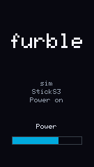

## Main menu

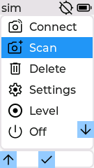

The main menu is the home screen. Its entries in order are:

- **Connect**: connect to a saved camera.
- **Scan**: search for a new camera to pair.
- **Delete**: remove a saved camera.
- **IR**: fire the camera over infrared. This entry appears only when the board
  has an IR LED and Infrared is enabled.
- **Settings**: the settings tree, described below.
- **Level**: the spirit level, shown when the IMU is enabled and its sensor is
  present.
- **Off**: power the device off.

The header shows the connection state and the battery indicator.

### Connect, Scan, Delete

These three entries open list pages driven by live Bluetooth activity:

- **Connect** lists your saved cameras. Selecting one connects to it. With
  Multi-Connect enabled the list also carries a Multi-Connect action to bring up
  more than one camera.
- **Scan** searches for nearby cameras in pairing mode and shows them as they
  are found, with a scanning indicator. Selecting a found camera pairs and
  connects to it.
- **Delete** lists saved cameras so you can remove one.

The simulator seeds a saved camera and a fake scan, so each list renders with an
entry in the full walkthrough shipped in the repository. The connecting overlay
they lead to is shown next.

### IR

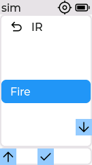

The IR entry opens a page with a single Fire button. Selecting it fires the
shutter over the IR LED using the protocol set under `Settings` > `Infrared`. The
entry exists only when the board reports an IR LED and that setting is on. The
Connected menu carries the same page as **IR**.

## Connecting

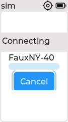

When you connect, furble shows a progress overlay naming the camera with a
Cancel button. Selecting Cancel aborts the attempt and returns to the menu. When
the link comes up the device moves to the Connected page.

### Camera pairing code

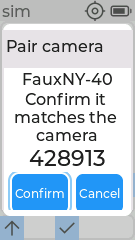

Some cameras request numeric-comparison pairing. furble shows the six-digit code
the camera generated in a modal before authorizing the link. Compare both
displays, then select **Confirm** only when they match. **Cancel** rejects the
request and drops the link. On the 80x160 M5StickC the two actions read **Yes**
and **No**, because the wider labels do not fit that panel.

A cancelled or expired camera is not automatically retried or prompted again
in the current session. Other active cameras remain eligible, and an explicit
fresh connect re-arms the declined camera.

A passkey-display request is the other direction: the code is furble's own
pairing passkey, which you type on the camera, and the modal offers Cancel only.
That passkey is fixed for the build, so a display request carries no
man-in-the-middle protection; the numeric comparison above does.

A prompt is answerable for 30 seconds, matching the Bluetooth Security Manager
timeout. After that it rejects itself and the connect fails, because an answer
the stack has already abandoned cannot complete the pairing. The screenshot is a
deterministic simulator render of the production modal; the real BLE exchange
still requires a camera that supports numeric comparison.

## Connected

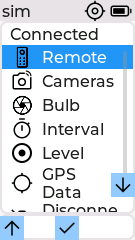

Once a camera is connected furble shows the Connected menu. Its entries in order
are:

- **Remote**: the shutter control page.
- **IR**: fire the shutter over infrared. Shown only when Infrared is supported
  and enabled.
- **Bulb**: a timed long exposure.
- **Interval**: the intervalometer, sharing the Timer configuration.
- **GPS Data**: the live GPS page.
- **Disconnect**: drop the camera and return to the main menu.

When enabled under Settings > Sensors, the home menu and Connected include the
Level spirit-level page and Diagnostics includes the live IMU readout. The
simulator injects deterministic samples through the same production sensor
seam.

### Remote

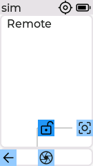

The Remote page is the shutter control. Select fires the shutter, Next
half-presses focus. Hold focus then press the shutter to lock the shutter open
for a long exposure. Leaving the page always releases the shutter. On Ricoh,
the Focus control remains visible in the generic UI but is a no-op: the BLE
protocol has no verified focus-only operation. The Ricoh shutter performs
capture with autofocus. On touch boards the on-screen Shutter, Focus, and
Shutter Lock buttons are always visible; the screenshot shows the button-board
indicators. A per-camera hide/disable treatment remains a UI follow-up.

### Cameras

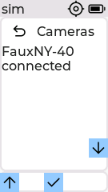

Cameras lists every camera in the session's target set with its live status, so
one picture covers single and multi-connect: each row is the camera name and one
of `connected`, `reconnecting`, `reconnecting <n>%`, `lost`, `disconnecting` or
`idle`. The list rebuilds once a second while the page is open and the session is
active, and with Multi-Connect on it holds one row per camera you connected.

### Bulb

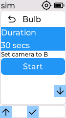

Bulb is a timed long exposure. The page carries the Duration row, a hint that the
camera must be in its own bulb (B) mode, and Start.

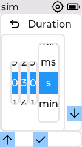

The Duration row opens the spinner: the value, then the unit (milliseconds,
seconds, or minutes). The chosen duration is remembered for next time.

Start opens the run page and holds the shutter for the chosen duration:

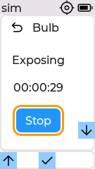

The run page counts the exposure down and Stop releases the shutter early and
returns to the duration page. When the timer reaches zero the state reads
`Done (<elapsed>)` and the button becomes Restart. A camera class with no way to
end a held exposure cannot start one, and the Connected menu's Bulb row is
disabled for that camera.

### Interval

Interval opens the same page as `Settings` > `Timer`, described under
[Timer](#timer). It runs the intervalometer with the stored Count, Delay,
Shutter, and Wait values. Press Start to run and Stop to end early.

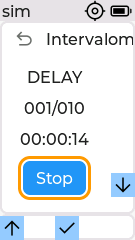

The run page shows the state, the frame counter and the remaining time. The state
is `WAIT` during the initial delay, `SHUTTER` while the shutter is held, `DELAY`
between frames, `FINISHED` at the end of a counted run, and `IDLE` after Stop.
Stop releases the shutter and returns to the Timer page.

### GPS Data

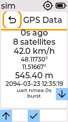

The GPS Data page shows the live fix: age, satellite count, speed, latitude and
longitude, altitude, and UTC date and time. It is reachable both here and under
`Settings` > `GPS` > `GPS Data`.

### Satellites

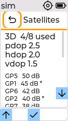

The Satellites page enables GSV/GSA capture only while it is open. It reports
the fix type, in-view and used counts, PDOP/HDOP/VDOP, and each satellite's
constellation, PRN, C/N0, and used-in-fix marker. The screenshot uses the
simulator's fixed eight-satellite fixture; it is a deterministic UI capture,
not evidence that the attached AT6668 receiver has been hardware-verified.

## Settings

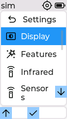

The Settings menu groups every option. Its entries in order are Display,
Features, Infrared, Sensors, GPS, Time, Timer, Theme, Text size, Bluetooth,
About, Power, Feedback, Diagnostics, Storage. Infrared, Feedback, and Storage
appear only on boards with the matching hardware.

### Display

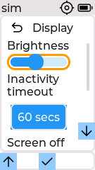

Scroll down to reach Screen off and Show Title:

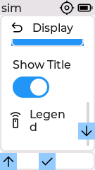

- **Brightness**: screen brightness slider with a live preview.
- **Inactivity timeout**: dim then sleep the screen after an idle period.
- **Screen off**: what the inactivity timeout does (Dim, Off, or Off with the
  remote still active on button boards).
- **Calibrate**: touch calibration. Touch boards only.
- **Show Title**: show or hide the window title in the header.
- **Legend**: on physical-button Stick boards, keep the shipped Buttons
  placement, move all three legends into the Bottom navigation band, or use
  Off to hide the hints without disabling the physical buttons. The
  choice is applied after Restart. Touch boards omit this setting because
  they have no physical-button legends; the M5Stack Core keeps its physical
  button legends in the navigation band.

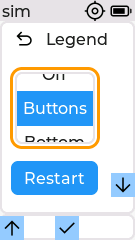

### Features

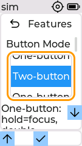

Button Mode picks two-button or one-button shutter control, with a gesture hint
below the roller. The switches below it are Auto-Connect, FauxNY (a fake test
camera for development), Infinite-ReConnect, Reconnect Backoff, Multi-Connect,
Companion (the companion BLE service), Watchdog (M5StickS3 only), Preset Picker
(the exposure preset stepper on the shutter page), and Boot screen (the startup
splash).

### Sensors

The Sensors page contains the **IMU** switch and the **Gestures** entry.
Gestures holds the **Wake Gesture** roller (Off, Tap, Shake, Both), the
**Double-Tap Shutter** switch, and the false-trigger warning. A gesture wakes
the display or fires one debounced shutter command on an active remote page.
Every gesture control is disabled when the IMU is unavailable. The
`sim/scenarios/e2e/imu-gesture-*.txt` scenarios cover detection, the wake
masks, the shutter guards, and the disabled state; the gating scenario runs on
all three simulator panel sizes.

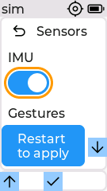
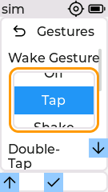

### Companion pairing

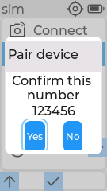

With the Companion service enabled, a companion app that connects raises a
pairing dialog showing the six-digit code with Yes and No buttons. Confirm that
the code matches the Mac or phone, then choose Yes; No rejects the pairing. The
dialog is width-capped to the Stick panel so the title, code and buttons stay
fully visible.

### Infrared

The Infrared submenu holds the Infrared on/off switch and the IR Protocol roller
(Nikon, Sony, Canon, Canon 2s). The whole submenu is hidden unless the board has
an IR LED. The simulator reports an IR LED present behind the `FURBLE_SIM_IR`
capture flag, so the submenu renders; see the
[settings reference](Settings-Reference#infrared) for the values.

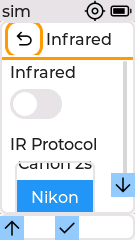

### GPS

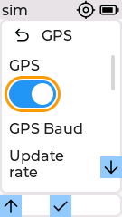

The GPS switch is the master control. When it is on, the receiver configuration
rows appear: GPS Baud (Auto, 9600, or 115200), Update rate, Sentences,
Constellation, Power saving, Assisted start, Platform, and the three live pages
GPS Data, Raw NMEA, and Satellites. When GPS is off, only the switch is shown.

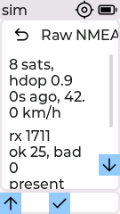

Raw NMEA shows the sentences arriving from the receiver, the fix state, and error
counters, binary configuration status, and a Hot restart button. Auto baud
probing requires two checksummed NMEA sentences; an unsuccessful probe marks the
receiver absent and cuts the external rail before one delayed retry. Auto
detection has simulator coverage and is pending live AT6668 verification.

Each receiver row opens its own page:

- **GPS Baud**: Auto, 9600, 115200.
- **Update rate**: Default, 1000 ms, 500 ms, 200 ms, 100 ms.
- **Sentences**: Default, RMC+GGA.
- **Constellation**: Default, GPS, BDS, GPS+BDS, GLONASS, GPS+GLO, BDS+GLO, All.
- **Power saving**: two rollers, Receiver (Always on, Standby (PCAS12), Rail
  cycling) and Sleep between fixes (No standby, 5 s, 10 s, 15 s).
- **Assisted start**: Off, Position and time, Position, time and ephemeris.
- **Fix Hold**: Off, 30 s, 2 min, 10 min, 60 min.
- **Platform**: Do not send, Portable, Stationary, Pedestrian, Vehicle.

| | |
| :--- | :--- |
| 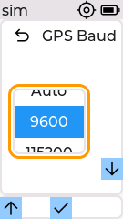 | 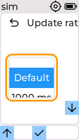 |
| 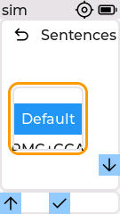 | 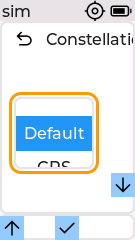 |
| 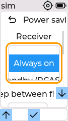 | 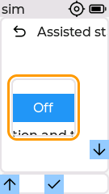 |
| 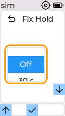 |  |

Motion Adaptive and Extrapolate are switches on the GPS page itself, so they have
no page of their own.

### Time

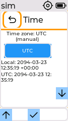

The Time page holds the Time zone roller and live clock rows. Local shows the
selected zone's civil time with its current offset. UTC shows the same instant
without an offset. The heading names the effective zone and its source.
Auto (GPS) picks the nearest curated zone from a fresh wired fix; the manual
choice wins, and Auto falls back to UTC after 30 minutes without a fix or
immediately when a fresh fix is outside the 30-degree nearest-zone radius.

### Timer

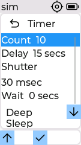

The Timer submenu is the intervalometer configuration. Count is the number of
frames, Delay is the time between frames, Shutter is how long the shutter is held
per frame, and Wait is the initial delay before the first frame. A Start button
runs the sequence.

Each row opens its own page. Count carries the Infinite switch plus three digit
rollers; Delay, Shutter and Wait carry the digits and a unit roller (ms, s, min).
Infinite counts frames until Stop instead of stopping at the set count.

| | |
| :--- | :--- |
| 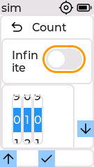 | 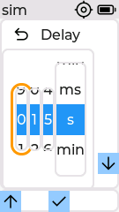 |
| 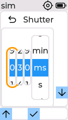 | 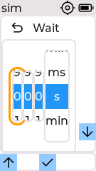 |

### Theme

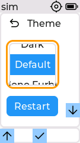

Pick Dark, Default, or Mono Furble, then press the Restart button to save and
apply.

### Text size

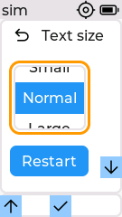

Pick Small, Normal, or Large, then press Restart to apply.

### Bluetooth

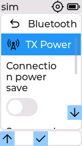

- **TX Power**: a submenu with an Adaptive switch and a transmit-power slider
  (P3, P6, P9).
- **Connection power save**: power save on the active connection.
- **Scan mode**: how hard the radio listens during Scan (Full, Balanced, Low).
- **Scan timeout**: end a scan by itself after a chosen time.

### About

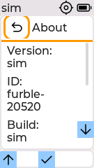

A read-only page: firmware version, device ID, build date, IDF version, uptime,
free heap, and reset reason.

Development firmware shows `dev+g<revision>` so a bench result can be tied to
its checked-out commit. Dirty checkouts append `.dirty`. Explicit release
versions are shown unchanged.

### Power

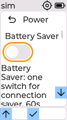

- **Sleep while connected**: doze between BLE events while connected. M5StickS3
  only.
- **CPU speed**: 80, 160, or 240 MHz.
- **Battery Style**: what the header battery indicator shows (Icon, Percent,
  Both).
- **Auto off**: power off after an idle period. Not on M5Stack Core Basic.
- **Low battery**: what to do on low battery. Not on M5Stack Core Basic.
- **Battery**: a live battery detail page (below).

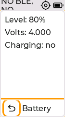

The Battery page shows charge level, voltage, current, charging state, and a
runtime estimate. Rows the board cannot measure are hidden.

### Feedback

The Feedback submenu picks an Output (Off, Sound, Light, Vibrate, or a
combination, filtered to what the board supports), a per-event mask (Shutter
fired, Countdown, Connect and disconnect, Low battery), and a Volume slider when
the chosen output includes sound. The submenu is skipped on boards with no output
beyond Off; the simulator reports the full output set behind
`FURBLE_SIM_FEEDBACK`, which is what the capture harness sets. See the
[settings reference](Settings-Reference#feedback) for the values.

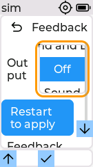
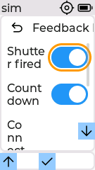
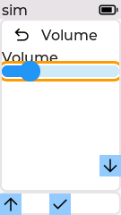

The events page carries one switch per mask bit. The Volume page only exists
while the chosen output includes sound, so its picture comes from a separate
capture pass that seeds Sound (`sim/scripts/docs-screenshots-volume.txt`); the
Feedback page above keeps the shipped Off default.

### Diagnostics

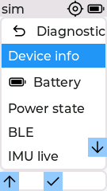

Diagnostics groups read-only status pages.

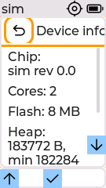
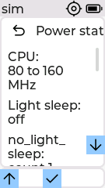

- **Device info**: chip, cores, flash, heap, uptime, reset reason.
- **Battery**: the same page linked from Power.
- **Power state**: clock frequency, sleep, power-lock rows, tickless idle, and a
  Dump locks button.
- **BLE**: a live BLE status row.

The `Heap: <free> B, min <minimum> B` row on Device info, and the same row on
About, come from the modelled allocator, so they describe the binary that drew
the picture: two runs of one binary print the same figures and a binary built
from a different revision does not. The images are pictures of one build, not
fixed values, and the UI screenshots workflow never compares a fresh render with
the committed bytes; its only image comparison is the committed GPS satellite
pair against its wiki mirror.

### Storage

The Storage submenu holds GPX Logging on/off, a GPX Interval roller, Export and
Import Settings actions, and a Card Info page. It appears only on boards with a
supported SD card slot. The simulator reports a mounted SD card behind the
`FURBLE_SIM_SD` capture flag, so the submenu renders; see the
[settings reference](Settings-Reference#storage).

## Dark theme

The Dark theme swaps the light background for a dark one and marks focus with a
green outline. Set it under `Settings` > `Theme` > `Dark` and press Restart.

## What the simulator models

The screenshots come from the SDL simulator, which runs the real UI code over a
modeled M5StickS3 panel. The pages that used to be described in words only are
modelled and captured:

- **Boot splash**: captured through a dedicated hook that snapshots the splash
  before the LVGL UI replaces it (`FURBLE_SIM_CAPTURE_SPLASH`).
- **Scan, Connect, and Delete list pages**: a seeded saved camera and a fake scan
  populate the lists so they render with entries.
- **Infrared, Feedback, and Storage submenus**: the simulator reports an IR LED, a
  feedback output, and a mounted SD card behind the `FURBLE_SIM_IR`,
  `FURBLE_SIM_FEEDBACK`, and `FURBLE_SIM_SD` capture flags, so the submenus
  render. These flags are sim only and never change the on-device hardware
  detection.
- **Connected-session pages and settings submenus**: the Cameras list, the
  Interval and Bulb run pages, the IR page and every GPS and Timer submenu are
  captured as well. No gate compares a fresh render with the committed bytes:
  the heap rows above make that equality binary-dependent, so the UI screenshots
  workflow's only image comparison is the committed GPS satellite pair against
  its wiki mirror.

## Pages that are actions, not screens

Four names in the simulator's page map have no screen of their own, so there is
nothing to photograph:

- **Off** (`power_off`): the main menu tile calls the power-off path directly, so
  the device stops with the main menu still on screen and the tile's own page is
  never loaded.
- **Disconnect** (`remote_disconnect`): the Connected entry drops the camera and
  returns to the main menu.
- **Interval** (`remote_timer`) and **GPS Data** (`remote_gps`): the Connected
  entries load the shared Timer and GPS Data pages, so `ui.page` reports `timer`
  and `gps_data` there and the entry's own page stays unloaded.

Every other page in the map is pictured in this tour. To regenerate the
screenshots, build the simulator (see `sim/CLAUDE.md`) and run
`sim/scripts/docs-capture.sh`, which rebuilds the simulator once per panel class
and drives the default and dark sets, the scroll strips, the text size gallery
and the Feedback Volume pass.
